Dans le cadre du vingtième anniversaire du Conseil Municipal des Enfants (CME), nous avons été sollicités pour organiser la construction d’une mosaïque lors de la soirée cocktail (sur invitation), et à la terminer, le lendemain, lors d’une expo 100% LEGO(r) ouverte au public.

Le vendredi 25 novembre 2016, le CME d’Epinay/Orge organisait une réception privée où étaient invités, entre autres, les actuels et anciens conseillers municipaux enfants. Après la description des activités réalisées par les enfants durant ces vingt dernières années, un cocktail dînatoire était servi et la construction de la mosaïque pouvait se poursuivre. Celle-ci avait été commencée plus tôt en fin d’après-midi avec l’aide de quelques enfants du CME impatients de participer à ce défi.

Le thème de la mosaïque a été donné par le CME et se trouvait tout naturellement être : La façade de l’hôtel de ville.  
En fin de soirée, environ 20% de l’assemblage était réalisé.

[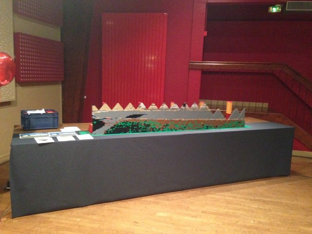](https://www.freelug.org/IMG/jpg/IMG_3272.jpg)

Le lendemain, rendez-vous est pris à 7h30 pour l’installation des 5 exposants participants à l’évènement ouvert au public tout le samedi.

Sébastien (assisté d’Amaury - primo-exposant) présentait son usine GBB (Grand Bidule à Balles) animée. Emerveillement assuré !

[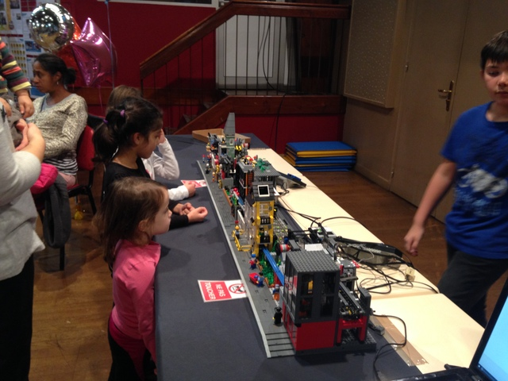](https://www.freelug.org/IMG/jpg/IMG_3288.jpg)

**Stand de Sébastien et Amory**

Paul est venu avec sa gare de Longjumeau étendue (avec circuit de chargement de wagons et passage à niveau lumineux automatique).

[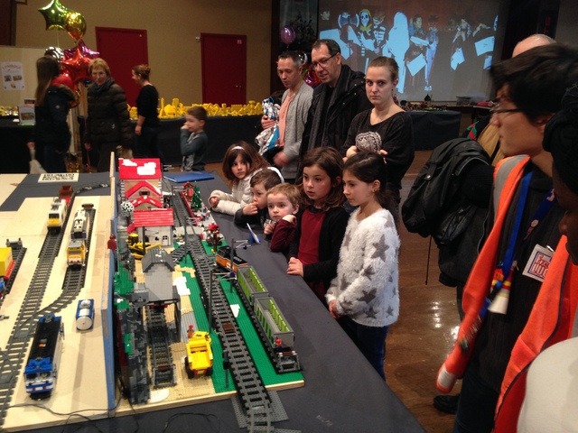](https://www.freelug.org/IMG/jpg/IMG_3287.jpg)

**Stand de Paul**

Stéphane proposait son diorama moyenâgeux bourré de détails croustillants.

[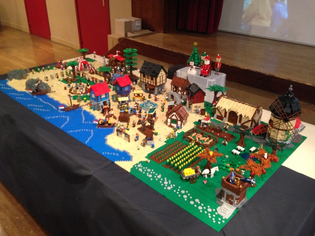](https://www.freelug.org/IMG/jpg/IMG_3278.jpg)

**Stand de Stéphane**

Stand de Stéphane

L’innovation est arrivée avec le circuit routier d’Alexis. La compétition a fait rage. Les pilotes en herbe s’en sont donné à cœur joie !

[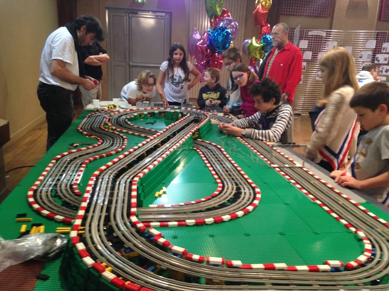](https://www.freelug.org/IMG/jpg/IMG_3285.jpg)

Stand d’Alexis

Le diorama City/Modular de Jérémy a également suscité de nombreux étonnements et l’admiration du public.

[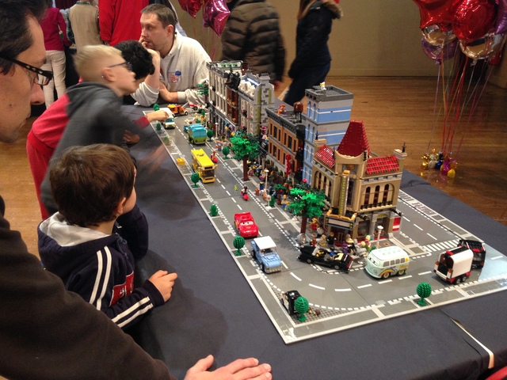](https://www.freelug.org/IMG/jpg/IMG_3284.jpg)

Stand de Thazz

Enfin, deux animations construction libre (briques jaunes et DUPLO) ont fait le plein d’artistes très jeunes et moins jeunes (voire beaucoup moins jeunes).

[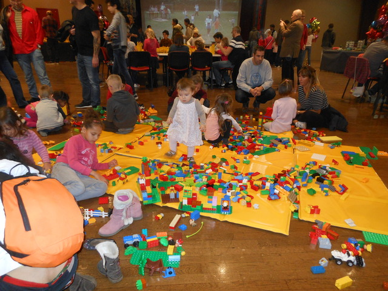](https://www.freelug.org/IMG/jpg/DSCN3511.jpg)

[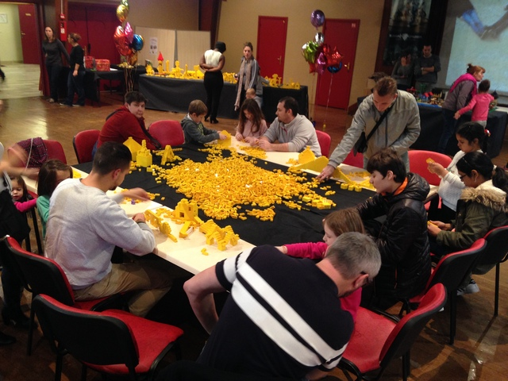](https://www.freelug.org/IMG/jpg/IMG_3283.jpg)

Briques jaunes - Construction libre

[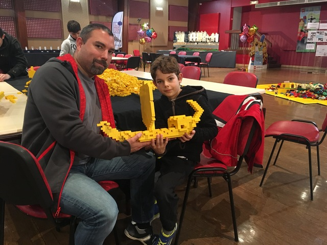](https://www.freelug.org/IMG/jpg/IMG_5009.jpg)

**Constructeurs toutes générations**

Enfin un petit tirage au sort a permis de réjouir de nombreux jeunes visiteurs qui sont repartis avec une minifig de collection, ou une boîte CREATOR ou DUPLO.

[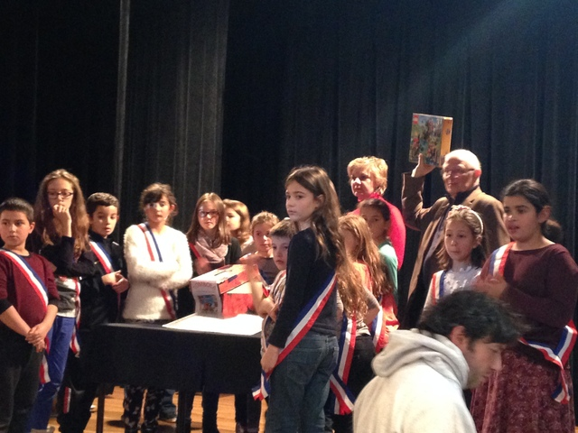](https://www.freelug.org/IMG/jpg/IMG_3294.jpg)

Tirage au sort

Le public, d’environ 600 personnes, a bien entendu été fasciné par toutes ces attractions avec leur diversité, ingéniosité, réalisme, détails et finitions de belle facture.

Un grand merci pour l’organisation impeccable du CME.

[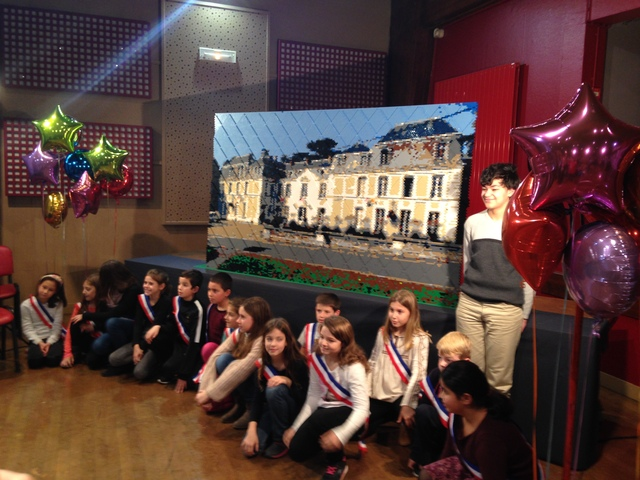](https://www.freelug.org/IMG/jpg/IMG_3281-2.jpg)

Mosaïque terminée

Pour plus de photos :  
[http://photos.freelug.org/main.php/v/dlaurencon/Expo/Epinay2016/](http://photos.freelug.org/main.php/v/dlaurencon/Expo/Epinay2016/)
