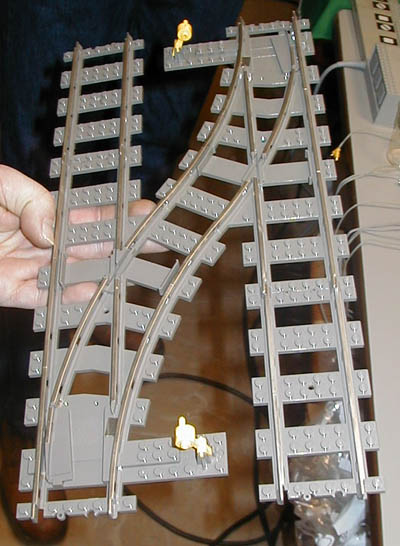
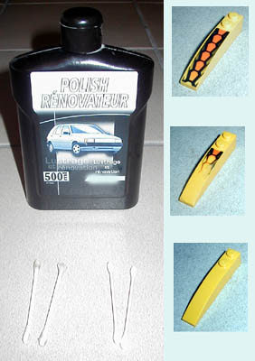

La créativité des AFOLs (Fan Adulte de LEGO®) est grande...et parfois un peu débridée. Je veux parler de ce que nos amis anglais appellent des "illegal moves", difficilement traduisible en français mais que l’on peut décrire comme l’ensemble de modifications apportées à nos chères briques.

Les puristes crient au sacrilège... et je tiens à préciser que les modifications que nous allons décrire n’ont pas pour but de porter atteinte à l’image des produits LEGO&reg ou à la marque LEGO® mais sont simplement issues de la volonté de leurs auteurs d’améliorer encore plus le réalisme de leurs créations. Nous rappelons entre autre que la société LEGO® n’est pas à l’origine de ce site et qu’elle ne le soutien d’aucune façon. Le site officiel de la société LEGO® se trouve à cette adresse : [www.lego.com](http://www.lego.com/)

## Avertissement

Certaines modifications exposées demandent l’emploi de produits (colles, peintures, solvants, etc.) ou d’outils (cutter, outillages électriques) qui présentent des risques si ils sont mal employés (incendie, blessures). Vous les utilisez à vos propres risques, veuillez vous informer auprès du fournisseur de leur mode d’emploi. Pour les mineurs, la surveillance par un adulte est recommandée.

## 1) L’application de stickers.

Quand je parle de stickers je veux dire autocollants fait maisons. C’est une modification pas si courante que cela mais pourtant très communément acceptée. Si toutefois les adhésifs sont de qualité.

Matériel :

**–** une imprimante  
**–** du papier adhésif  
**–** un cutter

Variante :  
**–** impression professionnelle (beaucoup plus chère)  
**–** décalcomanies

Exemples :  
**–** [Les containers](http://photos.freelug.org/picture.php?cat=42&image_id=2387&expand=all)  
**–** [Des torses de minifigs](http://www.brickshelf.com/cgi-bin/gallery.cgi?m=Kaminoan)

## 2) La mise en peinture.

C’est une modification inusitée et communément rejetée par la communautée des AFOLs.  
Je ne détaillerais pas cette méthode.

Si la peinture est une peinture à l’eau type gouache vous avez l’espoir de pouvoir la nettoyer avec un simple passage en machine à laver à 40°C.

Si la peinture est une peinture solvantée type peinture à maquette, il n’y a que très peu d’espoir, car ce type de peinture ne s’enlève qu’à l’aide de solvants puissants qui attaquent aussi le plastique de la brique.

Exemple :  
**–** [Minifig starwars custom](http://www.ozbricks.com/jediagh/a_customs/figures/sw_figures.htm)

## 3) Le collage.

C’est une modification peu usitée dans la communauté AFOL mais très utilisée par la société LEGO® pour la création des maquettes destinées à l’exposition (parcs, évènements) afin de solidifier les constructions surtout lorsque elles sont proches du public.

Pour la "récupération", c’est encore plus désespérée qu’avec la peinture car la colle a tendance à souder la brique en la faisant fondre en surface. La brique est définitivement perdue.

Les employés de la société LEGO® utilisent un petit marteau et un burin lorsqu’ils doivent refaire un morceau de bâtiment de Miniland dans les parcs LEGOLAND&reg.

Exemples :  
**–** Les aiguillages 9V  
**–** [Les modèles LEGO®](http://photos.freelug.org/category.php?cat=22&expand=all)

## 4) L’effacement des décors

Certaines pièces LEGO® présentent des décors ou inscriptions (pattern en anglais). On peut souhaiter les enlever et c’est réalisable sur les pièces présentant une surface parfaitement lisse, sans grains.

Matériel :

**–** un chiffon ou des cotons tiges  
**–** un produit de polissage pour carroserie de voiture (Brasso en anglais)  
**–** de l’huile de coude

Les décors sont des impressions en surface alors que la brique est teintée dans la masse. En polissant doucement, (le polish contient de toutes petites billes abrasives) on peut enlever ces impressions sans rayer visiblement le plastique et sans que celui ci perde sa couleur.

Suivant la taille de l’impression, elle sera effacée en une demi-heure de travail soigné.

Alternatives :  
**–** Solvants (avec le même problème que pour enlever les peintures.)

## 5) Les modifications mécaniques

J’entends par la tout ce qui est découpage, perçage, soudures... Ces modifications sont les plus difficiles à mettre en oeuvre, elle est en outre vaste et donne lieu à de nombreux produits maisons :

Matériel :  
**–** Outillage électroportatif de poche (Dremel®)

Exemples :  
**–** Aiguillages 9v (découpage + collage)  
**–** Mise en place de lumières (perçage) : [le site de Brickmodder](http://www.brickmodder.net/darkside.html)  
**–** Créations de détecteurs Mindstorms©  
**–** Correction de problèmes de roues sur la Santa Fe

## 6) Modification des pièces par ajout

Cette technique consiste a utiliser une pâte genre pâte à modeler qui durci comme du plastique en séchant. Elle peut être ensuite peinte comme une maquette.

Matériel :  
**–** Pâte

Exemples :  
**–** [Minifigs "Aliens"](http://www.brickish.org/bi/bi1.pdf)

## 7) La créations de pièces

Il s’agit là de créations de toutes pièces, en fait sans modifications de pièces LEGO. J’en parle ici car c’est à mon avis l’aboutissement des "illegal moves" : Ce n’est plus du bricolage, c’est le stade ultime de la modification qui n’existe plus que par elle même.

Et ce stade est difficile à atteindre car pour créer ses propres pièces il faut avoir la jouissance de matériel professionnel comme une presse à injecter par exemple.

Matériel :  
**–** De l’ABS (le plastique dont sont constituées les pièces LEGO&reg)  
**–** Une presse à injecter ou tout autre matériel permettant la mise en forme de l’ABS.

Cependant, deux sites de Fans proposent aujourd’hui des pièces faites maison

exemple :  
**–** [Des roues de trains](http://www.bigbenbricks.com/)  
**–** [Des armes Star Wars et Médiéval](http://www.littlearmory.com/)

Voila donc un tour d’horizon des modifications que vous pouvez apporter à vos créations afin de leur apporter toujours plus de réalisme.
