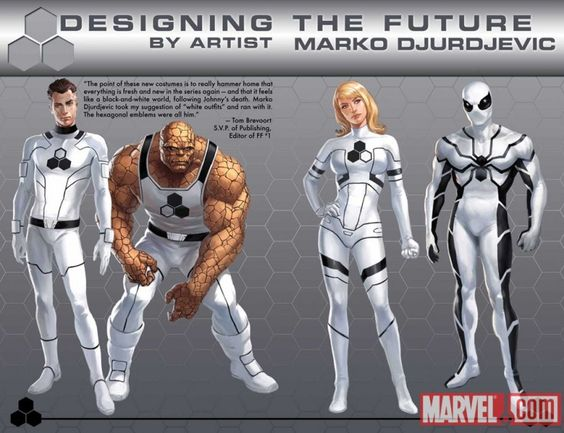
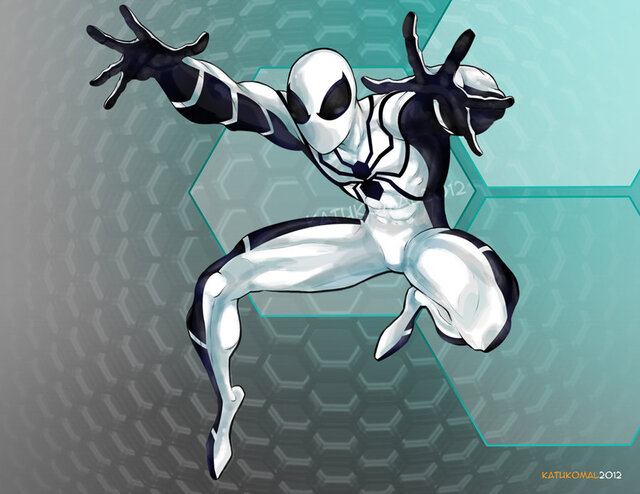
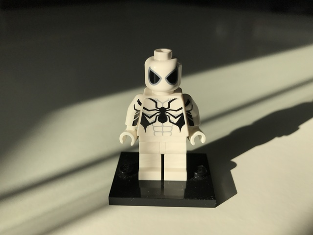
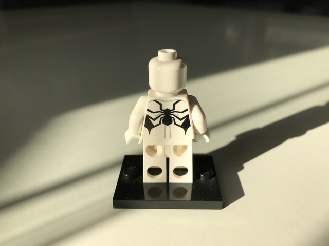
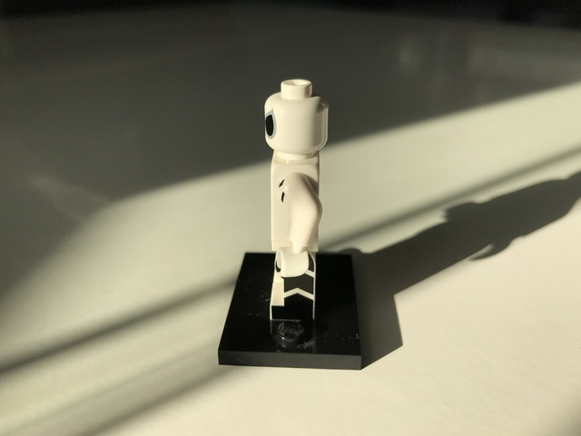
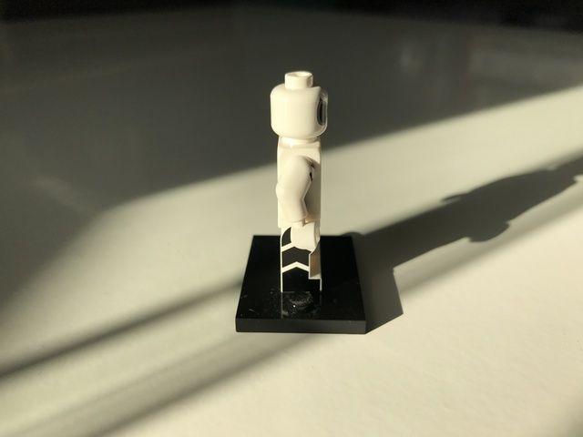
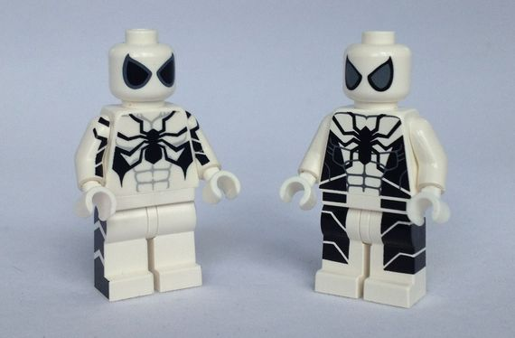

Aujourd’hui je vous propose la review d’une figurine custom du personnage de **Spider-Man Future Foundation** créé par _Christo_.

> Christo is an amazing custom minifigure maker and located in South Africa. His range of unique custom minifigures have been sought after and collected by many serious LEGO fans. Christo’s minifigures are inspired by characters from the Star Wars universe and Super Heroes that LEGO in the most have not yet released.
> 
> All his custom minifigures are machine printed and are of the highest quality, and many of them actually look better than the LEGO releases. All the molded parts he designs and uses are from ABS plastic which is the same that LEGO uses.

Vous pouvez retrouver ses créations sur le site _[custombrickandminifig.com](http://custombrickandminifig.auctivacommerce.com/Default.aspx)_.

* * *

La fig que je vais vous présenter est issue du comics _[Fantastic Four](http://www.marvel-world.com/encyclopedie-2657-fiche-fondation-du-futur-la-equipes.html)_ édité par _[Marvel](https://fr.wikipedia.org/wiki/Marvel_Comics)_.

* * *

## Spider-Man

Peter Parker est le fils unique de Richard et Mary Parker. Ses parents sont tués en travaillant sous couverture pour le gouvernement. Peter Parker, orphelin à l’âge de six ans, est alors confié à son oncle et à sa tante, Benjamin et May Parker.

Un jour, à la suite d’une expérience à laquelle il assiste, il est mordu par une araignée radioactive. Cette morsure lui confère des super-pouvoirs : une force et une agilité hors du commun, la capacité d’adhérer aux parois ainsi qu’un « sens d’araignée » l’avertissant des dangers imminents.

Dans un premier temps, Peter Parker va mettre à profit ses pouvoirs fraîchement acquis pour gagner de l’argent. Mais très vite, un drame va changer sa vie : il va laisser un voleur s’échapper alors qu’il aurait pu très facilement l’arrêter, prétextant que ce n’est pas son problème. Peu de temps après, son oncle est tué par un cambrioleur. Ivre de colère, il se lance à la poursuite de l’assassin qui, une fois arrêté, se révèle être le voleur qu’il n’avait pas daigné appréhender. À partir de cet instant, sa vocation sera de lutter contre le crime et de suivre l’adage de son défunt oncle : _Un grand pouvoir implique de grandes responsabilités_.

## Le costume de la Fondation du Futur

Après la mort présumée de la _Torche humaine_, Peter Parker rejoint les _Quatre Fantastiques_, qui se sont renommés _La Fondation du Futur_. Dans cette équipe, _Spider-Man_ arbore les couleurs noire et blanche ainsi que le logo de la Fondation (à la place du logo de l’araignée). Ce costume a la particularité de pouvoir inverser ses couleurs (passant du noir sur fond blanc au blanc sur fond noir) à volonté.

* * *

Le custom de _Christo_ est digne d’une minifig officielle, la sérigraphie est impeccable. De face le logo de l’araignée est magnifique, on remarque que l’intérieur des bras est sérigraphié. l’alignement des pattes entre le torse et les bras est parfaite. J’ai toujours aimé les grands yeux pour le masque et là aussi c’est une réussite.

Le dos est lui aussi magnifique, il est juste dommage que l’on ne retrouve pas la sérigraphie à l’intérieur des bras comme au recto.

Côtés gauche et droit, nous avons droit à une sérigraphie sur chaque jambe. Les customeurs sérigraphient depuis longtemps jambe et bras, et _LEGO_ semble s’en être inspiré pour ses minifigs. On ne s’en plaindra pas tant cela ajout au réalisme.

* * *

Je vous propose une petite image pour voir la différence entre deux custom du même personnage. A gauche _Christo_, à droite _Muddy River_.

Personnellement je trouve que celui de _Muddy River_ donne un effet vraiment chargé à la fig.

* * *

## Conclusion

Pour moi c’est un sans faute pour ce custom by _Christo_. La fig et la sérigraphie sont tout simplement magnifiques.

Alors c’est vrai que ce genre de customs sont chers (_Christo_, _Phoenix_...), mais quand on voit la qualité des réalisations on passe (trop) facilement outre le prix.
