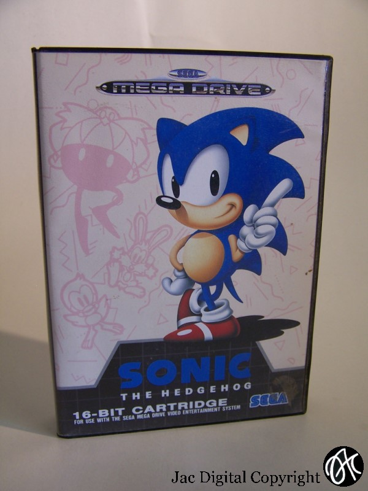
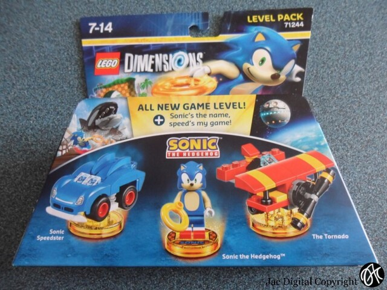
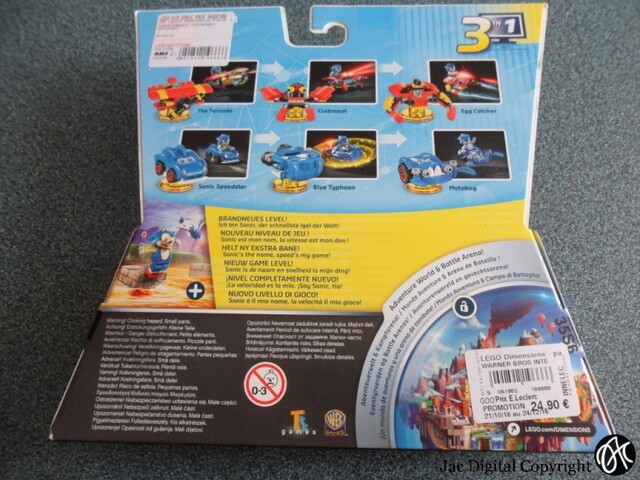
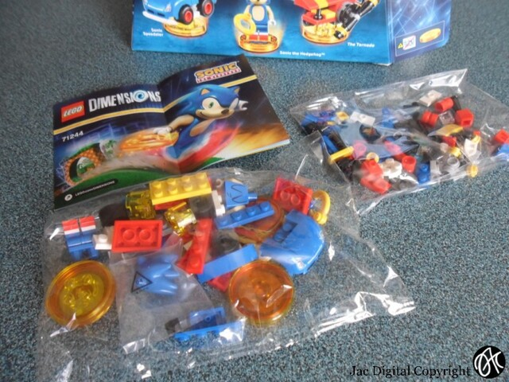
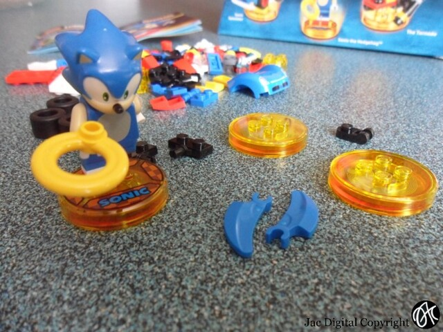
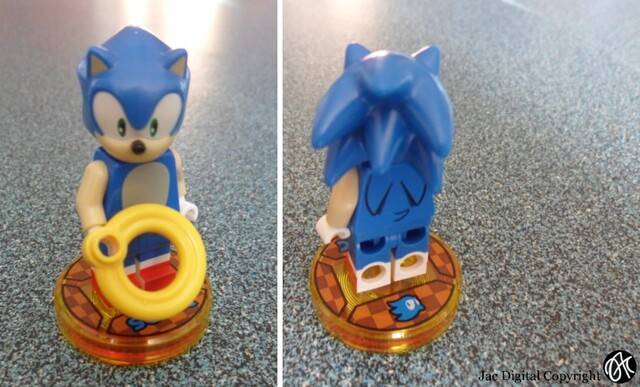
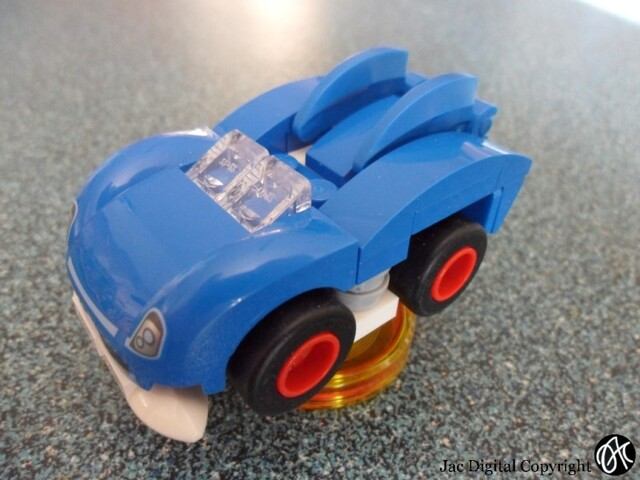
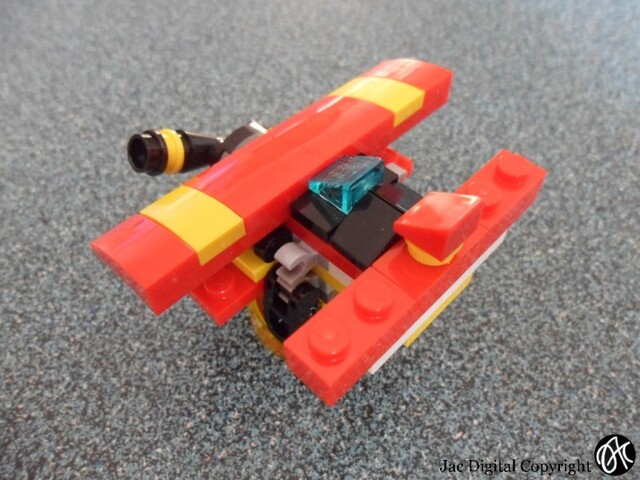

Sonic le petit hérisson bleu créé par la marque Sega existe désormais en minifig. Grâce au lancement de nouveaux niveaux de jeu, plein de nouveaux personnages sont disponibles dont ma mascotte préférée. Voici mes impressions.......

Le jeu "LEGO dimensions" permet de jouer sur une console de jeu de salon (Wii U, XBox360, PS3 ou PS4), avec son personnage préféré construit avec quelques briques. Ne m’en demandez pas plus, ce n’est pas ici le but de mon article. Mon achat est uniquement basé sur le fait que j’ai craqué pour la minifig de Sonic...

"Sega c’est plus fort que toi", à l’époque ce slogan était déjà bien provocateur. Alors quand j’ai découvert le petit hérisson bleu qui courait à toutes vitesses sur ma télé grâce à la Mega Drive, j’ai trouvé du changement par rapport au petit plombier !

Il me fallait donc cette nouvelle minifig, mais à quel prix. On ne trouve pas le pack actuellement à moins de 29 Euros. Heureusement j’ai profité d’une petite promotion dans un "super" supermarché du coin... Ce qui me donne tout de même 24,90 Euros pour une minifig et quelques pièces. Ça fait cher la collection. D’autant plus que la notice pour construire les deux véhicules n’est pas dans la boite. Le livret explique le lancement de jeu et le montage de la minifig, c’est tout. On apprend en fait qu’il faut avancer un peu dans le jeu avant que les notices de montage des différents véhicules se débloquent. Ça doit être la même chose pour tous les packs mais il faut le savoir. Sinon, on trouve les notices sur le S@H actuellement. J’ai donc pu les télécharger.

Bon, après cette petite description, commençons l’analyse...

**–** Référence 71244, sortie en 2016  
**–** Prix du Shop : 29.99 Euros  
**–** Nombre de pièces : 98  
**–** Rapport : 0,30 Euros la pièce...  
**–** Moins d’une heure de montage, pour le jeu, c’est vous qui voyez...

Comme je vous l’ai dis, les pièces sont chères dans ces packs !

La boîte est du même type que toutes celles de la gamme. Elles sont de plus ou moins grande contenance suivant la taille du pack. On aime ou on n’aime pas, mais elle clashe bien. On sait ce à quoi on a droit, avec les modèles à construire en photo sur le devant. Au dos on trouve des images des différentes possibilités. Et oui, à l’image d’un set "Creator", plusieurs créations sont possibles. Ici, les deux sachets et la notice remplissent bien l’espace.

Une petite image pour le contenu du pack.

En plus de la minifig de Sonic et de ses pièces spécifiques, on trouve de nouvelles ailes à clipser et des axes de roues sur des plates 1X2. A voir ce que l’on pourra en faire ultérieurement... Les disques sont communs à toute la gamme "LEGO dimensions".

La minifig de Sonic est très réussi. Les piques du hérisson correspondent bien à celles de la représentation habituelle de la petite mascotte. Le petit ventre est représenté sur le torse, ainsi que des piques supplémentaires dans le dos. La tête est très réussie à mon goût.

La petite voiture est très sympa, avec une belle métapièce sérigraphiée. La construction n’est pas des plus simple, même avec des photos. La notice est vraiment nécessaire.

On reconnait bien ici l’avion de Tails. Il est très réussi lui aussi.

Tails et Knukles doivent suivre, mais je n’ai aucune date de leur sortie. Je ferai bien la collection complète mais j’espère que ce sera disponible dans des packs moins chers.

Au final, ça reste un pack bien cher si on veut juste la minifig. Elle est très réussie mais est-ce qu’elle en vaut le prix je vous laisse juge. Si c’est pour le jeu vidéo par contre, comme annoncé au début, je ne pourrai pas en dire plus car je n’ai pas prévu de l’acheter, enfin pour l’instant...

Toutes les photos du montage dans la galerie [Sonic LEGO dimensions](http://photos.freelug.org/main.php/v/JAC/review/71244/).
