## MINDSTORMS

**UN SYSTEME POLYVALENT DE COMMANDE ET DE CONTROLE.**

_ADEPTE DU PUR LEGO CECI N’EST PAS POUR VOUS._

J’avais toujours eut envie de construire des robots, mais c’était une envie refoulée car l’approche traditionnelle à base de pièces détachées provenant de différents fournisseurs est très compliquée et demande un matériel important. Aussi quand j’ai vu la rediffusion du documentaire sur M6, j’ai été emballé, et 3 semaines après je sortais de la boutique du robot avec ma première boite de RIS sous le bras.

Je passai les premiers mois de la découverte et je me suis trouvé confronté aux inconvénients du système LEGO®

Pauvreté des entrées/sorties du RCX.  
Prix exorbitant des composants (surtout les capteurs), difficulté de se procurer les-dits composants.

Je me suis lancé dans un projet ambitieux en gros et à terme faire un robot se déplaçant en milieux hostiles.

Ce projet dans l’état actuel de conception ne demande pas moins de 18 moteurs et un nombre conséquent de capteurs une trentaine, y compris les sondes de rotations. A 20 Euros Pièce en moyenne, mon compte LEGO est dans le rouge depuis longtemps. J’ai pu me procurer des pièces détachées chez JEULIN, pour la « modique somme » de 220 Euros, et je n’avais que la moitié des capteurs et sondes nécessaires à mon projet.

Je décidai de prendre le problème à bras-le-corps, de sortir du concept tout LEGO® ; après tout je voulais faire des robots et pas enrichir Lego.

J’ai un peu l’habitude des standardisations et de l’intégration de matériels divers dans la production standard.

J’élaborai un cahier des charges pour la chaîne de contrôles commandes.

1.  garder l’esprit lego au maximum
2.  Faire un système polyvalent, général et facile a mettre en œuvre.
3.  Utiliser des composants standard et de faible coût.
4.  Miniaturiser au maximum

Je vous présente les premiers résultats de mon travail.

**–** Une sonde de contact polyvalente miniature.  
**–** Des accessoires miniatures permettant d’augmenter la capacité du RCX.  
**–** Une connectique standard.

## LA SONDE DE CONTACT.

C’est la base du système elle tient dans une brique 2x1 pour un coût de moins de 2.50 Euros.  
Sa fabrication est à la portée de tous, un parkinsonien peut le faire !

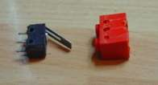

**le materiel de depart.**

on vois netement les 3 percages et la brique est evidée.  
soyez malins.  
faites Des sorties "droite" et "gauches".

**Matériel nécessaire :**

_Du commerce :_

**–** 1 contacteur subminiature à palette. Réf. 41.9199 chez Selectronic 1Euro30  
**–** 10 cm ce fil de câblage noir  
**–** 1 cm de gaine thermorétractable rouge Ø 3.2 3 Eu le mètre 0.032 Eu pour un contact.  
**–** 1 cm de gaine thermorétractable noire Ø 3.2  
**–** 1 cm de gaine thermorétractable bleu Ø 3.2  
**–** 2 fiches mâles barrettes sécables 2.30 Eu la barrette de 40 ref 41.1167 chez Selectronic

_LEGO_ :

**–** Brique 2 x 1

_Outillage :_

Indispensable :  
**–** Cutter  
**–** Fer à souder  
**–** Soudure  
**–** Mèche de Ø 2 mm  
**–** Limes fines  
**–** Pinces coupantes  
**–** Pinces à bec fin

Recommandé :  
**–** Mini perceuse (genre Dremel)  
**–** Fraise de 3 mm  
**–** Pince à dénuder. 5 Euros chez selectronic

Le summum :

**–** 3eme main ref 41.7673 Selectronic 4.5 Euros

**CONSTRUCTION :**

_Sur la brique :_

1.  Supprimer le point central de la brique
2.  Agrandissez la cavité jusqu’à ce que le contacteur entre à l’intérieur.  
    Opération facile avec la mini perceuse et la fraise, je ne sais pas avec le cutter ou la lime. Aux dimensions de l’écartement des picots percez 3 trous Ø 2 mm.

_Sur le contacteur :_

1.  Arrondissez le coté opposé à l’articulation de la palette. Surtout ne pas arrondir le coté articulation.  
    Faire un chanfrein de 0.5mm sur les arrêtes du fond.
2.  Souder perpendiculairement les 3 fils sur les picots. Souder au plus près du fond du contacteur
3.  Coupez les pins au ras de la soudure.

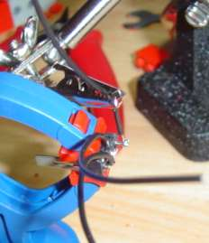

**les soudures**

ma troisiemme main ne sufisait pas, j’ai ajouter une quatrieme.  
verifiez bien la tenue mecanique des soudures

_Assemblage :_

Insérez le contacteur dans la brique. Personnellement je le serre dans les mâchoire d’un étau. Les pins pénètrent dans le plastique du fond et évitent un collage. Le corps du contacteur peut dépasser de la valeur du corps d’un plat (1/3 de brique).

_Finitions :_

Préparez trois morceaux de gaines de 10mm environ. (bleu, noir, rouge)  
Préparez deux ou trois morceaux de gaine noire de 3 mm de long.

Enfilez dans l’ordre :

1.  Les trois fils dans les gaines noires de 3mm de longs
2.  Le fil coté articulation de la palette dans le manchon Bleu
3.  Le fil central dans le manchon Noir
4.  Le dernier fil dans le manchon Rouge.

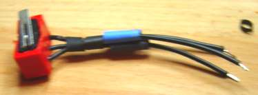

**les finitions**

prremiere étape  
les gaines

Cet ordre est important, ordre alphabétique, il permet un repérage facile. Toute autre combinaison de couleurs est possible à condition de la respecter _ad vitam_.

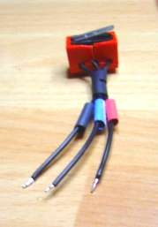

**les finitions 2**

ne pas se tromper dans position des gaines.  
le bleu coté articulation de la lame.  
B N R ordre alphabetique.  
le bleu est le commun

Séparez les 3 pins mâles de la barrette et soudez les sur les fils.

Vos avez 2 possibilités :  
**–** Soit vous gardez les broches assemblées  
**–** Soit vous les séparez. C’est la solution que je préconise, par commodité de fabrication et d’utilisation.

Mettez les manchons en place et rétractez les au fer à souder.  
Positionnez régulièrement les manchons de 3 mm en laissant 3 cm entre les manchons de couleurs et le premier manchon de fixation.

Voilà votre premier contact de touche ( interrupteurs de position est le terme consacré e.a. IdP) est terminé.

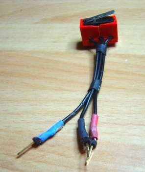

**les finitions 3**

la connectique est terminée.

**Remarques :**

La connectique employée vaut ce qu’elle vaut. Mais elle a l’avantage à mes yeux d’être très bon marché, Universelle, et ne nécessite pas de pinces spéciales. Vous pouvez utiliser les connecteurs de votre choix.

La couleur de la brique n’a aucune importance pour ma part je préfère la couleur rouge bien visible.

A l’aide de transfert type Mecanorma je numérote chaque brique sur les quatre faces. Mais ce n’est pas une obligation.

Je pense qu’un AFOL correctement équipé, mini-perceuse étau 3eme main peut construire 3 interrupteurs de position à l’heure

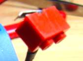

**les finitions 4**

pliage de la lame.  
TRES IMPORTANT.  
ni trop  
elle buterais contre le corps.  
ni pas assez :  
Elle coincerais dans ceratins cas

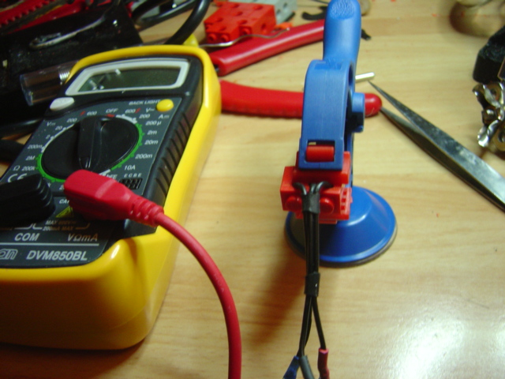

**verifications**

dernieres verifications electriques

## EN SITUATION

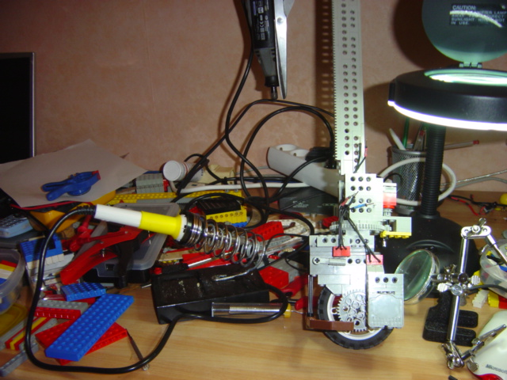

**jambe**

vue d’ensemble de la jambe et du "bronx " de mon espacce de travail. 1m20 x 80cm y compris le PC et son 19".

**Grogneugneu**

partie basse d’une jambe de GROGNEUGNEU.  
1 IdPU a gauche 3 fils  
1 FdCI premiere generation.  
2fils la diode est integrée dans la brique. notez le depassemznt d’un hauteur corps de plate. qui disparait danss la version definitive.  
dans un faible espace j’ai put logger 2 IdPU .  
ce type de montage "en butée est a evter.  
le FdC droit sert a detecter le sol.  
l’IdPU droit est actionné par la moustache anti colision.  
le micromoteur sert a orienté les roues.  
il manque la sonde de rotation.  
ca fait du monde dans un espace restreint.

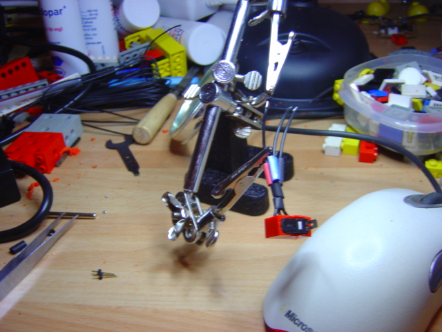

**soudure des pins males**

la 3emme maain est tres pratique

**RACCORDEMENT :**

Vous voilà en possession d’un ou plusieurs Interrupteurs de Position Universel. A la différence de contacts de Lego il est à contacts RT (repos/travail) quelquesoit sa position il y a toujours un contact passant. Lego fourni ce genre de contacteur dans les systèmes PRAMA. Il est au catalogue Jeulin.

## LES CABLES DE LIAISONS.

A l’aide de câble pour enceinte, on peut se les procurer facilement, leur taille est correcte et les 2 conducteurs sont repérés, Confectionnez une série de câbles de longueurs appropriées. De 10 cm a 1 m par saut de 5 ou 10 cm à votre choix.

Aux 2 extrémités vous soudez des pins femelles de la même manière que vous avez confectionné les câbles de sorties des IdP.

Confectionnez aussi une série de câbles mono conducteurs.

**Repérage des câbles :**

Pour les MOCs important, il est utile de repérer les extrémités des câbles. Bien sûr cela est facultatif.

Coupez des longueurs de gaine de couleurs (bleue jaune-vert noire rouge) de 3mm et de 6mm env.  
Cette combinaison de 4 couleurs et de 2 longueurs avec 2 bagues à chaque extrémité vous procure un nombre suffisant de repères.

## INTERFACE AVEC LEGO :

Le grand sacrifice.

Il vous faut maintenant assurer la possibilité de raccorder les IdP avec le système lego.  
Il va falloir sacrifier quelques câbles de raccordements lego. Je sais ca fait mal au cœur. Puriste ne regardez pas l’opération (MDR).

A chaque extrémité vous soudez un pins mâle.

## REMARQUES DE L’AUTEUR

Si vous êtes arrivés jusque là c’est soit par curiosité, soit par politesse, mais j’entends nettement les cliquetis de vos DM.  
**–** Les uns disent, Ouais tout ce travail pour pas grand chose.  
**–** Les autres, ce Vauban il est GOGOL.

Si on s’en tient là effectivement vous avez tous raison mais le plus intéressant est à venir.  
Sans m’attribuer des découvertes qui ne sont pas les miennes j’avais pensé à quelques dispositifs intéressants.  
Mais en discutant avec Philo et quelques autres, ils m’ont indiqué des sites ou les dispositifs sont décrits. A part la satisfaction personnelle de savoir que je ne suis pas encore si gogol que cela je ne veux pas m’attribuer des idées qui sont connues. Mais cela m’a fait gagner un temps précieux.

## LES ACCESSOIRES

Les 2 accessoires principaux sont  
**–** Le **multiplexeur de contacts** (e.a. MpI)  
**–** Le **fin de course intelligent et autonome** (e.a. FdC)

Ces deux dispositifs existent déjà mais leur réalisation nécessite pour l’un :  
Des plates électriques dites à électro-déposition. (rare et difficiles à se procurer), un crime de les modifier.

Pour l’autre :  
La fabrication spécifique de matériel de surcroît encombrant.

## L’IDEE DE BASE

La ca deviens xxx.

Les deux dispositifs sont à base l’un de résistances, l’autre d’une diode. Elles sont mises en parallèle entre les contacts de l’ IdP.

Le contacts NO (normalement ouvert) pour le multiplexeur.  
Le contact NF (normalement fermé) pour le FdC.

La taille des composants 2 mm de Ø et 6 mm de long est suffisamment petite pour être placé dans un dispositif discret.

Le montage de ce type sur un fil volant est connu par les techniciens en téléphonie commutée sous le nom de jarretière. D’où les xxx du début.

Pour fabriquer une jarretière il faut.

**–** Un fer a souder  
**–** Un cutter. et...  
**–** Et beaucoup d’habileté.

Ou  
**–** Un fer a souder  
**–** Une pince à dénuder ref 41.189 selectronic 1.3 Eu oui un Euro 30 cts

Et là c’est un jeu d’enfant.

**FABRICATION D’UNE JARRETIERE**

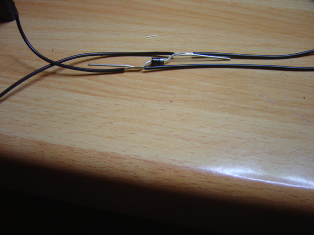

**la jarretiere**

apres soudure.  
on distingue bien les dénudages au milieu du fil.  
je soude avant de couper les fils en longeur

Cette opération est identique pour les 5 types de jarretière. Voir explications plus loin sur les différents types.

**Il vous faut :**  
**–** 2 longueurs de fils de 5 cm  
**–** un composant (diode ou résistance)  
**–** 2 pins males  
**–** 2 pins femelles  
**–** Un morceau gaine de couleur de 5 mm de diamètre  
**–** 2 morceaux de gaine rouge 3 mm de diam  
**–** 2 morceaux de gaine noire de 3 mm de diam

Les deux fils et le composants sont positionnés parallèlement.  
Les pattes du composant sont coupée à 1 cm environ (moi, je le fais après soudure).

Toute l’astuce tient à la manière de dénuder les fils.  
Il faut dénuder une partie au milieu du fil.

**Manipulation :**

1.  Dénuder une extrémité du fil sur 15 mm avec la pince.
2.  A environ 2 cm de l’extrémité de la gaine positionnez la lame de la pince à dénuder.
3.  Dénudez sur 8 mm (en fait la gaine glisse de 8 mm).
4.  Dénudez l’autre extrémité.
5.  Répétez l’opération sur le second fil.
6.  Placez les deux fils tête-bêche.
7.  Soudez le composant sur les deux parties dénudées centrales.
8.  Enfilez le morceau de gaine de 5 mm
9.  Enfilez les 4 morceaux de gaine de 3 mm

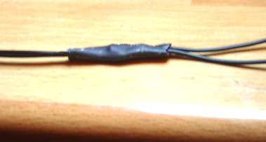

**zut s’est quoi ?**

une diode ou une resistance de 20 Kw  
that is the question !!!.

1.  Soudez les 2 pins males du même coté
2.  Soudez les 2 pins l femelles de l’autre coté

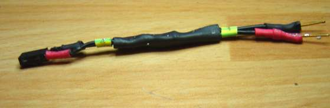

**la reponse**

s’etait une diode  
remarquez les deux bague de couuleurs vert-jaune. cela distingue les diodes des resistances.  
longeur finie 7 ccm

1.  Rétractez les gaines
2.  Votre jarretière est terminée.

Prix moins de 2 Euros.

## DIFERENTS TYPES DE JARRETIERE.

Pour le multiplexage des IdP

4 jarretières avec une résistance

Valeurs des résistances.  
**–** 5 kW (kilo ohms)  
**–** 10 kw  
**–** 20 kw  
**–** 40 kw

prix des résistances 0.30 Euros pièces

Faire une ou deux jarretières de chaque valeur. Le repérer soit par la couleur gaine thermo soit par le chiffre de 1 a 4 (1 pour 5 khoms 4 pour 40 khoms.)

Pour les FdC

Faire le nombre de jarretières désiré en nombre pair.

Une diode par jarretière standard 12V1 A prix 0.50 Eu

## FONCTIONNEMENT ET INSTALLATION

**1 LE MULTIPLEXEUR**

Vous pouvez multiplexer jusqu’a 4 IdP sur une entrée de RCX.

configurez l’entrée du RCX en détecteur de lumière.

Insérez les branchez les jarretières sur les bornes NO des IdP que vous voulez multiplexer. De 2 a 4.

Relier les jarretières en série dans n’importe quel ordre. (la sortie de la première à l’entrée de la suivante)

Relier le RCX à l’entrée de la première et à la sortie de la dernière.

Vous comprenez l’utilité des câbles mono conducteurs.

Programmation :

Les 4 résistances donnent 16 combinaisons

De 0 Ohms. à 75 Ohms

## TABLE DE VERITE

| Position | des | IDP | . | résistance totales en kilo Ohms |
| --- | --- | --- | --- | --- |
| 1 | 2 | 3 | 4 |  |
| 0 | 0 | 0 | 0 | 75 |
| I | 0 | 0 | 0 | 70 |
| 0 | I | 0 | 0 | 65 |
| I | I | 0 | 0 | 60 |
| 0 | 0 | I | 0 | 55 |
| I | 0 | I | 0 | 50 |
| 0 | I | I | 0 | 45 |
| I | I | I | 0 | 40 |
| 0 | 0 | 0 | I | 35 |
| I | 0 | 0 | I | 30 |
| I | 0 | I | 0 | 25 |
| I | I | 0 | I | 20 |
| 0 | 0 | I | I | 15 |
| I | 0 | I | I | 10 |
| 0 | I | I | I | 5 |
| I | I | I | I | 0 |

**–** **Actionné** = I  
**–** **relâché** = 0

## PROGRAMATION

Le RCX considère les multiplexeur comme une sonde lumière en mode absolu. Il vous faut calibrer les valeurs obtenues à cause des tolérances des résistances. Une fois le calibre obtenu il faut appareiller le groupe sous peine d’avoir à recadrer à chaque nouvelle construction.

J’ai écrit un programme d’essais et de calibration en NQC.  
Je le mettrais en ligne prochainement en même temps qu’un exemple.

**2- FIN DE COURSE.**

Les fin de courses sont des IdP particuliers. Leur fonction est de détecter la position extrême d’un organe en mouvement. Quand ils sont actionnés ils coupent l’arrivée d’énergie (électricité , huile hydraulique) dans l’actionneur (moteur électrique, vérin). Mais le mouvement inverse doit toujours être possible.

Quelques exemples de ce type de mouvement.  
**–** Rotation d’une flèche de grue à tour.  
**–** Mouvement vertical du crochet d’une grue.  
**–** Ouverture et fermeture d’une porte de garage.  
**–** Doigts de verrou dans une porte blindée.  
**–** securité des grandes échelles de pompier.

Il est facile de réaliser cette fonction avec un RCX mais cela use les moyens de contrôle-commande du RCX.

Dans le type de FdC présenté ici, la fonction totale est pris en charge par les IdP. Libérant par là même, une entrée bien utile. Dans certains cas elle permet de libérer aussi une commande moteur.

**PRINCIPE DE FONCTIONNEMENT**

Les FdC sont montés en série sur le circuit d’alimentation du moteur. En général un à chaque extrémité du mouvement. Une diode montée en parallèle au bornes NF permet le passage du CC dans un seul sens lorsque le FdC est actionné. Tant que le FdC n’est pas actionné le courant circule à travers les contacts. Lorsque un des contact s’ouvre le courant est bloqué par la diode et le moteur n’est plus alimenté. Si le mouvement inverse est ordonné la polarité du courant est inversée et la diode est passante. Le mouvement peut se faire.

Simple, efficace, ne consomme pas ou très peut de courant en positon arrêt, ce qui n’est pas le cas si on utilise le limiteur de couple Lego. Programmation simplifiée.

_Exemple :_

Vous voulez commander 2 portes de garage simultanément et la disposition ne permet pas de les relier mécaniquement.

**Solution classique**

_Solution Wait._

Vous programmez là le fonctionnement des moteur par une durée de fonctionnement et vous insérez un limiteur d’efforts dans la chaîne cinématique.

Les moteurs consomment du courant pas simple à régler.

Utilisation de quatre sondes de position.(aller on va être sympa, on les multiplexes) 1 entrée RCX

Chaque moteur est commandé séparément. Bref le RCX est utilisé a 60% il reste une sortie moteur et 2 entrées.

**Solution avec fin de course**

Les 2 moteurs sont sur la même sortie .

Il reste 2 sorties et les trois entrées sont libres.

La programmation est ultra-simple. On donne l’ordre du mouvement et on ne s’en occupe plus.

## CONCLUSIONS :

Cette technique que je nome NQL « presque du Lego » me paraît pleine de promesses pour des _Grogneugneu_ plus performants plus ludiques. J’en suis aux balbutiements, j’ai plein de sondes spéciales en tête.

La sonde de rotation est pratiquement terminée avec le concours précieux de Philo.

En chantier une sonde télémétrique.

En projet une platine de relais et une alimentation extérieure.

Des photos et les schémas seront disponible dans le courant de la semaine sur mon site [perso](http://perso.freelug.org/vauban/)

C’est une autre philosophie que le « TOUT LEGO », pour moi LEGO est un moyen pas un but.

Je suis sans doute le vilain petit canard dans une portée de cygnes.

## REMERCIEMENTS :

**–** En premier lieu à toi lecteur, qui m’a lu jusqu’au bout, malgré mon piètre français.j’attend tes remarques [Email](mailto:r.olivero@wanadoo.fr)  
**–** Ensuite à Philo, mon maître et ami pour sa patience et son aide. [http://www.philohome.com/](http://www.philohome.com/)  
**–** En dernier aux auteurs de ces pages :  
[http://www.akasa.bc.ca/tfm/](http://www.akasa.bc.ca/tfm/)  
[http://www.techno-stuff.com/](http://www.techno-stuff.com/)  
à qui j’ai honteusement pompé les calculs.  
**–** A tous les autres freelugiens pour leur patience et leur amitié.
