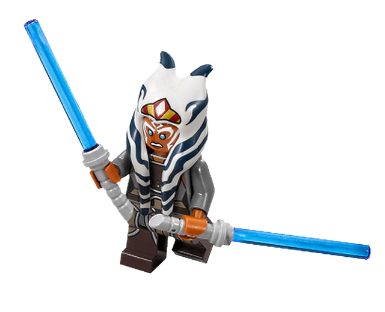
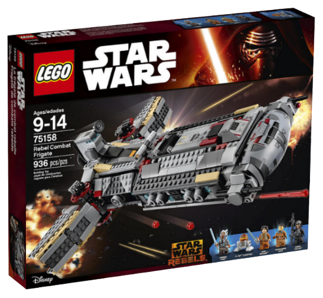
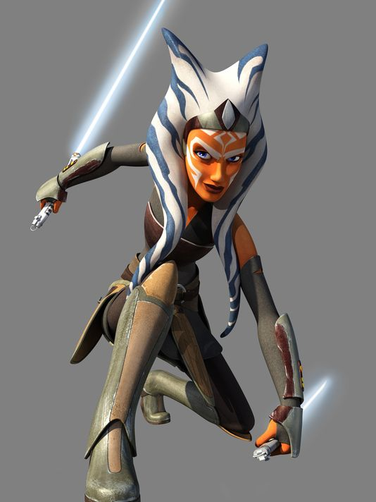
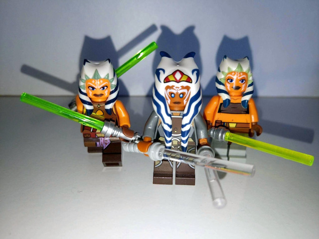
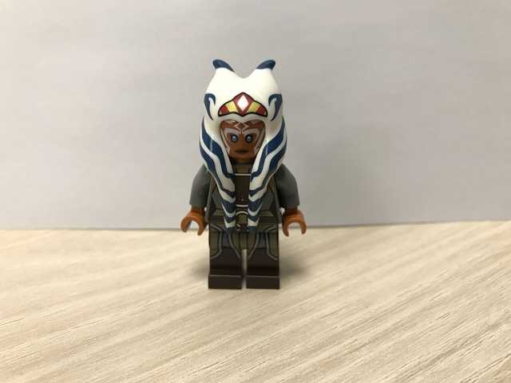
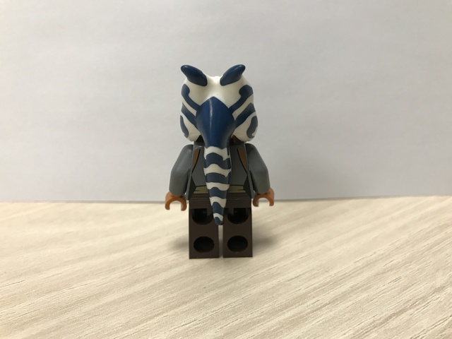
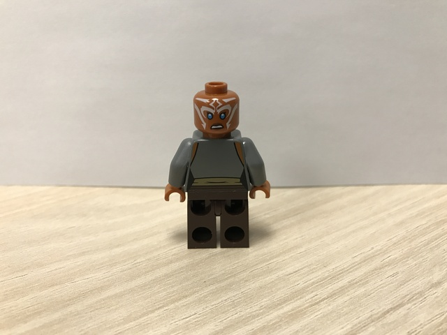
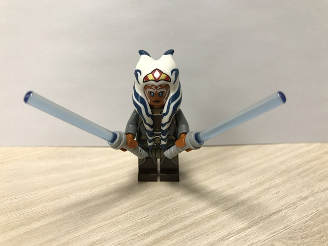
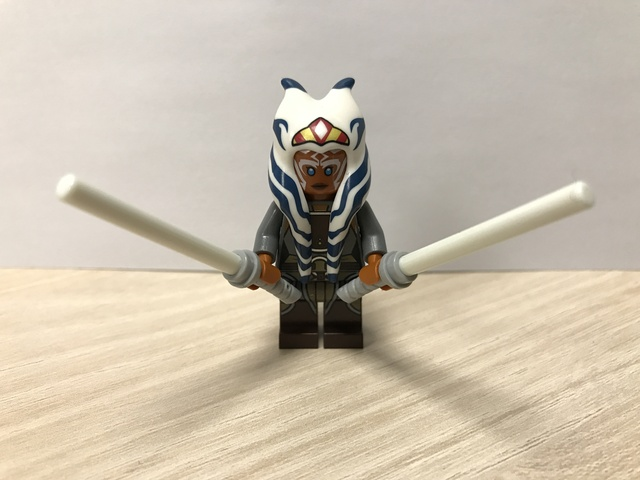
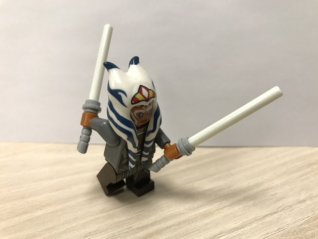

Aujourd’hui je vous propose la review de la figurine **_Ahsoka Tano_** (SW759) dans la gamme _Star Wars_.

Cette nouvelle mouture vaut-elle la peine ?

* * *

La fig que je vais vous présenter est issue du set _[75158 - Rebel Combat Frigate](http://brickset.com/sets/75158-1/Rebel-Combat-Frigate)_.

Ce set ne m’intéressant pas plus que ça, j’ai acheté la figurine seule sur _[Bricklink](http://www.bricklink.com/v2/catalog/catalogitem.page?id=147836#T=S&O={})_.

* * *

-   **Ahsoka Tano**

**_Ahsoka Tano_** est un personnage de la saga cinématographique _Star Wars_. Originaire de la planète _Shili_, elle est amenée dès l’enfance sur _Coruscant_ afin d’être formée en tant que Jedi. À la suite du début de la guerre des clones, **_Ahsoka_** devient l’apprentie d’ **_Anakin Skywalker_** et participe à de nombreuses batailles. Durant la deuxième année de guerre, elle est accusée d’un meurtre qu’elle n’a pas commis et quitte finalement l’Ordre Jedi.

Source _[Wikipedia](https://fr.wikipedia.org/wiki/Ahsoka_Tano)_.

* * *

Cette figurine est la troisième version du personnage chez _LEGO_ (_[SW192](http://brickset.com/minifigs/sw192/Ahsoka)_, _[SW452](http://brickset.com/minifigs/sw452/Ahsoka-Tano)_ et enfin _[SW759](http://brickset.com/minifigs/sw759/Ahsoka-Tano-\(75158\))_ qui nous intéresse aujourd’hui). Elle diffère des précédentes versions par un traitement moins dessin animé, nous sommes en présence d’une fig plus réaliste comme le reste de la gamme _LEGO Star Wars_ (photo ci-dessous by _Sébastien LEROUX_).

De face on voit tout de suite que cette figurine est de 2016, les sérigraphies sont maintenant bien plus détaillées et couvrent le torso et les jambes. La coiffe est elle aussi nouvelle et bien plus longue qu’auparavant.  
Les sérigraphies sont superbes, et le visage est bien plus réaliste que les anciennes fig.

L’arrière de la coiffe, là aussi bien plus longue, n’est pas totalement symétrique ce qui donne un côté "vivant" et naturel.

De dos la sérigraphie est moins riche mais c’est normal vu que la coiffe cache une bonne partie du dos.  
Le visage alternatif "énervé" est lui aussi une réussite.

* * *

Dans le set 75158, **_Ahsoka_** est fournie avec deux sabres aux lames bleutées. Or comme on peut le voir dans le dessin animé _Star Wars Rebels_, elle possède en fait des sabres à lames blanches (voir l’image d’illustration en haut de la review).

Du coup pour coller un peu plus au personnage, j’ai changé les lames bleutées par des lames blanches phosphorescentes (pièces officielles _LEGO_ que vous pouvez trouver sur _[Bricklink](http://www.bricklink.com/v2/catalog/catalogitem.page?P=30374&idColor=159#T=S&C=159&O={{ '{%' }}22color%22:159})_).

Voilà **_Ahsoka_** mise en situation de combat.

* * *

**CONCLUSION :**

Très belle réussite pour cette version _Rebels_ d’ **_Ahsoka_** , pour moi c’est clairement la plus belle version de cette fig.  
Une fois les lames des sabres changées, c’est clairement un must have pour tout collectionneur de minifig _Star Wars_.
