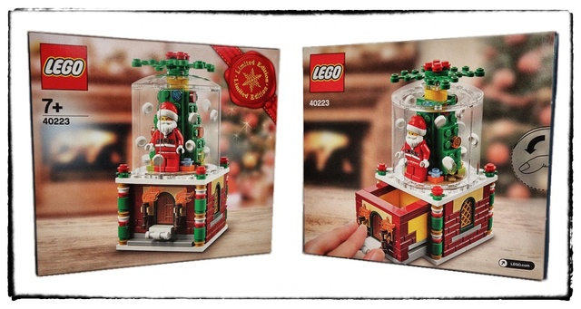
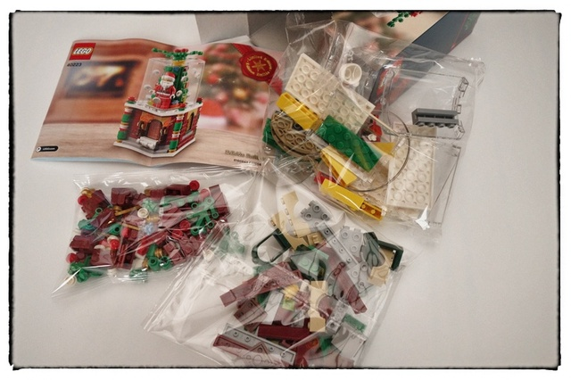
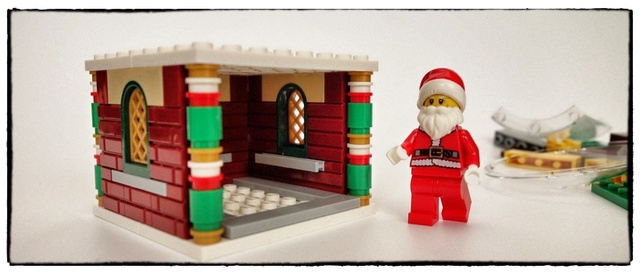
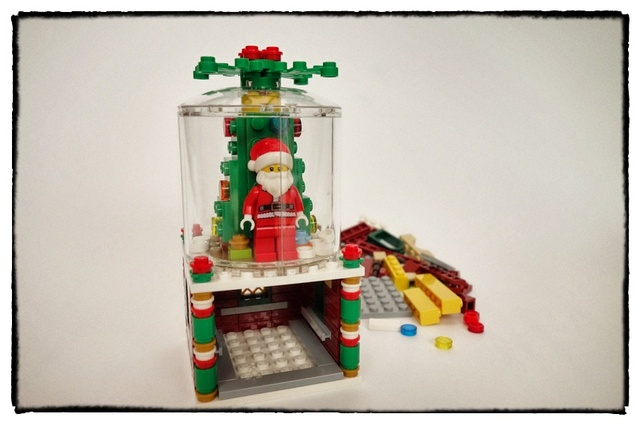
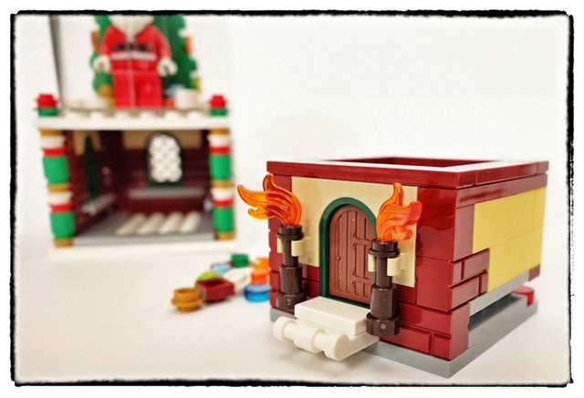
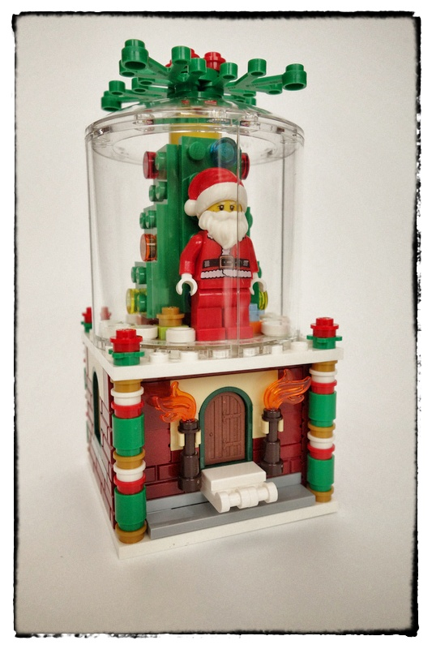
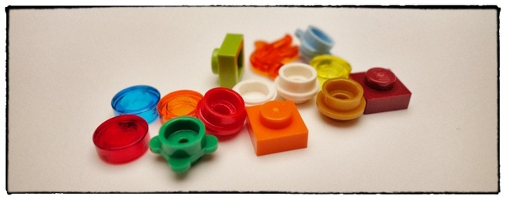
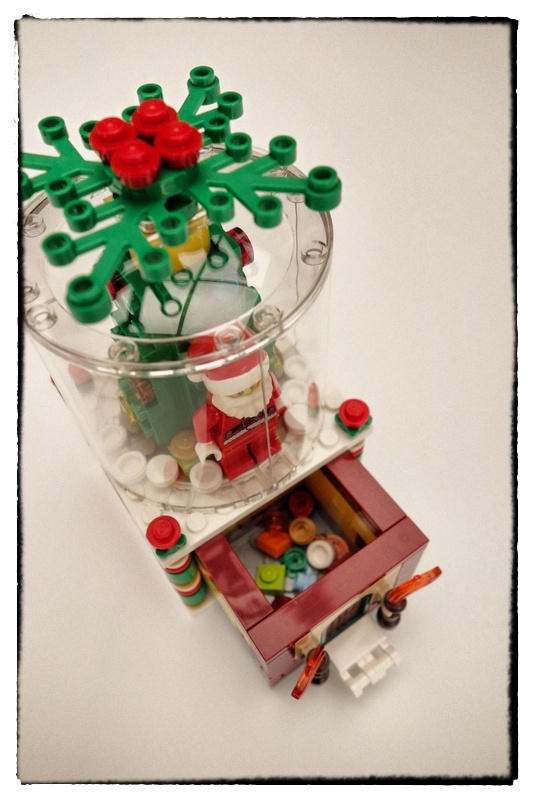
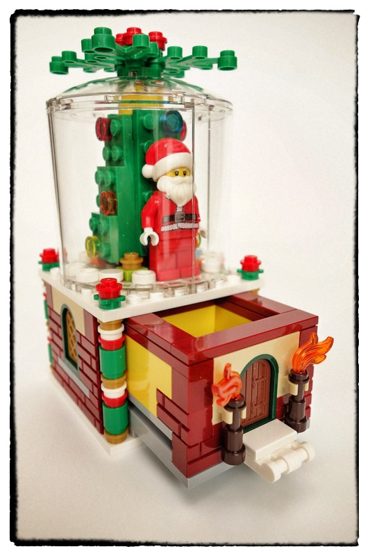
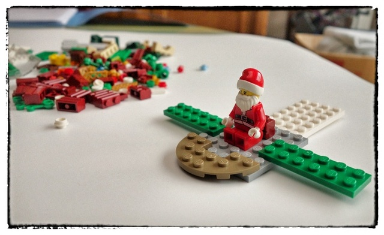

Jingle bells, jingle bells… Noël approche les amis, alors pour rester dans l’ambiance, aujourd’hui, je vous propose une rapide revue du set 40223, la boule de Noël.

Alors vous, je ne sais pas, mais moi, quand on me parle de boule de Noël, je ne peux plus m’empêcher de penser à ça :  
[https://www.youtube.com/watch?v=H7cAkkz0gEI](https://www.youtube.com/watch?v=H7cAkkz0gEI)

Mais revenons à nos flocons, et regardons ce set de 210 pièces d’un peu plus près.

Pour ceux qui l’auraient oublié, ou loupé, ce set est un set saisonnier, comme TLG en offre tous les ans à la même période. Cette année, il fallait effectuer 65€ d’achat sur le shop en ligne, ou dans un des Lego Stores, pour que cette boite soit rajoutée à votre panier.  
Notons au passage l’inflation sur le prix du cadeau, qui était auparavant offert dès 55€ d’achat.

L’emballage est classique pour ce genre de set, avec le pseudo ruban et le pseudo sceau en cire, qui indiquent que nous avons affaire ici à une édition limitée. Petite différence cette année, puisque le millésime n’est pas indiqué au milieu du sceau, remplacé par un visuel de flocon. La firme de Billund aurait-elle prévu de nous ressortir ce set dans des années futures ?  
L’arrière présente LA fonction de cette boule de Noël, un petit tiroir à secrets.

L’intérieur de la boîte est bien rempli, avec une notice, et trois sachets.  
La construction se divise en 3 parties, le socle de la boule, la boule en elle-même, avec son père Noël et son sapin sous globe, et le tiroir. L’inventaire n’a rien d’extraordinaire, beaucoup de plates et tiles round 1x1, et une grosse vingtaine de bricks 1x2 avec profil maçonnerie, en Dark Red.

Partie 1 : la base du globe

Partie 2 : nous avons enfermé le père Noël et son sapin dans sa cage de verre (ou d’ABS plutôt).

Partie 3 : le petit tiroir qui viendra s’encastrer dans la base, sous le globe.

L’objet terminé.

Pas plus de 20 minutes pour le montage (prise de photos inclue).  
Nous avons ici affaire à un objet, point de véhicule ou petit stand de vente de sapin, ou de friandise, qui viendra améliorer le village de Noël.

Quelques pièces en rab... qui trouveront leur place dans votre vrac, ou dans le petit tiroir !

Pourtant, ce set est complètement dans l’ambiance et sera certainement très sympa à monter avec un enfant. Il vous faudra alors peut-être un peu plus de 20 minutes, il y a quand même pas mal de plates ou tiles 1x1 round ; mais au final, cette petite boite/boule de Noël, apportera une petite touche festive supplémentaire à votre décoration intérieure.

Fichtre ! Je me rends compte que j’ai oublié de vous présenter la minifig du père Noël. Rien de très grave, rien de plus basique que cette figurine, vue et revue, au travers notamment des calendriers de l’avent et autres sets festifs de Noël.  
Pourtant, à la demande générale, la voici aux commandes du modèle alternatif à cette boîte, le Santa Claus Plane, monté en 7 secondes 3 dixièmes, par Nathan.

Joyeux Noël à tous !!
