**–** 76077 – Iron Man : Detroit Steel Strikes  
**–** Nbre de pieces : 377  
**–** Prix S@H : 34,99€  
**–** Ratio prix/pièce : 9,3cts/pc  
**–** Minifigs : 3

Ce set fait partie de la première vague 2017 de la gamme Marvel Super Heroes normalement disponible au premier janvier, mais qu’on pouvait trouver dans les stores dès la fin décembre.

Dès son annonce, ce set a retenu l’attention de nombreux AFOLs - dont moi en l’occurrence, par la présence de la minifigure de l’Agent Phil Coulson, emblématique représentant du SHIELD, mais surtout de LOLA, sa voiture volante, une Chevrolet Corvette de 1972, présente dans la série "Marvel’s Agents of SHIELD".

L’attente en valait-elle la peine ? Jetons un œil sur cette boîte.  
Ce set se présente dans la sous-gamme Avengers, comme l’indique le logo en bas à gauche de la boîte, sans porter de référence particulière à un film où à la série. Il reprend les couleurs et le bandeau des autres sets de la gamme.

[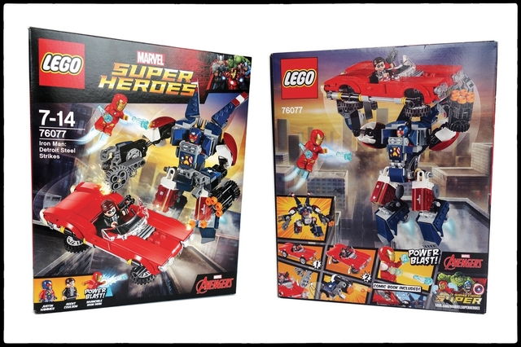](https://www.freelug.org/IMG/jpg/2017-01-01_-_76077_Iron_Man_Dtroit_Steel_Strike_001.jpg)

La face avant nous propose une mise en scène avec les 3 minifigs présentes à l’intérieur : Invicible Iron Man, Agent Coulson et Justin Hammer, ainsi que les véhicules, LOLA donc, et le mécha Detroit Steel. Le mécha est mis en valeur et semble bien grand par rapport à la voiture.

[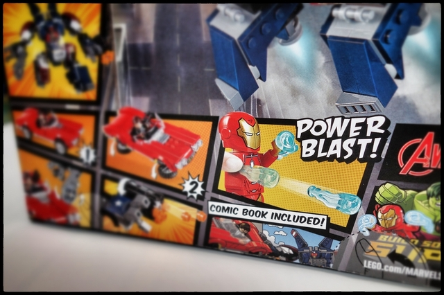](https://www.freelug.org/IMG/jpg/2017-01-01_-_76077_Iron_Man_Dtroit_Steel_Strike_002-2.jpg)

Sur la face arrière, nous avons droit comme d’habitude à à la présentation d’un florilège de fonctionnalités diverses et variées : l’inclinaison des roues de LOLA, la scie et le six-studs shooter qui équipent les bras de Detroit Steel. Mais la fonctionnalité la plus mise en avant est sans doute le nouveau système de jouabilité qui va révolutionner la façon de jouer de nos chères têtes blondes depuis l’arrivée du blaster à plates, j’ai nommé le PooOOOOooowerrrrr BlaaAAAsssst !!!

[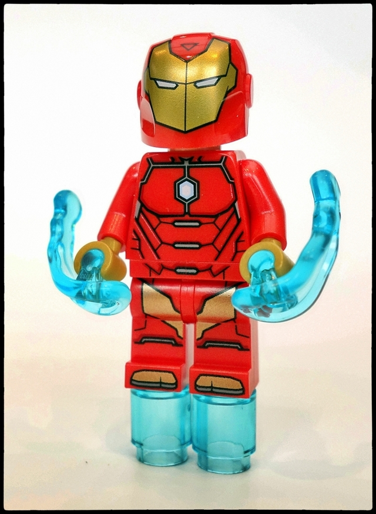](https://www.freelug.org/IMG/jpg/2017-01-01_-_76077_Iron_Man_Dtroit_Steel_Strike_023.jpg)

Un système qui permet à Iron Man d’envoyer de vraies décharges d’énergie vers ses adversaires, rien que ça ! Le fonctionnement en est très simple, la pièce représentant la charge d’énergie vient se clipser sur la main de la minifig, et une partie remonte légèrement le long de son bras. Il suffit d’exercer une pression sur cette partie, pour que le pièce se détache de la main et soit propulsée vers l’avant. J’ai testé…ça fonctionne globalement, c’est-à-dire que la pièce ne part pas vraiment en ligne droite, par contre, elle peut partir assez loin, vous avez plutôt intérêt à regarder où elle file.  
Je vois d’ailleurs très bien cette pièce ressurgir rapidement dans des MOCs de fontaines, elles figureront à merveille de l’eau qui coule.

Ceci étant dit, regardons maintenant ce que contient cette boîte : trois sachets numérotés, une notice en deux parties, un comic book (ou ce que TLG appelle un comic book), qui met en scène les sets 76076, 76077 et 76078, et une petite planche de stickers. Bizarrement, en voyant la boîte, je m’attendais à une planche bien plus fournie, c’est donc une agréable surprise, même si les stickers…ben, c’est pas top quand même.

[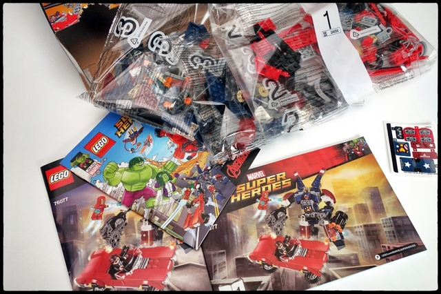](https://www.freelug.org/IMG/jpg/2017-01-01_-_76077_Iron_Man_Dtroit_Steel_Strike_003.jpg)

[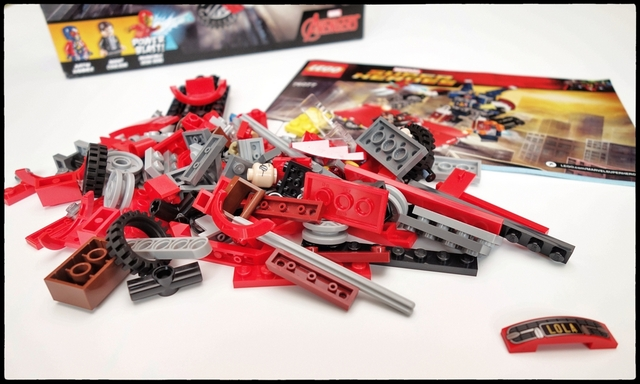](https://www.freelug.org/IMG/jpg/2017-01-01_-_76077_Iron_Man_Dtroit_Steel_Strike_004.jpg)

Ouverture du premier sachet, et là !! BAM !! La super surprise du set, la pièce qui représente la calandre de LOLA est sérigraphiée ! Là où sur toute la gamme Speed Champions il a fallu se coltiner le collage plus ou moins droit de stickers, ici nous avons droit à une belle pièce pourvue d’une belle sérigraphie détaillée, qui n’a d’ailleurs rien à voir avec l’immatriculation de la voiture dans la série.

[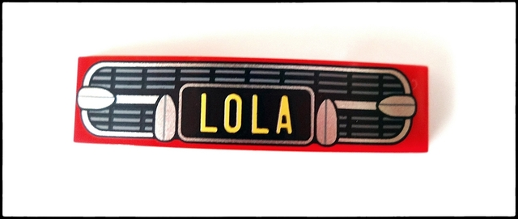](https://www.freelug.org/IMG/jpg/2017-01-01_-_76077_Iron_Man_Dtroit_Steel_Strike_020.jpg)

Comme quoi, au Danemark, quand on veut, on peut.

[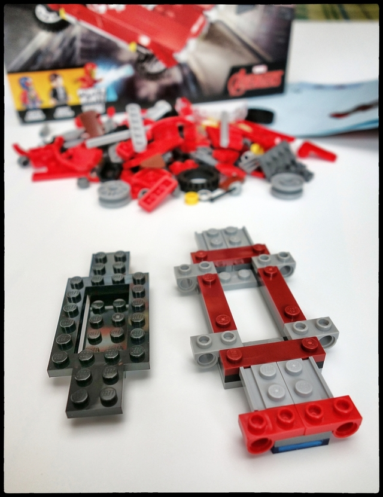](https://www.freelug.org/IMG/jpg/2017-01-01_-_76077_Iron_Man_Dtroit_Steel_Strike_005.jpg)

[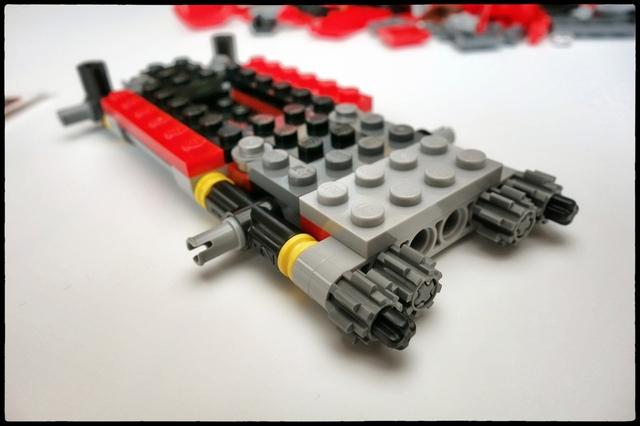](https://www.freelug.org/IMG/jpg/2017-01-01_-_76077_Iron_Man_Dtroit_Steel_Strike_006.jpg)

On commence par construire un cadre dans lequel viendra se loger le mécanisme d’inclinaison des roues.

[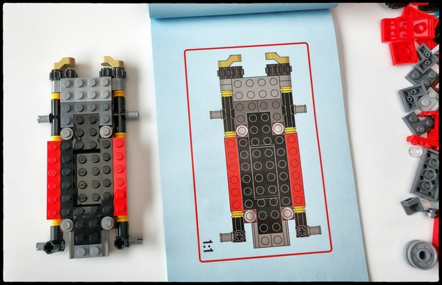](https://www.freelug.org/IMG/jpg/2017-01-01_-_76077_Iron_Man_Dtroit_Steel_Strike_007.jpg)

Jusqu’ici, tout va bien.

[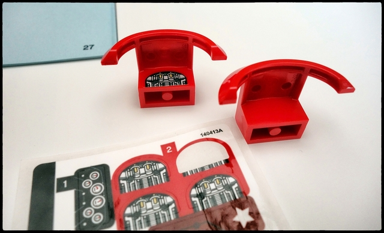](https://www.freelug.org/IMG/jpg/2017-01-01_-_76077_Iron_Man_Dtroit_Steel_Strike_008.jpg)

Première pose de stickers à l’intérieur des ailes, si vous pouvez le faire avec une pince à épiler, ce sera bien mieux qu’avec des gros doigts. L’idée est sympa de décorer cette partie du véhicule, mais au final, on ne le verra que très peu. Au final, ça fait un peu : "Il reste de la place sur la planche de stickers, les gars. Trouvez-moi un truc à coller."

[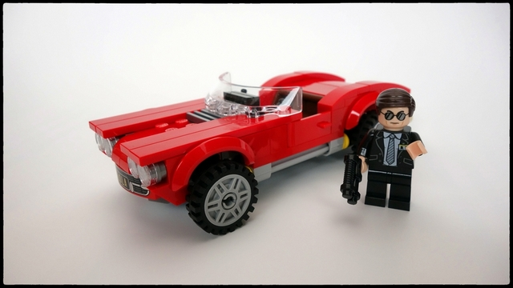](https://www.freelug.org/IMG/jpg/2017-01-01_-_76077_Iron_Man_Dtroit_Steel_Strike_009.jpg)

**DON’T TOUCH LOLA !!**

[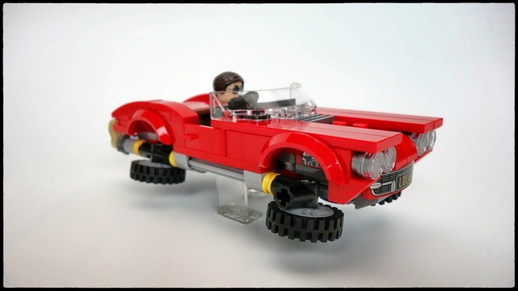](https://www.freelug.org/IMG/jpg/2017-01-01_-_76077_Iron_Man_Dtroit_Steel_Strike_010.jpg)

LOLA nous est proposée ici en version cabriolet, et à part le mécanisme des roues, elle n’intègre aucun système d’envoi de missile ou de cachette.

[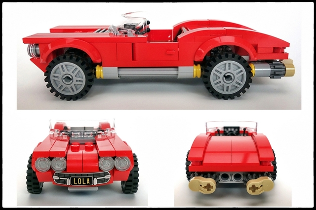](https://www.freelug.org/IMG/jpg/2017-01-01_-_76077_Iron_Man_Dtroit_Steel_Strike_021.jpg)

En fait j’étais assez enthousiaste lors de la construction de la carrosserie, même si la partie avant au niveau des phares, avec ces deux tiles qui viennent en prolongation au-dessus, lui donne un côté agressif que l’original n’a pas. Sur l’arrière, par contre, les rondeurs de LOLA sont parfaitement respectées, et le designer a réussi à donner à ses courbes un galbe qui n’est pas déplaisant. L’ensemble est assez effilé, et ressemble à l’idée qu’on peut se faire d’un coupé cabriolet.  
Ça se gâte avec le montage des roues… Tout d’abord, le système utilisé, laisse un léger jeu, ce qui fait que les roues bougent légèrement, que ce soit en position verticale ou en position horizontale. Ensuite, les roues dépassent d’un demi-tenon sur l’extérieur et sont bien trop hautes pour ce type de véhicule, et au final, on à l’impression d’avoir une caisse de cabriolet sur un châssis de SUV, c’est dommage. Et pour finir, les deux pièces à l’arrière qui permettent de faire tourner les roues, auraient pu être un peu cachées, ici elles défigurent un peu le modèle. Peut-être aurait-il fallu les mettre en rouge, pour les camoufler un peu, ou réutiliser le principe mis en œuvre pour l’autre voiture volante du SHIELD, celle de Nick Fury, du set 76004.

Le premier sachet nous propose également la minifig de Phil Coulson, c’est celle de Justin Hammer qui se trouve à l’intérieur du second. Je reviendrai sur les minifigs à la fin.

[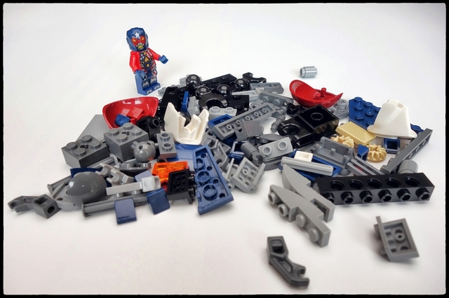](https://www.freelug.org/IMG/jpg/2017-01-01_-_76077_Iron_Man_Dtroit_Steel_Strike_011.jpg)

Encore un mécha. Après celui de Lex Luthor (très réussi d’ailleurs), c’est ici un mécha existant dans l’univers Marvel qu’on nous propose de construire ici. Pour être franc, je n’avais jamais entendu parler de Detroit Steel avant ce set. Il semblerait qu’il ait été construit par la fille de Justin Hammer, Justine (!) après le décès de celui-ci - que fait donc sa minifig dans le set alors, et qu’il soit piloté par un ancien soldat. La MkI, présentée ici, est peinte aux couleurs du drapeau US.

[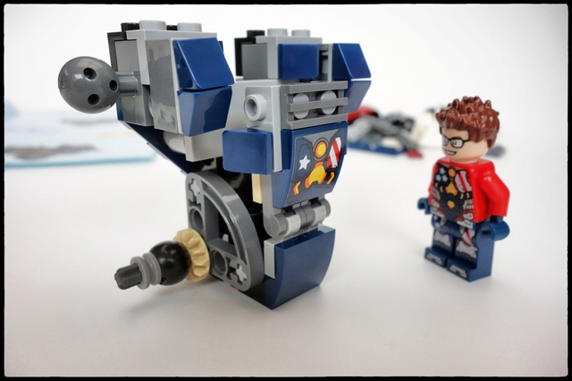](https://www.freelug.org/IMG/jpg/2017-01-01_-_76077_Iron_Man_Dtroit_Steel_Strike_012.jpg)

[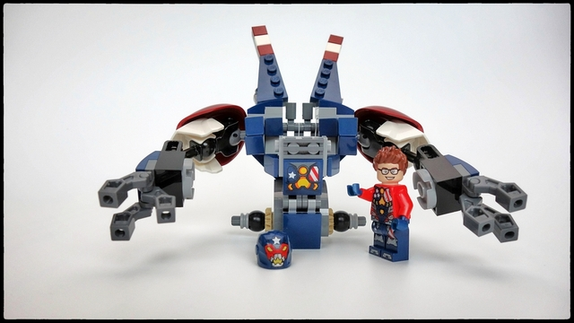](https://www.freelug.org/IMG/jpg/2017-01-01_-_76077_Iron_Man_Dtroit_Steel_Strike_013.jpg)

On construit assez rapidement le torse de la bête, auquel on ajoute les bras. Sans être follement original, l’ensemble est plutôt agréable.

[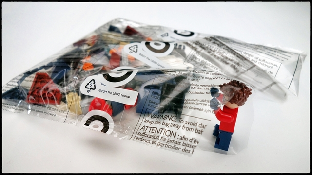](https://www.freelug.org/IMG/jpg/2017-01-01_-_76077_Iron_Man_Dtroit_Steel_Strike_014.jpg)

Allons chercher ce qu’il faut dans le dernier sachet pour finir le montage. Voyons voir là-dedans.

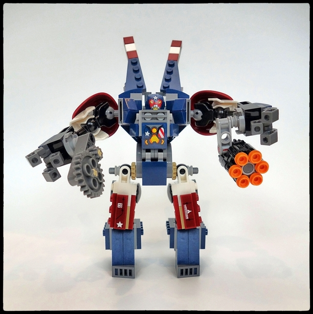

Montage inversé identique pour les jambes, qui font vraiment… pas terminées. On a l’impression que le designer a cherché à s’éloigner de la manière de faire les jambes sur les autres méchas, et autant la partie supérieure donne l’impression d’avoir été un peu travaillée, autant les jambes sont franchement n’importe quoi. Pareil pour les équipements des bras, la scie et le stud shooter, qui ajoutent à l’agressivité du mécha, mais qui auraient mérité un peu plus de détail.

Parlons des figs maintenant :

[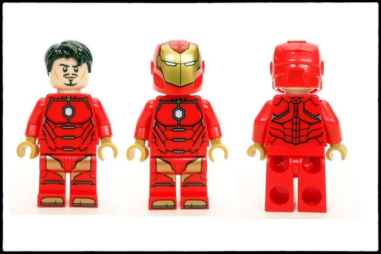](https://www.freelug.org/IMG/jpg/2017-01-01_-_76077_Iron_Man_Dtroit_Steel_Strike_018.jpg)

Invicible Iron Man, dans une livrée rouge vif et or, au lieu du traditionnel dark red, mais surtout équipé de son nouveau casque, dont tout le monde se demandait si il venait par-dessus la tête, ou si c’était une pièce complète. J’aimai bien l’ancienne version, avec la visière qui se relevait, mais il faut avouer que celui-ci, même si il fait globalement la même taille, propose une silhouette bien plus affinée. La sérigraphie est très belle, très détaillée. Un léger défaut de centrage sur la poitrine, mais rien de dramatique.

[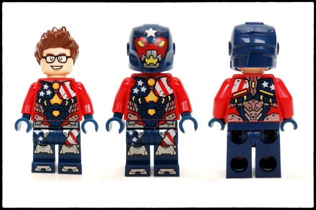](https://www.freelug.org/IMG/jpg/2017-01-01_-_76077_Iron_Man_Dtroit_Steel_Strike_019.jpg)

Justin Hammer, dans son armure/combinaison. Celle-ci est juste superbe, avec rien de moins que 6 couleurs, et un luxe de détails superbe. Le casque est la même pièce que celui d’Iron Man, avec un visuel qui ressemble à une tête d’insecte.

[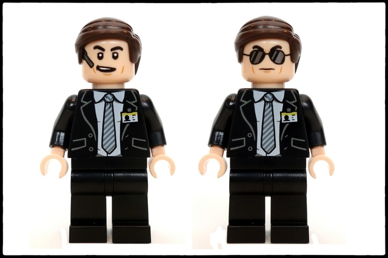](https://www.freelug.org/IMG/jpg/2017-01-01_-_76077_Iron_Man_Dtroit_Steel_Strike_022.jpg)

Phil Coulson, dans son costume, avec son badge d’accès au SHIELD. La sérigraphie est sympa, par contre l’arrière se résume au strict minimum avec deux plis sur la veste (en même temps, que faire de plus). Comme toutes les figs de ce set, il est livré avec une double face, ici une version avec lunettes de soleil (joli effet sur les verres), et une version avec micro.

Notons qu’en plus de leurs doubles faces, Tony Stark et Justin Hammer sont fournis également avec des cheveux, et c’est suffisamment plaisant pour être signalé.

[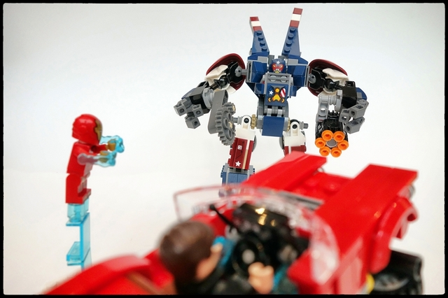](https://www.freelug.org/IMG/jpg/2017-01-01_-_76077_Iron_Man_Dtroit_Steel_Strike_016.jpg)

[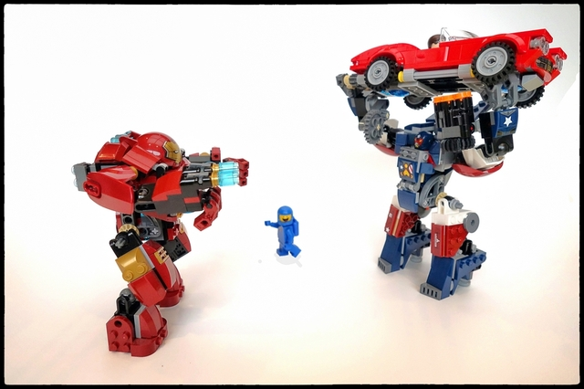](https://www.freelug.org/IMG/jpg/2017-01-01_-_76077_Iron_Man_Dtroit_Steel_Strike_024.jpg)

**SHOWDOWN !!!**

En conclusion, je dirai que ce set avait tout pour être un très bon set, mais que plusieurs petits détails (les roues de LOLA, les jambes du mécha), l’empêchent de l’être vraiment. Il reste cependant un set qui atteint son objectif de jouabilité, et les gamins vont adorer ça.

Quelques extra parts...

[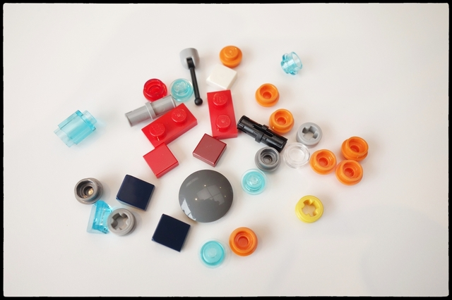](https://www.freelug.org/IMG/jpg/2017-01-01_-_76077_Iron_Man_Dtroit_Steel_Strike_017.jpg)
