Batman choisira t’il de désamorcer la bombe ou partira t’il à la poursuite de son ennemi juré, le Joker ?

**–** Prix S@H : 14,99€  
**–** Nbre de pièces : 124  
**–** Ratio prix/pièce : 12cts/pièce  
**–** Nbre de minifigs : 2

Disponible depuis le 1er janvier, ce set est l’entrée de gamme de la nouvelle série consacrée au prochain film d’animation "The Lego Batman movie", qui sortira le 8 février prochain.  
Pour cette première vague, 13 sets sont prévus, allant de 14,99€ à 164,99€, complétés par une série de 20 minifigs à collectionner.  
Alors, pour ce prix, que nous propose-t-on ?

[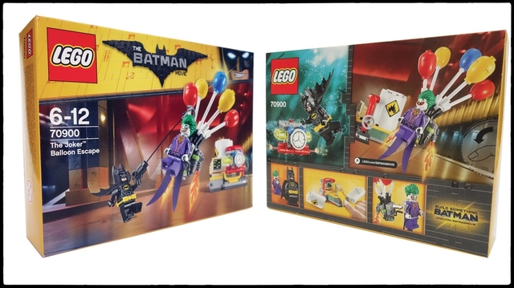](https://www.freelug.org/IMG/jpg/2017-01-07_-_70900_Joker_Balloon_Escape_002.jpg)

Le visuel de la boîte est dynamique, attractif, avec des couleurs vives et le grand bandeau jaune sur lequel figure le Batlogo brickbuild du film, on ne peut pas louper les sets dans les rayons. Celui-là au moins, avec les couleurs chatoyantes des ballons.  
Sur la face avant, les deux personnages présents dans la boîte sont mis en situation. C’est simple, ludique et ça promet de la jouabilité. L’élément de décor est peu mis en valeur, laissé dans un léger flou.  
Sur l’arrière, les traditionnels éléments de jouabilité : la destruction d’une cuve, et la possibilité de clipser rapidement au Joker sa machine à ballons. Une image retient mon attention, celle de Batman, sous l’eau, aux prises avec la bombe géante. Un indice pour une scène du film ? Encore quelques semaines d’attente avant de le savoir. LEGO nous propose également de nous connecter sur son site à la page Batmanmovie pour y construire quelque chose de BATMAN !  
Il est temps d’ouvrir l’emballage.

[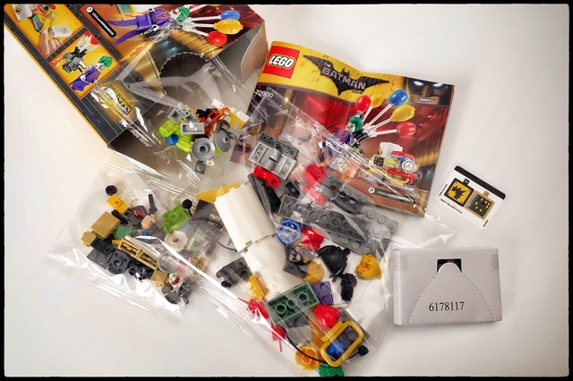](https://www.freelug.org/IMG/jpg/2017-01-07_-_70900_Joker_Balloon_Escape_003.jpg)

[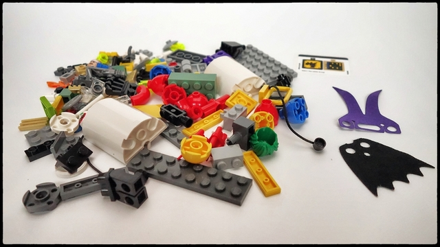](https://www.freelug.org/IMG/jpg/2017-01-07_-_70900_Joker_Balloon_Escape_004.jpg)

Trois sachets non numérotés, un petit carton qui protège la cape du chevalier noir et la queue de pie de son ennemi juré, une toute petite planche de stickers, accompagnent la notice.

[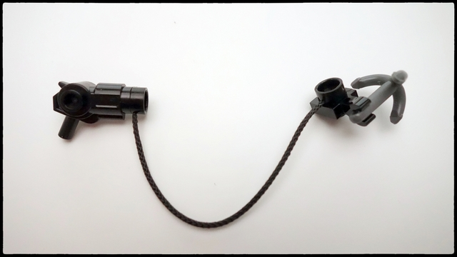](https://www.freelug.org/IMG/jpg/2017-01-07_-_70900_Joker_Balloon_Escape_005.jpg)

[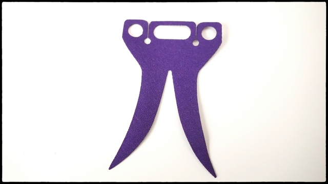](https://www.freelug.org/IMG/jpg/2017-01-07_-_70900_Joker_Balloon_Escape_006.jpg)

Première chose à faire, assembler les figurines et le lance-grappin du héros. La queue de pie du Joker qui viendra s’insérer entre les jambes et le torse est taillée dans l’ancienne matière dont on faisait les capes, un peu rigide, ce qui oblige à la travailler à la main un peu pour lui permettre de s’arrondir derrière le Joker, sinon la rigidité empêche la figurine de rester debout.

[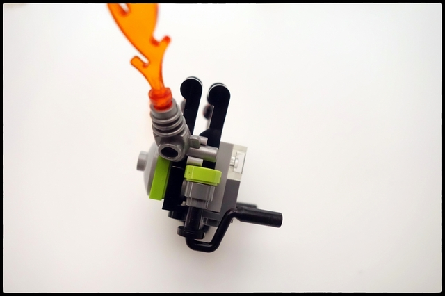](https://www.freelug.org/IMG/jpg/2017-01-07_-_70900_Joker_Balloon_Escape_007.jpg)

On commence par monter la machine (un compresseur ?) qui soutiendra les ballons. A noter, une utilisation astucieuse des poignées des rouleaux de peintres pour figurer les poignées. C’est malin et ça rend vraiment bien.

[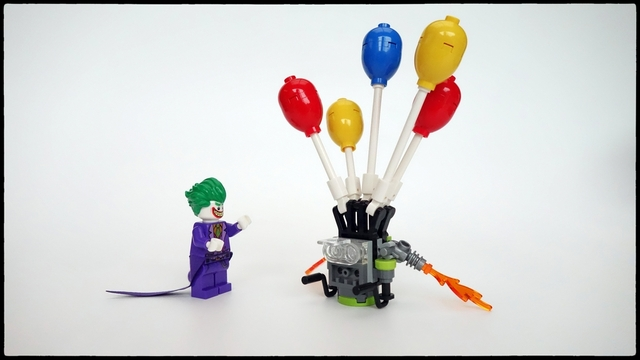](https://www.freelug.org/IMG/jpg/2017-01-07_-_70900_Joker_Balloon_Escape_008.jpg)

[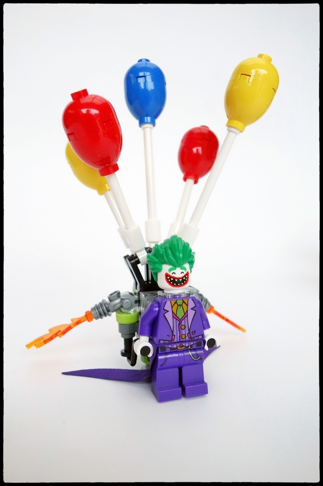](https://www.freelug.org/IMG/jpg/2017-01-07_-_70900_Joker_Balloon_Escape_014.jpg)

On vient ensuite fixer les cinq ballons qui vont permettre au prince du crime de Gotham City de s’échapper. Je ne sais pas si la pièce qui vient figurer la partie inférieure des ballons est spécifique à ce set, ou si elle a déjà été utilisée dans un autre set, mais elle est différente de celle présente habituellement pour faire des ballons. Elle est ici plus haute, affinée, et donne aux ballons une forme ovale très réaliste. L’ensemble est plutôt bien proportionné.

[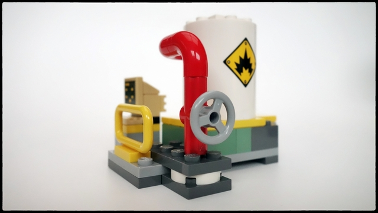](https://www.freelug.org/IMG/jpg/2017-01-07_-_70900_Joker_Balloon_Escape_009.jpg)

[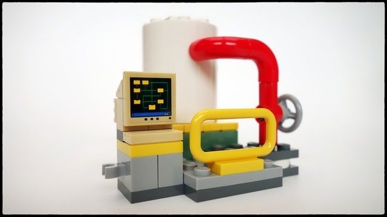](https://www.freelug.org/IMG/jpg/2017-01-07_-_70900_Joker_Balloon_Escape_010.jpg)

On construit ensuite très rapidement une petite partie de décor qui pourra se combiner avec les décors des sets 70910 et 70901. Une cuve (avec un contenu explosif, c’est le sticker qui le dit) qui pourra exploser grâce à un mécanisme à levier, un ordinateur (ou un écran de surveillance), une barrière sur laquelle viendra se fixer la bombe, et un bout de tuyau avec une vanne.  
En fait, j’ai bien aimé ce détail de tuyauterie avec la vanne, ça donne un peu de mouvement dans le décor. C’est très simple, 4 pièces et 4 connecteurs, mais ça fonctionne bien.

[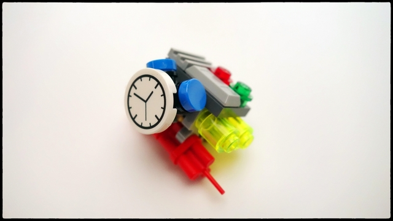](https://www.freelug.org/IMG/jpg/2017-01-07_-_70900_Joker_Balloon_Escape_011.jpg)

[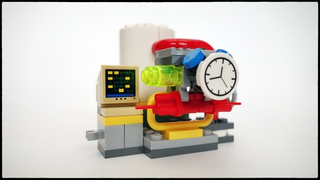](https://www.freelug.org/IMG/jpg/2017-01-07_-_70900_Joker_Balloon_Escape_012.jpg)

Vient le tour de la bombe. Un sacré morceau, qu’on n’imagine pas très propre avec ces deux pièces en trans-neon green (un gaz toxique, ou un acide… acide ?), et ses deux pains de dynamite. Elle fait quand même la taille d’une minifig, au final.

## Les minifigs

[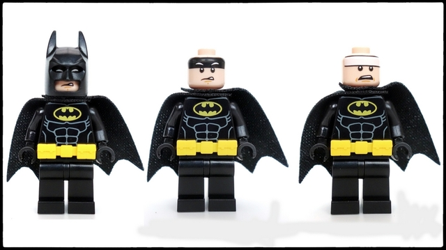](https://www.freelug.org/IMG/jpg/2017-01-07_-_70900_Joker_Balloon_Escape_001.jpg)

Batman, en costume noir et jaune, retrouve son vieux logo. Service minimum pour la sérigraphie face et dos, et des jambes nues. Nouveauté avec cette gamme, l’apparition d’une pièce ceinture, avec des pochettes. C’est certainement une bonne idée à la base, et comme on a pu le dire sur beaucoup de forums, déclinée en d’autres couleurs (elle est déjà en reddish brown avec la minifig de Catman), pas mal de MOCeurs militaria vont s’en donner à cœur joie. Pour ma part, je trouve que l’échelle minifig s’accommode mal de ce genre de détail, et si de face, ça passe encore, de profil, c’est visuellement moche (ce n’est que mon avis, hein… ?).  
Visage alternatif, mode "dent serrées, yeux plissés, tu vas voir ce que tu vas voir" et mode "Mon dieu, si cette bombe explose c’est la fin !".

[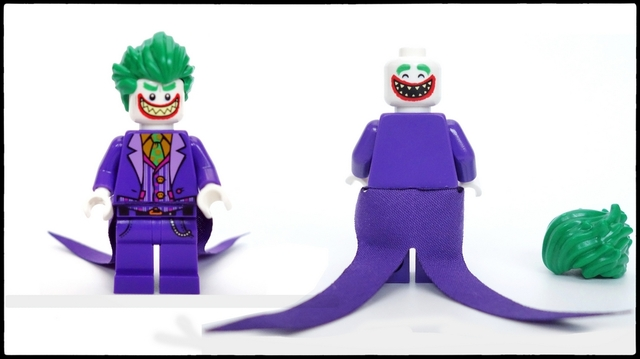](https://www.freelug.org/IMG/jpg/2017-01-07_-_70900_Joker_Balloon_Escape_016.jpg)

Le Joker, par contre, est une petite merveille. La sérigraphie du torse est sublime, avec un soin du détail apporté au gilet impressionnant (les rayures et les boutons jaunes). La sérigraphie continue sur les jambes avec le bas du gilet, les poches et une chaîne de montre à gousset. Pour le coup, il est dommage que la queue de pie vienne s’insérer entre le torse et les jambes, ça casse le raccord. Et puis, franchement, vous ne trouvez pas que ça lui donne un gros cul… (en tous cas ça a l’air de le faire marrer). Visage alternatif pour lui aussi.

## Alors ? Il vaut quoi ce set ?

[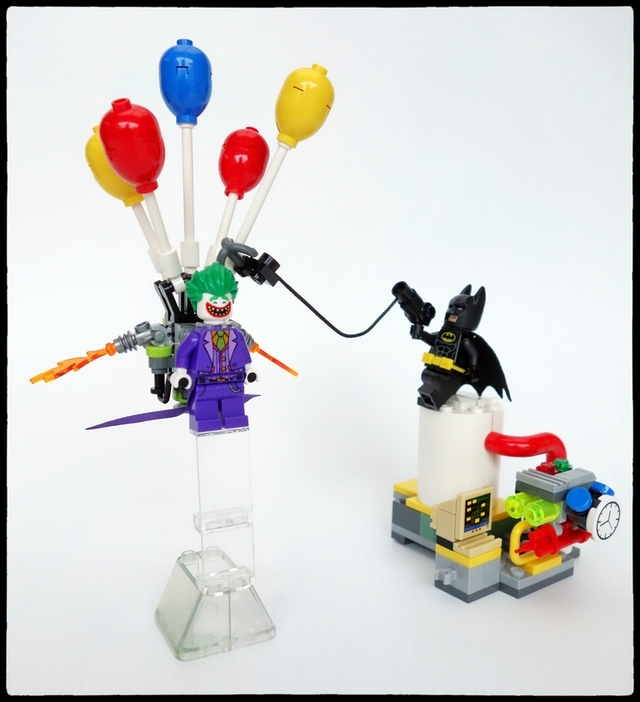](https://www.freelug.org/IMG/jpg/2017-01-07_-_70900_Joker_Balloon_Escape_015.jpg)

Certes, on aurait tous aimé avoir un bout de décor un peu plus consistant, mais pour le prix, je trouve que ce set fait parfaitement le job.

[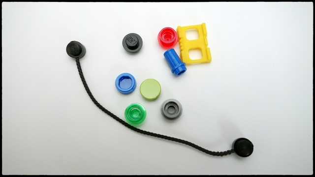](https://www.freelug.org/IMG/jpg/2017-01-07_-_70900_Joker_Balloon_Escape_013.jpg)

Parmi les extra parts, un bout de ficelle et une ceinture supplémentaires.
