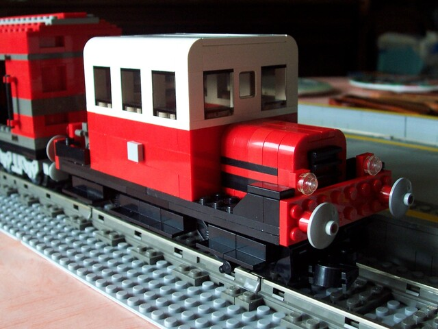
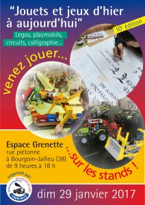
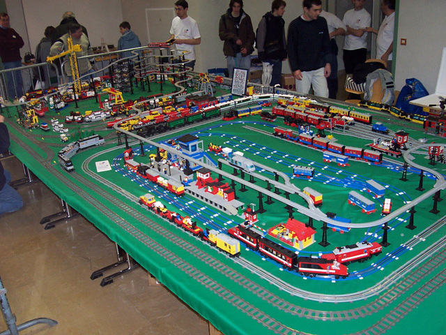

5 Questions à un AFOL à l’occasion d’un événement : Interview de Loys Bailly à l’occasion du Salon du jouet ancien organisé par Omnibus avec la participation de FreeLUG.

5 Questions à un AFOL à l’occasion d’un événement : Interview de Loys Bailly à l’occasion du Salon du jouet ancien organisé par Omnibus avec la participation de FreeLUG.

_**1) Pour ceux qui ne te connaissent pas, peux-tu te présenter en quelques lignes et nous dire comment tu as connu FreeLUG ?**_

Alors, Loys Bailly, alias Chimere, bientôt 50 ans et j’habite en Rhone-Alpes, à mi-chemin entre Lyon et Grenoble. En 2001/2002, je cherchais sur le net d’autres personnes et des sites qui causaient LEGO(r). Je suis tombé sur une liste de discussion nommé Lego-construction, puis un chat irc, j’y ai rencontré des gens comme Jac, Jean-Louis, Gilles et d’autres... Et on a créé FreeLUG !! C’était il y a déjà pas mal de temps !!!

_**2) Tu fais partie de ces AFOL qui ont fait une pause quelques années et ont mis de côté leur passion du LEGO(r) pour d’autres choses. Peux-tu nous dire pourquoi et comment tu es revenu à la petite brique ?**_

En fait, ma pause LEGO(r) s’est fait presque "naturellement", comme beaucoup, avec le collège, puis le lycée. Je n’ai d’ailleurs jamais retrouvé mon stock de l’époque. En 2000, LEGO(r) sort les premiers sets Star Wars, le film de ma jeunesse, et je suis retombé dedans en achetant le Faucon Millenium 7190.

_**3) Es-tu plutôt collection ou mocceur ? De quelle création ou pièce de ta collection es-tu le plus fier ?**_

J’achète bien de temps en temps une ou deux boites lors des AFOL Day, mais je suis plutôt un mocceur, un petit mocceur. La construction qui m’a le plus marquée, c’est une draisine rouge motorisée en 9v, que j’ai reproduit à partir d’une simple photo.

**Draisine rouge motorisée en 9v**

Un jour, un chemineau retraité est venu me voir lors d’une exposition, parce qu’il revoyait la draisine sur laquelle il avait travaillé des années durant. Quel plaisir ce fut !!

_**4) Parlons maintenant un peu de l’exposition de Bourgoin qui aura lieu à la fin du mois. Elle est organisée par l’association Omnibus. Il s’agit d’une exposition assez historique pour FreeLUG. Peux-tu nous raconter un peu son histoire ?**_

**Salon du jouet ancien à Bourgoin Jallieu**

Cela a commencé en 2003, nous étions 2 ou 3, et nous avions juste posé quelques sets sur une table, avec entre autres des UCS Star Wars. Mais l’année marquante, c’est 2004. Cette année-là, nous étions 7, avec entre autres Denis Huot, Philippe Label et Didier Enjary. Nous avions présenté pratiquement tout ce qui existait en train LEGO(R) : du 4,5v, du 12v, du 9v et du monorail.

**Exposition Bourgoin 2003**

Depuis, Omnibus et FreeLUG ont noué de très bonnes relations, et nous avons pratiquement participé à tous leurs événements. Depuis 2009, nous sommes leur principal exposant.

_**5) Afin de mettre l’eau à la bouche aux futurs visiteurs, peux-tu nous dire un peu ce qu’il sera possible de voir ou faire à cette exposition ?**_

Alors pour cette édition 2017, nous serons une vingtaine d’AFOL. Il y aura bien sûr beaucoup de mocs. Il y aura aussi une rétrospective chronologique non exhaustive des différentes gammes LEGO(r). Omnibus souhaitait une interaction avec le public, nous allons donc proposer une mosaïque à monter par les petits et grands, et notre amis Jean-Yves installera son studio stopmotion pour que les enfants puissent créer leur petit film LEGO(r)....

Voilà alors venez nombreux ! Toutes les informations pratiques sont disponibles [ici](http://freelug.org/spip.php?page=evenement&id_article=2543).
