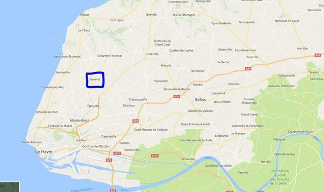
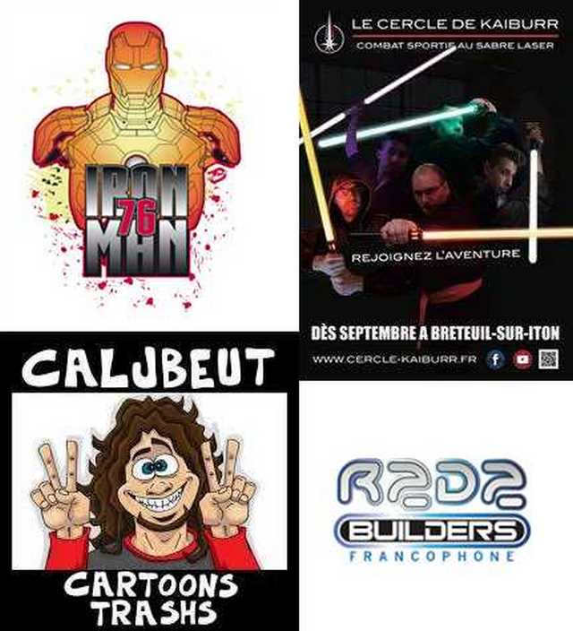
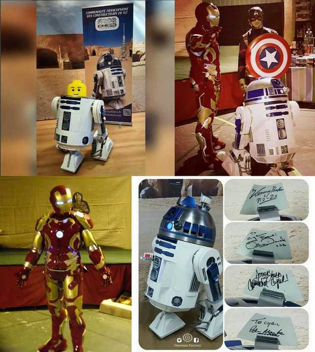
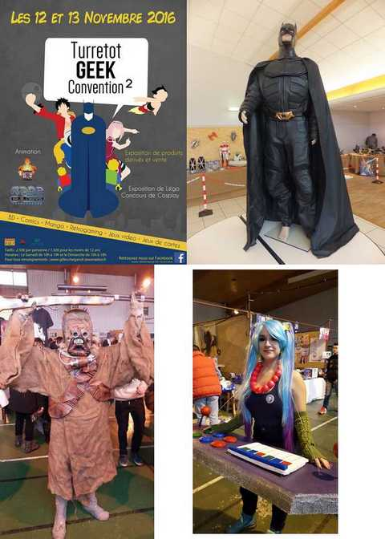
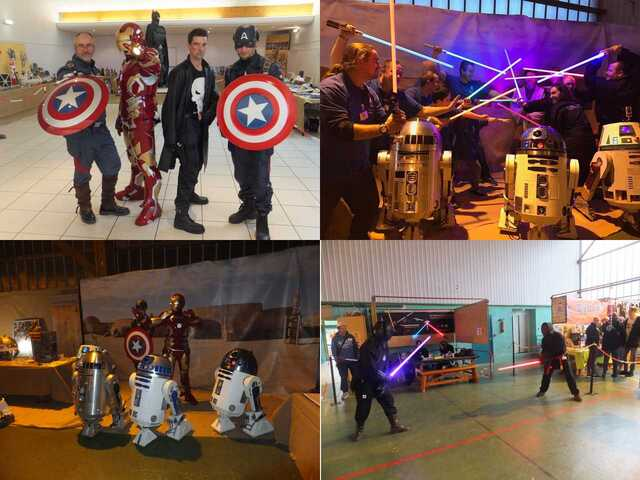
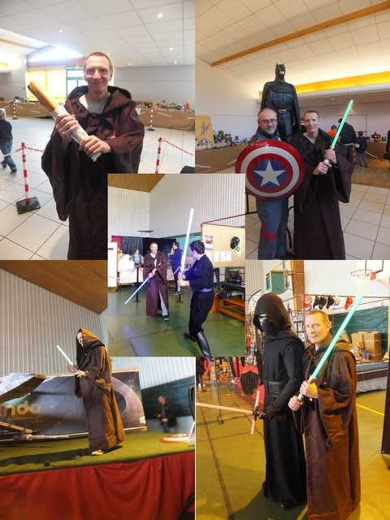
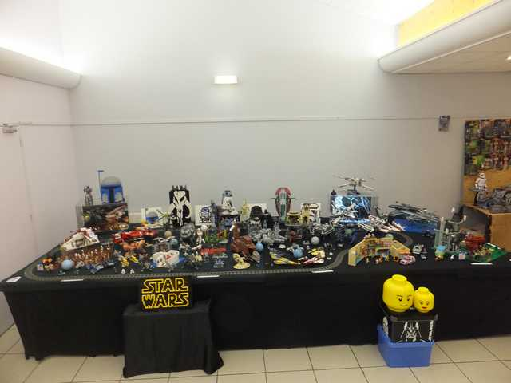
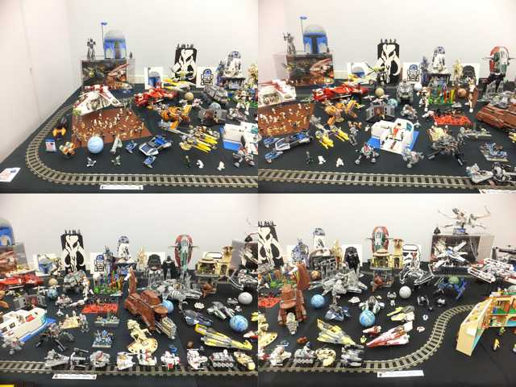
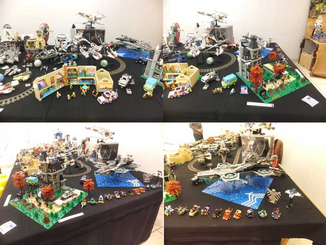
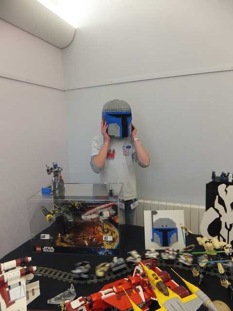

les 12 et 13 novembre 2016, Thomas et moi-même avons participé à la seconde convention GEEK de Turretot en Seine-Maritime. Nous avons exposé principalement du Star Wars.

Lors de ma visite à la première édition en 2015, l’organisateur a validé notre participation à Thomas et moi les 12 et 13 novembre 2016. Turretot se trouve en Normandie (76), proche d’Etretat, pas très loin du Havre. Pour nous c’est à 5mn de route de la maison. La première édition a eu lieu dans un gymnase. Pour la seconde édition en plus du gymnase il y une autre salle.

**Turretot**

Turretot

Au total 24 exposants autour de Star Wars, MARVEL et DC COMIC, Manga, les années 80, Power Rangers, consoles de jeux vidéo, LEGO et 3 dessinateurs locaux. La présence de CALJBEUT- Cartoons Trashs ne passe pas inaperçu, de nombreux fans sont là à l’ouverture pour avoir une dédicace et une photo souvenir. Le club R2D2 Builders France avec leurs robots échelle 1 sillonne les allées pendant les 2 jours. IRONMAN 76 fait également son apparition pendant la durée du salon. Le cercle de KAIBURR initiera le public au maniement du sabre laser et fera des démonstrations de combat. Un concours de « cosplay » aura lieu le dimanche dans l’après-midi afin de récompenser les visiteurs ou exposants venus déguisés. J’ai participé mais le jury ne m’a pas classé dans les 3 premiers, pas grave le principal est de participer et de passer un bon moment. Un fond vert est mis en place pour faire des photos seul ou avec IRONMAM76, R2D2, Captain América, ou autres. Ces photos sont à poster sur le site Facebook de la « Turretot Geek Convention ». Vous récupérez ensuite votre photo avec un fond Star Wars principalement. Pendant l’exposition de nombreux visiteurs sont venus costumés.

**Logo**

Logo des principales animations

**Le clou de l’animation**

Le clou de l’animation, R2D2, Iron Man

**Cosplay**

Différents Cosplay

**Cosplay**

Différents Cosplay

**Mes combats de sabre laser**

Nous disposons de 4m de long sur 1.8m de large pour montrer principalement du Star Wars. Nous nous trouvons dans la seconde salle, un peu à l’écart du gymnase, avec des collectionneurs de Star Wars, MARVEL et DC COMIC, Power Rangers et consoles de jeux vidéo.

**vue d’ensemble du réseau**

vue d’ensemble du réseau, 4m sur 1.8m

**Zoom sur le réseau**

Zoom sur le réseau

**Zoom sur le réseau**

Zoom sur le réseau

La mise en place se fait la veille, le vendredi vers 18h00 avec Thomas. Nous mettons le plus gros. Le samedi matin rendez-vous à 08h30 pour finir la mise en place, l’ouverture au public est à 10h00. Surprise quand nous sortons les cartons de dessous les tables, 1 matelas pneumatique et 1 duvet. La salle est effectivement bien gardée et tout ça re-servira pour le soir.

**Qui est sous ce casque LEGO ?**

La première édition avait fait 800 entrées payantes environ. Pour cette seconde édition, ce chiffre est atteint le samedi à la fermeture à 18h00. Au total c’est 2100 entrées qui seront faites sur le week-end. Pour une petite commune comme Turretot, c’est pas mal.

Merci à Pascal BREARD pour ses 2 vitrines, à mon frère Dominique pour son X-Wing UCS et son R2D2. Bien sûr merci à Gilles MEGANCK et à la MAM les Grenouillères de Turretot pour l’organisation, l’accueil, le gardiennage, et le ravitaillement.

La 3ème édition est prévue les 30 septembre et 01 octobre 2017. Le salon sera encore plus grand. En plus du gymnase il y aura les 2 terrains de tennis couvert adjacents, soit une surface de 3200m2. Bien entendu Thomas et moi seront de la partie. Si des amateurs de LEGO Star Wars, Supers Héros, Harry Potter, Lord of the Rings, Ninjago, Chima, Tortues Ninja et pourquoi pas des créations comme du Steampunck, Goldorak, Albator, Cosmos 1999, les Thunderbirds etc… souhaitent venir à cet évènement ils seront les bienvenus.

Voir en ligne : [Turretot Geek Convention](https://www.facebook.com/Turretot-Geek-Convention-1052319048113344/)
