Aujourd’hui, je vous propose la revue de la boîte 31027, **Le Bolide bleu**.

Cet ensemble sorti en 2016 comporte 67 pièces pour un coût de 4,99 €, soit environ 7 centimes par pièce.

* * *

Le recto de la boîte présente les habituelles mentions « CREATOR », « 3-in-1 », et montre les trois véhicules pouvant être construits avec le set (une voiture de course, une déneigeuse, et un buggy).

[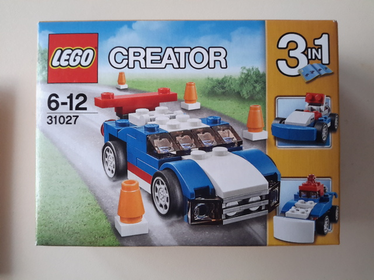](https://www.freelug.org/IMG/jpg/20170122_141759.jpg)

Le verso quant à lui met les trois véhicules en scène simultanément, et montre le coffre arrière de la voiture de course.

[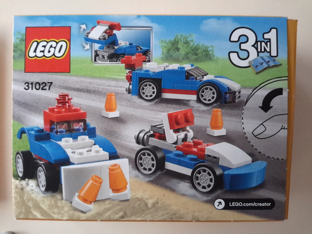](https://www.freelug.org/IMG/jpg/20170122_141819.jpg)

Sans surprise la boîte contient une notice et un sachet de pièces.

[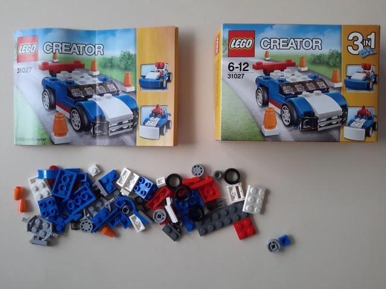](https://www.freelug.org/IMG/jpg/20170122_141740.jpg)

* * *

La construction commence avec une barre 2x6 sur laquelle se greffe un support à roues, avec de quoi étendre le véhicule sur 4 tenons de largeur.

[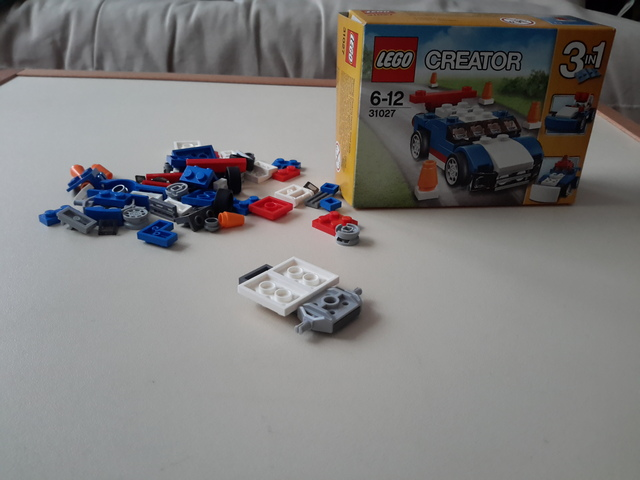](https://www.freelug.org/IMG/jpg/20170122_142026.jpg)

Sur le côté on met un peu de rouge, pour agrémenter la construction.

[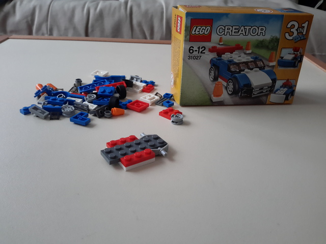](https://www.freelug.org/IMG/jpg/20170122_142041.jpg)

Ensuite on pose les garde-boues avant, on monte les phares. À noter le support de roue avant qui est à cheval sur la plaque 2x6 et le pièce à tenons verticaux, et sur l’arrière les éléments du moteur.

[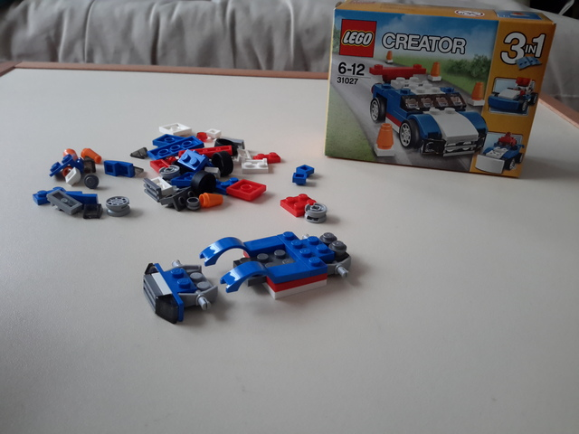](https://www.freelug.org/IMG/jpg/20170122_142152.jpg)

On accroche l’avant et le capot, et on met quelques plaques par-dessus pour aller en hauteur. La grille sur l’arrière évoque le moteur.

[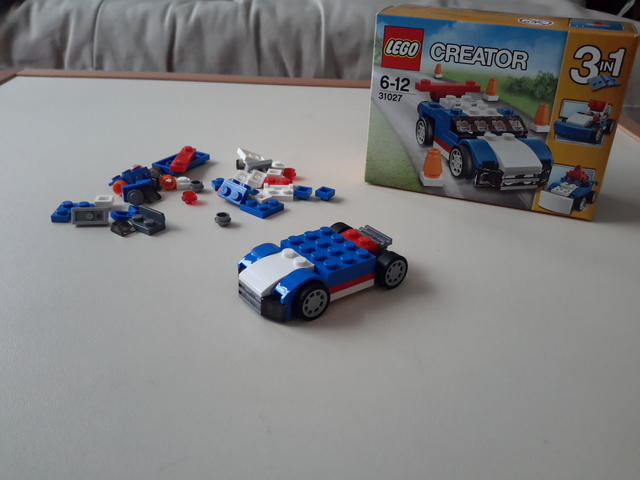](https://www.freelug.org/IMG/jpg/20170122_142404.jpg)

Puis on ajoute des crochets sur l’arrière, pour accrocher le capot arrière, quelques courbes, et le pare-brise, constitué de 4 pièces transparentes.

[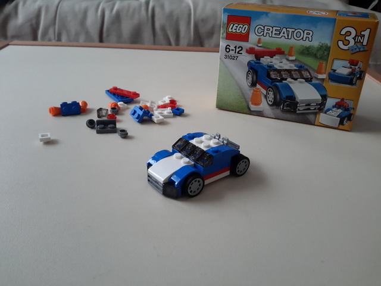](https://www.freelug.org/IMG/jpg/20170122_142517.jpg)

Et voici l’arrière en partie monté, avec les phares en vertical.

[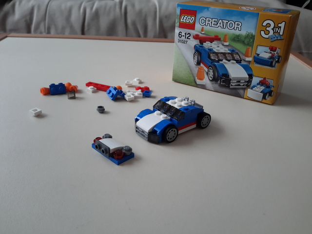](https://www.freelug.org/IMG/jpg/20170122_142636.jpg)

On termine avec un aileron rouge, on monte l’arrière, amovible, et on finalise la construction avec les quatre plots (simplement constitués de deux pièces).

[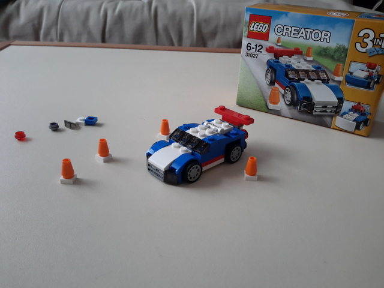](https://www.freelug.org/IMG/jpg/20170122_142945.jpg)

Et voici le modèle terminé, avec l’arrière ouvert pour montrer le super moteur...

[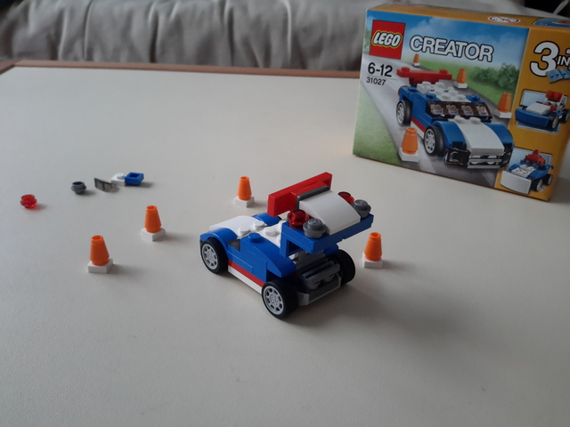](https://www.freelug.org/IMG/jpg/20170122_142955.jpg)

... et sous un autre angle.

[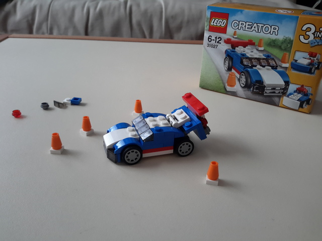](https://www.freelug.org/IMG/jpg/20170122_143007.jpg)

* * *

**Avis :** construction simple sans trop de surprises, mais le rendu est, comme pour les différentes boîtes de la gamme, agréable à voir, et très bien proportionné. Même si ce n’est pas à l’échelle mini-figurine, bien évidemment.

**Bonus 1 :** les deux autres véhicules pouvant être construits, la déneigeuse...

[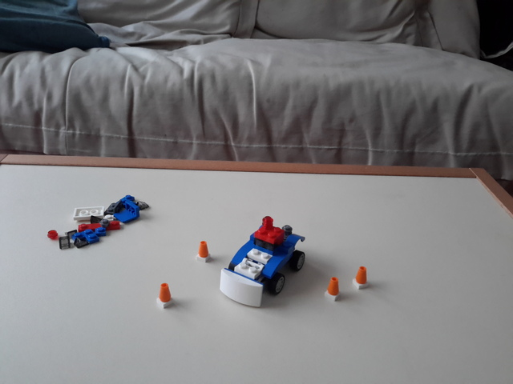](https://www.freelug.org/IMG/jpg/20170122_124302.jpg)

[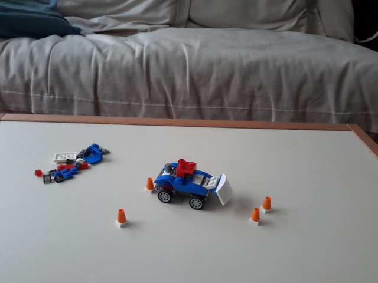](https://www.freelug.org/IMG/jpg/20170122_124320.jpg)

... et le buggy.

[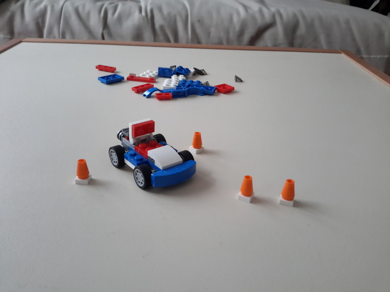](https://www.freelug.org/IMG/jpg/20170122_135034.jpg)

[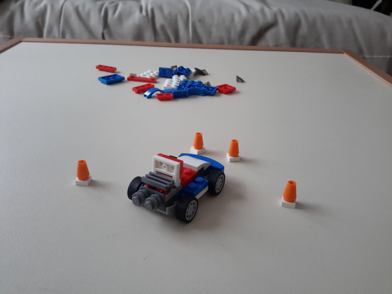](https://www.freelug.org/IMG/jpg/20170122_135046.jpg)

À noter que tous deux reprennent les plots, qui après tout peuvent servir dans les trois cas.

**Bonus 2 :** animation de la construction du bolide (cliquer pour lancer).

[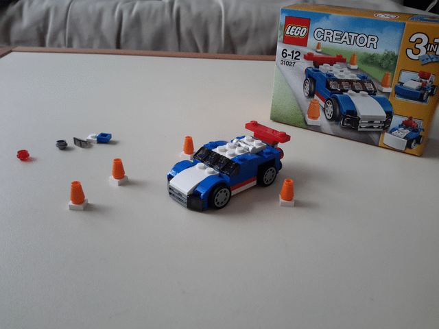](https://www.freelug.org/IMG/gif/31027.gif)
