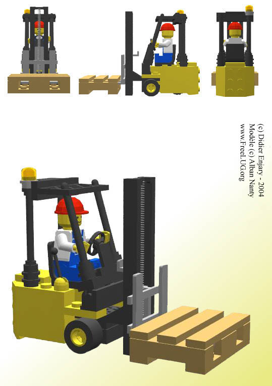
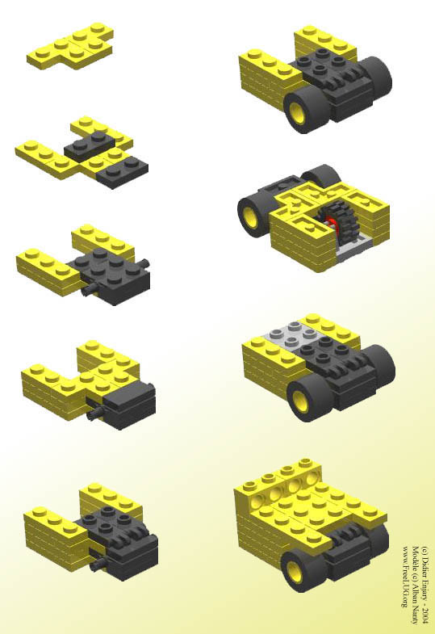
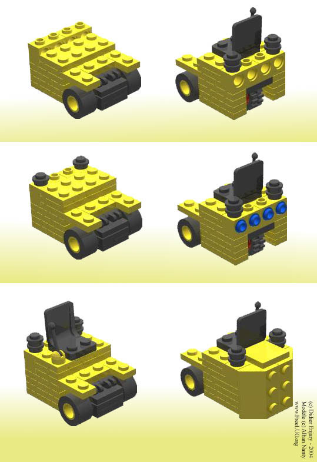
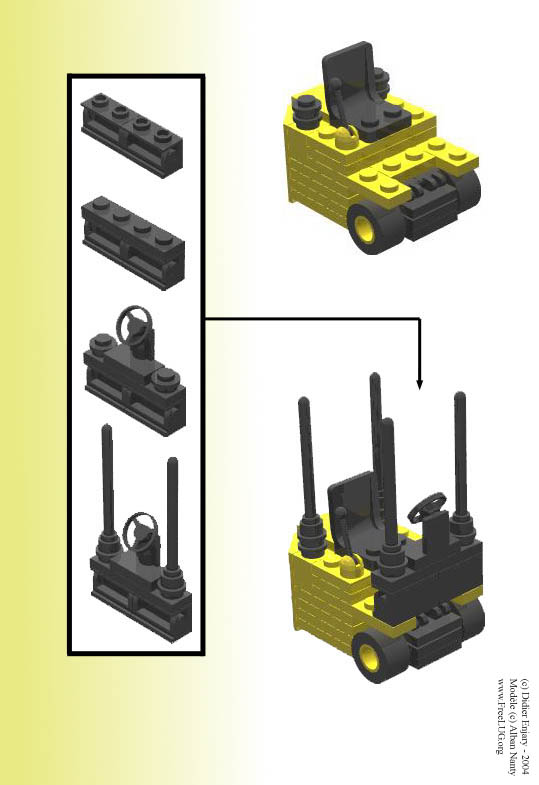
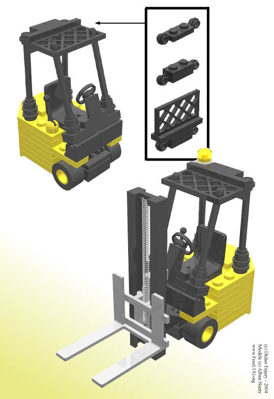
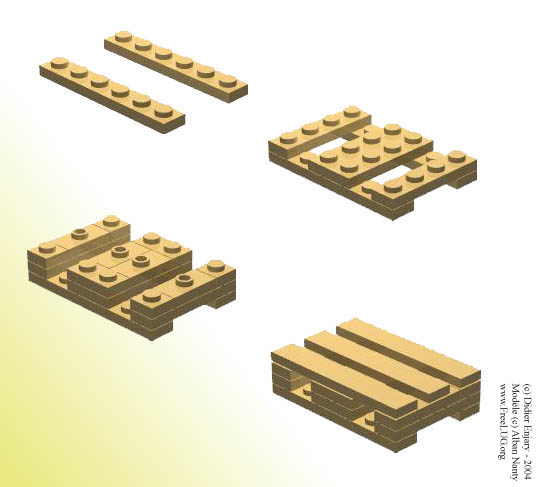

Pour l’expo d’Orléans, j’avais besoin de construire un petit chariot élévateur pour meubler ma scierie. Didier, grâce à ses talents d’infographistes, en a fait la notice.

Ce MOC est fait d’un empilement de plates jaunes. L’inconvénient est que la surface des flancs est moins lisse que si j’avais utilisé des briques, mais l’avantage est que le modèle est plus solide.

Une des clefs de la réussite de ce modèle est à mon avis d’avoir reculé d’un tenon les charnières qui tiennent la potence par rapport aux roues. Personnelement je trouve que, si on ne le fait pas, la potence est trop eloigné de la cabine.

J’ai aussi utilisé des roues lisses, car je les trouve plus proche des roues qu’on peut voir sur les vrais chariots élévateurs. Le fait qu’elles dépasses un peu me plaisait aussi.

L’arrière du chariot m’a donné beaucoup de mal. Je cherchais à faire un arrière arrondit ou biseauté et à la fois compact. C’est aussi un détail qui m’a semblé caractéristique des chariots élévateurs (l’arrière arrondit permet au chariot de tourner plus facilement dans les coins), et c’est pourquoi j’ai cherché à le reproduire.

J’ai assez vite pensé aux antennes pour faire les montants de la cabine, mais malheureusement elles étaient trop courtes. En rajoutant des plates rondes 1x1 pour les agrandir, j’ai eu l’heureuse surprise de constater que ça rajoutait un coté esthétique et sympathiques aux montants.

L’inclinaison des montants de devant me semble aussi caractéristique, mais cette fois l’idée du montage m’est venu très rapidement, et cela a été très facile à faire.

Le toit pourrait peut-être être refait avec une autre grille, mais là j’ai manqué d’inspiration.

Le gyrophare est une idée de Pierre Normandin. A vrai dire, je n’en avait pas mis, car j’ai rarerement vu un chariot élévateur électrique avec un gyrophare. C’est plus courant sur les chariots thermiques (les électriques s’utilisent plutot en intérieur, alors que les thermiques s’utilisent plutôt à l’extérieur).

Enfin pour complèter le modèle, j’ai créé une petite palette, sans trop réfléchir. Le problème de cette palette est que la planche transversale du milieu fait deux tenons de large, ce qui est en théorie trop large, mais bon, je ne vois pas trop comment faire autrement. :-)

Les inconvénients de ce modèle :

**–** si la potence est verticale, elle frotte sur le sol, mais la relever d’une plate rend le chariot trop haut et gache ses proportions.

**–** La tête de la minifig touche un peu le toit. Pierre Normandin m’avait proposé de rapprocher le siège d’un demi tenon, mais je trouve qu’un des détails qui font que le modèle est ressemblant, est l’espace libre entre le bloc moteur sur lequel est posé le siège et le volant. C’est espace sert en théorie au pilote à mettre ses jambes, et c’est vrai qu’une minifig ne peut pas plier les genoux, mais bon, au niveau du look, je préfère ma version. Sur la première image, vous pouvez observer la variante proposée par Pierre.
