Les Galeries du Centre Culturel Valery-Larbaud ont accueilli du 10 décembre 2016 au 5 février 2017 une exposition à destination du jeune public sur le thème du PIXEL ART et des briques LEGO. Le dernier week-end fût l’occasion d’une exposition LEGO par des membres FreeLUG et [Brickpirate](http://www.brickpirate.net/site/) (entre autres).

[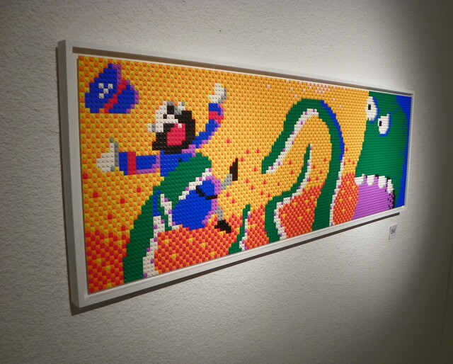](https://www.freelug.org/IMG/jpg/100_4844.jpg)

L’exposition Pixel Art c’est une galerie de mosaïque mais aussi le jeu du personnage célèbre, des coloriages pixel, des animations fortes sympathiques pour les enfants.

[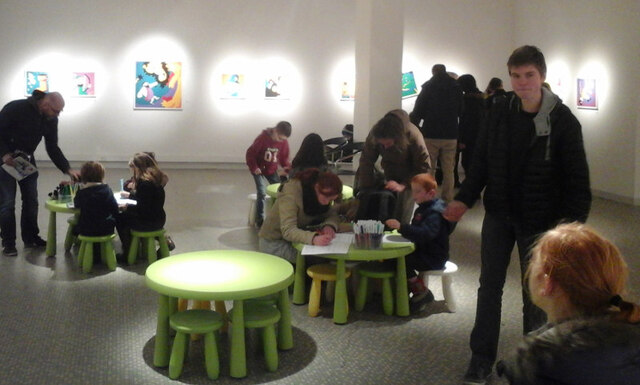](https://www.freelug.org/IMG/jpg/PixelArt2.jpg)

[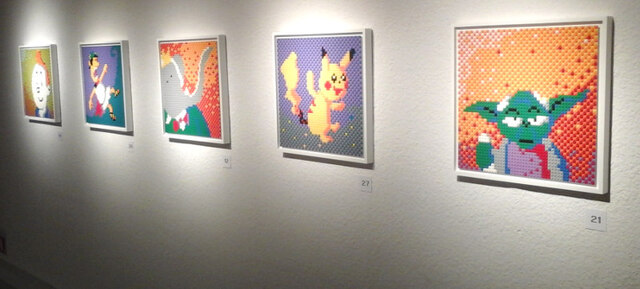](https://www.freelug.org/IMG/jpg/PixelArt1.jpg)

[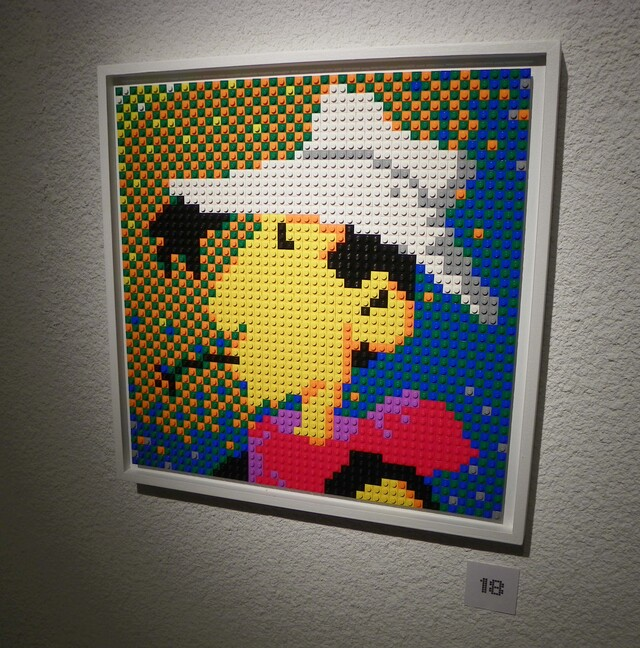](https://www.freelug.org/IMG/jpg/100_4853.jpg)

[L’animation mosaïque](https://www.freelug.org/spip.php?article2235) avait pleinement sa place dans cette exposition dédiée au Pixel Art. Elle a été particulièrement appréciée des familles nombreuses venues lors de ce week-end nuageux et venteux.

[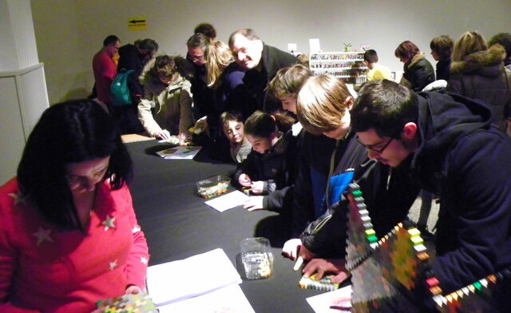](https://www.freelug.org/IMG/jpg/MosaiqueVichy050217-2.jpg)

[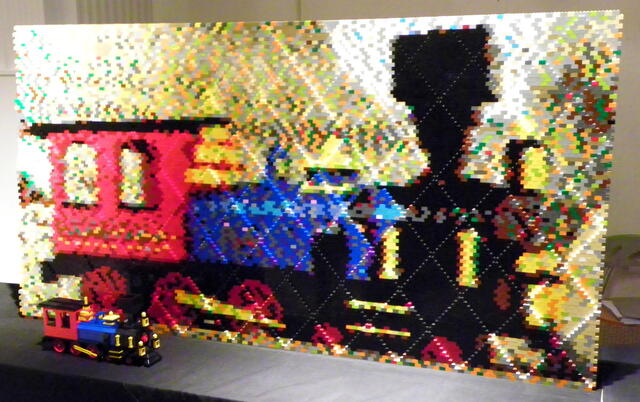](https://www.freelug.org/IMG/jpg/MosaiqueVichy050217.jpg)

Nos amis de [LittleBricks](http://www.bricklink.com/store/home.page?p=dorsetdude) étaient présents avec leur magasin mais aussi avec quelques créations originales dont ces mosaïques de type ["Walker"](https://www.freelug.org/spip.php?article1505), là encore parfaitement dans le thème "Pixel Art".

[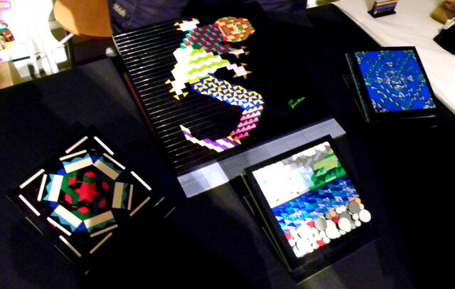](https://www.freelug.org/IMG/jpg/MosaiqueJenny.jpg)

Le désormais célèbre [Mathieu](http://www.brothers-brick.com/2016/12/06/french-artist-mat-green-is-back-with-more-giant-metal-minifigure-sculptures-and-theyre-jaw-dropping/) était présent avec ses figurines géantes en métal

[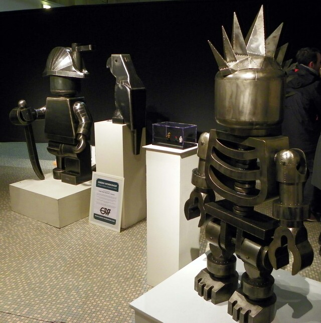](https://www.freelug.org/IMG/jpg/100_4837.jpg)

Les créations de Frédéric Lebreton dans l’univers de la science-fiction des années 70-80 ont été appréciées des nostalgiques.

[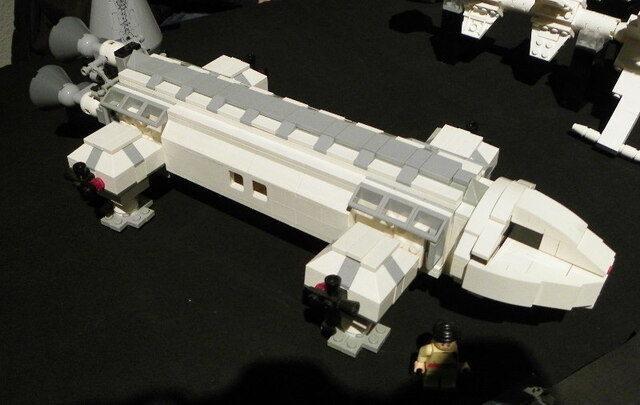](https://www.freelug.org/IMG/jpg/EagleCosmos99.jpg)

[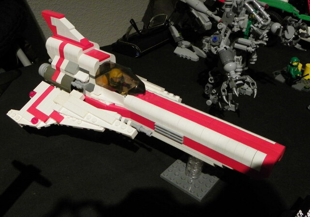](https://www.freelug.org/IMG/jpg/ViperGalactica.jpg)

D’autres exposants étaient aussi là que vous pourrez découvrir dans l’article que le journal "La Montagne" a consacré dans son édition du dimanche 05 février 2017 à cet événement.

[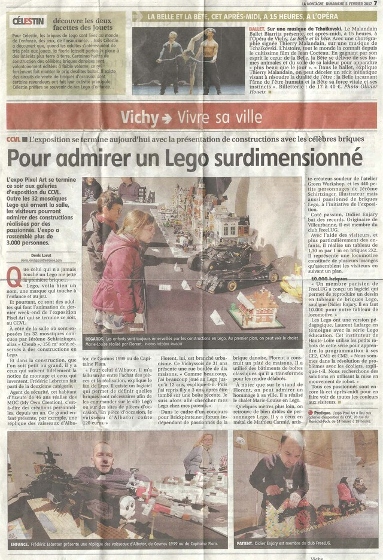](https://www.freelug.org/IMG/jpg/LaMontagneExpoPixelArt.jpg)

On notera aussi que l’ensemble du staff du LEGO Store de Clermont-Ferrand est venu visiter l’exposition dimanche et à pris le temps de saluer les exposants présents.

* * *

L’endroit très sympathique du centre de Vichy nous a accueilli pour quelques heures. J’ai vraiment apprécié de pouvoir revoir un peu des fans anciens et nouveaux. Nous avons beaucoup échangé sur ce que nous savons faire.

Dans la petite salle dédiée aux AFOLs énormément de variété présente autour de nos chères "petites" briques. Ca allait des gros et lourds personnages en tôles, aux anciennes boites présentées par Cheub, en passant par des MODs SF et micro scale city.

Le magasin "Little bricks" permettait de chiner quelques nouveautés.

Enfin tout pour passer un moment agréable en famille.

Merci à tous pour votre accueil et à Cheub pour l’organisation heureuse de cette exposition particulière.

[Voir mes quelques photos dans ma galerie.](http://photos.freelug.org/main.php/v/JAC/Exposition/2017/Mosaiques/)

Jac63
