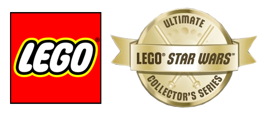
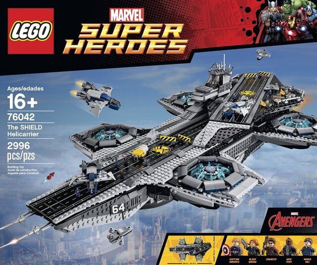
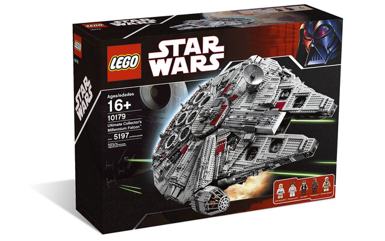
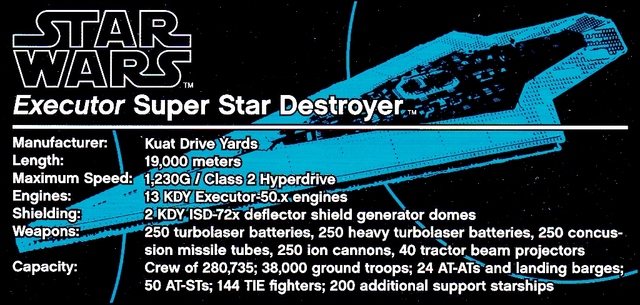
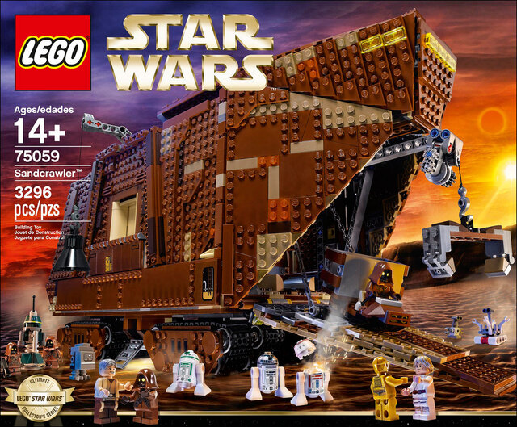

Bonjour à tous,

Aujourd’hui je fais une petite news pour vous donner la liste officielle des _UCS_ (_Ultimate Collector Series_). Cette liste nous a été communiquée directement par le SAV _LEGO_.

> The Ultimate Collector’s Series, or UCS, is a subtheme of sets. UCS sets are meant to be more detailed and aimed at older builders. These sets do not generally include Minifigures, but since 2007, most have included at least one. Most are also not designed to scale with Minifigures, though there are some cases (such as 75060 Slave 1) where the set is completely to scale. Ultimate Collector’s Series sets tend to be larger, and more expensive than typical sets..  
> (source lego.wikia.com)

* * *

Même si les _UCS_ sont principalement des sets issus de la gamme _Star Wars_, il existe des exceptions du côté de nos chers super-héros.

Pour rappel, certains _UCS_ n’ont pas le logo sur la boite (le 10179 par exemple).

D’autres n’ont pas de plaque de présentation.

* * *

Voici donc la fameuse liste (numéro, nom et année de sortie du set) :

**STAR WARS**

-   7181 TIE Interceptor (2000)
-   7191 X-wing Fighter (2000)
-   7194 Yoda (2000)
-   10018 Darth Maul Bust (2001)
-   10019 Rebel Blockade Runner (2001)
-   10026 Special Edition Naboo Starfighter (2002)
-   10030 Imperial Star Destroyer (2002)
-   10123 Cloud City (2003)
-   10129 Rebel Snowspeeder (2004)
-   10134 Y-Wing Attack Starfighter (2004)
-   10143 Death Star ll (2005)
-   10144 Sandcrawler (2005)
-   10174 Imperial AT-ST (2006)
-   10175 Vader’s TIE Advanced (2006)
-   10178 Motorized Walking AT-AT (2007)
-   10179 Ultimate Collector’s Millennium Falcon (2007)
-   10186 General Grievous (2008)
-   10188 Death Star (2008)
-   10195 Republic Dropship with AT-OT Walker (2009)
-   10212 UCS Imperial Shuttle
-   10215 Obi-Wan’s Jedi Starfighter (2010)
-   10221 UCS Super Star Destroyer (2011)
-   10225 R2-D2 (2012)
-   10227 B-Wing (2012)
-   10236 Ewok Village (2013)
-   10240 Red Five X-Wing Starfighter (2013)
-   75059 Sandcrawler (2014)
-   75060 Slave l (2015)
-   75095 TIE Fighter (2015)
-   75098 Assault on Hoth (2016)
-   75159 Death Star (2016)
-   75187 BB-8 (2017)
-   75192 Millennium Falcon (2017)
-   75181 Y-Wing Starfighter (2018)
-   75222 Betrayal at Cloud City (2018)

**DC COMICS**

-   7784 The Batmobile Ultimate Collectors’ Edition (2006)
-   76023 The Tumbler (2014)

**MARVEL**

-   76042 The S.H.I.E.L.D. Helicarrier (2015)
-   76105 The Hulkbuster : Ultron Edition (2018)

Tout autre set que ceux indiqués au dessus ne sont pas considérés par _LEGO_ comme des _UCS_.

