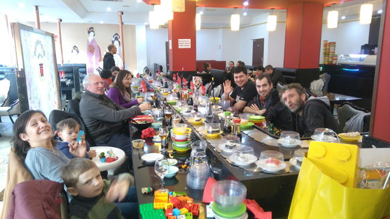

Le samedi 4 février 2017, un restoLEGO a été organisé à Clermont-Ferrand pour profiter de la présence des adhérents FreeLUG venus à l’AFOL’s day au LEGO store du centre commercial Jaude 2.

Nous avons passé un excellent moment de convivialité autour de sushis et autres plats japonais servis à volonté sur un buffet tournant.

Quelques animations ont été organisées avec la réalisation flash de MOCs sur la base de consignes de construction posées sur le champ : le MOC le plus haut sachant tenir debout tout seul avec 20 briques tirées au hasard dans un sac de vrac ; le MOC le plus large, toujours avec 20 briques.

Des boites de LEGO, issues de la dotation support de FreeLUG affectée au CoR Massif-Central, ont été offertes aux gagnants de ces concours et des sachets de vrac furent distribués à tous les participants.

Merci à tous les adhérent(e)s qui sont venu(e)s participer à cette animation enthousiasmante.
