Aujourd’hui, je vous propose la review du set 70362 dans la gamme _Nexo Knight_ : **Battle Suit Clay**.  
Ce set sorti en 2017 au prix de 9,99 € est composé de 79 pièces, soit un ratio prix/pièce de 13 centimes d’euros.

[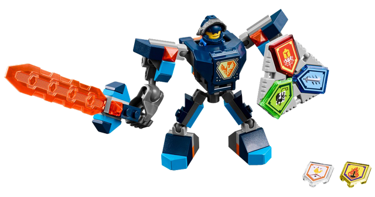](https://www.freelug.org/IMG/png/ClayExoSuit.png)

Après les _Ultimate_ en 2016, voici venir les _Battle Suit_ en 2017.

* * *

Visuel très dynamique, comme tout les sets de cette gamme.

[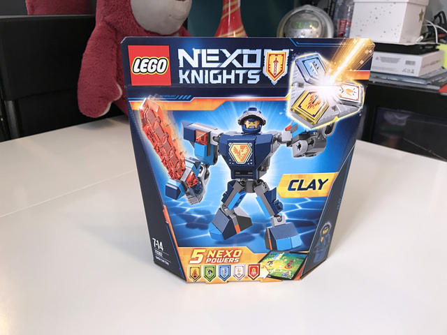](https://www.freelug.org/IMG/jpg/ClayExoSuit_01.jpg)

Comme pour les sets _Ultimate_ de l’année dernière, le dos du set permet de faire de la pub pour le jeu vidéo.

[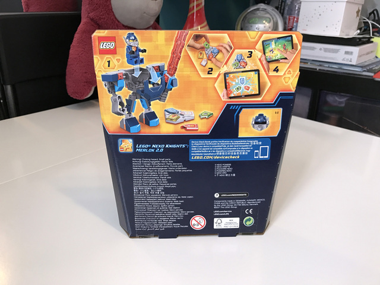](https://www.freelug.org/IMG/jpg/ClayExoSuit_02.jpg)

Le set contient deux sachets, une notice de montage et deux lames.

[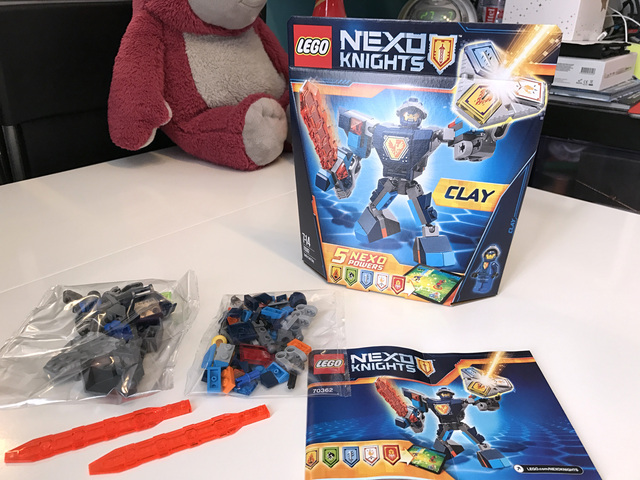](https://www.freelug.org/IMG/jpg/ClayExoSuit_03.jpg)

* * *

Belle réalisation pour ce _Clay_. Ici point de sur-armure ni de sérigraphie sur le bas des jambes puisque elles seront cachées.

[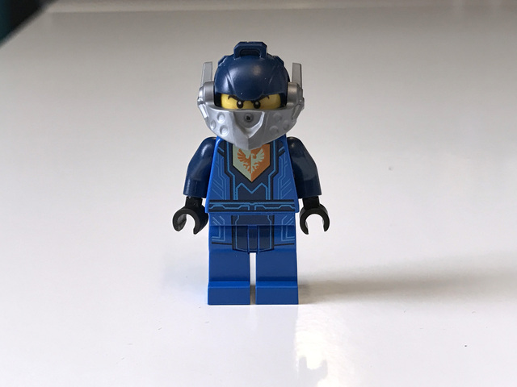](https://www.freelug.org/IMG/jpg/ClayExoSuit_04.jpg)

Les sérigraphie sont vraiment réussies, comme sur toute la gamme _Nexo Knight_. Nous avons droit à un double visage, j’aime beaucoup le rendu sur la face avant, facilement réutilisable pour des MOC ou des versions custom.

[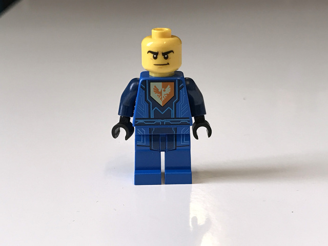](https://www.freelug.org/IMG/jpg/ClayExoSuit_05.jpg)

Au verso, encore une fois de superbes sérigraphies qui rappellent le film _Tron_. Le visage alternatif énervé est lui aussi très sympa et facilement réutilisable.

[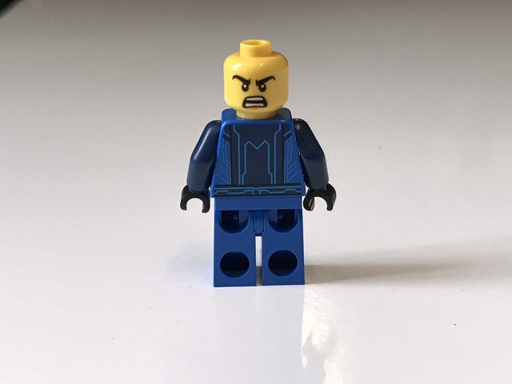](https://www.freelug.org/IMG/jpg/ClayExoSuit_06.jpg)

* * *

Voici les six pièces sérigraphiées de ce set. Le blason du _Battle Suit_ et les cinq bouclier _Nexo Power_ (vous pouvez les scanner pour le jeux vidéo si vous êtes adepte).

[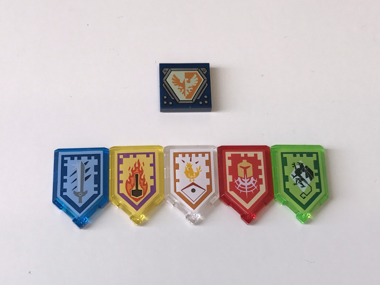](https://www.freelug.org/IMG/jpg/ClayExoSuit_07.jpg)

* * *

Le montage est plutôt simple, mais permet de se faire une première idée de la marche à suivre pour les gens qui voudrait se mettre aux _Mecha_.

[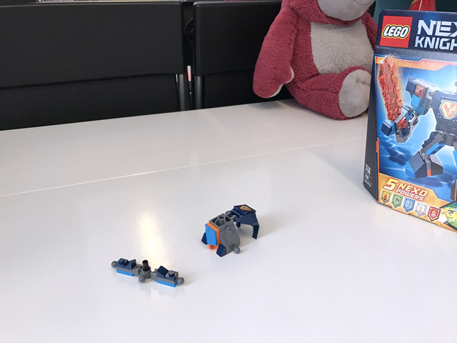](https://www.freelug.org/IMG/jpg/ClayExoSuit_08.jpg)

Le _Battle Suit_ sur pieds.

[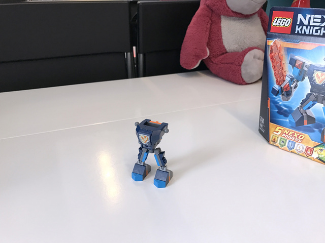](https://www.freelug.org/IMG/jpg/ClayExoSuit_09.jpg)

On s’attaque aux bras.

[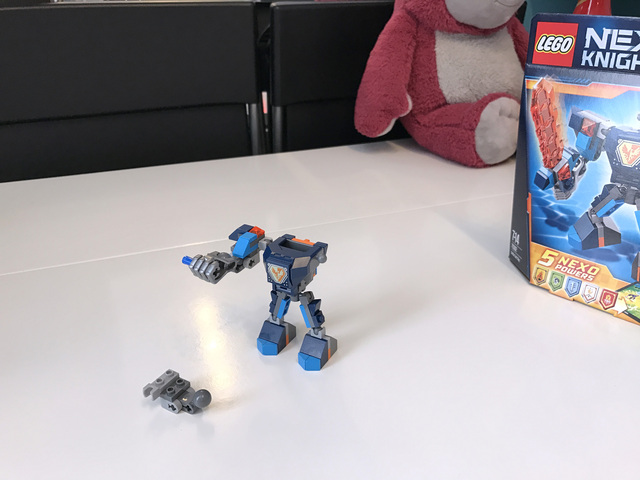](https://www.freelug.org/IMG/jpg/ClayExoSuit_10.jpg)

Réalisation encore une fois simple mais efficace.

[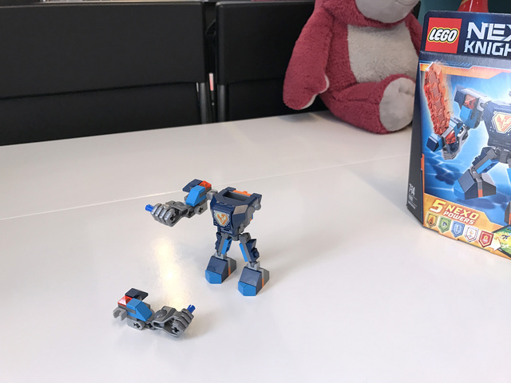](https://www.freelug.org/IMG/jpg/ClayExoSuit_11.jpg)

Montage de l’épée.

[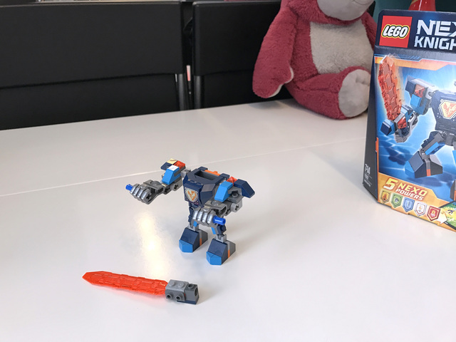](https://www.freelug.org/IMG/jpg/ClayExoSuit_12.jpg)

D’ailleurs on est plus en présence d’une Claymore vu la taille de la lame.

[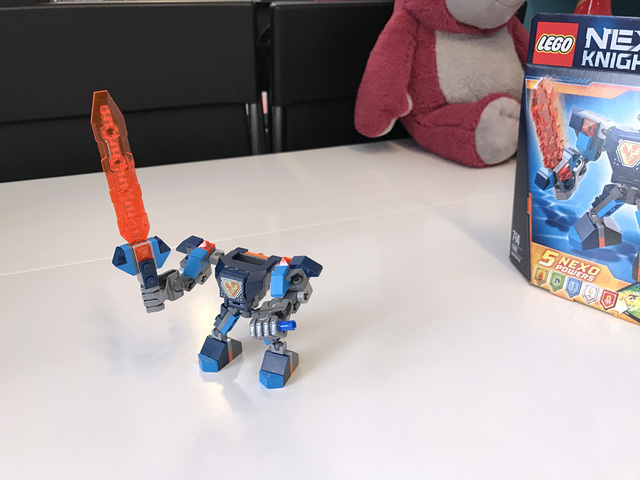](https://www.freelug.org/IMG/jpg/ClayExoSuit_13.jpg)

Le set terminé.

[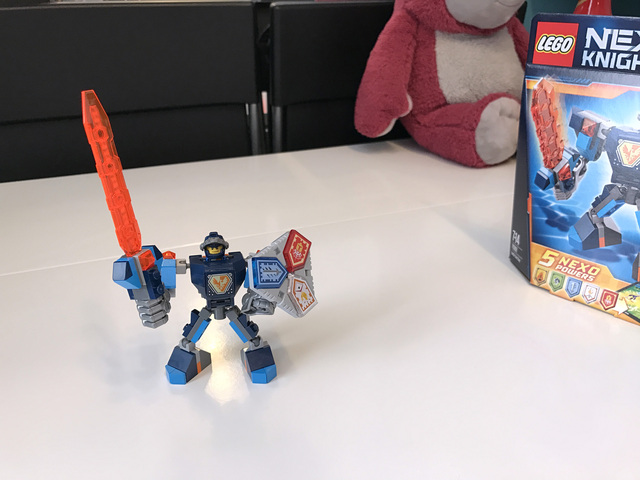](https://www.freelug.org/IMG/jpg/ClayExoSuit_14.jpg)

Le _Battle Suit_ sous différents angles.

[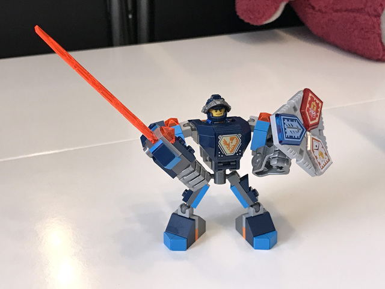](https://www.freelug.org/IMG/jpg/ClayExoSuit_15.jpg)

[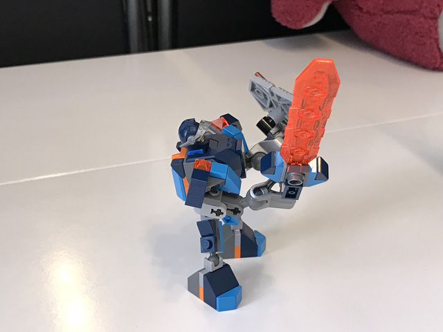](https://www.freelug.org/IMG/jpg/ClayExoSuit_16.jpg)

[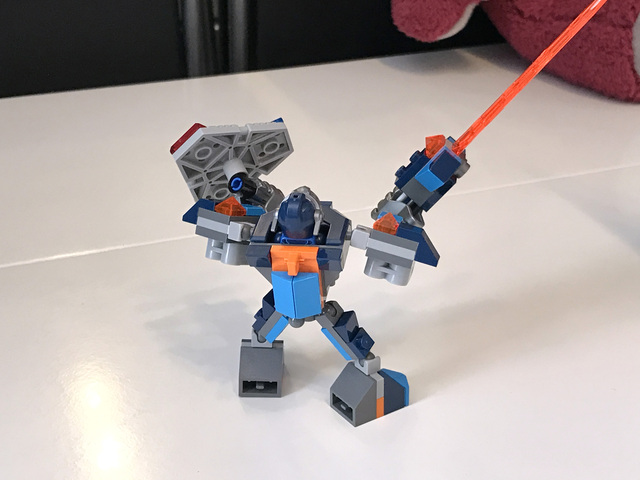](https://www.freelug.org/IMG/jpg/ClayExoSuit_17.jpg)

[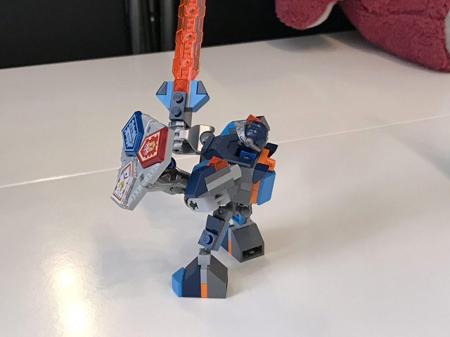](https://www.freelug.org/IMG/jpg/ClayExoSuit_18.jpg)

[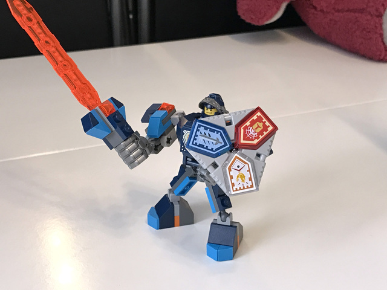](https://www.freelug.org/IMG/jpg/ClayExoSuit_19.jpg)

* * *

**CONCLUSION :**

Jolie réalisation pour ce _Battle Suit Clay_. Le rapport qualité/prix est excellent, les enfants adoreront assurément le _Battle Suit_. Cerise sur le gâteau la figurine est dans le haut du panier niveau réalisation et _LEGO_ nous offre une deuxième lame géante dans le set, ce qui est toujours bienvenus pour les MOCeurs.

**BONUS :**

Voici un GIF animé réalisé avec la totalité des photos prises pour cette review (cliquez sur l’image pour lancer l’animation).

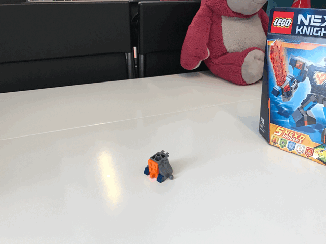
