Le sujet de cette présentation m’a été soufflé par des membres qui ressentaient le besoin de construire des arbres pour leurs dioramas.

A vrai dire, quand on observe les créations des fans (et des designers LEGO) on observe qu’il existe mille-et-une façons de construire des arbres, et il n’est pas question ici d’en faire une étude exhaustive.

Nous n’allons pas non plus présenter les fameuses "metapièces", ces pièces qui par leur design sont destinées à un emploi précis : souche d’arbre, sapin, feuilles diverses.

[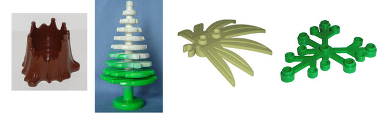](https://www.freelug.org/IMG/jpg/metapieceArbre.jpg)

Pourquoi ne pas utiliser des metapièces ? Parce qu’elles sont contraignantes. Elles imposent la destination de leur usage, elles imposent l’échelle, elles imposent la couleur ; en clair, elles restreignent la créativité...à moins de les employer différemment, de refuser ce qu’elles nous imposent [^1]. De plus elles peuvent être difficile à obtenir (en quantité) et sont souvent coûteuses.

[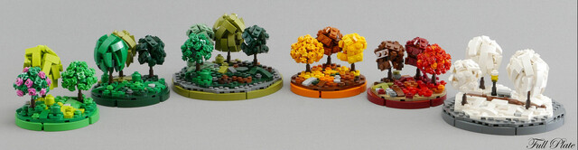](https://www.freelug.org/IMG/jpg/MicroSeasonsByFullPlate.jpg)

Ci-dessus, bel exemple par "Full Plate" des variations sur le thème des saisons et des couleurs qui n’est pas (encore) accessible avec les feuilles metapièces produites par la société LEGO.

Construire en briques LEGO - ces fameuses pièces "carré" - des objets organiques est un véritable défi. Les arbres font partie de ces objets et les constructeurs doivent faire appel à leur créativité et à leur imagination pour les reproduire : il n’y a pas deux arbres identiques.

Mais à l’étude de ce qui existe (Cf la webographie ci-dessous), on doit constater que la création d’arbres mobilise aussi de nombreuses techniques de montages avancées que vous connaissez peut-être déjà pour les avoir découvertes sur ce site.

Par souci de clarté, mais aussi parce que cela correspond à une réalité, nous scinderons cet exposé en trois (courtes) parties : le tronc, les branches et le feuillage.

## Le tronc

C’est avant tout une partie structurelle, c’est-à-dire un montage qui va supporter le poids de l’ensemble. Il est très commun d’utiliser des pièces de couleur brune pour le tronc des arbres mais il faut bien prendre en compte les possibilités de variations que ce soit vers le plus sombre - brun foncé, noir - que vers le plus clair - dark tan, tan et même le blanc très apprécié pour reproduire le bouleau.

Il est commun d’utiliser les briques (et cônes) et plaques rondes que ce soit 1x1 ou 2x2 (pensez aussi aux pièces modifiés). Quand vous empiler des briques, par exemple pour faire un mur, vous décaler les joints pour gagner en stabilité. Ce n’est pas possible avec les troncs et vous devez les renforcer d’une autre manière.

Une des techniques les plus courantes - pour ne pas dire indispensable - consiste à utiliser un axe quand c’est possible (pièces 2x2) ou une barre (pièces 1x1) qui va servir de squelette interne.

[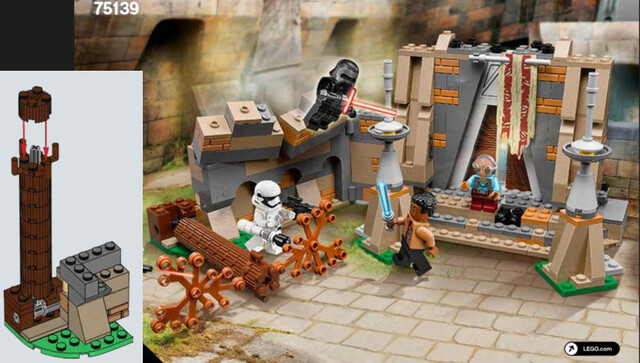](https://www.freelug.org/IMG/jpg/RenfortSquelette.jpg)

Si vous voulez faire "plus gros", il existe des pièces rondes 4x4 mais si gros va de pair avec "grand" vous pouvez utiliser la technique SNOT des colonnes. De formes octogonales, tenons visibles, ces colonnes sont une bonne approximation d’un tronc. Elle a le gros avantage de permettre de créer toute une variété de diamètres. Elle se base sur la brique 1x1 avec des tenons sur les côtés et comme un dessin vaut toujours mieux qu’un long discours :

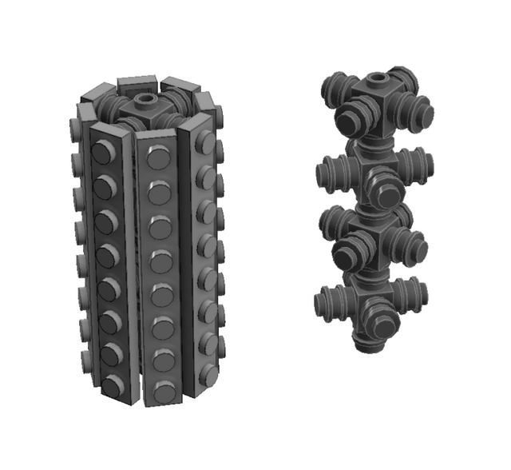

[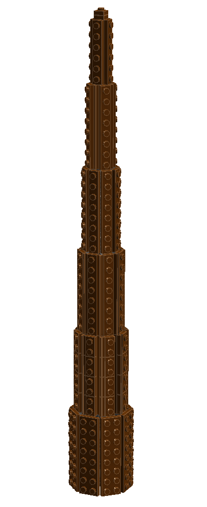](https://www.freelug.org/IMG/png/columns4.png)

Vous voulez faire plus gros encore ? Le technicien laisse la place à l’artiste, au sculpteur. Armez-vous de vos briques pentues (slopes, wedges et curved) et à l’image de la croissance naturelle et anarchique d’un chêne pluri-centenaire, faites croître votre tronc en empilant les pièces hautes et en alternant avec des pièces longues montées en SNOT sur une structure centrale à l’image du fabuleux village Ewok.

[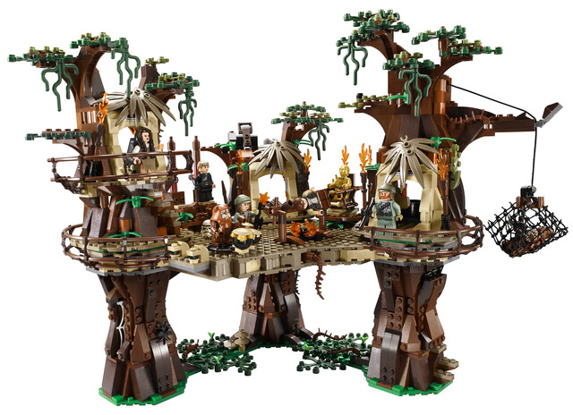](https://www.freelug.org/IMG/jpg/LEGO-Star-Wars-10236-Ewok-Village-002.jpg)

## Les branches et arbustes

Comme le tronc, les branches sont structurelles, tout en étant moins présentes. Elles apportent la forme et la silhouette générale de l’arbre. Elles sont aussi courbes et souples

Une pièce plébiscitée pour cet usage est l’arche 1x5x4. Abondamment employée par la société LEGO, elle apparait en brun, éventuellement foncé, dans une quarantaine de set à cet effet.

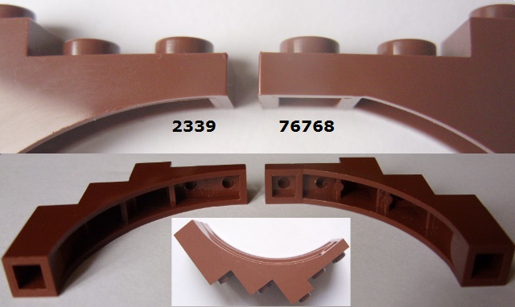

Pour éviter le stéréotype et créer des structures fines et courbes, il est nécessaire de se rabattre sur d’autres solutions plus créatives.

Nous l’avons vu plus haut, il est possible de glisser un axe ou une barre dans les briques rondes 1x1 pour les renforcer. Mais une technique, que j’appelle le "tubing" et dont je vous avais déjà parlé à la fin de [cet article](/articles/2019/), fait usage des tuyaux, plus ou moins rigides, Technic ou pneumatique. Ici un exemple de palmier par Nivremis faisant usage de cônes montés à l’envers pour le stipe. Notez aussi l’usage du buisson, à l’envers, représentant les anciennes feuilles fanées.

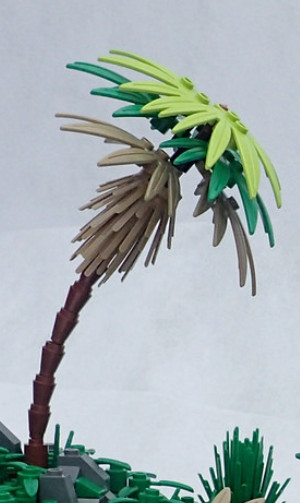

Un autre exemple pour ces bambous par Renaud "Daftren"

[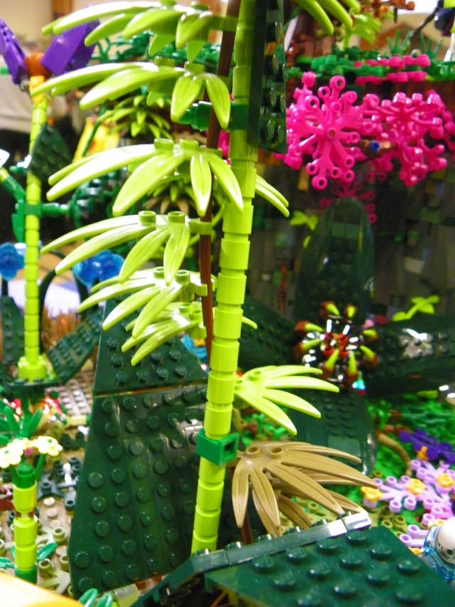](https://www.freelug.org/IMG/jpg/ArbreTubing-Bambou.jpg)

Toujours avec ces fameux tuyaux, il est possible de varier la taille et la rigidité de l’ensemble en les tressant. On se passe alors de les habiller et on les utilise nus. Ici un exemple simple mais efficace par Tirrell Brown

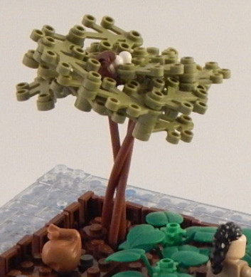

Enfin, une technique "officielle" qui mérite d’être citée est celle employant des connecteurs Technic. Elle est particulièrement stable.

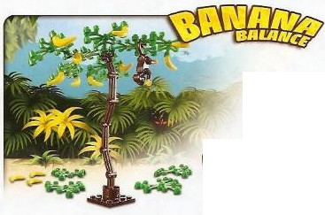

Ici, encore par Renaud "Daftren", la technique est employée de façon intensive pour cet arbre extra-terrestre

[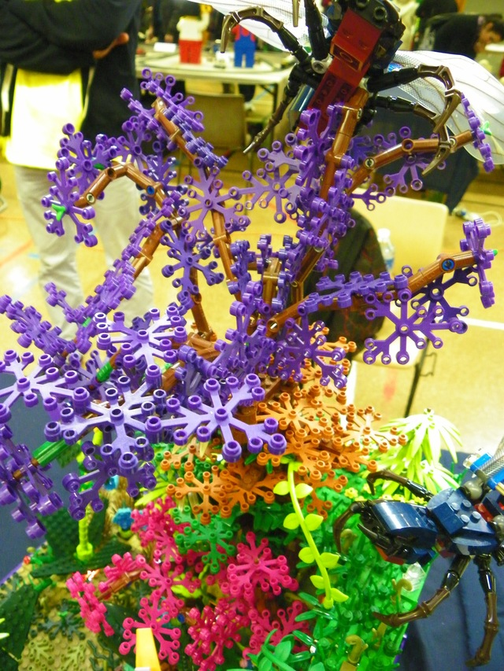](https://www.freelug.org/IMG/jpg/ArbreConnecteur-ExtraTerrestre.jpg)

## Le feuillage

Pour le feuillage, nous allons utiliser des éléments aussi simples que les plaques. On peut diviser l’usage des plaques pour représenter le feuillage en deux catégories :

En empilant de façon aléatoirement ordonnée des plaques rondes, on obtient des volumes reproduisant assez bien le côté organique tout en pouvant obtenir une grande variété de formes.

[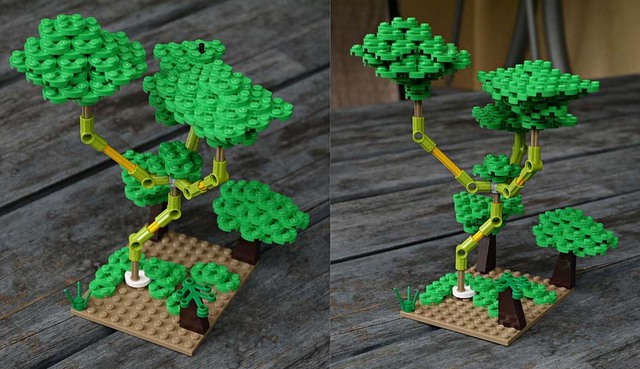](https://www.freelug.org/IMG/jpg/ArbresBySteffenRau.jpg)

Cette technique n’est pas l’apanage des feuillages mais est aussi utilisée, par exemple, pour reproduire les nuages (d’eau ou de fumée), des monticules (de neige ou de sable)...

Les techniques de SNIR peuvent aussi nous aider. Plutôt qu’utiliser des plaques rondes, on utilise une série de plaques classiques qui vont être empilées les unes sur les autres, avec un léger espacement, mais surtout avec un décalage dans leur orientation.

On peut pour cela utiliser les diagonales opposées, et cela convient particulièrement aux sapins

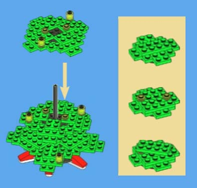

ou alors employer des connexions par tenon unique, libre en rotation, pour créer des couronnes de diamètres variés. Le résultat est plus fragile.

[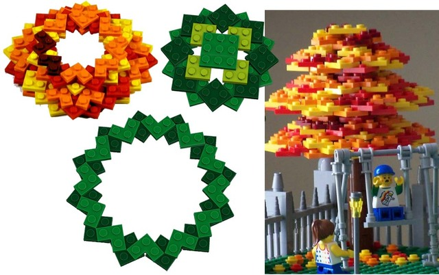](https://www.freelug.org/IMG/jpg/PlaqueBuilt3.jpg)

Bien que cela puisse paraître moins technique, vous pouvez aussi utiliser des briques, normales ou modifiées comme les pentues (slopes) et les courbes (curved). La technique est employée aussi bien officiellement (les sapins de noël LEGO faits de briques pentues vertes sont maintenant un classique - on ne parlera pas des Minecraft qui sont volontairement pixellisé) que par les KFOL et AFOL.

[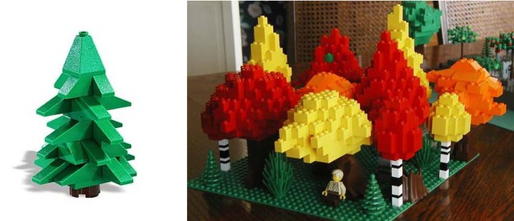](https://www.freelug.org/IMG/jpg/BrickBuiltTreesByLEGOetSava.jpg)

Pour conclure, nous allons nous permettre d’utiliser des métapièces, mais avec un peu d’originalité

**Intrication**

La technique d’intrication, en évitant d’utiliser les éléments de connexions, permet de casser la régularité et de gagner un aspect organique. L’exemple suivant par Katie Walker est à la fois simple et élégant.

[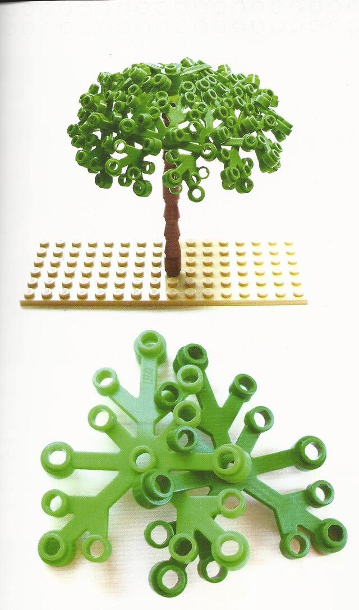](https://www.freelug.org/IMG/jpg/IntricationByKatieWalker.jpg)

**Maillage**

La technique du maillage consiste au contraire à utiliser au maximum les points de connexions, permettant ainsi de construire un réseau bidimensionnel (ou pourquoi pas tridimensionnel).

Un exemple connu est celui des stems (support de fleurs) combinés avec les fleurs neuves (deux pièces disponibles au pick a brick ou sur Bricklink en très grande quantité). Les fleurs - neuves - sont assemblées par 4. On peut donc combiner ces éléments pour créer des tapis de fleurs de toutes formes.

[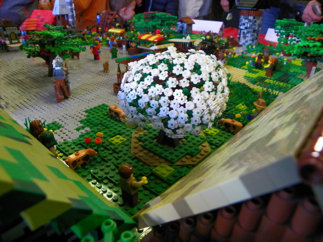](https://www.freelug.org/IMG/jpg/MatriceCanopeeWithSprue.jpg)

**Foisonnement**

La dernière technique consiste à prendre une pièce de petite taille, aux formes courbes, et à les faire foisonner en multipliant les connections (par exemple avec la brique 1x1 avec 4 tenons). Le plus bel exemple sans doute est celui de MarcoVanBesten qui utilise une pièce "Bionicle Spine" en quantité gargantuesque pour créer ses sapins.

[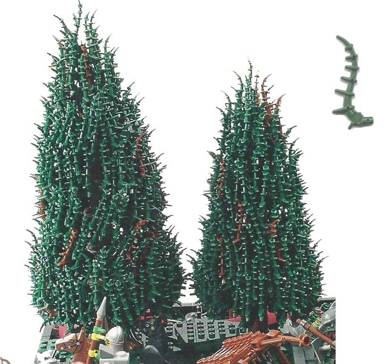](https://www.freelug.org/IMG/jpg/BioncileSpineTreeByMarcoVanBesten.jpg)

**Biblio-Webo-graphie**

**–** La [section "arbre"](http://mocrecipes.com/category/techniques/tree/) de [Mocrecipes](http://mocrecipes.com/)  
**–** Le malheureusement trop [ancien tuto](http://www.classic-castle.com/howto/articles/Foliage.html) de l’excellent [Classic Castle](http://classic-castle.com/)  
**–** Le groupe Flickr ["Arboretum"](https://www.flickr.com/groups/lego_arboretum/) fourmille de bonnes idées (et d’autres moins bonnes)  
**–** **Blocks**, Issue5, _A matter of Technique : Building Trees_  
**–** **L’art du design LEGO**, Jordan Schwartz, p153

[^1]: On retrouve alors ici la notion de Nice Part Usage
