Le magasin PicWic situé dans la Zone d’Activité Commerciale de la Croix Blanche à Sainte-Geneviève des Bois dans l’Essonne (91) a donc accueilli FreeLUG pour deux semaines d’exposition. De concert, avec Sébastien, le responsable du rayon LEGO, nous avons décidé d’exposer sur une surface de 3,60x1,60m une réalisation sur le thème de Harry Potter et du médiéval.

## **Résumé de l’animation**

Partager notre passion et faire découvrir au plus grand nombre notre association et ses principales activités est toujours une opportunité à saisir.

Quand, en plus, cela permet de développer notre [partenariat avec les revendeurs](/articles/182/) et de jeter les bases d’une collaboration constructive, il n’y a aucune raison de se priver.

Cette animation, qui s’est tenue du 29 Mai au 1 Juin 2004 est donc notre première action engagée directement auprès d’un revendeur partenaire, en l’occurrence, le magasin [PicWic de Sainte-Geneviève des Bois](/articles/281/).

Après quelques balbutiements pour mettre en place la logistique et la réalisation au pied levée par Gilles d’un barrièrage, ce n’est pas sans une certaine appréhension que nous avons laissé, à disposition du magasin, cette présentation mettant en valeur la gamme Harry Potter, agrémentée de quelques MOC réalisés pour l’occasion.

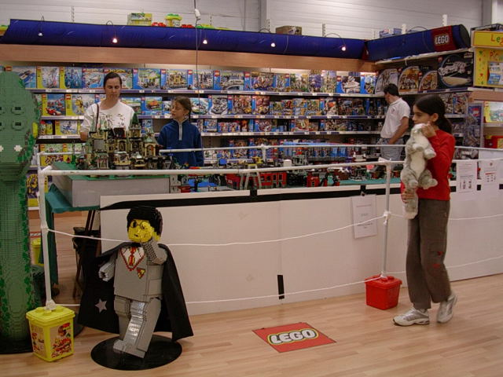

**Vue générale**

J’avais suggéré ce thème afin de coller à l’actualité cinématographique et à la sortie des nouveaux sets Harry Potter. Cela permettait également de faire un lien avec les sculptures LEGO® déjà présentes dans le magasin.

Nous avions décidé avec Fabien et Gilles de préparer le Lay-out suivant :

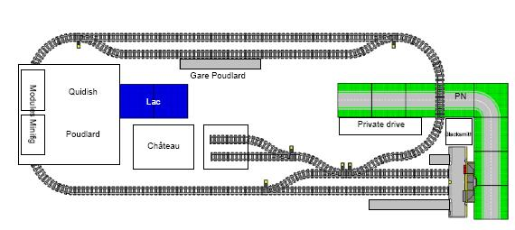

**LayOut initial PicWic**

Un circuit simple de train, pour faire tourner le "Poudlard Express", comportant une gare en configuration terminus et une autre gare avec voie d’évitement.

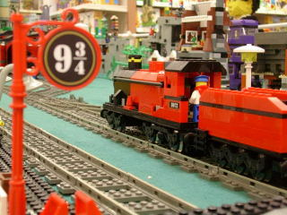

**Gare principale**

Un bloc tunnel, réalisé en styrodur (polystyrène destiné à l’isolation) sur lequel était installé le château de Poudlard et le terrain de Quiddish et une zone centrale où se trouvait la résidence d’Harry Potter et la partie médiévale. Le tout était agrémenté de quelques véhicules de style anglais.

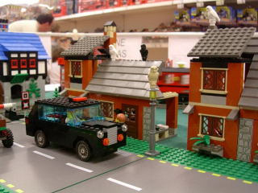

**Taxi Anglais**

**–** Fabien (gunter) nous a confié sa maison de l’allée des Troènes avec une petite amélioration au niveau du toit.

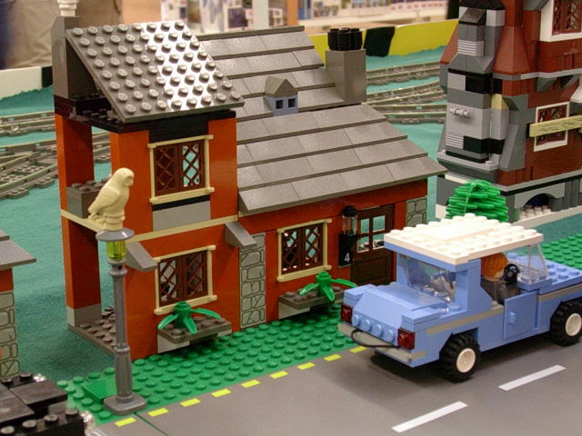

**Maison Fabien**

**–** Gilles a ajouté un barbecue (sa signature personnelle...) sur la maison Velux et a apporté un petit set médiéval historique.

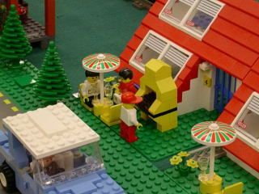

**Gmi\_barbecue**

**–** Denis m’a confié une partie de son stock de BURP et LURP (voir le [glossaire de dicky](/articles/128/)), ainsi qu’un petit château acheté en brocante le dimanche matin.

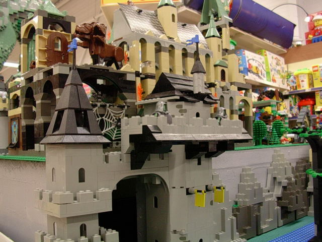

**Chateau de Poudlard**

**–** Et pour bien faire le lien entre l’univers médiéval et les films d’Harry Potter, Raphaël avait une astuce toute trouvée. Silence on tourne !

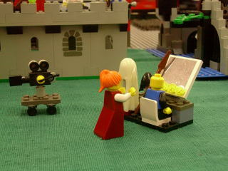

**Contribution Raphaël**

Le week-end des 5 et 6 Juin, nous avons également organisé un petit atelier de construction pour permettre à nos jeunes visiteurs de mettre la main à la pâte et de nous accompagner dans nos délires créatifs.

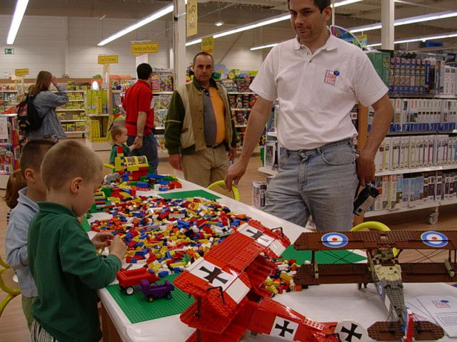

**Atelier construction**

Histoire de faire un petit clin d’œil à nos pionniers Rhônes-Alpiens, qui avaient participé à l’exposition du centre commercial à la Part Dieu, j’ai réalisé bien plus modestement cette petite girafe.

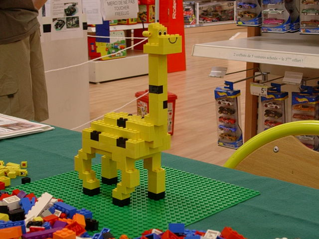

**Girafe**

## **Bilan**

Dès le premier jour notre animation a connu un franc succès tant auprès des clients que vis à vis du personnel du magasin. Comme lors des différentes expositions, le fait d’avoir des éléments mobiles comme le train, attire l’oeil et les visiteurs de tous ages se sont vite massés autour de nos barrières.

Passé la surprise de voir l’étendue de ce que l’on pouvait faire en briques LEGO®, les questions fusaient...  
**–** Combien a-t’il fallu de temps pour monter tout ça ?  
**–** Je ne savais pas que LEGO faisait du train, où peut-on trouver certains modèles ?  
**–** Il doit y en avoir pour des sous, là, sur la table ?  
**–** Est-ce vous aussi qui faîtes les sculptures ?  
**–** Combien de briques y a t’il dans le serpent ?  
**–** Excusez-moi Monsieur, où peut-on trouver les cartes Pokémon...

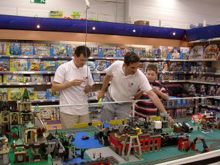

**Denis, Gilles et Raphaël**

Et de là partaient différentes discussions pour préciser que nous étions les représentants d’une association d’amateurs, qui n’a rien à voir ni avec le magasin (pour les cartes Pokémon, voyez un vendeur), ni avec la société LEGO (désolé, les sculptures c’est pas nous) et que si les gens voulaient avoir plus de précisions sur l’univers des LEGO® et nos principales réalisations, ils pouvaient venir consulter notre site dont les références sont sur la [petite plaquette](http://photos.freelug.org/category.php?cat=7&expand=6,7)...

Pour certains la discussion se poursuivait par des commentaires sur les grands enfants dont on a gardé tous les vieux sets (si vous voulez vous en débarrasser, [prenez une plaquette](http://photos.freelug.org/category.php?cat=7&expand=6,7)...), sur les Papa collectionneurs (si vous voulez vous joindre à nous, je suis moi-même plus très jeune...), sur nos activités (rendez-vous au mois de Novembre au Musée de l’air...) et sur les pièces qui manquent et que l’on cherche à récupérer (allez faire un tour sur [Bricklink](http://www.bricklink.com/)).

Notre principale préoccupation pour cette exposition était de laisser pendant deux semaines nos petites briques sous la responsabilité de notre partenaire. Ce n’était pas un manque de confiance de notre part, mais nous savons que même les modèles collés, réalisés par la LEGO, finissent par être détériorés.

C’est donc avec une certaine angoisse que nous avons laissé nos LEGO chaque dimanche soir, avant de les retrouver le samedi suivant, avec quelque fois des petites surprises, mais sans gros dégâts ou perte. Le directeur du magasin nous a d’ailleurs précisé que visiblement les visiteurs du magasin avaient bien respecté notre exposition, la signalétique réalisée par Gilles précisant que ces LEGO appartenaient à des particuliers y a sans doute contribué.

Précisons quand même que les résultats de vente sur les LEGO, n’ont pas été impactés de façon significative durant notre présence et que cela n’était ni le but de PicWic, ni le notre. Nous avons cependant pu répondre à la politique générale du magasin, qui est de montrer les produits et à notre objectif principal qui était de faire connaître l’association.

## **Présentations de nos activités**

Cette animation nous a également permis de faire découvrir quelques-unes de nos réalisations.

Je remercie Marc, Didier, Erik et Loys pour leur contribution et j’invite tous les FreeLUGien(ne)s qui montent des expositions à récupérer les plaquettes ci-dessous pour mettre en valeur le savoir-faire de nos membres.

**–** Dauphin de Marc.

**Présentation Dauphin**

  
**–** Création de Notices par Dicky.

**Présentation Notices**

  
**–** Cde Tonquédec par Erik.

**Présentation Tonquédec**

  
**–** Modules Minifig par Loys.

**Présentation Module Minifig**

Je remercie également le personel du magasin PicWic pour leur accueil. Prochaine expo, début Novembre sur le thème Star Wars avec un atelier Mindstorm ?
