## Description et liens techniques

**–** [LUGNET](http://guide.lugnet.com/set/4504)  
**–** Inventaire [bricklink](http://www.bricklink.com/catalogItemInv.asp?S=4504-1)  
**–** [Shop@Home](http://shop.lego.com/product.asp?p=4504)  
**–** Prix : 149,99 €  
**–** Nombre de pièces : 985  
**–** Prix par piece : 0,15 €

## Découverte

**La boite** :

La première chose qu’on découvre en achetant ce set est la boite (évidemment :-)).

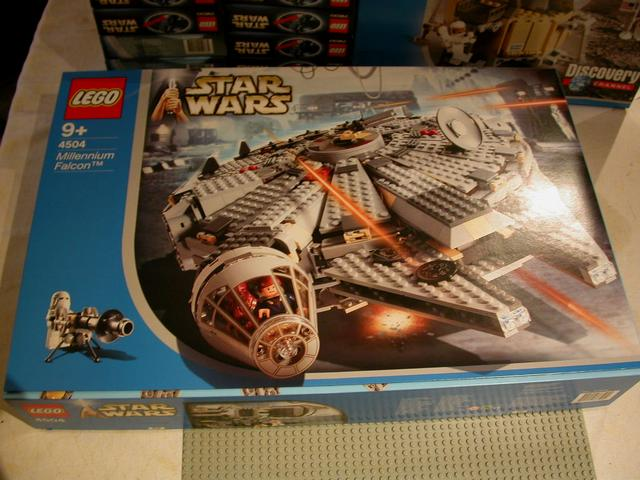

**La boite fermée**

Et celle-ci nous réserve une bonne surprise : elle a un rabat qui permet d’être tenu encore plus en haleine avec des photos de l’interieur du Faucon Millenium, ainsi que des photos de l’enigmatique set 10131 (lire [ceci](http://eurobricks.hosting.ipsyn.com/forum/index.php?act=ST&f=2&t=107&s=62ec9836bd6c4227a20289f2d3296fc1) et [cela](http://eurobricks.hosting.ipsyn.com/forum/index.php?act=ST&f=2&t=133&s=2c8777042b89cb820ae733e8564243b0) à ce propos).

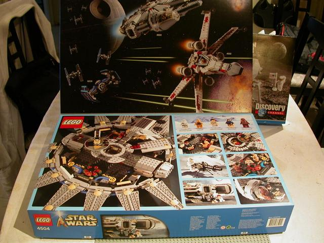

**La boite avec le rabat ouvert**

Sans plus attendre on ouvre la boite

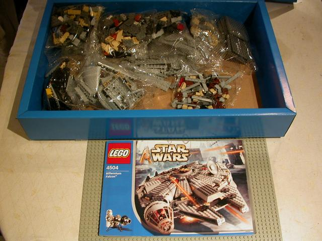

**La boite ouverte**

On peut s’apercevoir que, comme c’est souvent l’habitude chez LEGO®, la boite n’est remplie qu’a moitié. La deuxième chose dont on s’apercoit, est la présence d’un correctif sur l’étape 57. La mise en production aurait-elle été faite dans la hâte, sans avoir le temps de tout verifier ? mystère.

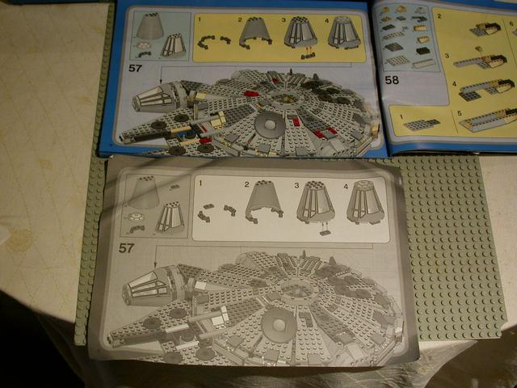

**Correction d’une erreur a l’étape 57**

Il ya aussi 3 petites plates 1x2 (dont une en plus) qui accompagne cette modification.

Après avoir fait le tour de la boite, ce qui n’est pas le plus passionnant, nous allons nous lancer dans la construction de ce set que j’ai longtemps attendu :-)

## Les minifigs

Les minfigs, et particulierement celle de Leia, ont participé, au moins autant que le Faucon Millenium lui-même, à rendre le précédent set ( le [7190](http://guide.lugnet.com/set/7190/) ) très recherché (il suffit de chercher le 7190 sur [bricklink](http://www.bricklink.com/) pour s’en rendre compte). Nous allons donc passer rapidement en revue les nouvelles minifigs de ce Faucon Millenium.

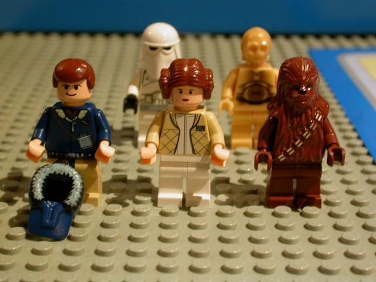

**Les minifigs**

La première chose qui saute aux yeux, et fait bondir les puristes, est que les minifigs de Leia et Han ont leurs mains et visage et couleurs chair (rose pale). Si personnellement cette couleur ne me choque pas plus que cela, une fois la minifig au milieu d’un diorama avec des minifigs jaunes, je vois la chose differemment.

Un petit détail, qui dénote un peu du manque de rigueur pour la notice, est que Han n’a pas la même couleur de veste sur la notice que celle qui est présente sur la minifig. Rien de grave, mais cela fait quand même 2 grosses erreurs sur cette notice.

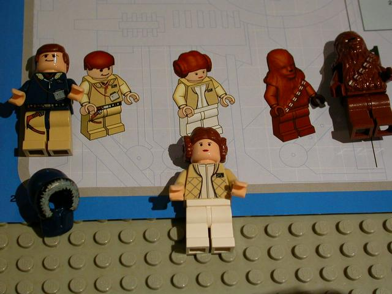

**Une autre erreur dans la notice ..**

La veste de han ne correspond pas entre la notice et la réalité

Comparons, maintenant, les minifigs avec leurs ainées du 7190 :

**Han Solo**

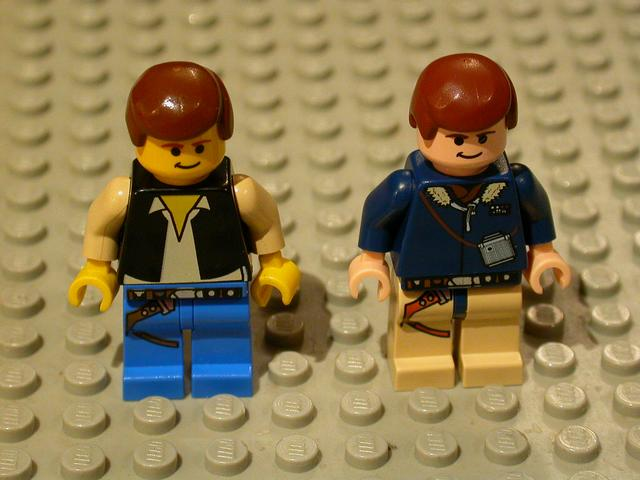

**Comparaison des Han**

Mis a part la couleur de la "peau" de la minifig, nous constatons que cette minfig de Han est en tenu de "Hoth" (avec la cagoule qui va bien en plus de la chevelure brune). Cette situation chronologique (Episode 4) du Faucon Millenium est confirmé par la présence d’un snowtrooper (à voir plus bas).

**Pincess Leia**

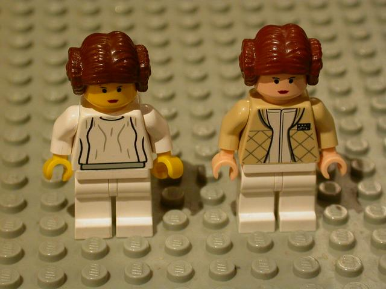

**Comparaison des Leia**

Cette princesse retrouve la même chevelure (tant recherchée) que celle du 7190. Elle est elle-même en tenue de Hoth.

**Chewbacca et C3PO**

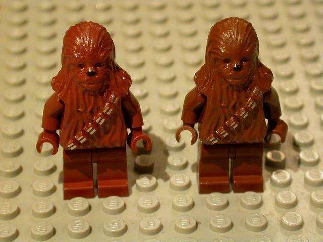

**Comparaison des Chewbacca**

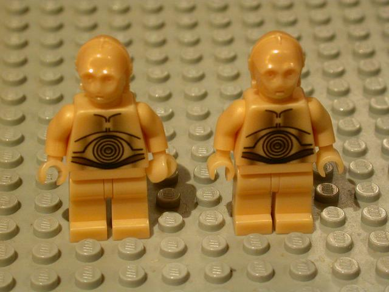

**Comparaison des c3po**

Rien de particulier à dire sur ces minifigs. Les couleurs ne sont pas rigoureusement identique, mais je ne saurai pas dire si cela vient de l’age des anciennes minifigs, ou d’un léger changement de couleur. Aux experts en la matière de juger.

**Le snowtrooper et son canon**

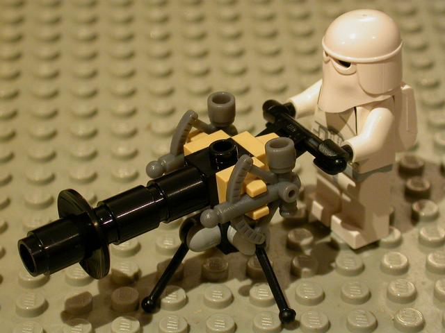

**Le snowtrooper et le web canon.**

On retrouve ici, en cinquième minifig, un snowtrooper et son "e-web canon", ce qui situe clairement l’action à la fin de la bataille de Hoth, lorsque les rebelles ont fuit la base, et que les troupes de l’empire en prennent possession. Le Faucon Millenium etant resté en retrait, il se fait attaquer par un snowtrooper et son canon. Les snowtrooper étant encore assez rare (je rêve d’une boite de minifig orientée Hoth, avec un ou 2 snowtrooper et un ou 2 hoth rebel :-)), cela fait toujours plaisir d’en trouver un dans cette boite. Le "e-web canon" est sympathique, sans être génial (où est son chargeur ?). Il existe des MOC de ce canon que je trouve plus réussi, comme [celui-ci](http://www.brickshelf.com/cgi-bin/gallery.cgi?i=705662)

## La construction

**Le Faucon Millenium**

Parmi les premières choses que j’ai constaté, il y a l’abondance de la couleur tan (ce qui est étonnant pour un vaisseau à dominante grise). J’avoue que ce genre de chose m’étonne et m’épate toujours dans les modèles LEGO : l’utilisation de couleur n’ayant a priori rien à voir avec la couleur globale du set. Dans l’ancien Faucon nous avions une abondance de bleu et de rouge, ici nous avons donc une abondance de tan.

Si l’on gagne dans ce faucon un bel hyperdrive (Han et Chewbacca en sont tout content :-)) ..

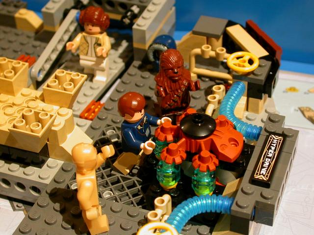

**L’hyperdrive en place et fonctionnel (enfin on espère :-) )**

on perd par contre bon nombre de cachette qui étaient présente dans le précédent Faucon. La seule qui reste se trouve dans le "nez" du faucon :

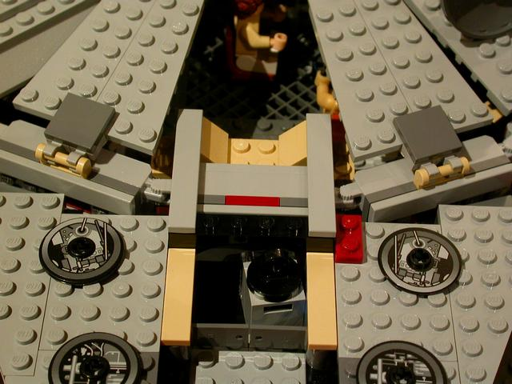

**La seule cachette qui reste.**

La structure externe du faucon est faite à base de pieces articulées entres elles (c’est ce qui donne la rondeur du vaisseau). Cette méthode, si elle donne de bon résultat en terme de "rondeur", a tendance à "aérer" le vaisseau, ce qui lui fait perdre un peu de réalisme.

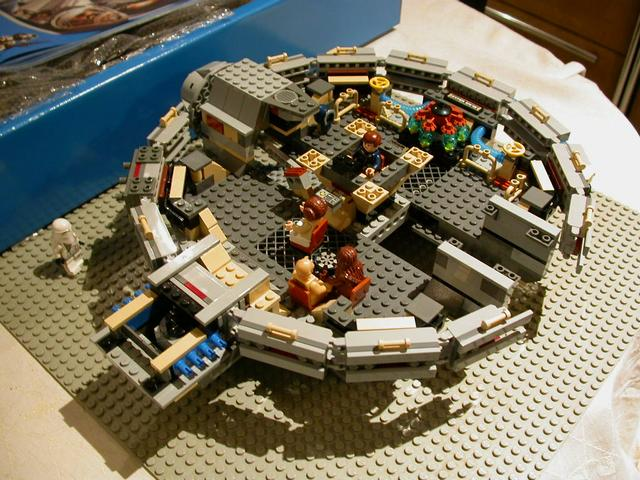

**Le contour du vaisseau (pas étanche tout cela :-) )**

Parmi les nouveautés de ce Faucon nous avons aussi un nouveau poste de tir, dans lequel une minifig peut tenir (ce qui n’était pas vraiment le cas du précédent Faucon). Nous voyons ici Han dans ce poste.

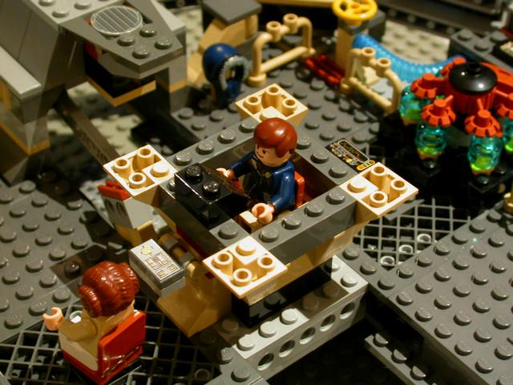

**Le poste de tir**

Le poste de pilotage a été revu aussi. Il permet de faire tenir 2 personnages (contre un seul dans le 7190). Enfin ca c’est la théorie, dans la pratique il n’est pas aisé de les faire tenir tous les deux. Il n’y a qu’une seul position dans laquelle Han et Chewbacca peuvent tenir (le pauvre Chewbacca doit garder le bras en l’air .. il risque la crampe :-)).

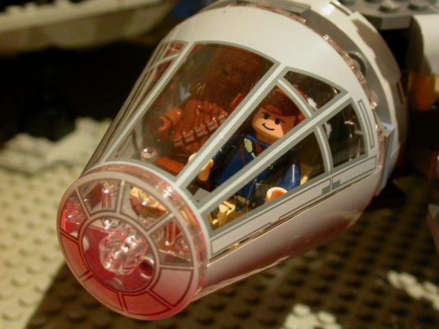

**Le poste de pilotage.**

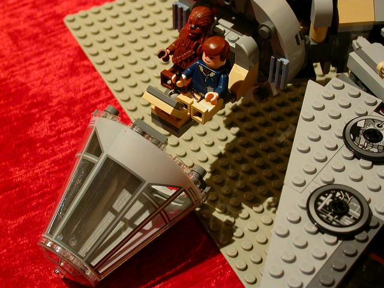

**Poste de pîlotage**

Enfin dernière nouveauté interessante de ce vaisseau : la passerelle pour descendre du faucon monte et descend en tirant sur l’écoutille externe du vaisseau. Voici les images avec la passerelle relevée et avec la passerelle abaissée :

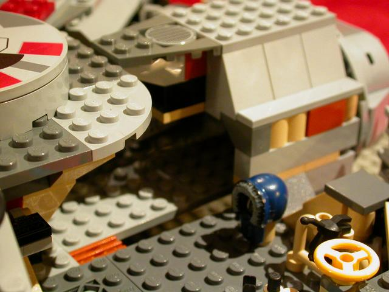

**Passerelle fermée (vue de l’intérieur)**

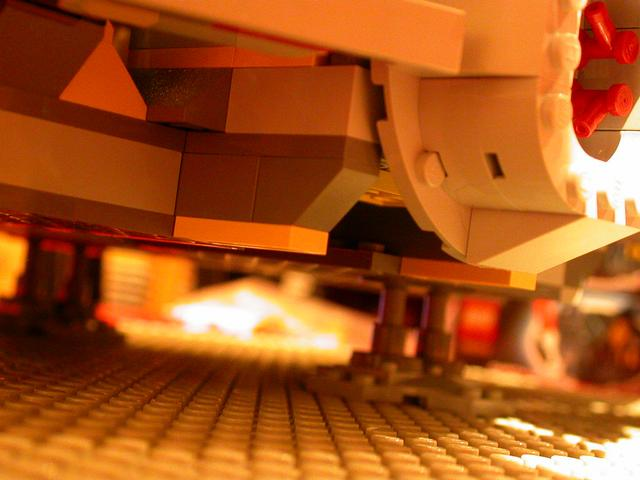

**La passerelle fermée**

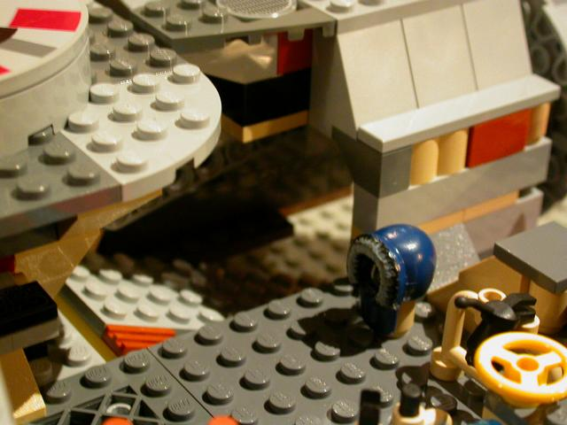

**Passerelle ouverte (vue de l’intérieur)**

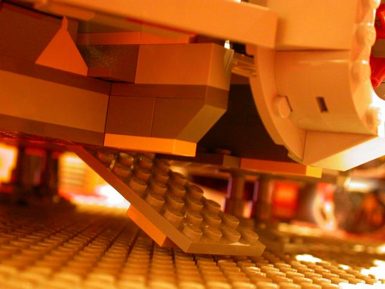

**La passerelle ouverte**

**La capsule de survie**

Han se plaignait [ici](http://www.fbtb.net/greg/swlego12.gif) de devoir retenir son souffle dans la "capsule" de survie. Ceci a été corrigé dans cette nouvelle version du Faucon Millenium, comme nous le montre cette photo comparant les 2 capsules :

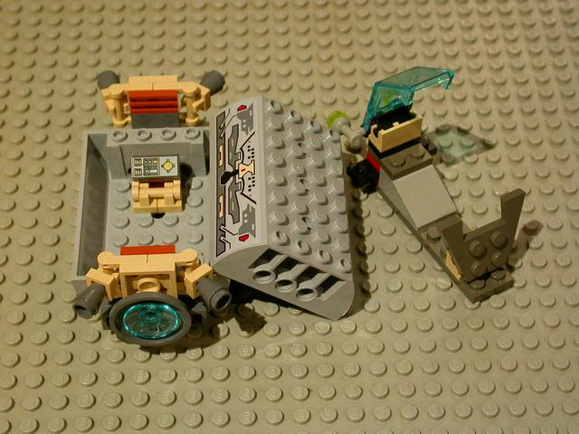

**Comparaison des capsules de secours.**

Par contre du fait de la construction de ce nouveau Faucon, c’est maintenant durant tout le trajet dans son Faucon Millenium que Han va devoir retenir son souffle :-)

## Comparaison avec l’ancien Faucon Millenium ([7190](http://guide.lugnet.com/set/7190))

Voici tout d’abord quelques photos des 2 vaisseaux l’un a coté de l’autre. Contrairement à ce que j’avais pu penser, ce nouveau faucon n’est pas plus petit que l’ancien.

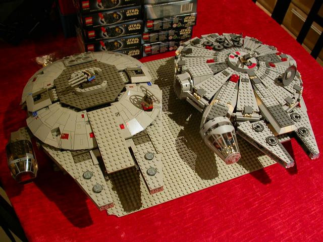

**Comparaison des Faucons**

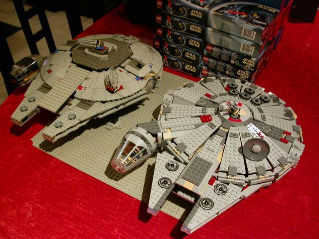

**Comparaison des Faucons (bis)**

D’allure générale, ce Faucon Millenium fait beaucoup plus réaliste que l’ancien, si l’on excepte son ouverture en "marguerite".

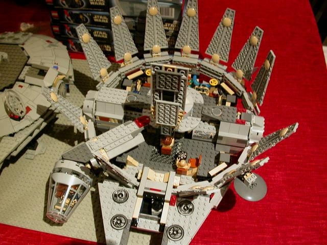

**Le Faucon "ouvert"**

Un autre inquiétude que j’avais avant mon achat était la fragilité de ce modèle. J’avais été désagréablement surpris par la fragilité du AT-AT qui le rendais assez peu jouable (des pieces tombent de partout lorsqu’on commence à le manipuler). J’avais donc de grandes inquiétudes sur ce modèle. Le résultat est mi-figue/mi-raisin ; il n’est pas aussi fragile que je le craignais (l’armature ronde externe est solide), par contre le toit en marguerite est globalement assez fragile, et je suppute qu’après quelques temps d’usure, les attaches ne seront plus aussi fermes qu’au début, rendant le toit très instable.

## Conclusion

Cette réédition du Faucon Millenium reste une bonne et agréable surprise (même si j’etais déjà l’heureux possesseur de 2 anciennes versions). Ce modèle devrait donc ravir jeunes et moins jeunes, pour peu que le prix ne les arrète pas. J’avoue que si j’ai l’occasion de pouvoir en racheter d’autres à un prix raisonnable (150 Euros n’est pas un prix raisonnable) je n’hesiterai pas :-)
