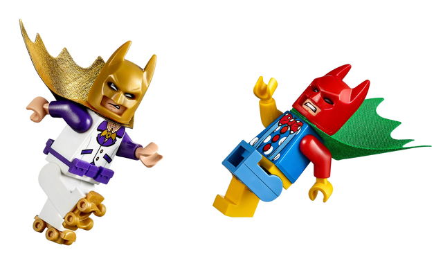
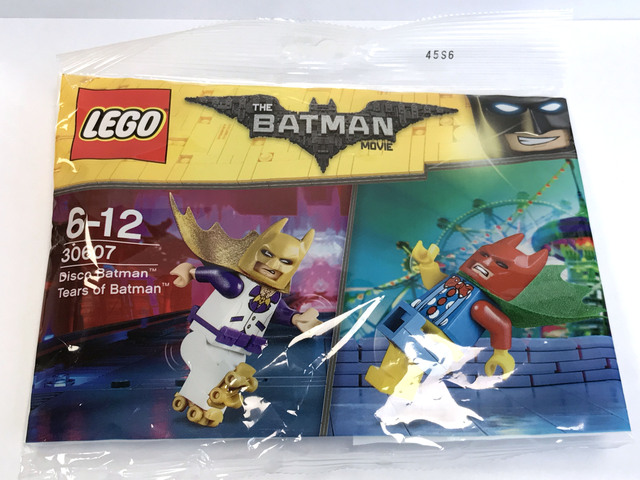
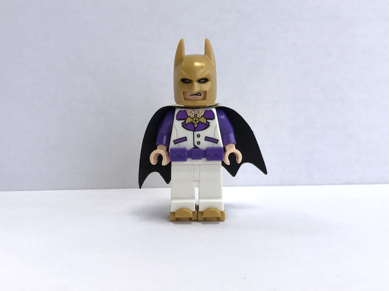
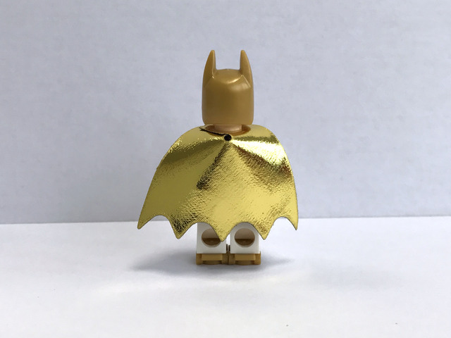
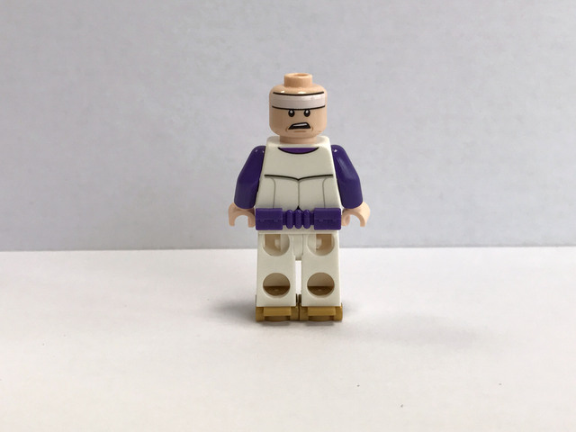
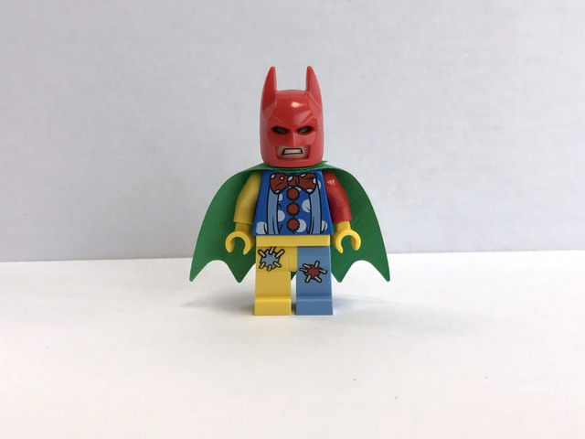
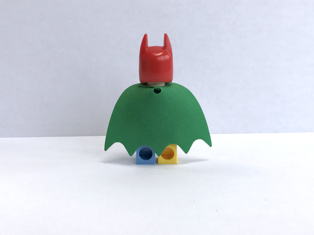
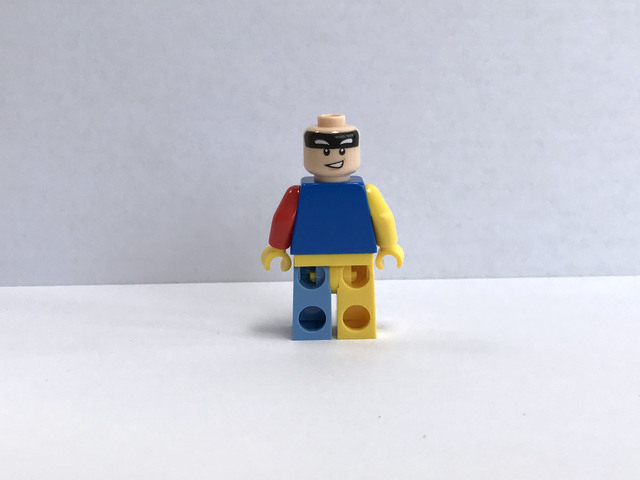
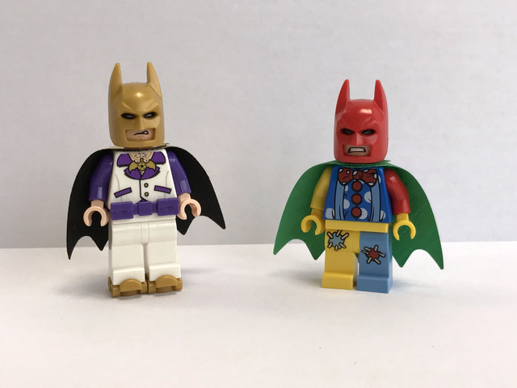

Bonjour à tous, aujourd’hui je vous propose une review du polybag 30607 dans la gamme _The LEGO Batman Movie_ : **Disco Batman - Tears Batman**.  
Ce polybag sorti en 2017 est composé de 13 pièces, il était offert pour 55 euros d’achat du 6 au 26 février 2017 en _LEGO Store_ et sur le _[Shop@Home](https://shop.lego.com/fr-FR/)_.

* * *

Sur le polybag, les figurines sont mises en situation dans des environnements qui rappellent leurs Bat-Costumes. Une piste de danse dans la Bat-Cave pour la version Disco et un arrière-plan de fête foraine pour la version clown. Le haut du polybag contient un bandeau jaune avec les logo _LEGO_ et _The Batman Movie_.

* * *

_[Roller Disco Batman](http://brickset.com/minifigs/sh376/roller-disco-batman-\(30607\))_, figurine exclusive, dans son costume disco blanc et violet n’a rien à envier à celui de _John Travolta_ dans _[La fièvre du samedi soir](https://fr.wikipedia.org/wiki/La_Fi%C3%A8vre_du_samedi_soir)_. Les sérigraphies sont réussies (mention spéciale aux poils sur le torse) et les patins complètent parfaitement cette tenue disco. Le masque _Pearl Gold_ et la cape dorée sont tout simplement superbes.

De dos, on reste un peu sur sa faim. Le visage alternatif apeuré a une belle expression.

_[Tears of Batman Clown](http://brickset.com/minifigs/sh377/tears-of-batman-clown-\(30607\))_ est lui aussi réussi, même si le personnage parait un poil terne à côté de la version Disco. Les sérigraphies sont propres et on a même le droit à un pantalon rapiécé.

De dos, à part le visage alternatif rigolard, c’est le désert de Gobi.

* * *

Voici les deux figurines côte à côte.

* * *

**  
AVIS :**

Très belle réussite pour ce polybag, outre les figurines que tout collectionneur qui se respecte se doit de posséder, _LEGO_ nous offre deux masques aux couleurs exclusives. Ce qui ravira, sans nul doute, les customeurs de monochrome.
