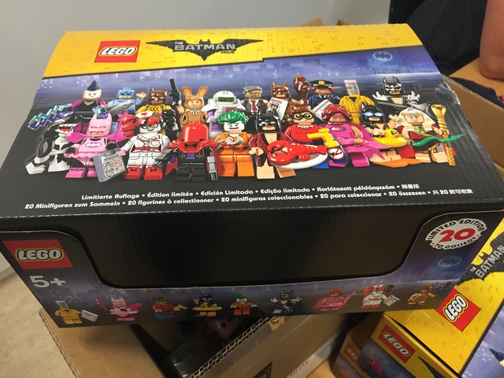
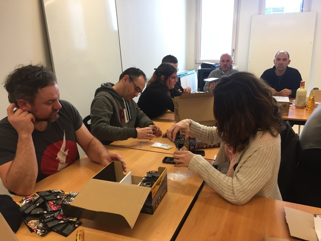
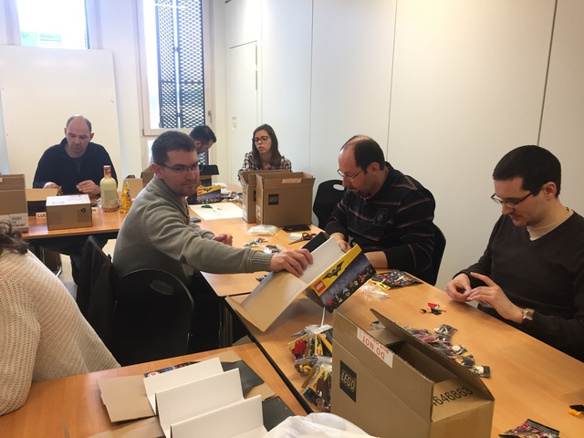

Le week-end du 4 mars nous nous sommes retrouvés dans les locaux de l’INSA pour un nouveau tri de minifigs. Toujours très bien accueilli par Fabrice Ville et sous la gestion de Xavier.

Au programme 1800 minifigs à trier avec les habitués et quelques nouveaux qu’il a fallu former.

Lors de cet après-midi, nous avons trié, échangé autour des LEGO et des futures expositions de la région ainsi que de la future AG.

Après tout ça, un petit goûter était prévu pour finir l’après-midi sur une bonne note.

Prochain rendez-vous avec le tri de la série 17.
