Vous ne savez pas encore si vous allez craquer et dépenser suffisamment pour avoir ce set, jetons y un œil, peut-être que cette revue vous permettra d’y voir plus clair.

Comme tous les ans à la même période, la firme danoise participe à l’évènement « May the 4th » qui célèbre la saga initiée par George Lucas et aujourd’hui sous le contrôle de l’Empire Disney. Généralement, durant une durée limitée et pour un montant minimum d’achat en produits de la gamme Star Wars, un cadeau est généreusement offert aux clients de la marque. Il s’agit souvent d’un polybag contenant une minifig exclusive (ou qui se veut exclusive).

L’an dernier, en plus de ce polybag, une sélection d’AFOLs, triés sur le volet avait eu la possibilité supplémentaire d’obtenir un [set représentant l’échappée du Faucon Millenium du vers de l’astéroïde dans l’épisode V](/articles/2327/), l’Empire contre-attaque, à l’occasion d’une ouverture prématurée des stores. Pour obtenir ce set, le montant minimum d’achat était de 125€. Cette année, pour les 40 ans de la saga, nombreux étaient les AFOLs qui espéraient la reconduction de cet évènement.

Malheureusement, cette année, point d’event exclusif, mais une durée rallongée de l’évènement – du 29 avril au 6 mai – pendant laquelle sera distribué ce polybag qui porte la référence 30611 et qui permet de construire l’un des deux droïdes les plus connus d’une galaxie lointaine, très lointaine, le tout en 70 pièces. Durant cette période, les sets de la gamme bénéficient en plus d’une remise de 10%, et tous les jours, un set différent voit son prix baisser de 30%.

Le polybag ressemble à tous les autres polybags, il est habillé ici de la livrée "Rogue One" qui se retrouve sur tous les sets de la gamme en ce moment. Un petit logo Disney en bas à gauche nous rappelle que c’est désormais le géant américain qui préside à la destinée de la saga. Le visuel est simple, R2-D2 sur une étendue de sable qui figure sans aucun doute la planète Tatooine.

[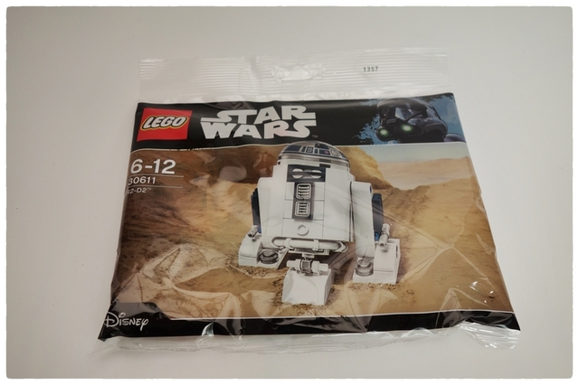](https://www.freelug.org/IMG/jpg/30611_R2-D2_Polybag_001.jpg)

La notice est une simple feuille pliée, sur laquelle figurent les 17 étapes de construction.  
Parmi l’inventaire, on remarque tout de suite la coupole tampographiée qui va faire office de tête, et la tile 1x2 en dark blue qui va venir se poser sur le corps. Le sérigraphie de la coupole est nette, sans bavure.

[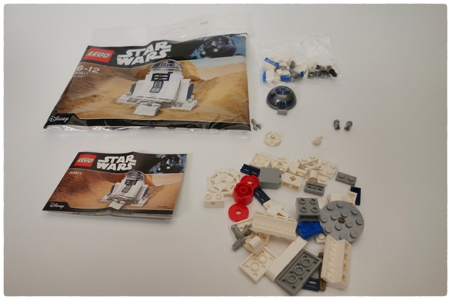](https://www.freelug.org/IMG/jpg/30611_R2-D2_Polybag_002.jpg)

[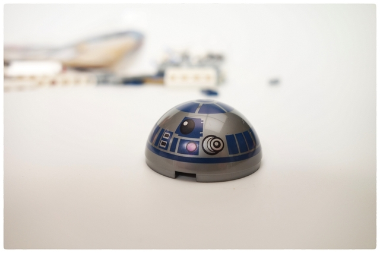](https://www.freelug.org/IMG/jpg/30611_R2-D2_Polybag_003.jpg)

Pour ma part, c’était la première fois que je trouvais la nouvelle tile 2x3 dans mon inventaire.

[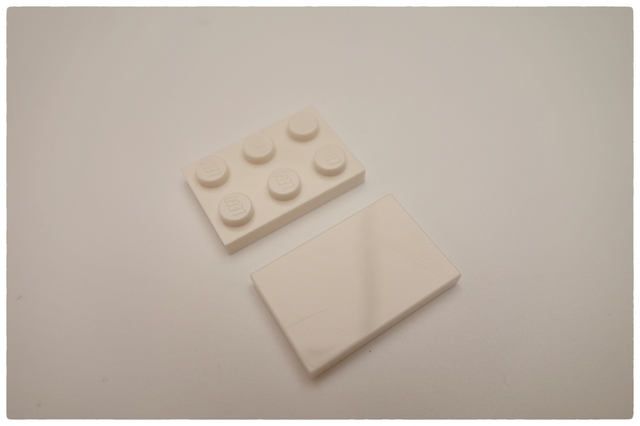](https://www.freelug.org/IMG/jpg/30611_R2-D2_Polybag_004.jpg)

On commence la construction par monter le corps de notre ami R2. L’utilisation de deux briques 1x2x2 avec des tenons sur un côté, permet de construire en SNOT avec des briques incurvées. Cette étape ne prend pas beaucoup de temps.

[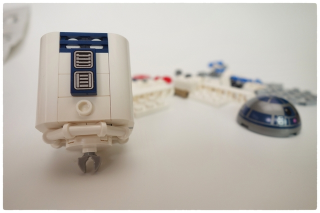](https://www.freelug.org/IMG/jpg/30611_R2-D2_Polybag_005.jpg)

Les jambes quant à elles, sont constituées de deux beams Technic, habillés d’une tile grille et d’un T, fixée sur une plate 2x3.

[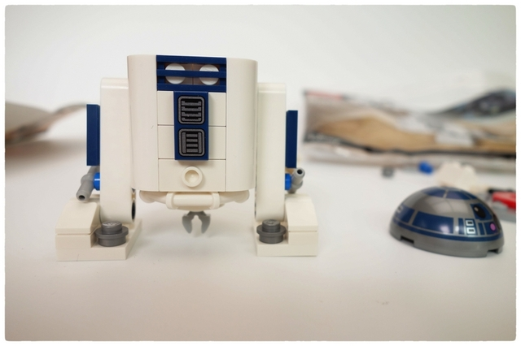](https://www.freelug.org/IMG/jpg/30611_R2-D2_Polybag_006.jpg)

On termine par la tête et la jambe centrale.

[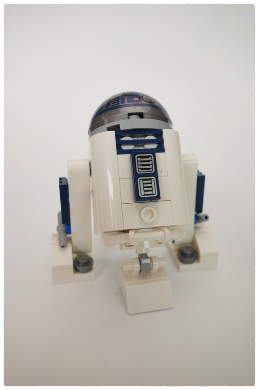](https://www.freelug.org/IMG/jpg/30611_R2-D2_Polybag_007.jpg)

[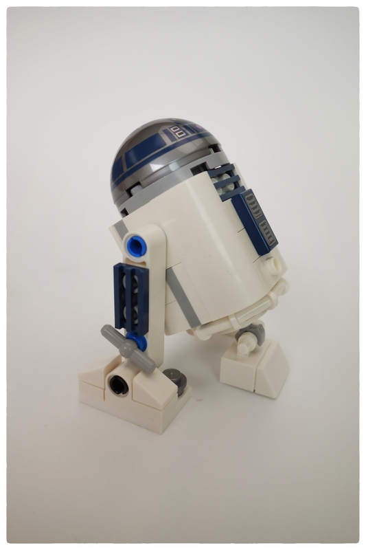](https://www.freelug.org/IMG/jpg/30611_R2-D2_Polybag_008.jpg)

[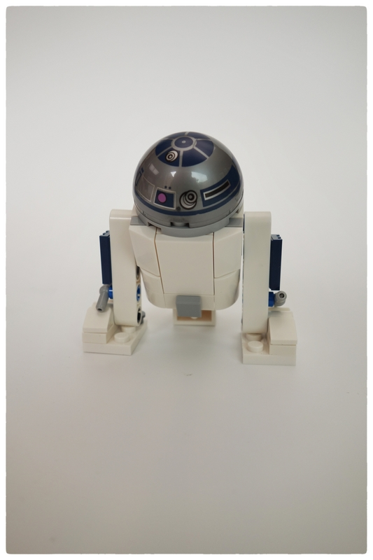](https://www.freelug.org/IMG/jpg/30611_R2-D2_Polybag_009.jpg)

Quelques pièces en rab’

[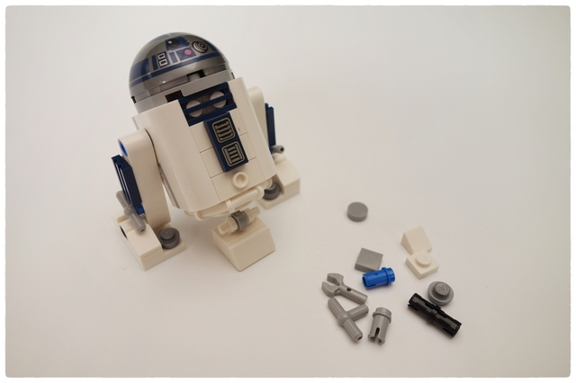](https://www.freelug.org/IMG/jpg/30611_R2-D2_Polybag_010.jpg)

Et une petite comparaison entre ce modèle et la version échelle minifig.

[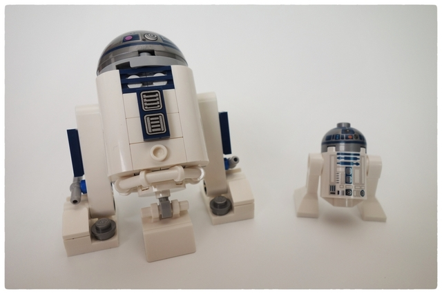](https://www.freelug.org/IMG/jpg/30611_R2-D2_Polybag_011.jpg)

**Conclusion**

Rien d’exceptionnel dans ce set, les pièces utilisées sont relativement basiques et les techniques de montage – même la partie en SNOT – sont utilisées très couramment dans d’autres sets. Pourtant, au final, il a quand même un peu de gueule ce droïde, il est solide, donc jouable, et on se prend vite à rêver de son acolyte dorée à la même échelle.  
C’est typiquement le genre de petite construction qui se pose sur un coin de bureau pour décorer, sans prendre de place.  
Au final, ben ouais… je suis assez fan.
