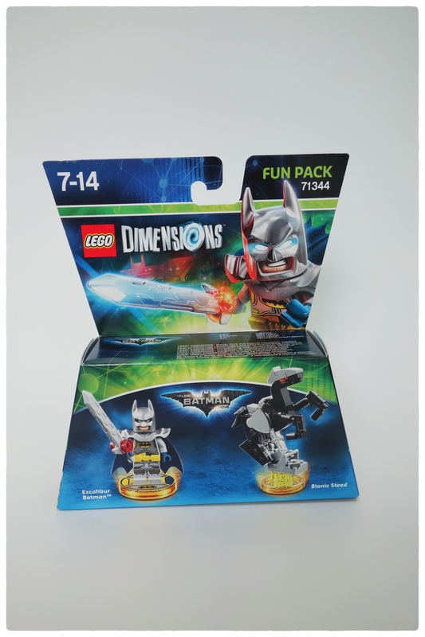
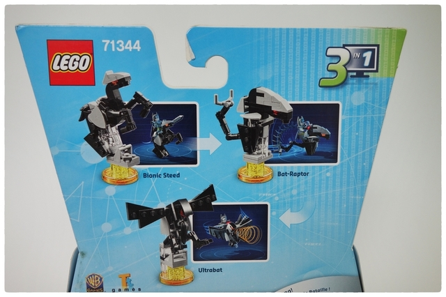
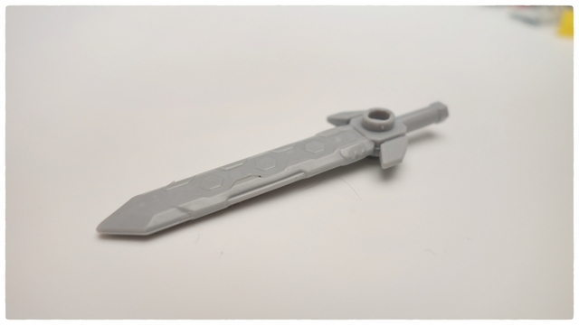
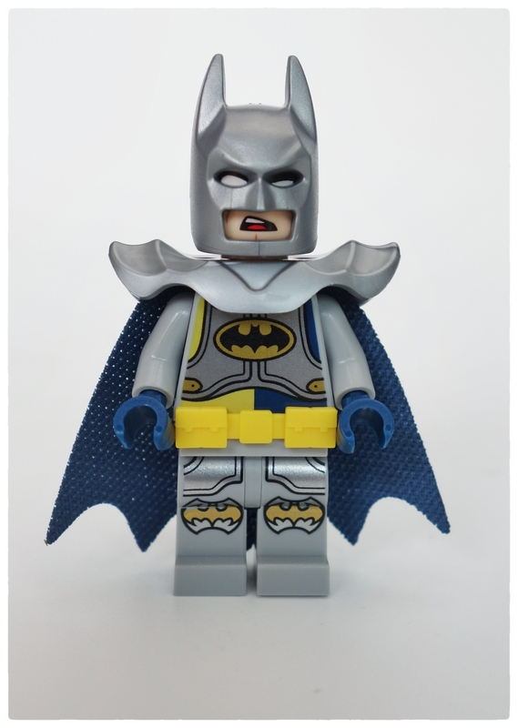
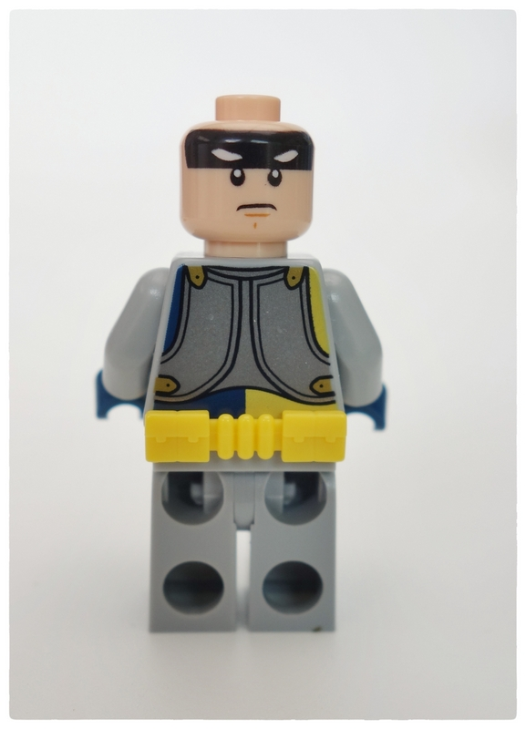
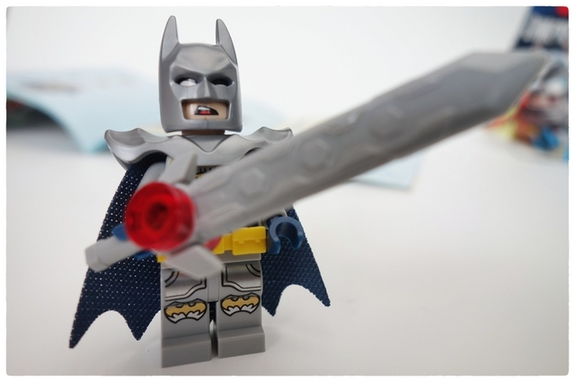
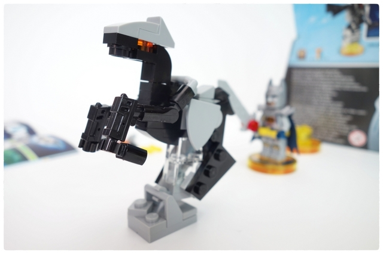
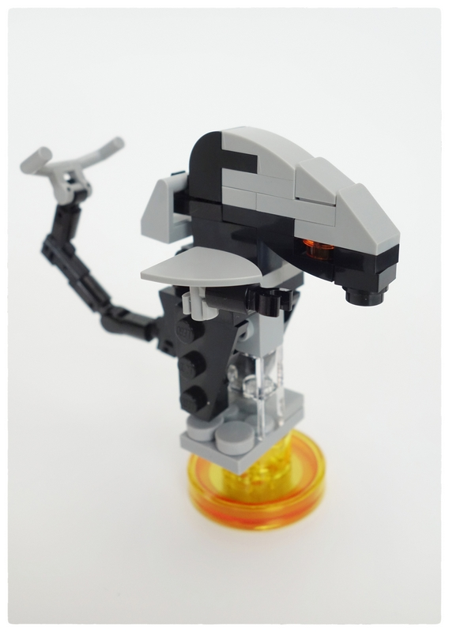
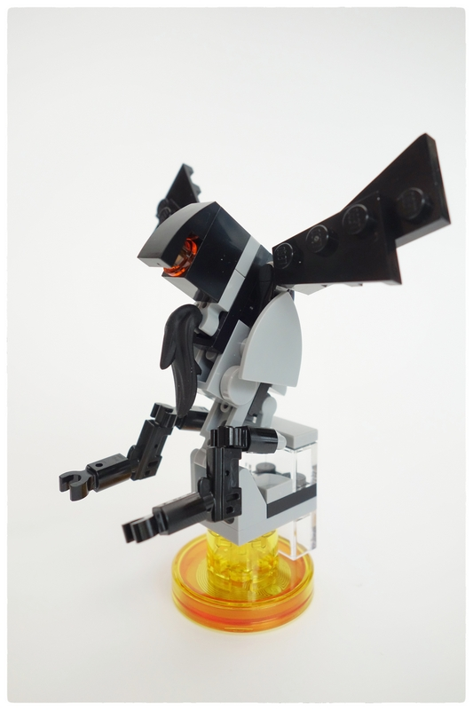

Le film The LEGO Batman Movie a certainement battu des records en termes de produits dérivés, il était donc évident que la gamme Dimension propose elle aussi son set à l’effigie du justicier de Gotham City. Ici, nous avons droit à Excalibur Batman !

C’est dans un Fun Pack – les packs de base qui proposent une minifig et un élément de jouabilité dans le jeu sur console – que l’on retrouve donc ce Batman équipé d’une belle armure argentée.

Que les choses soient claires, je ne joue pas à Dimension sur console, et les quelques packs que j’ai pu acheter l’ont été uniquement pour les minifigs. Après Doc Brown, le bibendum chamallow de Ghostbusters et Barracuda, je ne pouvais pas passer à côté de ce nouveau costume.

Cet « set » de 50 pièces, incluant les deux puces à connecter, est donc sorti en 2017 au prix de 14,99€ Soit un ratio prix/pièce assez important de 30cts (29,98€ pour être exact). Si vous prenez en compte pour la minifig un prix de 3,99€, pratiqué sur la série à collectionner, le prix de la pièce revient alors à 20cts. J’ai eu la chance de pouvoir obtenir le mien pour 9,99€. Il faut dire que la gamme Dimension semble être un échec et que les magasins cherchent à vider leurs stocks au plus vite.

L’emballage spécifique à cette gamme ne change pas. En partie haute, il est habillé d’un très joli visuel de Batman, Excalibur au poing. C’est dynamique et ça donne presque envie. En partie basse, la minifig de Batman et son fier destrier, Bionic Steed, chacun sur leur puce, entourent le logo du film.

Au verso, on découvre que c’est comme la gamme Creator, avec une construction 3 en 1. En plus de Bionic Steed (dont l’histoire ne nous dit pas si il s’appelle John), nous pouvons construire le Bat-Raptor et l’Ultrabat.

Avant de regarder de plus près cette figurine, l’examen de l’inventaire nous permet de découvrir une nouvelle pièce, qui n’est autre que l’épée Excalibur. Un modèle bien travaillé, qui apparaît également en bicolore dans certains sets de la gamme Nexo Knights de ce début d’année 2017.

En plus de son casque et de ses épaulettes qui bénéficient pour l’occasion d’un moulage en Pearl light gray, Batman est habillé d’une armure argentée très réussie. Le visuel est simple, mais la tampographie réussi à rendre parfaitement le côté brillant de cette couleur. Les jambes sont également imprimées, et le bat-logo sur les genouillères est du plus bel effet.

La minifig présente une impression en recto-verso. Et la tête une double-face qui n’est pas inédite, puisqu’on la retrouve dans les sets 70903, 70905, 70909 et 70911 (je vous laisse chercher à quoi ils correspondent ;) ).

« Je suis Batman ! Et j’ai une grosse… épée ! »

Avant que les pièces qui accompagnent cette minifig ne rejoignent mon vrac, je vous propose de voir à quoi ressemblent les modèles qu’elles permettent de construire. Bien évidemment, comme pour les autres sets de la gamme, la notice fournie dans la boîte explique uniquement comment monter la figurine, et pas les modèles qui viennent avec. Il vous faudra donc vous connecter au jeu pour les obtenir (pour ceux qui jouent), ou les trouver sur le net, car malgré le peu de pièces utilisées, certains modèles peuvent être ardus à monter.

Bionic Steed, le fier destrier. J’aime particulièrement l’utilisation des pistolets pour les jambes. C’est malin.

Le Bat-raptor. On ne sait pas trop à quoi ça ressemble… plus à un alien qu’à un raptor en tout cas.

L’Ultrabat. Là encore, on sent que les designers ont dû aller chercher loin pour créer un modèle alternatif, et justifier ainsi le 3 en 1.

**Conclusion.** Si vous êtes fan de Batman, cette minifig est pour vous, par contre, attention, elle peut être difficile à trouver. Si j’étais vous, je n’attendrais pas les prochaines soldes où on retrouvera certainement ce qui restera de cette gamme à prix cassés. Et si vous êtes joueur, à vous de voir l’expérience de jeu supplémentaire que peut vous apporter ce module.

Merci à Mika, qui m’a accompagné durant cet après-midi de revue.
