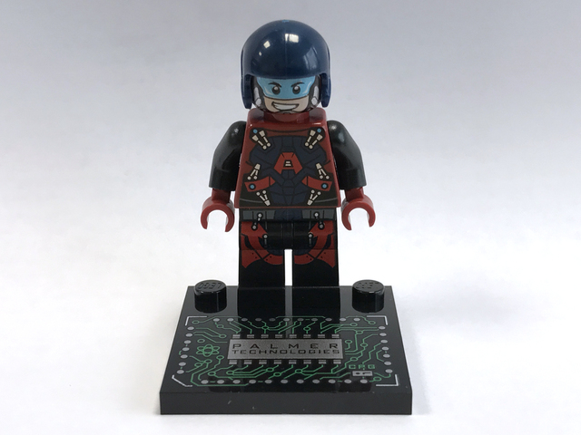
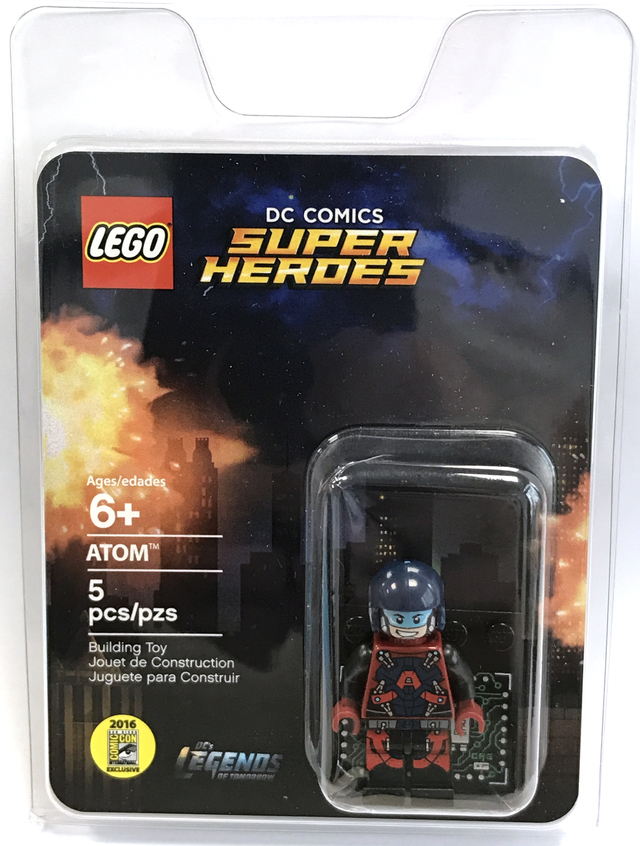
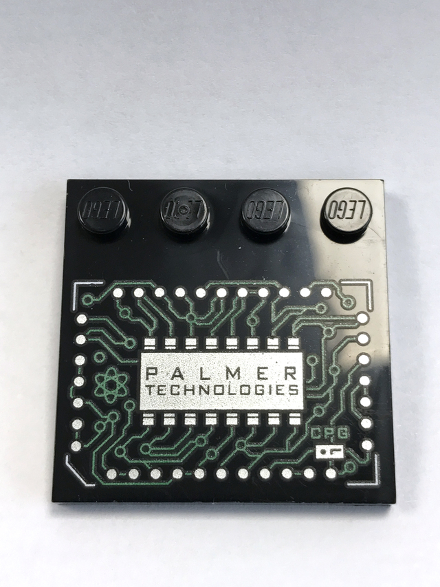
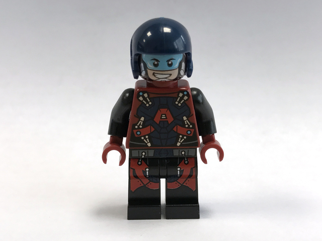
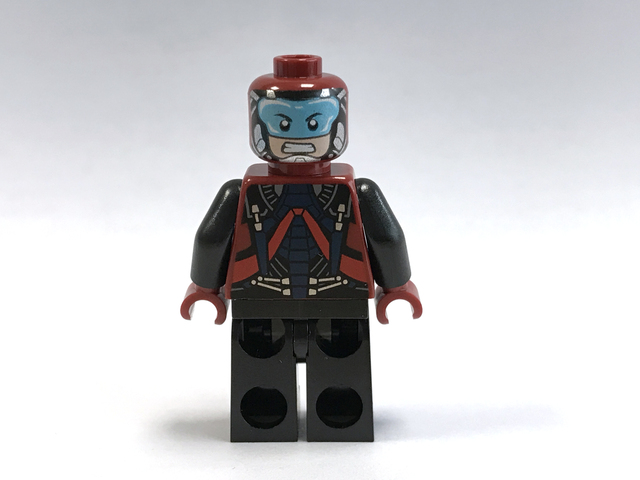

Aujourd’hui je vous propose la review de la minifigure **Atom**/Ray PALMER, vendue lors du _SDCC 2016_ (_San Diego Comic-Con_), dans la gamme _DC Comics Super Heroes_.

Les minifigs _SDCC_ sont réputées pour leur prix prohibitif et leurs qualité de fabrication, voyons voir si cette réputation est fondée ou non.

* * *

**\* The Atom**

> **Atom** (_The Atom_ en version originale) est un super-héros de comics appartenant à l’univers de _DC Comics_, c’est l’un des membres de la _Ligue de justice d’Amérique_. Le costume a été porté par plusieurs personnages différents.
> 
> Créé en octobre 1940 par Ben Flinton et Bill O’Conner dans _All-American Comics #19_ sous l’identité d’Al Pratt. Sous l’identité de Ray Palmer, le personnage est créé par Gardner Fox et Gil Kane en 1961 dans _Showcase # 34_. John Ostrander crée la version Adam Cray en aout 1990 dans _Suicide Squad #44_. Une nouvelle version est créée en 2006 sous l’identité de Ryan Choi par Grant Morrison, Gail Simone et John Byrne.
> 
> Source : _[Wikipedia](https://fr.wikipedia.org/wiki/Atom_\(comics\))_.

* * *

Comme toutes les figs _SDCC_, **Atom** est livré dans un blister en plastique. Non scellé, il permet de ne pas avoir à tout arracher quand on veut sortir la figurine de son écrin.

La fig est livrée avec une plaque sérigraphiée et qui permet de donner l’illusion qu’**Atom** est perché sur un circuit électronique à une taille microscopique.  
Belle idée de **LEGO**.

Superbe travail de sérigraphie sur ce _Ray PALMER_, la combinaison regorge de détails. Le visage est vraiment réussi.

Au dos, le travail est là aussi impressionnant et le visage alternatif "énervé" est lui aussi une réussite.

**Atom** sur son micro-circuit _Palmer Technologies_.

* * *

**CONCLUSION :**

On m’avait vanté la beauté des figurines _SDCC_, maintenant que j’en ai une je peux vous dire que c’est la vérité. On aimerait que toutes les figurines des gammes Super Héros atteignent ce degré de qualité.

Il est clair que niveau tarif, ce n’est pas pour toutes les bourses, mais _LEGO_ nous prouve ici que quand il veut, il peut.
