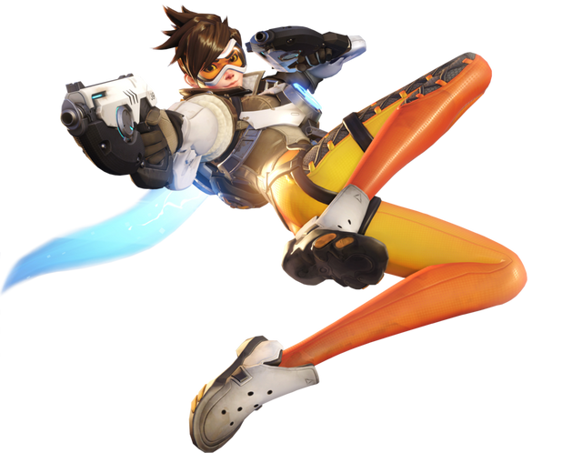
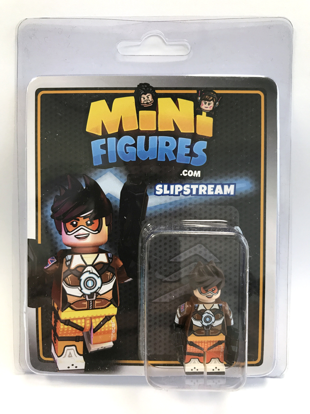
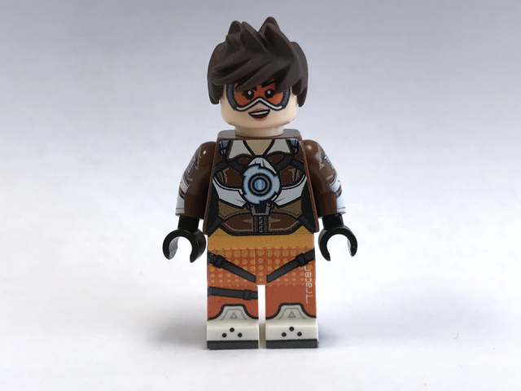
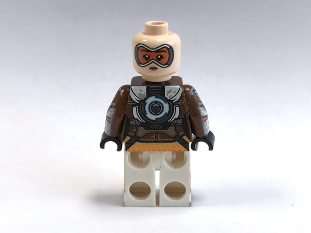
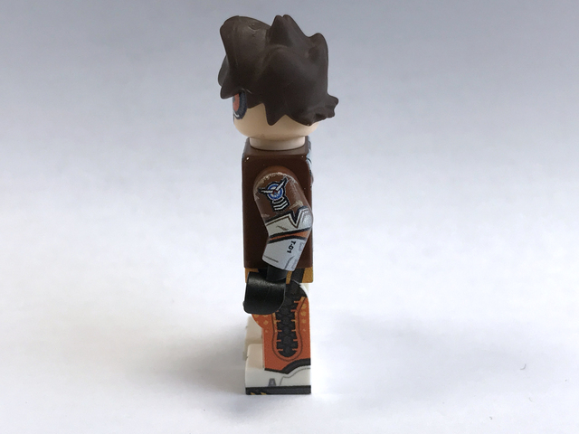
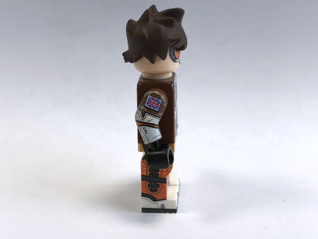
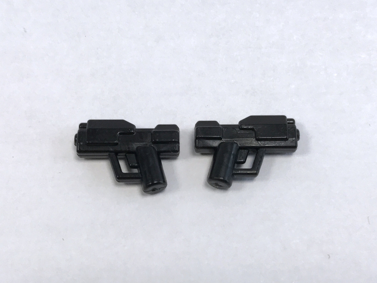
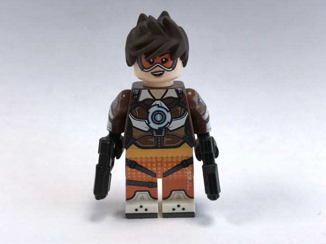

Aujourd’hui je vous propose la review de la figurine custom **Slipstream** (_Tracer_, mascotte du jeu vidéo _Overwatch_), venant du site _[minifigures.com](http://www.minifigures.com/)_, site anglais créé en 2004 et spécialisé dans le custom des minifigures _LEGO_.

Le site utilise des pièces _LEGO_ officielles vierges qui ont droit ensuite à une impression digitale (procédé différent de la sérigraphie). Ils ont maintenant une clientèle mondiale avec notamment des entreprises comme _Google_, _Pixar_ ou _Fox Studio_...

* * *

-   **Overwatch**  
    Ce custom est inspiré par le personnage de _Tracer_ dans le jeu vidéo _Overwatch_.

> _Overwatch_ est un jeu vidéo de tir en vue subjective en ligne développé et publié par _Blizzard Entertainment_. Le jeu est annoncé le 7 novembre 2014 à la BlizzCon, et est commercialisé le 24 mai 2016 sur Windows, PlayStation 4 et Xbox One.
> 
> Source : _[Wikipedia](https://fr.wikipedia.org/wiki/Overwatch)_.

* * *

-   **Tracer**

> _Tracer_ est l’un des héros d’_Overwatch_. C’est une aventurière. Il s’agit de la représentation et de la mascotte officielle du jeu.
> 
> Source : _[Wikia Overwatch](http://fr.overwatch.wikia.com/wiki/Tracer)_.

* * *

L’emballage est soigné et résistant, il reprend en arrière-plan la version 3D de la minifigure présente sur le site. Nouveauté, on peut maintenant ouvrir le blister sans tout déchirer, ce dernier n’étant plus scellé.

De face, **Slipstream** est une réussite, on constate tout de suite le bon en avant réalisé par _Minifigures.com_ sur la qualité de l’impression numérique par rapport à leurs premières productions.

La fig regorge de détails, on aimerait que _LEGO_ fasse la même chose sur ses sérigraphies.

Au dos, même impression qu’à l’avant, c’est beau. Nous avons même droit à un visage alternatif.

Je ne sais pas si c’est grâce à l’impression numérique, mais les côtés de la fig sont richement décorés. Bien plus que ce que fait _LEGO_ même aujourd’hui sur ses dernières productions.

Seules pièces non officielles, les pistolets customs.

**Slipstream** avec ses pistolets.

* * *

**CONCLUSION :**

Malgré l’impression numérique, _Minifigures.com_ nous livre là une magnifique figurine. Le bond en avant fait par leur production m’a sauté aux yeux dès la sortie du blister.

Bref, même si ce n’est pas de la sérigraphie, je vous recommande vraiment cette minifig pour son rapport qualité/prix.

Vous pourrez trouver cette fig au prix de 14,95 £ en cliquant _[ICI](http://minifigures.com/products/slipstream.html)_.
