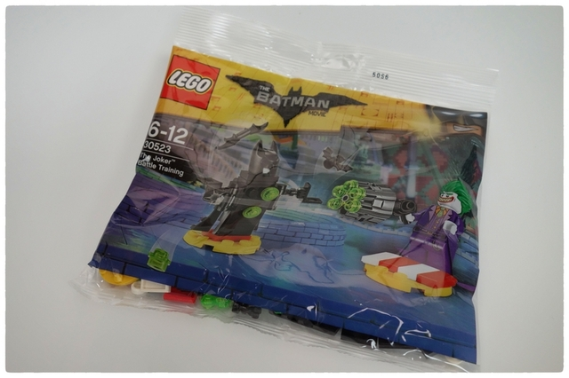
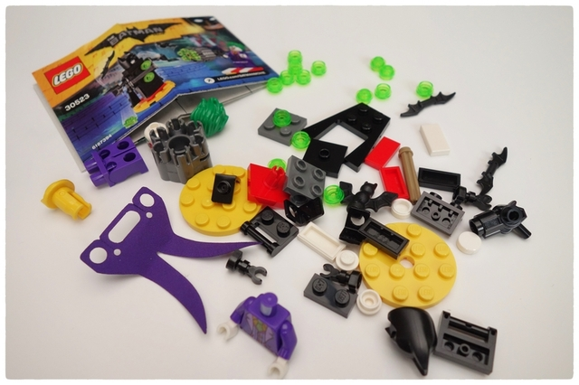
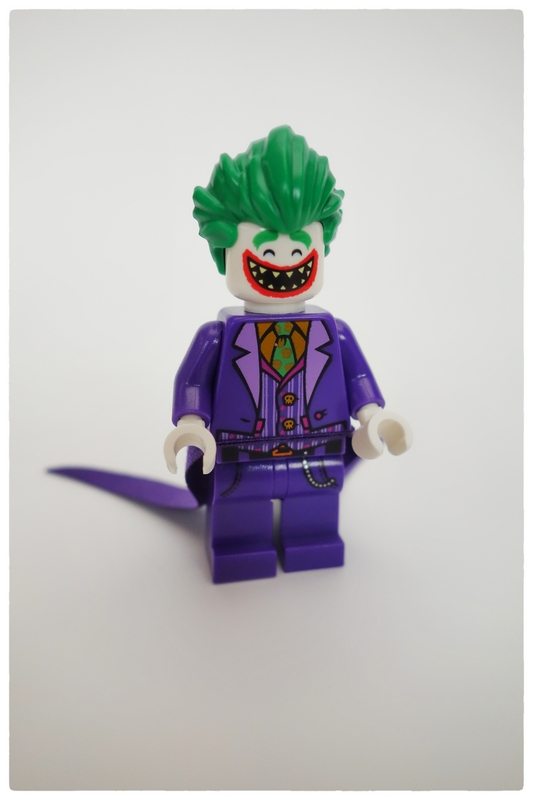
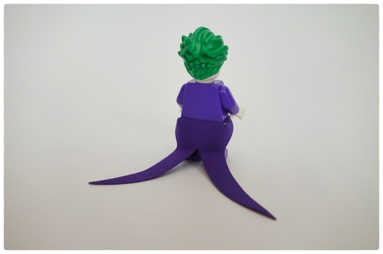
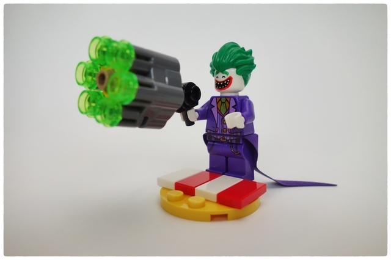
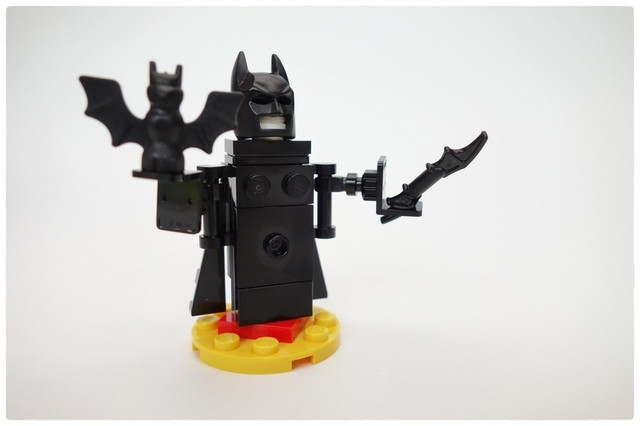
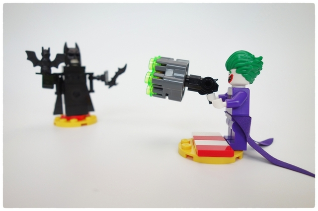
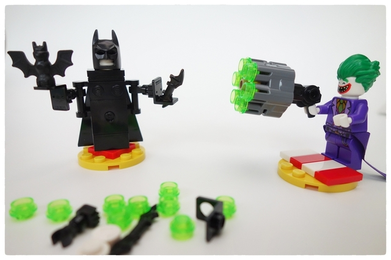

Pour accompagner la sortie de « The LEGO® Batman Movie », nos amis de Billund ont complété les deux vagues de sets prévus par une série de polybags, disponibles à l’occasion de nombreuses opérations promotionnelles lors de la sortie du film. Le polybag 30523 « The Joker Battle Training » en fait partie. Avons-nous droit ici à une minifig accompagnée de quelques briques qui permettent de construire un « bidule quelconque », ou à un mini-set plus consistant ? Allons donc voir…

Le polybag est habillé comme toute la gamme « The Batman Movie », de son bandeau jaune supérieur, avec le logo du film et d’un gros plan de Batman sur la droite. Le contenu du polybag y est incrusté sur un fond qui représente vraisemblablement le manoir Wayne vu dans le film.

Comme son nom l’indique, ce petit set nous propose une minifig du Joker, identique à celle contenue dans le set 70900 – The Joker Balloon Escape, armé d’un studshooter surdimensionné et d’un dummy à l’effigie du chevalier noir.

44 pièces composent l’inventaire de ce polybag qui était offert chez JouéClub pour un achat dans la gamme.

La sérigraphie est de toute beauté, j’apprécie spécialement les têtes de mort qui sont imprimées sur la cravate et dont la forme est reprise pour les boutons du gilet. La liaison entre le torse et les hanches est parfaite, mais malheureusement gênée par l’ajout de la queue de pie du Joker.

Cette queue de pie est fabriquée dans un tissu rigide, et il faut la travailler à la main pour que le personnage ne soit pas déséquilibré et tombe en avant.

Seule la tête bénéficie d’une tampographie double face, et il faut bien admettre, comme je l’ai fait remarquer dans ma revue du set 70900, que cette queue de pie fait quand même un gros cul au Joker.

Une fois armé de son studshooter, il est impératif de fixer la minifig sur la plate round 4x4 qui représente avec ses tiles rouges et blanches la limite à ne pas franchir pour une bonne distance d’entraînement. Sinon, c’est la chute assurée…

Le dummy est monté très rapidement et fait bien le job. La silhouette est bien caractérisée et pivote sur une tile avec pin. Des neck brackets font office de mains et permettent de poser en équilibre un batarang et une chauve-souris. Le casque est lui aussi juste posé sur le dessus pour pouvoir sauter au premier coup dans le mille.

L’entraînement peut commencer.

**Conclusion.** On a affaire ici à un véritable petit playset, avec une vraie possibilité de jouer (attention par contre, vous allez retrouver des plates round 1x1 partout). C’est un sans-faute pour moi, largement plus sympa qu’une micro batmobile ou un micro batwing.
