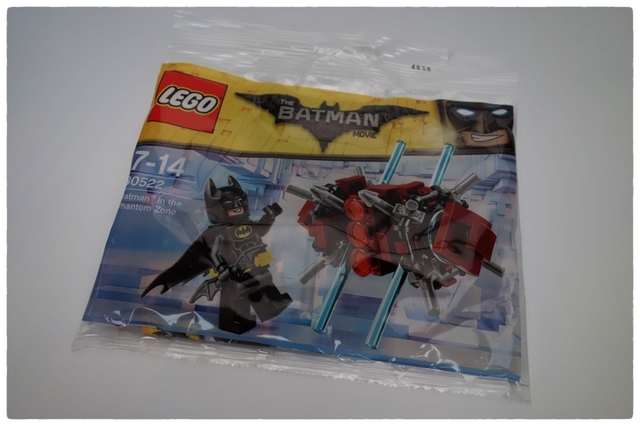
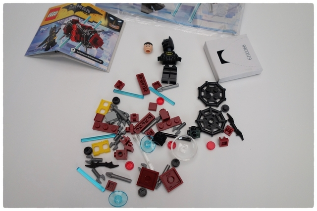
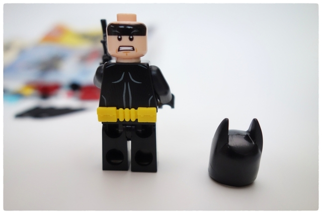
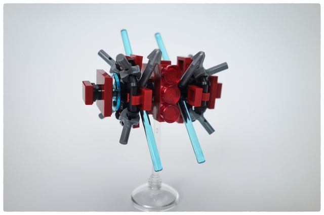
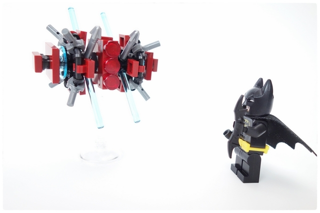

Pour accompagner la sortie de « The LEGO® Batman Movie », nos amis de Billund ont complété les deux vagues de sets prévus par une série de polybags, disponibles à l’occasion de nombreuses opérations promotionnelles lors de la sortie du film. Le polybag 30522 « Batman in the Phantom Zone » en fait partie. Avons-nous droit ici à une minifig accompagnée de quelques briques qui permettent de construire un « bidule quelconque », ou à un mini-set plus consistant ? Allons donc voir…

Le polybag est habillé comme toute la gamme « The Batman Movie », de son bandeau jaune supérieur, avec le logo du film et d’un gros plan de Batman sur la droite. Le contenu du polybag y est incrusté sur un fond qui représente vraisemblablement la zone fantôme dans laquelle Batman se rend au cours de son aventure.

Ici c’est une minifig de Batman que nous propose ce polybag. Elle est identique à celles contenues dans les sets 70910, 70901 et 70904, ainsi que dans le pack 853650 (le movie maker set), et également dans deux autres polybags.

53 pièces composent son inventaire. Ce polybag était offert chez Cultura pour un achat dans une sélection de sets LEGO®.

On ne va pas s’égosiller sur le visuel de la tampographie, plusieurs voix s’étaient élevées sur le net pour se plaindre que les designers de Billund auraient pu faire plus original, plus neuf. Sauf que c’est le look qu’ont choisi les réalisateurs pour ce personnage, et il faut faire avec. Bref rien d’extraordinaire, c’est propre, et les jambes sont épargnées de la moindre impression.

Sur l’arrière, quelques lignes pour figurer la silhouette de Batman, et une face alternative (oups, on a gardé la même pour la photo du verso). Minimum syndical.

Une fois la minifig montée, Mika attaque les 11 étapes qui vont permettre de monter le… bidule, truc, …machin, que Batman rencontre à son arrivée dans la zone fantôme. Vous vous rappelez des micro-managers noirs dans le « LEGO Movie », et bien nous avons droit ici à leur équivalent dans la zone fantôme.

Une fois terminé, ça ressemble à… une espèce de gros virus. Par contre, c’est sympa aux designers d’avoir prévu un support transparent pour le poser.

« Qui es-tu étranger ?! Que viens-tu faire dans la zone fantôme ?  
I’m Batman ! »

**Conclusion.** A mon avis, nous avons affaire ici à un polybag largement dispensable, sauf si vous êtes un ultra-complétiste et qu’il vous le faut. Au pire, le bidule se construit avec des pièces communes et la notice se trouvera facilement sur le net. Quant à la fig, je suis certain que vous en avez déjà au moins deux…
