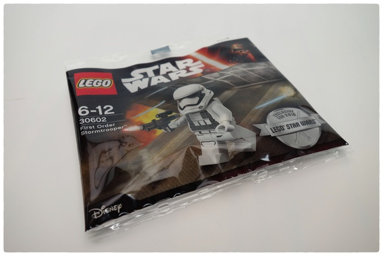
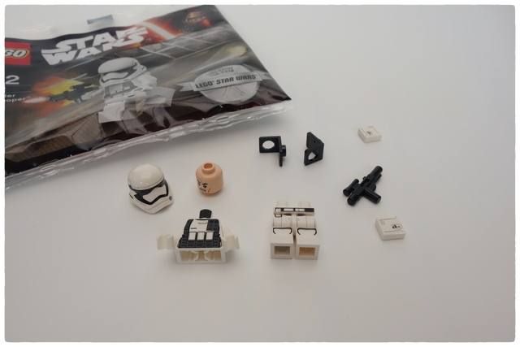
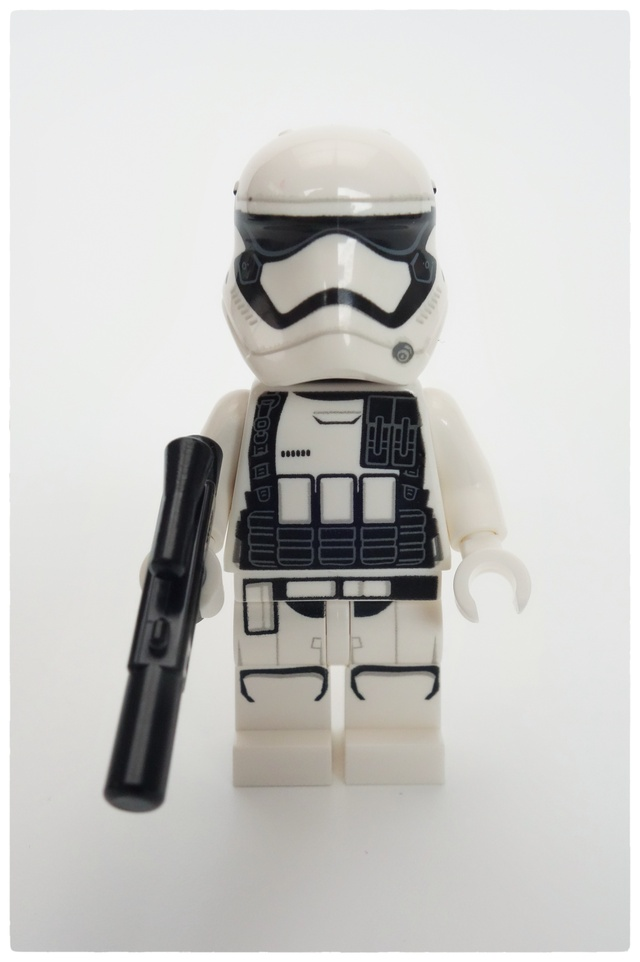
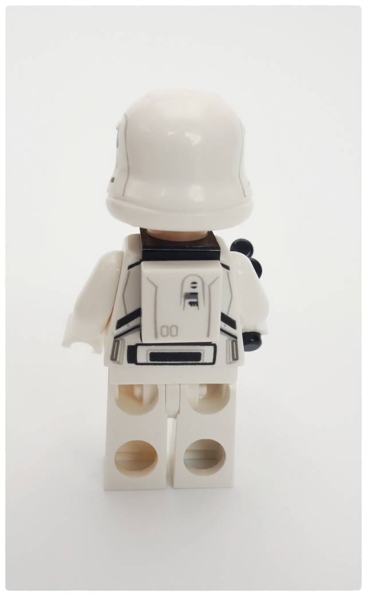
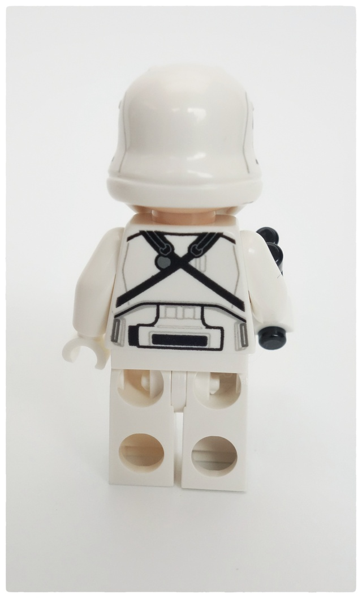

Retour en arrière avec ce polybag offert l’an dernier à l’occasion de l’opération "May the 4th". Avons-nous vraiment affaire à une minifig exclusive comme l’annonce le logo fièrement apposé sur l’emballage ?

Lancé dans la foulée de l’épisode 7, ce polybag offert pour 55€ d’achat dans la gamme "Star Wars" affiche sur son packaging un logo "Exclusive for 2016 - Lego Star Wars".  
Il est à noter que l’an dernier, dans certains stores, il était proposé aux acheteurs de choisir entre ce polybag et celui du "First Order General".

Nous avons droit ici à un visuel qui propose une belle mise en situation du trooper, débarquant d’un vaisseau, vraisemblablement lors de la scène d’ouverture du film. Le bandeau supérieur est à l’effigie de Kylo Ren, comme tous le merchandising Star Wars de cette époque, et le fameux logo "exclusive for 2016" est quant à lui situé en bas à droite.

A l’intérieur du sachet, 9 pièces (dont deux doubles). La tête est simple face.

Le stormtrooper est équipé d’un blaster. La sérigraphie est détaillée, fine, et la liaison entre les hanches et les jambes est très réussie. Sur le torse, une cartouchière supplémentaire justifie l’appellation exclusive de cette minifig.

Au dos, un petit pack dorsal vient compléter l’uniforme.

Une fois le pack retiré, la sérigraphie dorsale est assez réussie elle aussi. Un léger décalage vers le haut des bretelles croisées, visible sur les photos en gros plan, mais à peine perceptible à l’œil nu.

**Conclusion.** Une figurine sympathique qui viendra augmenter une escouade, une armée ou un peloton de stormtroopers, où la petite différence de sérigraphie donnera un peu de variété à l’ensemble.
