Aujourd’hui, je vous propose la review du set 6430 dans la gamme _LEGO System Town_ (l’ancêtre de la gamme _City_) : **Night Patroller**.  
Ce set, sorti en 1991 (oui, oui, il y a 26 ans) au prix de 25 euros (enfin 164 Francs à l’époque), est composé de 140 pièces, soit un ratio prix/pièce de 18 centimes d’euro.

[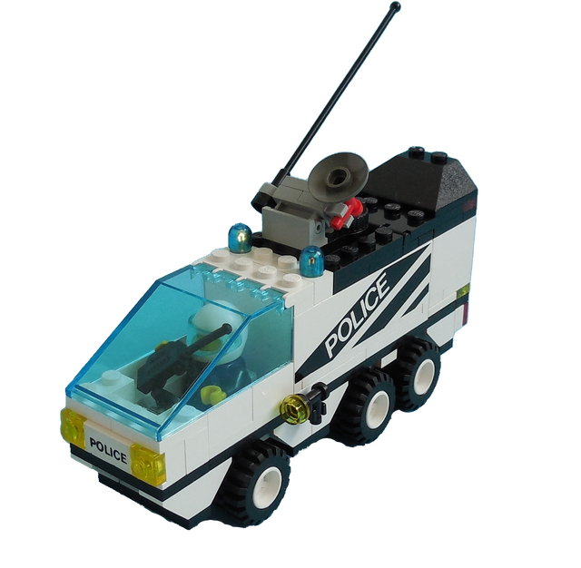](https://www.freelug.org/IMG/png/NightPatroller_Entete.png)

Ce petit set fait partie de la collection _Light And Sound_. Créée par _LEGO_ en 1985, cette collection a perduré jusqu’en 1997 et [comporte quatorze sets (_City_ et _Space_)](https://brickset.com/sets/list-1005) et quatre packs d’accessoires.

* * *

Voici la notice de ce sympathique set, la boite avait un visuel identique mais à l’horizontal.

[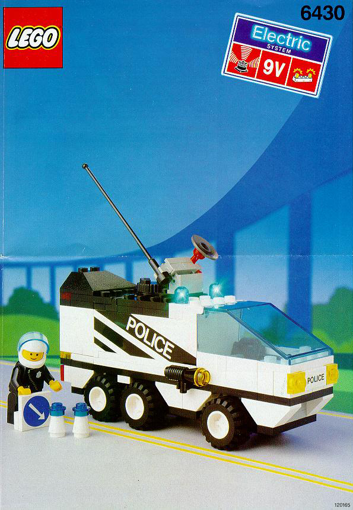](https://www.freelug.org/IMG/jpg/NightPatrollerBox.jpg)

* * *

Le montage commence par le châssis du véhicule.

[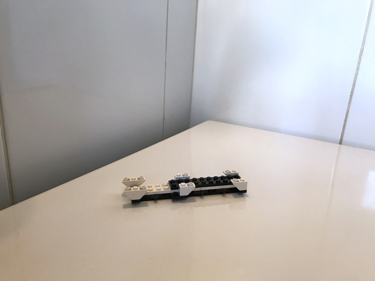](https://www.freelug.org/IMG/jpg/NightPatroller_01.jpg)

Très rapidement le compartiment 9V permettant d’alimenter le système _Light and Sound_ est installé, la petite partie grise 2x1 faisant office de bouton marche/arrêt. On peux noter qu’aucun autocollant n’est présent dans ce set, toutes les pièces sont sérigraphiées.

[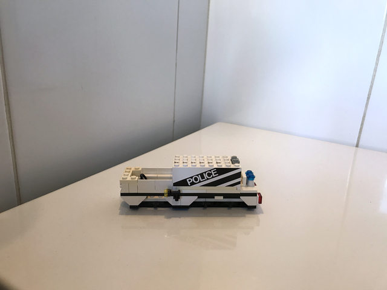](https://www.freelug.org/IMG/jpg/NightPatroller_02.jpg)

La verrière de l’habitacle est en place, ainsi que le système de son ressemblant à une brique _Round 2x2_ noire.

[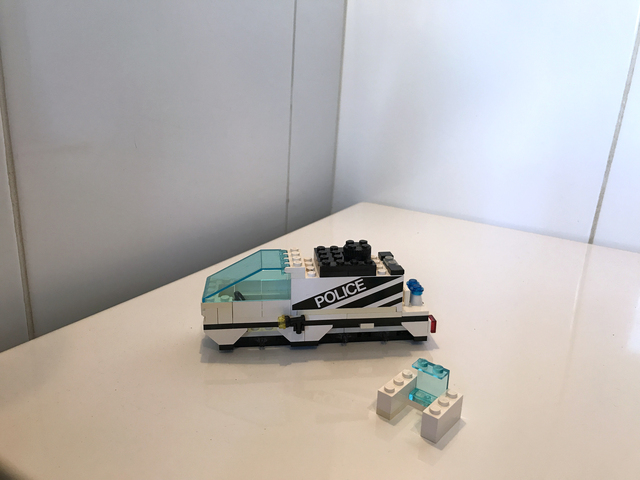](https://www.freelug.org/IMG/jpg/NightPatroller_03.jpg)

Construction du coffre permettant de ranger les accessoires et de cacher l’interrupteur.

[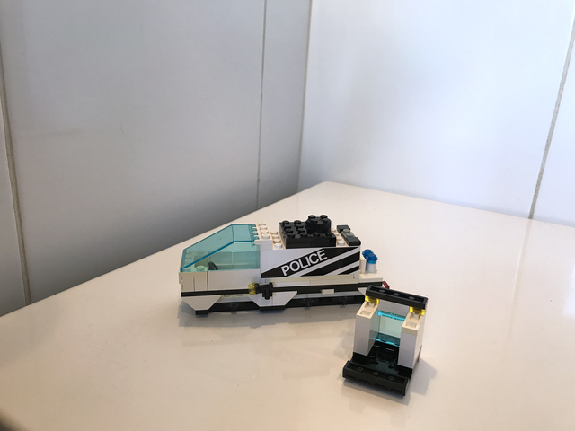](https://www.freelug.org/IMG/jpg/NightPatroller_04.jpg)

Le système de lumière est maintenant posé.

[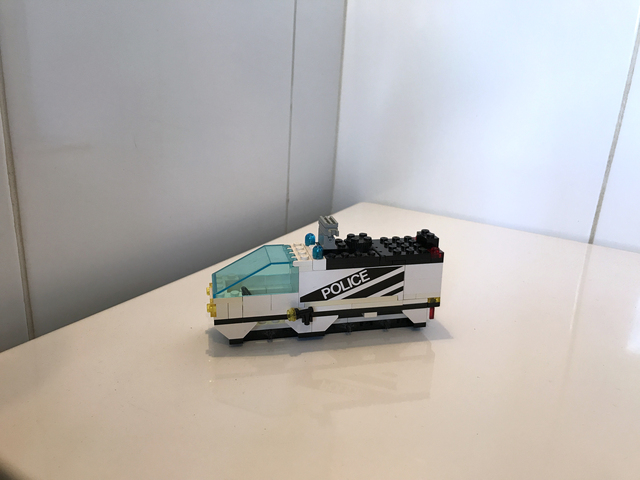](https://www.freelug.org/IMG/jpg/NightPatroller_05.jpg)

On finit par l’antenne et les roues.

[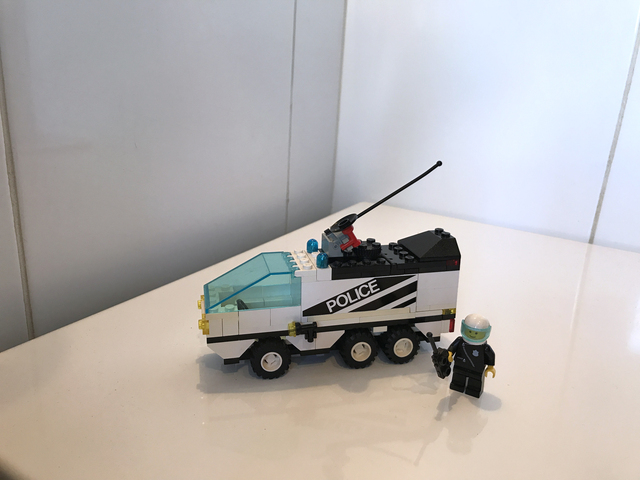](https://www.freelug.org/IMG/jpg/NightPatroller_06.jpg)

* * *

Le _Night Patroller_ sous différents angles, toutes lumières allumées.

[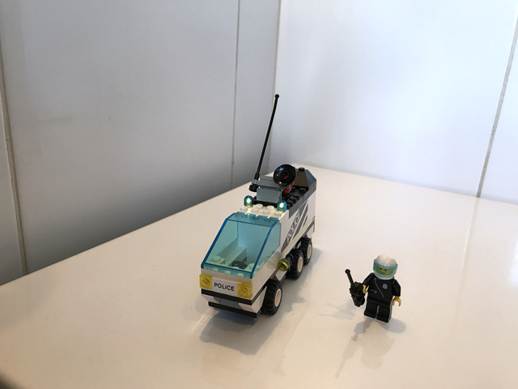](https://www.freelug.org/IMG/jpg/NightPatroller_07.jpg)

[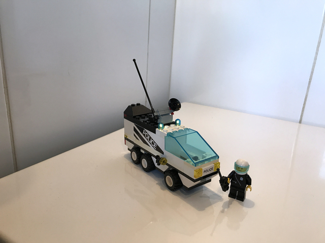](https://www.freelug.org/IMG/jpg/NightPatroller_08.jpg)

[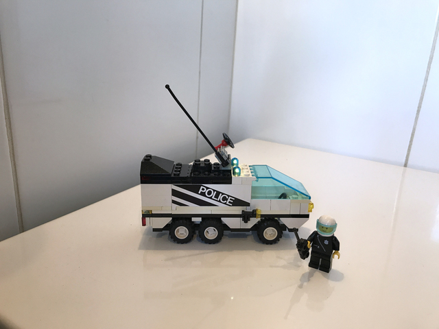](https://www.freelug.org/IMG/jpg/NightPatroller_09.jpg)

[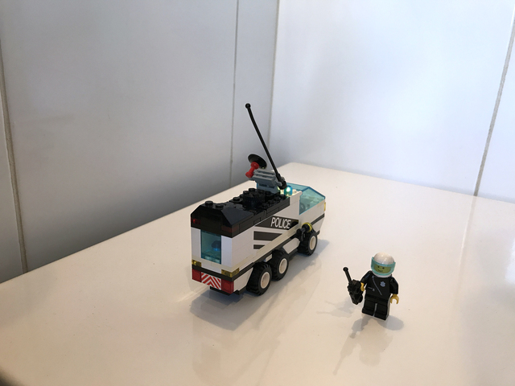](https://www.freelug.org/IMG/jpg/NightPatroller_10.jpg)

[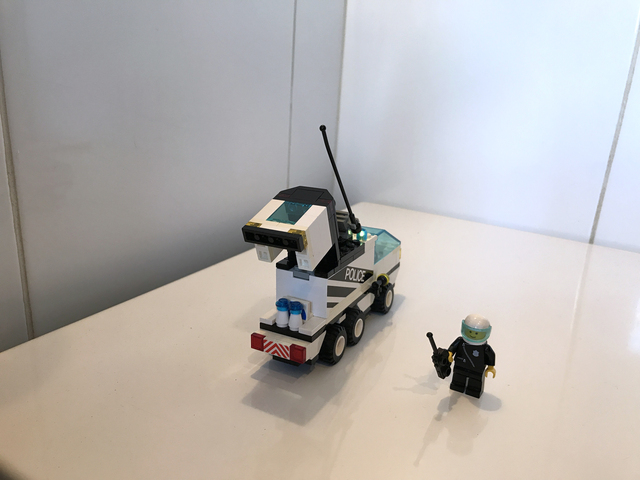](https://www.freelug.org/IMG/jpg/NightPatroller_11.jpg)

[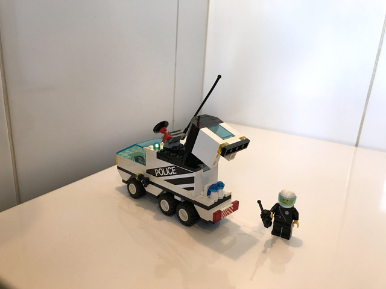](https://www.freelug.org/IMG/jpg/NightPatroller_12.jpg)

[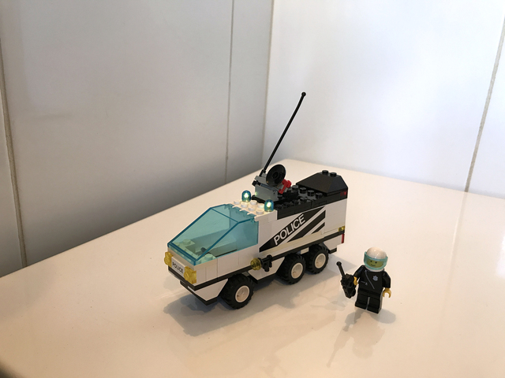](https://www.freelug.org/IMG/jpg/NightPatroller_13.jpg)

* * *

**Aavis :**

Comme il est plaisant de ressortir des vieux sets et de les (re)construire. Ce véhicule a belle allure (un poil futuriste) quand on sait que le pool de pièces n’était pas aussi vaste qu’aujourd’hui.  
Et puis le système _Light and Sound_, je crois que c’est une des options que j’aimerais revoir sur les _LEGO_ actuels tant cela apporte un plus au set sans le dénaturer.

Bref vous l’aurez compris, si d’aventure vous tombez sur un set _Light and Sound_ fonctionnel, précipitez-vous, ce sont des petites pépites qu’il est plaisant de posséder.

**Bonus :**

Voici un GIF animé comprenant toutes les étapes de construction de ce modèle (cliquez sur l’image pour lancer l’animation).

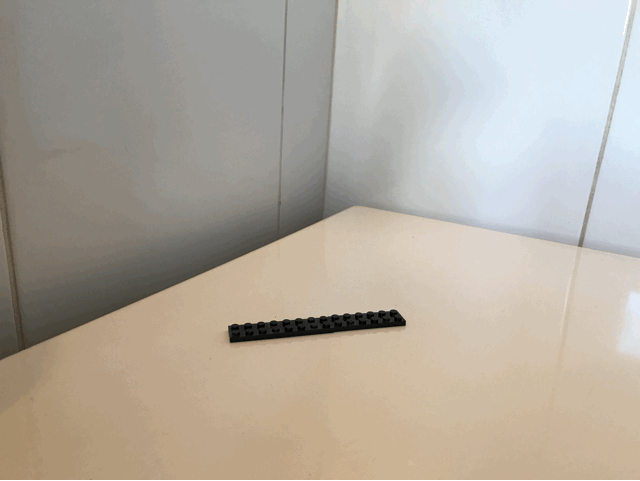
