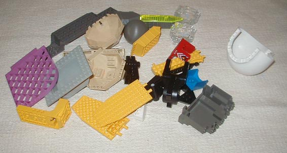
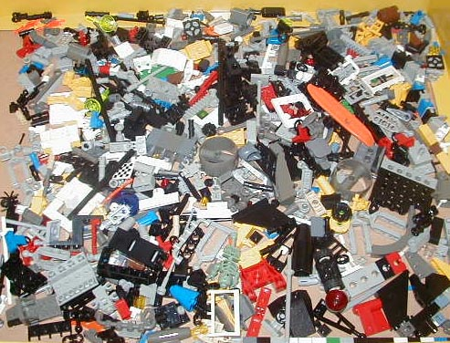
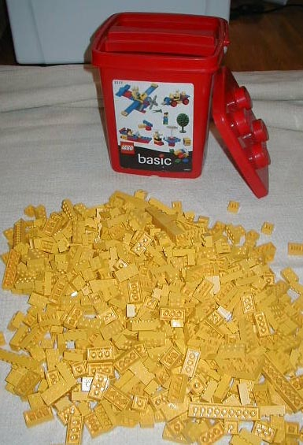
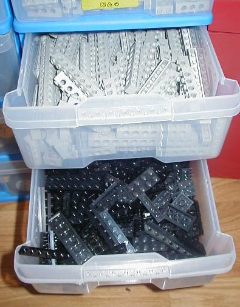
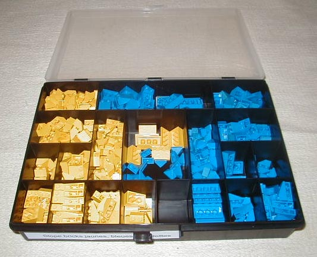
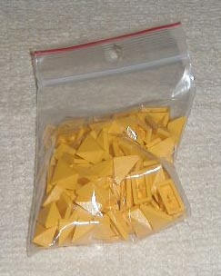

Si vous avez plus de 1000 pièces LEGO® à trier par mois, cet article est pour vous.

**Pourquoi trier ?**

Si vous conservez vos modèles LEGO® exposés sur vos étagères cette question vous semble incongrue car pour vous elle ne se pose pas. Mais certains préfèrent monter de nouveaux modèles. Par mesure d’efficacité dans la création il faut être en mesure de retrouver rapidement n’importe quelle pièce : le trie s’impose.

**La situation initiale**

Vous vous retrouvez avec un bac contenant un vrac coloré de pièces. Avant toute chose, éparpillées les (mais pas trop) sur un tapis ou encore mieux sur un tissu non pelucheux qui pourra aussi vous servir de sac pour tout "ranger" rapidement.

**Le début du tri**

Commencez par mettre de côté les plus grosses pièces. Elles prennent beaucoup d’espace mais sont peu nombreuses : en clair elles gênent le tri.

**On poursuit**

Les chose sérieuses commencent : Armez vous de trois ou quatre bacs et commencez à trier :

**–** Les plaques  
**–** Les briques  
**–** Les briques pentues et arrondies  
**–** Les plaques en forment d’ailes

il vous reste un ensemble de pièce globalement de petites tailles : chacun à partir de cette étape trie à sa façon et en fonction du type de brique qu’il possède (System® Technic®...) La tache reste ardue.

Ce tri est rapide et permet rapidement d’avoir cinq lots de taille similaires et plus facilement manipulable.

**Pour terminer**

Chacun des 4 lots peut être trier plus ou moins finement par la suite.

**–** Je trie par couleur les plaques et les briques

**–** Je trie par forme les briques pentues, arrondies et les ailes, ainsi que la plupart des autres pièces.  
**–** Je trie aussi à la fois par forme et par couleur. Je mélangent dans mon tri les couleurs peu courantes.

Dans ce dernier cas il faut avoir beaucoup de bacs.

**Les bacs et containers**

Les fans aiment bien acheter des bacs plastiques : bacs à tiroirs,

bacs à casiers

que l’on trouve dans les commerces de bricolage.

Toutefois, vous pouvez utilement vous servir des emballages LEGO&reg pour le tri. J’utilise aussi pour les petites pièces des sachets type Ziplock.

**Le briques c’est bien , mais le reste comment je le trie ?**

Ben oui il faut trier :

**–** Les notices  
**–** Les emballages  
**–** Les stickers

Pour les notices c’est bien simple : elles sont archivées dans des boites qui partent au garage, à la cave ou au grenier !! En effet avec ma connection internet je le consulte [en ligne](http://www.freelug.org/article.php3?id_article=220) directement.

Pour les emballages cartons c’est bien souvent "l’aplatissage" et la mise au grenier. Cetrtains sont utilisés pour le stockage des pièces, tout comme les barils plastiques.

Les stickers sont collés sur les pièces : on les y laisse mais il se décolleront petit à petit. Sinon je conserve les planches d’autocollants à plat et à l’abri de la lumière sans les trier particulièrement (y’en a pas beaucoup et ils ne prennent pas trop de place)

Je ne sais pas comment trier mes minifigs...demander à Pascal comment il fait ;-)

Et voila une salle de jeu bien rangée :)
