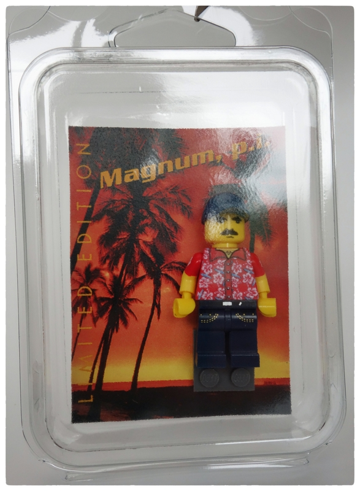
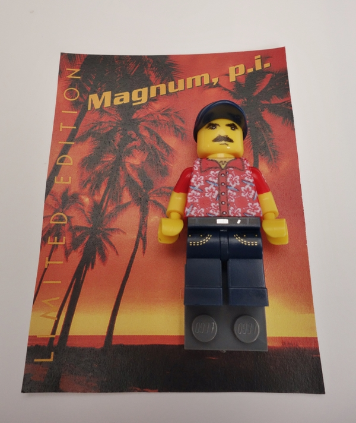
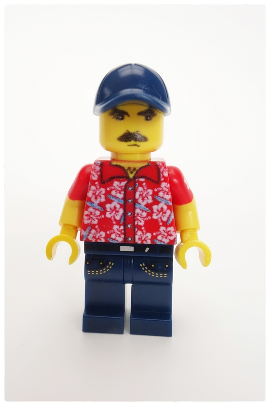
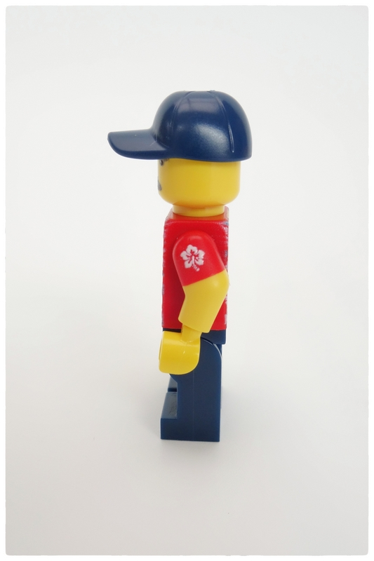
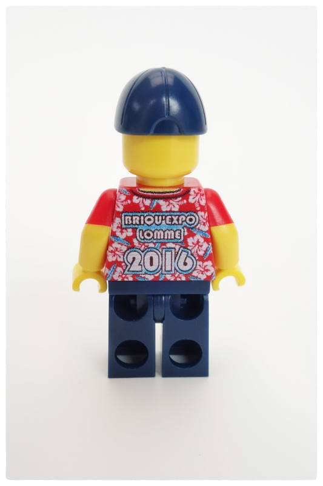

La fig, placée sur un cartel, est présentée dans un blister en plastique moulé, qui lui donne tout de suite un air exclusif.

Des palmiers, un fond de soleil couchant, et le logo Magnum P.I. (Private Investigator) composent le fond de ce cartel. La minifig est fixée sur une plate 2x2 collée.

La mention Limited Edition figure sur le côté gauche de l’image.

Pas de soucis, le détective à la Ferrari est bien reconnaissable avec sa chemise à fleur, son jean, sa moustache et sa casquette.  
La tête et le torse sont les deux pièces spécialement imprimées pour cette fig.

Les bras bénéficient également d’une impression, complétant la finition et le détail de cette minifig.

Le dos reprend le visuel à fleur de la chemise sur lequel vient se superposer l’inscription _Briqu’Expo Lomme 2016_, rattachant définitivement cette minifig exclusive à cette manifestation.

**Conclusion.** Avec sa production limitée à 80 exemplaires, distribués aux bénévoles et aux exposants de la première exposition du COR Nord, il s’agit bel et bien d’une véritable exclusivité.

Il ne manque plus qu’à lui construire une Ferrari 308GTS...
