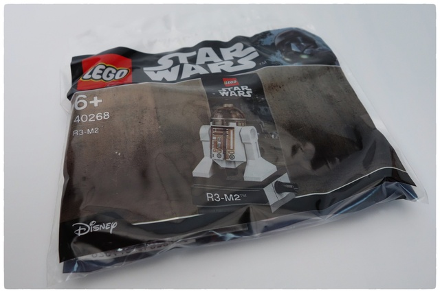
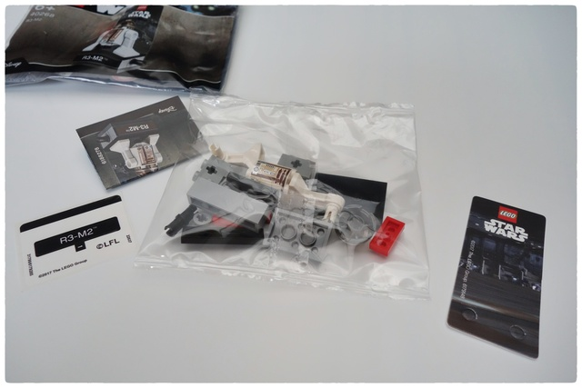
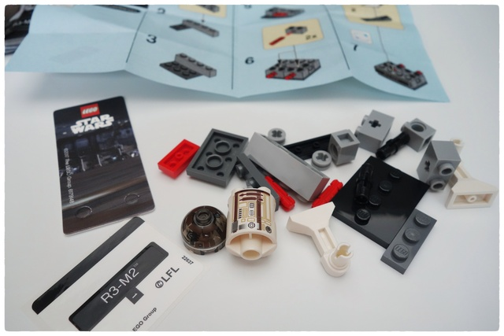
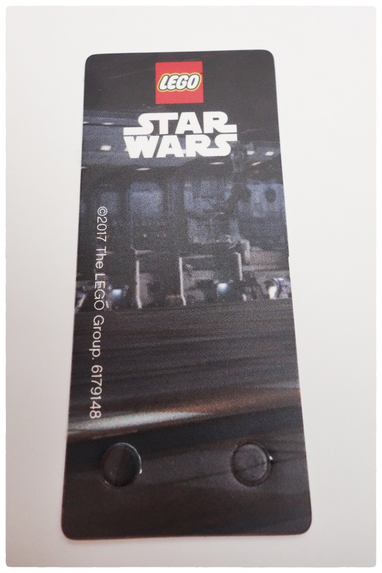
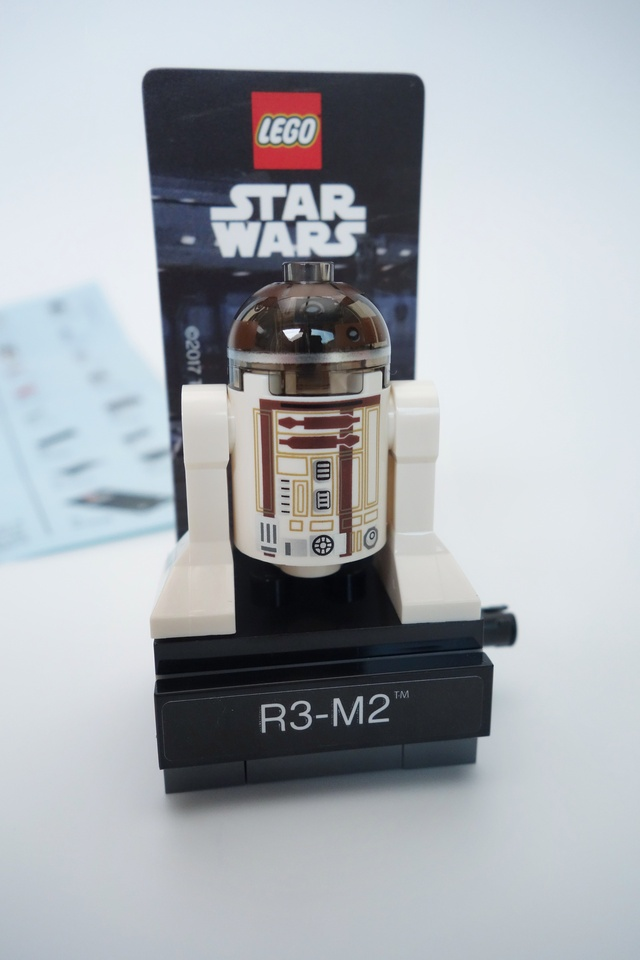
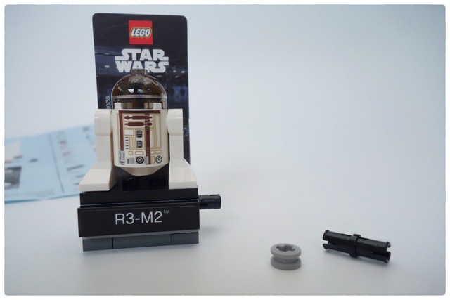

Offert dans la foulée de l’opération May the 4th 2017, jusqu’à la fin du mois pour tout achat Star Wars, ce petit polybag propose un nouveau droïde : R3-M2

R3-M2 est un droïde astromech de l’alliance rebelle. Il apparaît dans le film "Rogue One" dans le temple de Yavin, où est installée la base rebelle.

Ce polybag est atypique à plus d’un titre, puisqu’il propose le droïde sur un socle, avec une petite carte en plastique en fond, et un pin technic sur le côté, laissant suggérer une déclinaison avec d’autres personnages.

Livrée Rogue One pour ce polybag en plastique différent des polybags traditionnels.

Les pièces qui composent le droïde et son socle sont présentées dans un sachet, à part de la notice de construction, de la plaque de fond et d’un sticker.

4 pièces pour le droïde, dont un très beau dôme en trans-black sérigraphié. Le corps du droïde bénéficie lui aussi d’une impression fine et détaillée.

La plaque de fond, un décor de base rebelle, avec les logos LEGO® et Star Wars.

C’est vite construit, la plaque tient grâce à deux petits axes technic rouge 2L, et est suffisamment rigide pour tenir bien droit.

**Conclusion.** L’ensemble est plutôt anecdotique et ne vaut que par la promesse d’une série future que l’on pourra assembler. Qui seront les personnages des futurs polybags ? Tout le monde y va de ses souhaits et espoirs sur la toile.

Une petite chose sur laquelle nos amis danois auraient pu faire un effort pour donner un cachet supplémentaire à ce set : sérigraphier une tile 1x4 noire, au lieu d’un misérable sticker, aurait tout de suite élevé le niveau de finition de ce set. Pour le coup, c’est un peu mesquin.

Mais bon, on ne peut pas en attendre trop non plus pour un sachet offert quel que soit le montant d’achat dans la gamme. Si les conditions sont les mêmes pour les prochains, il y a la possibilité de se constituer une petite collection sympa, à pas trop cher (au pire, vous augmenterez votre collection de porte-clés ;) ).
