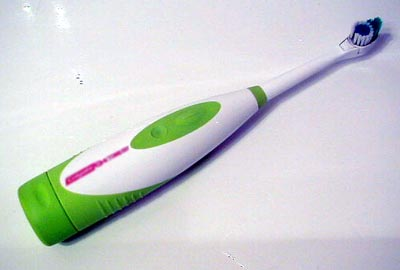

Voila, vous avez vos anciennes briques ou celles d’occasion qui ont pris la poussière et autres salissures. Comment nettoyer tout cela ?

Vous vous en doutez, il n’y a pas de miracle mais d’autres ont défriché le terrain pour nous. Les solutions dépendent du type de salissures et du type de pièces.

**Pour les salissures classiques** (poussières, traces de graisses, sucres,...) rien ne vaut les détergents habituels (lessives, savons,...)

**–** Les plaques de bases et les très grosses pièces iront au lave-vaisselle avec les assiettes du repas de famille. Attention toutefois à la température (pas plus de 40-50°C au très grand maximum) - je décline toute responsabilité en cas de détérioration.

**–** Les pièces de taille moyenne se retrouveront dans la machine à laver, dans une taie d’oreiller nouée. Même considération de température....30°c sont efficaces.

**–** Les petites pièces trouveront leur place aussi dans le lave-linge, enfermées dans un des bas nylon de madame.

_N.B. Il est évident que ces méthodes s’appliquent aux pièces en plastiques qui sont les plus courantes : briques, plaque,... mais pas aux moteurs, éléments pneumatiques... On évitera aussi ces méthodes aux éléments décorés pour éviter d’effacer les décorations._

J’utilise aussi du lave-vitre à l’alcool pour les traces de graisse et les résidus de colles en nettoyage manuel.

Justement le lavage manuel est utile pour les taches qui résisterais ou pour les pièces délicates (décorations). La solution dans ce cas est d’utiliser une brosse à dent électrique (très efficaces entre les tenons) mais aussi le coton-tige (dans les creux) ou tout simplement le chiffon.

**Les cas extrêmes**

Vos pièces sont jaunies, peintes, ou finement rayées...et le passage en machine à laver n’y change rien. Perdue pour perdue essayons les méthodes costaudes !

Pour les pièces blanches jaunies, faites les tremper dans de l’eau de javel pure pendant 3 jours. Cependant les pièces perdront un peu de leur plasticité...Faites attention aussi en manipulant l’eau de Javel.

Pour la peinture vous pouvez tenter des solvants comme l’alcool...mais malheureusement bien souvent le plastique s’abime en même temps que la peinture s’en va si le solvant est trop puissant (acétone)...car le plastique des briques LEGO® est très peu résistant aux solvants. Utilisez plutôt un polish carroserie et beaucoup d’huile de coude. Le polish contient de petites billes abrasives qui décaperont la peinture.

Cette dernière astuce est valable aussi pour les très fines rayures. Un coup de polish permet de lisser la surface...à ne pas faire sur les pièces décorés, vous effaceriez le décor.

**Les derniers conseils**

**–** Conserver vos modèles à l’abri de la lumière (soleil direct) et de la poussière.  
**–** Pour le rinçage à l’eau après lavage, utilisez une eau non calcaire.  
**–** Le meilleur moyen d’avoir de belles briques c’est...de ne pas les salir.  
**–** Les plus maniaques se laveront les mains pour manipuler leurs briques.

**Remerciements**

Merci à Petzi, Legnome et Jibouille alias Schmilbrick pour leurs expériences.
