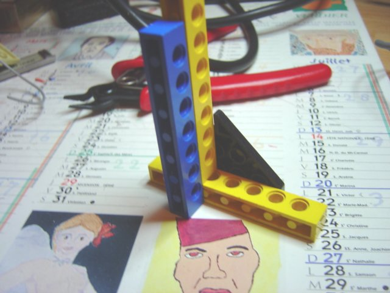
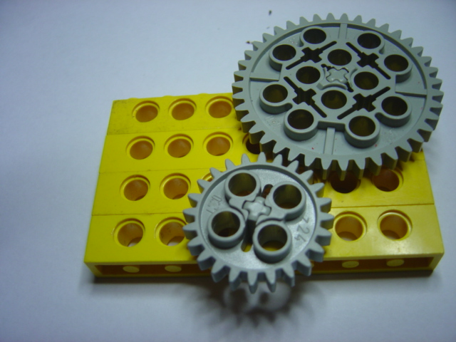
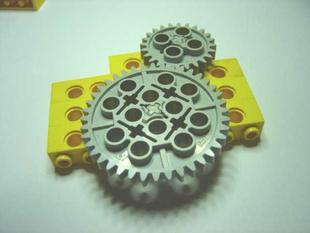
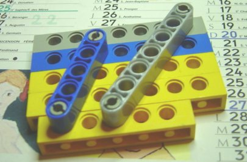

## Le réglage par ½ stud.

Vous connaissez tous le travail de **Reinhard** "Ben" **Beneke** ou vous devriez le connaître en bon membre de FreeLUG que vous êtes. (Voir la brève [www.freelug.org/breve.php3 ?id\_breve=92](http://www.freelug.org/breve.php3?id_breve=92) ).

Personnellement je ne le connaissais pas et c’est grâce à Didier Enjary que j’ai fait connaissance avec ce remarquable travail sur la possibilité du 1/2 tenon.

Une plate existe, qui facilite grandement notre vie. La plate 2x1 avec un tenon [http://www.peeron.com/inv/parts/3794](http://www.peeron.com/inv/parts/3794)

Mais nulle part j’ai trouvé à ce jour une quelconque publication de ce dont je vais vous parler. Sans doute quelque part existe des écrits en anglais sur ce sujet. Mais malheureusement je ne lis pas très bien cette langue, donc cela a put m’échapper.

J’ai toujours pensé que le lamage [^1] des tenons des briques technique était là pour réaliser une économie de matière.  
J’avais tort mais c’est mon passé industriel qui me joue des tours. C’était faire injure à la remarquable qualité du staff technique de LEGO®. La forme même du tenon aurait du m’alerter.  
Bref j’avais donc remarqué comme vous cette particularité, sans y prêter plus d’attention. C’est une difficulté rencontrée dernièrement dans l’assemblage de mon Grogneugneu qui m’a fait prendre conscience sur les possibilités qu’apporte ce fameux lamage.

Vu la taille de mon MOC je dois souvent travailler en aveugle [^2]. J’avais a realiser l’assemblage de la photo 1.  
J’enclenchais bien la traverse sur le longeron, mais impossible de cliquer les plaques de renforts. Apres maints jurons je retournais grogneugneu sur le dos, pour voir pourquoi ces satanées plaques refusaient de s’enclencher. Je m’aperçut que les longeront étaient décales d’1/2 stud. Sur le moment je n’y prêtais pas plus d’attention. Je positionnais correctement les pièces et tout rentra dans l’ordre.

**photo 1**

assemblage longeron => poutrelles

Mais une petite alarme s’était allumée quelque part dans mon DM. Si petites soient elles, je n’aime pas ce genre d’alarmes. Mais j’étais pris par les problèmes que me pose mon enjambeur.  
Un soir je me retrouvais avec le même problème, je savais la cause, mais pas le pourquoi.  
Pourquoi dans certains cas les briques s’enclenchaient dans cette position ? Et là je sus pourquoi les ingénieurs avaient pris la peine de faire ce fameux lamage. Lamage qui coûte la peau de fesses.  
Il permet le réglage par pas d’1/2 stud. Oui mais dans certaines conditions. Les questions se bousculaient dans mon DM. Je tripotais les briques sans vraiment trouver l’intérêt d’une telle option. Surtout que 2 briques identiques ne peuvent pas s’emboîter avec un décalage d’1/2 tenon. Jusqu’à ce que j’emboîte une 4 tenons dans une 8 tenons.  

**Une remarquable possibilité.**

C’était tellement génial que je me pose encore la question : Pourquoi dans aucun des manuels ou des sites traitant des differentes difficultées posé par les ecartement des trous dans le sens vertical, on ne parle pas de cette paricularité ? Je me suis replongé dans la lecture des manuels, articles etc et je n’ai pas trouvé la plus petite mention. Tous parlent du triangle de Pythagore, du nombre de rangées pour que les trous verticaux correspondent aux trous longitudinaux, mais pas une fois j’ai trouvé la moindre trace du décalage d’1/2 tenon.  
Pourtant ce décalage peut être très utile. Il permet de se libérer dans certains cas du problème d‘écartement des trous.

**Un exemple pratique.**

Vous avez besoin de faire engrener une roue Z 40 avec une roue Z 24 dans les sens vertical. Tous les manuels donnent cette combinaison comme mauvaise. Effectivement les dents s’engrainent très mal. Beaucoup de jeu.  

**photo 2**

Montage normal d’un Z 40 avec un Z 24.

Dans le montage ci-dessus les dents travaillent sur 1/4 de leurs hauteur.

Mais avec un décalage d’1/2 tenon tout change.  
Les photos sont explicites.  

**photo 4**

avec le decalage d’1/2 tenon

**photo 5**

DETAIL l’entrainement est parfait

**CONCLUSIONS :**  

Les possibilités offertes par le décalage d’1/2 tenons sont nombreuses. Je n’ai malheureusement pas le temps de les chercher. J’ai écrit ces quelques lignes pour vous informer de cette possibilité. Sans doute les maîtres constructeurs la connaissent. Mais peut être quelques débutants tireront profit du temps passé à la lecture.  
Pour ma part j’ai utilisé la possibilité offerte par le décalage sur mon grogneugneu.

**autre exemples**

Verrouillage vertical  
Normalement le verrouillage vertical de 4 et 5 rangées de briques n’est pas possible

[^1]: Lamage perçage non débouchant à fond plat exécuté a l’aide d’une fraise et non d’une mèche qui laisse au fond du trou un cône a 120 °

[^2]: Travailler en aveugle : travailler sans voir ou difficilement la zone de travail
