Revue du set 31004, **Le rapace**.

Cette boîte sortie fin 2014 comporte 166 pièces pour 9,99 €, soit un ratio de 6 centimes par pièce.

* * *

Le recto propose en haut à gauche l’emblème LEGO, en haut au centre la mention « CREATOR », en bas à droite « 3-1 », avec le rapace occupant comme il se doit la plus grande partie de la boîte, et un petit espace en bas pour les deux autres animaux pouvant être construits, un scorpion et un castor.

[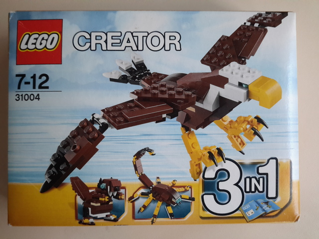](https://www.freelug.org/IMG/jpg/20170611_201241.jpg)

Le verso quant à lui présente, comme classique pour la gamme, les trois animaux ensemble, à la même taille, et certains mouvements possibles pour le rapace.

[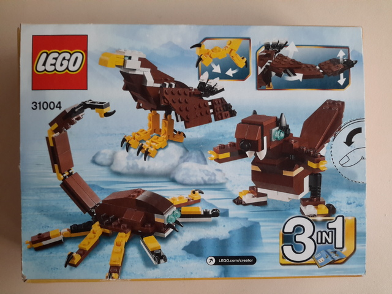](https://www.freelug.org/IMG/jpg/20170611_201254.jpg)

La boîte contient deux notices et trois sachets de pièces, avec beaucoup de marron, adapté aux animaux.

[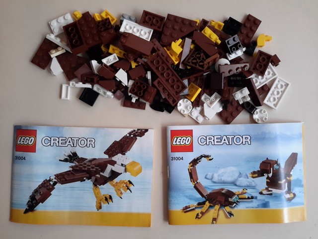](https://www.freelug.org/IMG/jpg/20170611_201937.jpg)

* * *

La construction commence par le corps, très symétrique. Quelques pièces Technic permettent d’avoir des supports pour les serres, qui pourront tourner autour d’un axe vertical.

[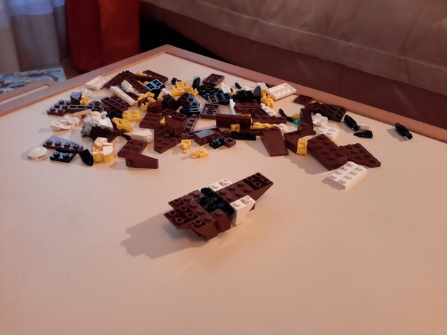](https://www.freelug.org/IMG/jpg/20170611_210110.jpg)

Le corps se continue en montant quelques pièces de toit sur l’arrière du dos, pour donner une forme aérodynamique. On monte également le support de queue, auquel s’attacheront plus tard quelques plumes.

[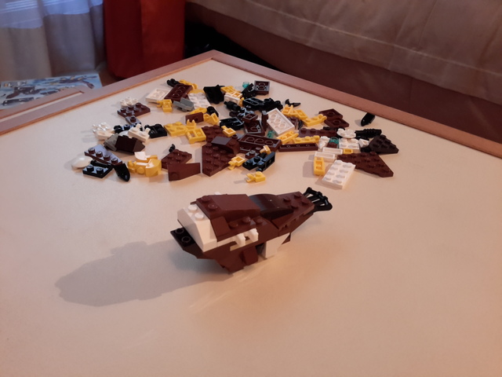](https://www.freelug.org/IMG/jpg/20170611_210552.jpg)

Le corps principal monté, on fait un détour par la tête. Le bec est représenté par deux pièces jaunes du plus bel effet, tandis que les yeux seront avec deux pièces bleu transparent.

[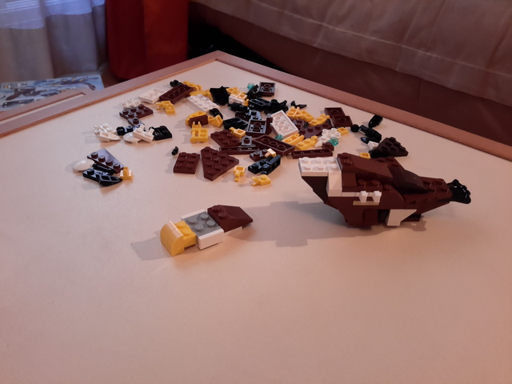](https://www.freelug.org/IMG/jpg/20170611_210717.jpg)

La tête construite puis assemblée, on ajoute les plumes de queue, puis on passe aux redoutables serres, d’un beau jaune. Elles comportent de nombreuses articulations, de façon à permettre à l’aigle de saisir ses proies facilement. Les supports Technic s’emboîteront sur les pièces vues tout au début.

[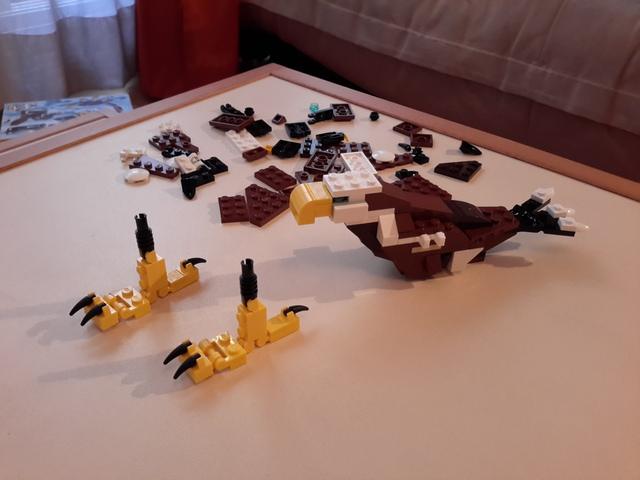](https://www.freelug.org/IMG/jpg/20170611_211257.jpg)

Les serres ajoutées, il reste à construire les ailes, d’une belle envergure. La notice fait construire l’une après l’autre, mais j’ai choisi de les monter en symétrique. Elles ont une articulation autour d’un axe vertical, et seront complétées par un morceau supplémentaire.

[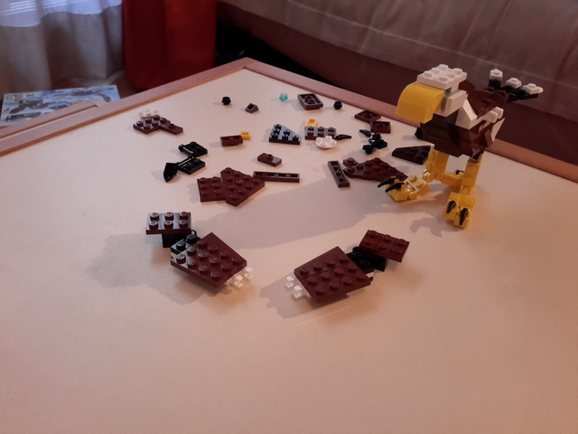](https://www.freelug.org/IMG/jpg/20170611_211620.jpg)

Et voici les bouts d’ailes, avec des plumes symbolisées par des pièces que j’ai généralement vues utilisées comme griffes — comme quoi en LEGO tout est possible !

[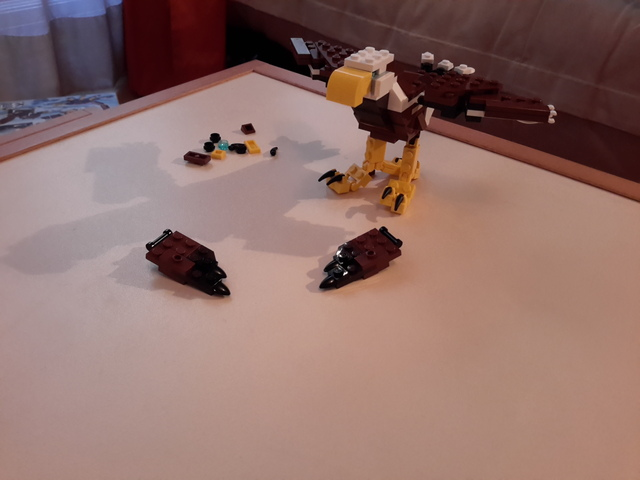](https://www.freelug.org/IMG/jpg/20170611_212320.jpg)

Les ailes terminées, le rapace est complet. Le voici avec les ailes dépliées...

[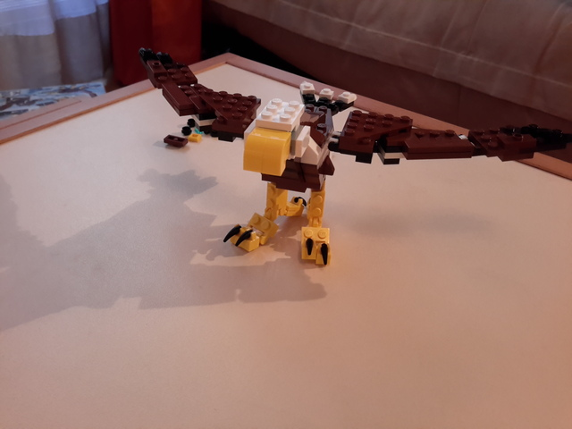](https://www.freelug.org/IMG/jpg/20170611_212342-2.jpg)

... et repliées tandis que le rapace surveille le tas de pièces supplémentaires. À noter que les deux 1x1 rondes noires ne sont utilisées que pour les autres modèles, pas le modèle de rapace.

Vue sous d’autres angles :

[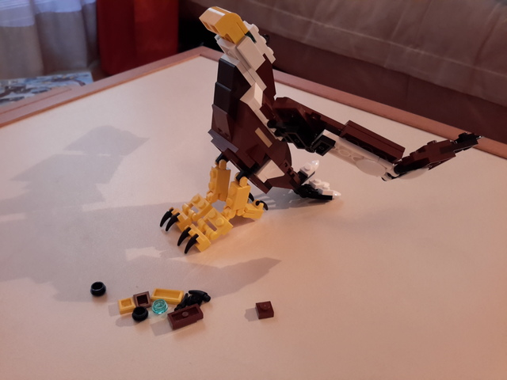](https://www.freelug.org/IMG/jpg/20170611_212447.jpg)

[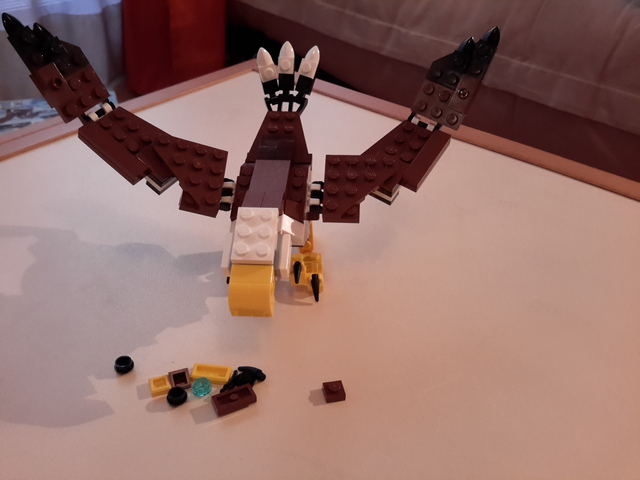](https://www.freelug.org/IMG/jpg/20170611_212513.jpg)

* * *

**Mon opinion :** un petit set, avec un joli rendu. Le rapace est très aérodynamique, les ailes sont sympathiquement articulées, et les gammes de couleurs sont très adaptées.

— -  
**Bonus 1 :** le castor, second modèle proposé, avec une belle queue et des mains prêtes à saisir tout morceau de bois disponible.

[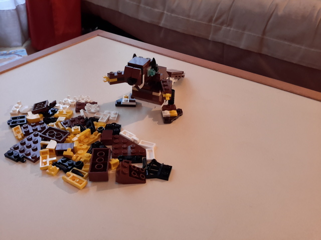](https://www.freelug.org/IMG/jpg/20170611_202926.jpg)

[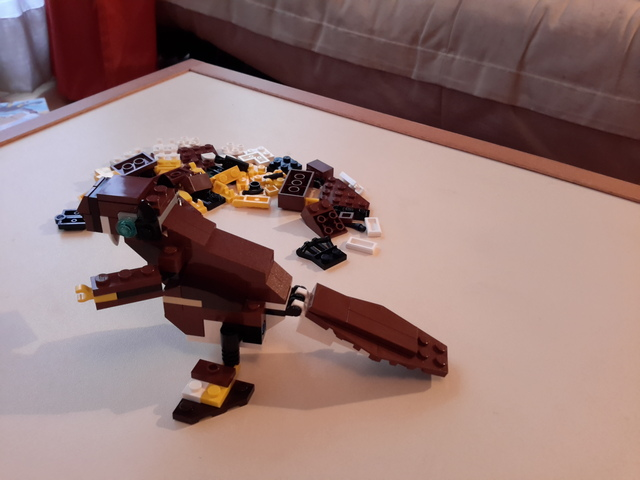](https://www.freelug.org/IMG/jpg/20170611_202938.jpg)

[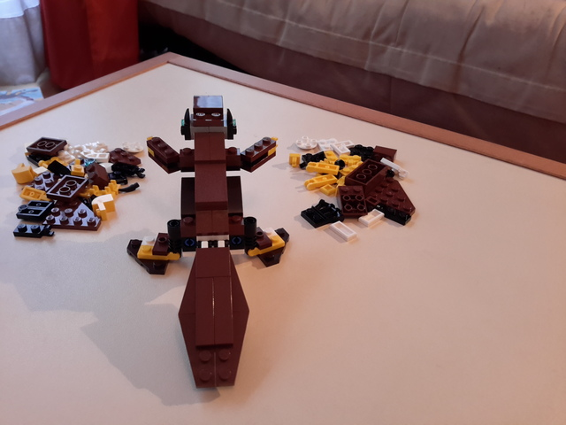](https://www.freelug.org/IMG/jpg/20170611_203004.jpg)

[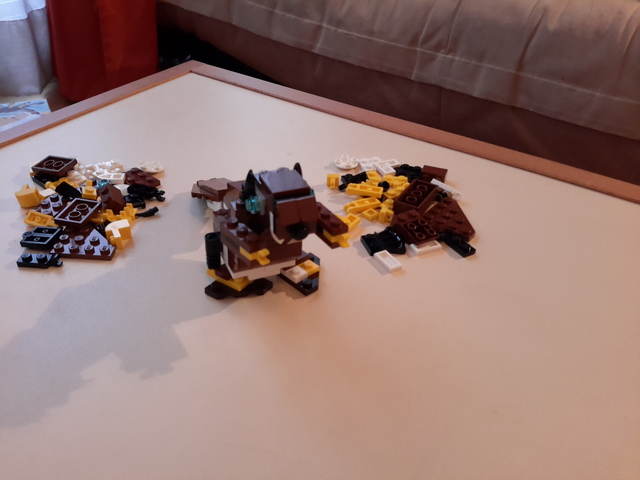](https://www.freelug.org/IMG/jpg/20170611_203020.jpg)

Et le scorpion, avec peu d’articulations (chaque patte ne peut que bouger verticalement) mais néanmoins d’aspect redoutable.

[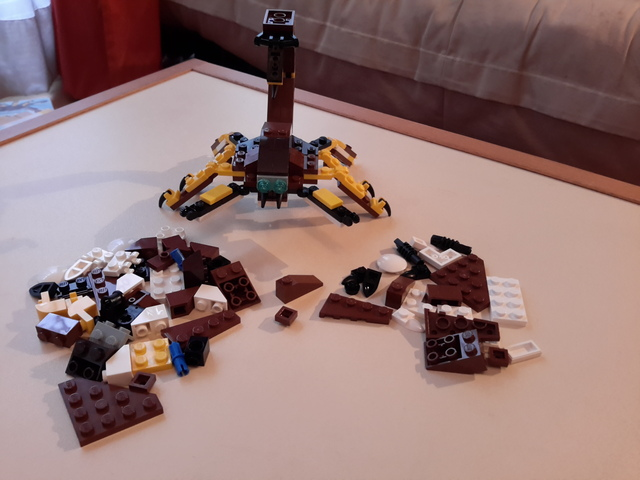](https://www.freelug.org/IMG/jpg/20170611_204403.jpg)

[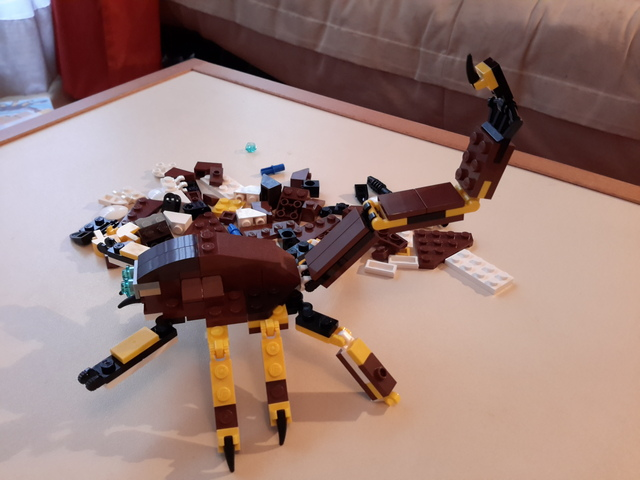](https://www.freelug.org/IMG/jpg/20170611_204415.jpg)

[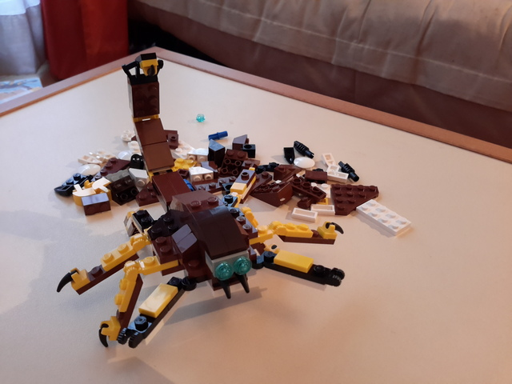](https://www.freelug.org/IMG/jpg/20170611_204429.jpg)

**Bonus 2 :** animation du montage (cliquer pour lancer).

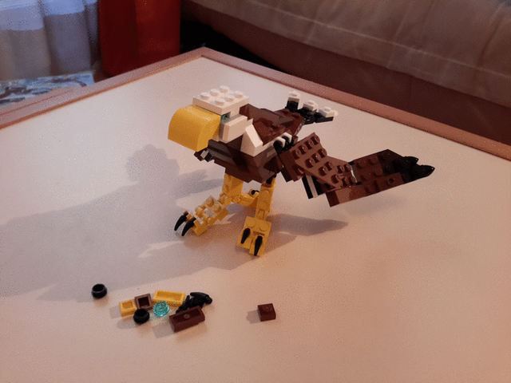
