Aujourd’hui, je vous propose la review de la figurine custom **Kaneda**, provenant du site _[minifigures.com](http://www.minifigures.com/)_, site anglais créé en 2004 et spécialisé dans le custom des minifigures _LEGO_.

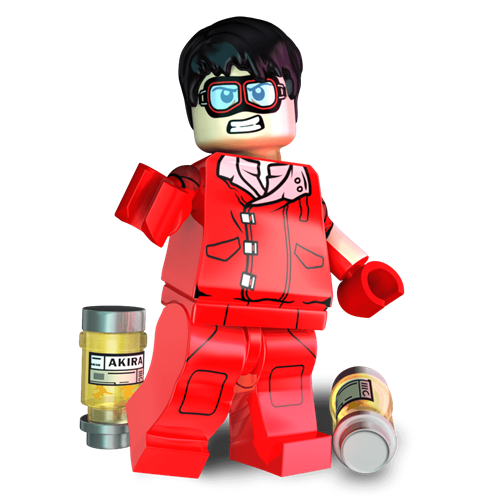

Le site utilise des pièces _LEGO_ officielles vierges qui ont droit ensuite à une impression digitale (procédé différent de la sérigraphie). Ils ont maintenant une clientèle mondiale avec notamment des entreprises comme _Google_, _Pixar_ ou _Fox Studio_...

* * *

-   **Akira**

Ce custom est inspiré du personnage de _Kaneda_ dans le film _Akira_.

> _Akira_ est un film d’animation japonais de 1988, de Katsuhiro Ôtomo, adapté du manga éponyme.
> 
> Synopsis :
> 
> Le 16 juillet 1988, Tokyo est détruit.
> 
> Trente-et-un ans plus tard, après la Troisième Guerre mondiale, en 2019, Neo-Tokyo est une mégalopole corrompue et sillonnée par des bandes de jeunes motards désœuvrés et drogués. Une nuit, l’un d’eux, _Tetsuo_, a un accident en essayant d’éviter ce qui semble être d’abord un jeune garçon mais qui a un visage de vieillard. Il est capturé par l’armée et fait l’objet de nombreux tests dans le cadre d’un projet militaire secret visant à repérer et à former des êtres possédant des prédispositions à des pouvoirs psychiques (télépathie, téléportation, télékinésie…).
> 
> _Tetsuo_ finit par s’enfuir. Mais lorsque ses amis, dont leur chef _Kaneda_, le découvrent, il est devenu violent et imprévisible.
> 
> En parallèle, se nouent des intrigues politiques. Dans la rue et dans les alcôves du pouvoir, le nom d’_Akira_ circule. Sauveur messianique pour certains groupes religieux, il est de toute évidence lié au projet militaire auquel Tetsuo a été mêlé malgré lui. L’armée essaye par tous les moyens de continuer le projet en espérant percer le secret de la puissance d’_Akira_ et de la maîtriser pour s’en servir par la suite. De leur côté, les politiques ne voient pas l’intérêt de continuer à allouer du budget à un projet de plus de trente ans qui n’a jamais rien rapporté. Enfin, un mouvement révolutionnaire veut renverser le pouvoir en utilisant le phénomène _Akira_ à des fins politiques.
> 
> _Tetsuo_ gagne peu à peu en puissance, et lorsqu’il apprend qu’_Akira_ aurait un pouvoir plus grand que lui et qu’il pourrait être responsable de ses maux de tête, il décide d’aller le trouver. Il passe sans difficulté les barrages mis en place par l’armée pour l’en empêcher, et finit par découvrir _Akira_, un ensemble d’organes disparates disposés dans différents tubes transparents.
> 
> Hors du laboratoire, _Tetsuo_ n’a plus accès aux médicaments qui lui permettent de contrôler son pouvoir. Il est dépassé par son pouvoir, et finit par disparaître avec _Akira_ et les autres sujets d’expériences. Les dégâts infligés à la ville à la suite de cette disparition sont considérables : inondations, immeubles écroulés…
> 
> Source : _[Wikipedia](https://fr.wikipedia.org/wiki/Akira_\(film_d%27animation\))_.

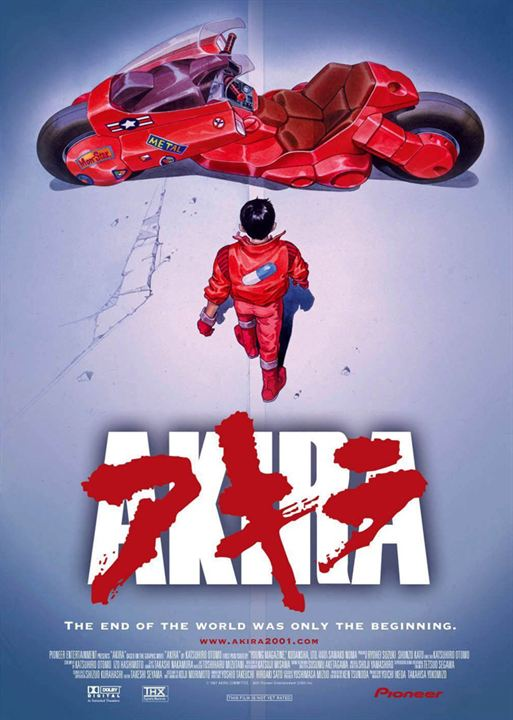

* * *

-   **Kaneda**

> **Shôtarô Kaneda** : Ami de _Tetsuo_ et chef de leur bande de motards, ce petit délinquant d’apparence drogué, macho, égoïste, glouton et parfois lâche est entraîné dans la lutte contre le programme militaire quand il croise le chemin de _Kei_. Dans son combat contre _Tetsuo_, il n’est motivé que par la colère et la soif de vengeance, après l’extermination de sa bande par le mutant. Mais, forgé par les épreuves successives, le mûrissement de son amour pour _Kei_ et diverses expériences lors du contact avec les manifestations des pouvoirs des mutants (y compris un saut dans le temps), il commence à réfléchir davantage sur lui-même et le monde - et à prendre ses responsabilités. Finalement, il fonde « _Le Grand Empire de Tokyo_ », où les jeunes vont reconstruire, seuls, sur les ruines de Tokyo, un monde à leur façon.
> 
> Source : _[Wikipedia](https://fr.wikipedia.org/wiki/Personnages_de_Akira)_.

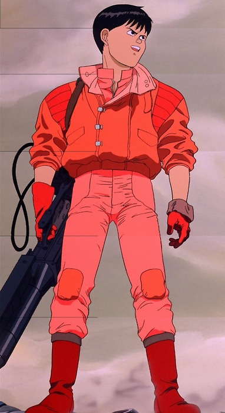

* * *

L’emballage est soigné et résistant. Il reprend, en arrière-plan, la version 3D de la minifigure présente sur le site. Nouveauté, on peut maintenant ouvrir le blister sans tout déchirer, ce dernier n’étant plus scellé.

[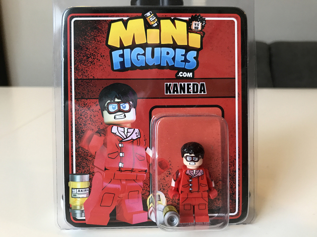](https://www.freelug.org/IMG/jpg/CustomKaneda_01.jpg)

Au dos on retrouve un texte explicatif sur le personnage et diverses informations.

[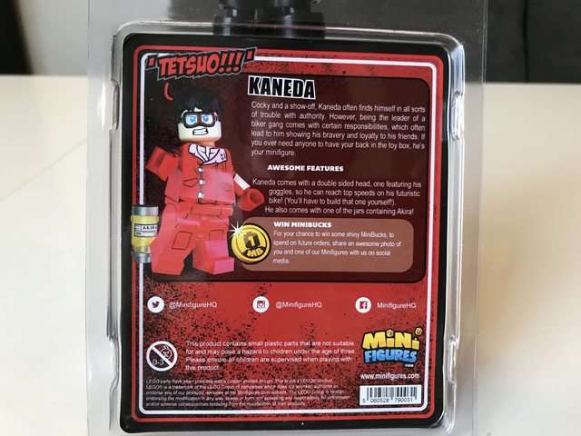](https://www.freelug.org/IMG/jpg/CustomKaneda_02.jpg)

De face, _Kaneda_ est une réussite. Malgré le dessin simple, l’impression est belle et précise.

Le visage énervé avec le masque de moto est splendide.

[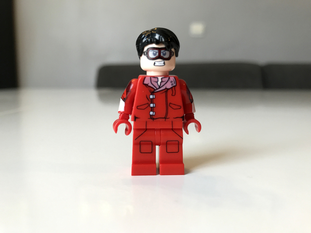](https://www.freelug.org/IMG/jpg/CustomKaneda_03.jpg)

Au dos, même impression qu’à l’avant, c’est beau. Le slogan du blouson pour les pilules d’amphétamine est bien présent. Nous avons droit à un visage alternatif narquois.

[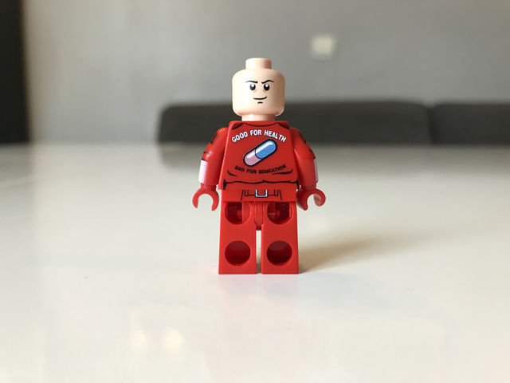](https://www.freelug.org/IMG/jpg/CustomKaneda_04.jpg)

Sur les côtés on a le droit aux manches de blouson relevées, on colle au film. Petit bémol sur l’impression couleur chair qui n’est pas des plus réussies.

[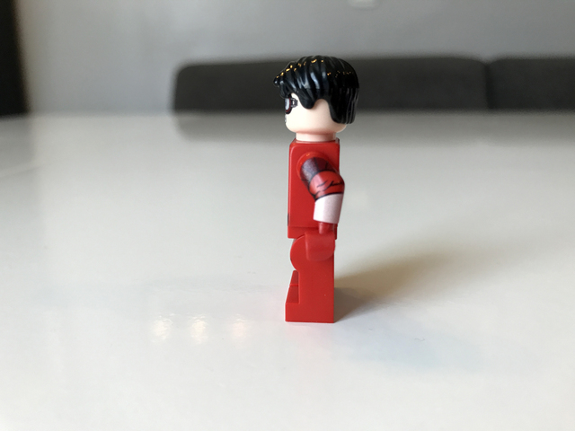](https://www.freelug.org/IMG/jpg/CustomKaneda_05.jpg)

[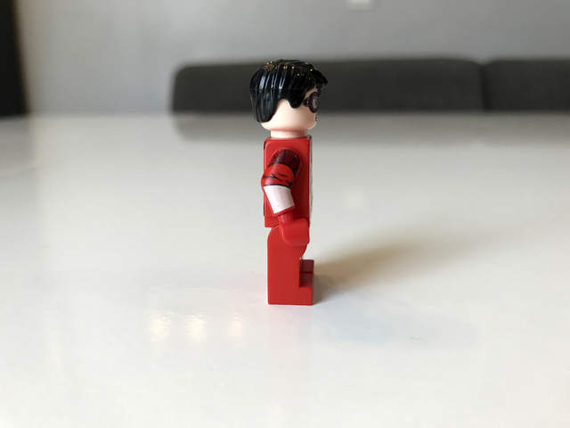](https://www.freelug.org/IMG/jpg/CustomKaneda_06.jpg)

Impression aussi sur la _Round 1x1 trans-yellow_, qui simule un des bocaux contenant les restes analysés d’_Akira_.

[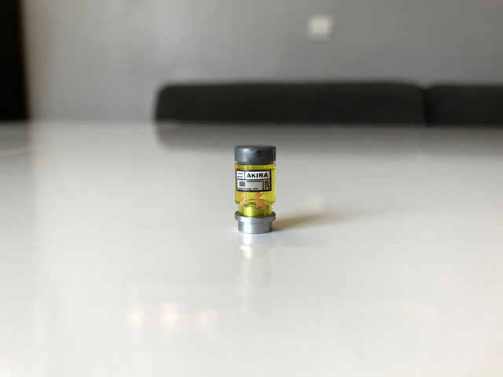](https://www.freelug.org/IMG/jpg/CustomKaneda_07.jpg)

_Kaneda_ avec le bocal.

[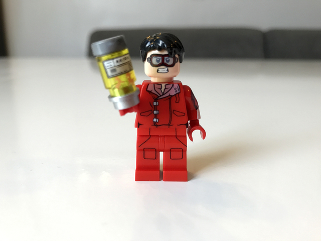](https://www.freelug.org/IMG/jpg/CustomKaneda_08.jpg)

**CONCLUSION :**

Malgré l’impression numérique, _Minifigures.com_ nous livre encore une fois une magnifique figurine. Même si ce n’est pas de la sérigraphie, je vous recommande vraiment cette minifig pour son rapport qualité/prix, surtout si comme moi vous êtes fan du manga.

Vous pourrez [trouver cette fig au prix de 14,95 £](http://minifigures.com/products/kaneda.html).
