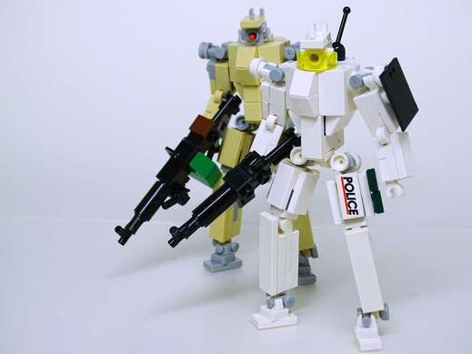
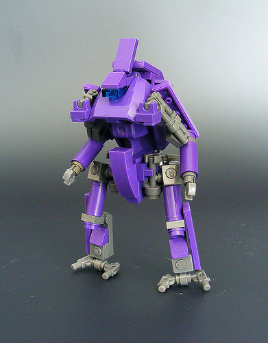

Cinq questions à un AFOL qui vit sa passion au travers de jeux de société : Maitre Sinh.

_**Question 1 : Bonjour Maitre Sinh. Tout d’abord, peux-tu te présenter en quelques mots. Quel est ton rapport avec les LEGO® ? Es-tu moceur ? Collectionneur ?**  
_

Je suis de la génération LEGO®. Mon truc, dans les 80s, c’était la gamme "space". Aujourd’hui, je suis papa, professeur et éditeur de jeux... Je ne suis pas collectionneur ni moceur, ou plutôt je ne l’étais pas jusqu’à découvrir [Mobile Frame Zero](http://www.500nuancesdegeek.fr/category/en-cours/mobile-frame-zero/). Il me manquait cette "excuse".

_**Question 2 : Comment en es-tu venu à développer/traduire des jeux de société/wargame s’appuyant sur des figurines construites en LEGO® ?**_

J’étais joueur de jeux de rôles dans les 80s et je suis passé aux jeux de plateau dans les 90s. Au début des années 2010, j’ai ouvert une ludothèque puis ai commencé à me lancer dans l’édition de jeux narratifs, une nouvelle forme de jeux pour raconter des histoires. Ce sont des jeux compétitifs, sans MJ (Maître du Jeu), quelque part à mi-chemin entre les jeux de rôles et les jeux de plateau.

C’est en explorant cette "frontière" ludique que j’ai découvert [Mobile Frame Zero](http://www.500nuancesdegeek.fr/category/en-cours/mobile-frame-zero/). Evidemment, Mechas + LEGO® + jeux, j’ai eu immédiatement le coup de foudre. Le jeu étant en licence ouverte, j’ai décidé de le traduire moi-même et d’en faire une édition accessible à tout le monde. J’ai donc traduit le Background (l’univers), et d’autres contributeurs se sont chargé des règles complètes.

_**Question 3 : Peux-tu nous parler un peu plus de ce premier jeu que tu proposes déjà depuis un petit moment : [Mobile Frame Zero](http://www.500nuancesdegeek.fr/category/en-cours/mobile-frame-zero/) ? De quel type de jeu s’agit-il ? Où peut-on le trouver ?**_

On peut le trouver en téléchargement libre sur le site [500 Nuances de Geek](http://www.500nuancesdegeek.fr/) et plus précisément [ici](http://www.500nuancesdegeek.fr/mfz-le-pdf/). Il y a également un [forum](http://www.500nuancesdegeek.fr/forum/viewforum.php?f=11), le "hangar" avec des modèles à télécharger, des conseils, etc. Le jeu a connu un grand succès aux USA, sur Kickstarter puis sur son forum et sur Flickr. On trouve de nombreux modèles originaux créés par des moceurs et il y a maintenant une communauté assez importante.

Le jeu propose des affrontement entre Mechas, dans la grande tradition japonaise (Robotech, Gundam, etc..), à travers un univers-canevas. Sa particularité est d’intégrer pleinement les possibilités offertes par les LEGO®. Les mechas ne sont pas de simples figurines, le fait que ce soit des LEGO® joue un rôle important. Par exemple, un mecha blessé "perd" des pièces (un bras, un canon, etc...) ce qui donne aux LEGO® un intérêt particulier.

_**Question 4 : Alpha Bandit est ton tout nouveau jeu. Peux-tu nous en parler également ?  
**_

C’est la suite de [Mobile Frame Zero](http://www.500nuancesdegeek.fr/category/en-cours/mobile-frame-zero/), mais cette fois, pour faire des batailles spatiales. Les règles sont les mêmes adaptées à ce nouveau thème. C’est un jeu simple et nerveux, comme [Mobile Frame Zero](http://www.500nuancesdegeek.fr/category/en-cours/mobile-frame-zero/), et qui conjugue le plaisir du MOC à celui du jeu et de la science-fiction.

_**Question 5 : Nous nous étions croisés très rapidement à la Briqu’Expo Diemoz en septembre 2015, et je vois que depuis, tu as bien développé [Mobile Frame Zero](http://www.500nuancesdegeek.fr/category/en-cours/mobile-frame-zero/) et un nouveau jeu débarque. Tu es très actif ! As-tu d’autres projets dans les tuyaux ?**_

Avec les LEGO® ? Oui : sortir ces deux jeux dans des versions "beau livre", avec des illustrations et des modèles originaux de [Cole Blaq](https://www.flickr.com/photos/coleblaq/) qui nous a déjà créé deux modèles téléchargeables pour [Mobile Frame Zero](http://www.500nuancesdegeek.fr/category/en-cours/mobile-frame-zero/).

Mais pas de date précise pour le moment. J’attends que la communauté s’étoffe sur le forum, et que les fans de LEGO® soient plus nombreux à connaitre le jeu.

On avait aussi été contacté par la boutique 1001briques qui nous avait proposé une collaboration pour proposer des sets prêt-a-jouer de LEGO® pour le jeu. Mais pour l’instant, ça reste à l’état de projet.
