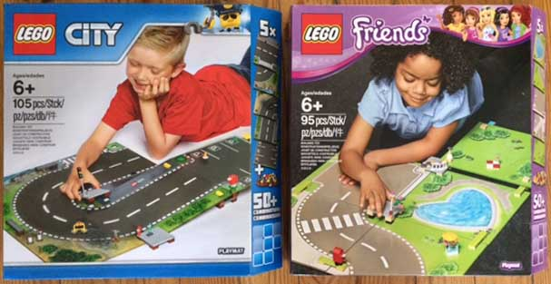
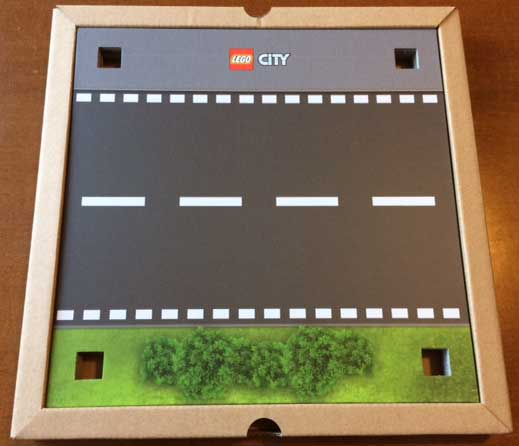
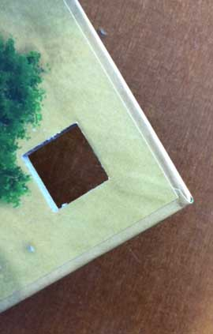
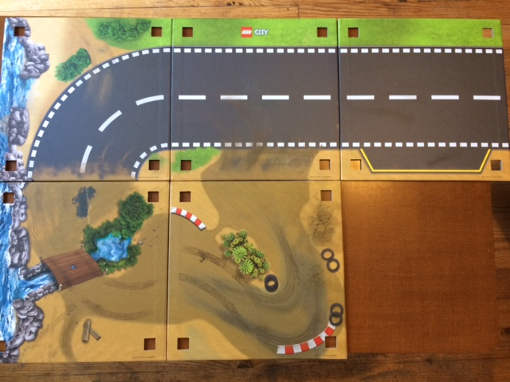
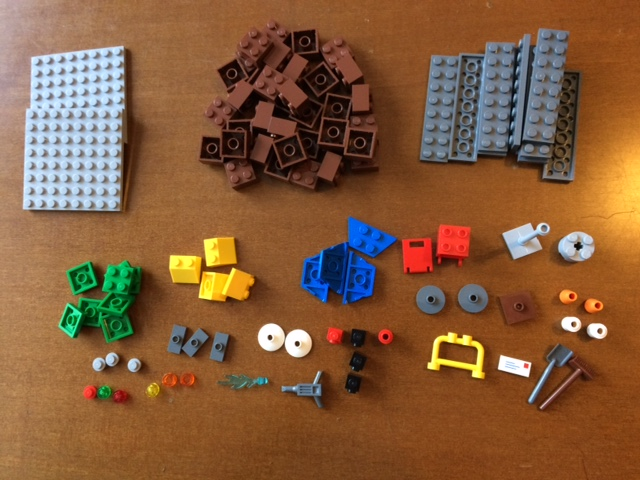
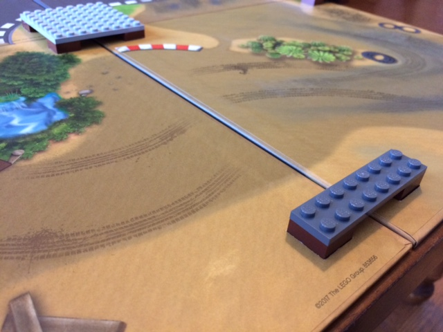
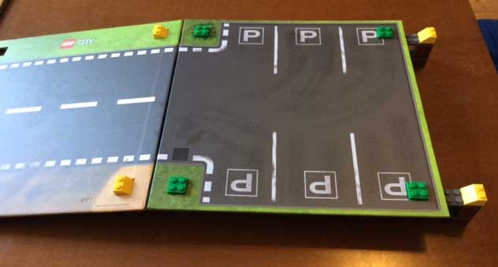
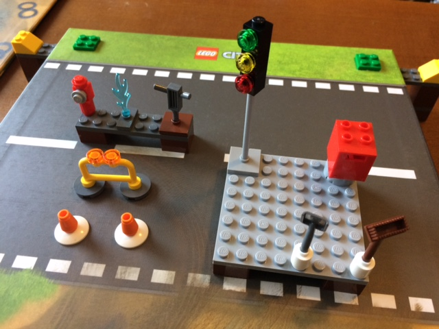
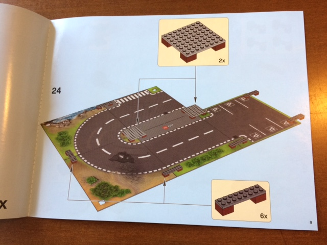

Nous vous présentons un nouveau concept de tapis de jeu dans les gammes City et Friends.

Ces produits doivent vous être très largement inconnus. C’est vrai qu’il ne s’agit pas d’ensembles classiques mais plutôt d’accessoires qu’on retrouvera avec les boîtes de rangement ou de présentation et les montres et horloges sur le site en ligne de la société LEGO.

Pour ma part je les ai trouvés presque cachés entre deux étagères au LEGO Store de Lyon. Le produit n’est pas présenté en magasin et les vendeurs n’en savent pas plus que moi. Au départ pas intéressé mais simplement intrigué, mon fils étant en pleine période "petites voitures", je prends ce prétexte pour prendre les deux versions pourtant clairement destinées aux garçons et aux filles. Je ne vois personnellement pas pourquoi mon fils ne pourrait pas jouer avec des couleurs pastels, des fleurs et des cœurs.

Les deux produits restent semblables dans leur composition et ce qui suit vaut pour les deux.

Veillez à ouvrir correctement l’emballage. Il est muni d’un intercalaire séparant les plaques des pièces et de la notice : il servira pour le rangement, les plaques, en carton, étant par ailleurs bien protégées dans un cartonné.

**Les plaques**

Les plaques sont en carton - pas en plastique. C’est important de le souligner car il pourrait y avoir une confusion tout à fait légitime. Les décors sont imprimés sur une feuille collée sur le carton. Des encoches sont présentes à chaque coin. Pas de tenons ! C’est du carton.

Il y a une _compatibilité dimensionnelle_ avec les pièces LEGO : les plaques font 32x32 (et env. 3mm d’épaisseur) et les encoches 2x2 à 2 tenons du bord. Autre point important du concept produit est la _modularité_. Avec 5 plaques, les possibilités sont déjà nombreuses (lignes droites, demi tour, zig-zag,...) mais avec un deuxième ensemble, il est possible de créer des circuits. D’autant plus que – contrairement aux classiques tapis de sol - les plaques présentent un décor différent sur chaque face.

**Les pièces.**

Elles sont une petite centaine :

**–** des plaques 2x8 et 8x8 ainsi que de nombreuses briques 2x2. Elles servent à créer des supports et plateformes permettant le maintien des plaques cartonnées entre elles par l’intermédiaire des encoches.

Combinées avec des briques pentues et des petites plaques trapèzes, elles permettent de créer des rampes ou des élévations.

**–** des pièces variées permettant de construire de petites créations pour habiller le décor : feu tricolore, boîte à lettre, barrières, plots, lampadaire, parasol...

**La notice**

Elle présente le montage des accessoires et des supports en décrivant les possibilités de combinaisons des plaques en rampe, pont et élévation.

**Analyse**

Comment comprendre l’abandon des plaques de base en plastique ? D’autant que celles-ci existent aussi dans des versions très variées autant en décor (routes, pistes, plages...) qu’en relief. Le produit carton est certainement moins cher à produire mais on perd la compatibilité du tenon.La société LEGO aurait-elle trouvé dans le carton la matière idéale pour remplacer l’ABS ?

On voit ici se poursuivre la mise à mort programmée de la plaque de base (formée sous vide). C’est particulièrement flagrant avec les plus petites (16x16) disparues depuis 2013, remplacées dans de nombreux ensembles par des plaques moulées. Les formats 32x32 pour leur part ne persistant que dans les ensembles de prestige comme dans la gamme Modular, et ayant disparu du City et du Creator.

Mais est-ce un mal ? Les plaques de base, très peu épaisses, résistent mal aux sollicitations des plus jeunes qui lors d’usages répétés et soutenus parviennent à les abîmer. Le remplacement par des plaques plus épaisses ou en carton est donc une amélioration.

D’autant plus qu’avec ce nouveau concept de tapis de sol on gagne vraiment en modularité, surtout avec les deux faces. La possibilité de faire des rampes est un vrai plus pour les jeunes cascadeurs. Le tarif (25 euros) est comparable au prix des plaques de base "routes" (12 euros les deux). L’abandon du tenon est loin d’être complet, et l’on peut construire sur les plateforme 8x8.

Les papas et mamans bricoleurs, avec du papier, du carton et un peu de peinture, pourraient même envisager de créer leurs propres modèles de "plaques de sol" à peu de frais.

Quant aux fans adultes, de leur côté, ils conservent bien des sources d’approvisionnement de leur plaque de base. Et quand bien même elles viendraient à disparaître, la société LEGO n’est pas la première pour innover et la créativité des fans a déjà conduit à des solutions modulaires et sujettes à extension , comme le démontre les routes faites de briques ["Modular Street LEGO Road”](https://www.youtube.com/watch?v=D46BTRmRqjk&t=183s).
