Une fois n’étant pas coutume, voici une review d’un petit set qui bien que labellisé « City » ne s’intègre a priori pas directement dans un diorama (et encore, je suis sûr que des Maîtres Constructeurs arriveraient à le caser quelque part de façon très naturelle), mais est plutôt un objet à part.

Il s’agit du set _40110_, la _Tirelire LEGO® City_, qui se présente comme un coffre-fort.

Sorti en 2015, ce set comporte 122 pièces pour un prix de 12,99 €, soit un ratio de 0,11 € par pièce, assez élevé pour un set de cette gamme me semble-t-il.

* * *

La face avant présente la tirelire dont la porte est entrebaillée, laissant apercevoir une magnifique toile d’araignée à l’intérieur, ainsi qu’une souris et un bâton de dynamite, probablement posé par le voleur qui sourit d’un air narquois sur le côté gauche. À noter que l’on pourrait croire que la lumière sur le sommet de la tirelire s’éclaire, mais non c’est une simple pièce rouge transparente.

[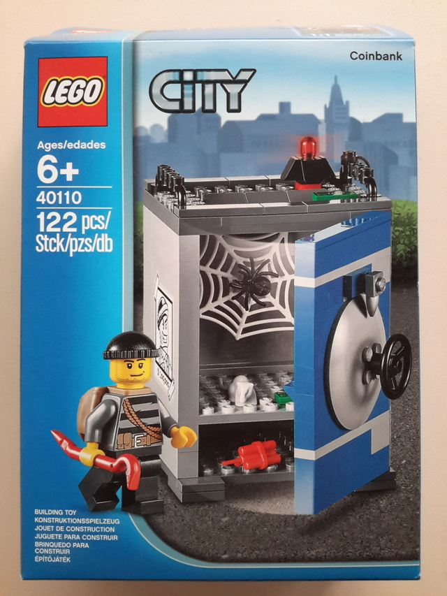](https://www.freelug.org/IMG/jpg/20170708_210239.jpg)

L’arrière présente la tirelire en utilisation « normale », avec explication de comment introduire les pièces dedans — bien que le voleur soit déjà arrivé sur le sommet.

[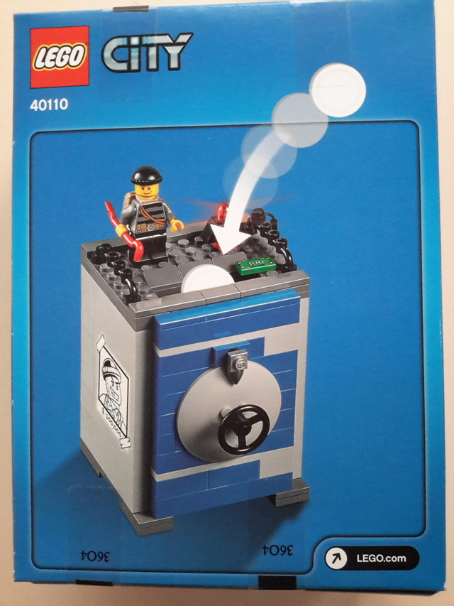](https://www.freelug.org/IMG/jpg/20170708_210310.jpg)

À l’intérieur de la boîte se trouvent trois sachets, qui une fois ouverts font un petit tas de pièces. S’y trouve également une plaque d’autocollants, une magnifique fissure et un avis de recherche du voleur — il n’en est manifestement pas à son coup d’essai ! La boîte, pour une fois, n’est fermée que par de l’adhésif sur ses deux côtés, et peut donc être facilement démontée et pliée, puis remontée plus tard.

[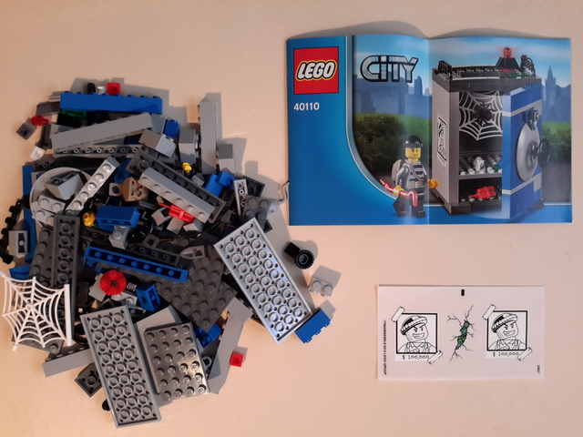](https://www.freelug.org/IMG/jpg/20170708_210604.jpg)

Le voleur est très bien équipé. Outre son pied de biche d’un magnifique rouge vif et un sac pour emporter son butin, il a une corde enroulée sur une épaule et une ceinture d’accessoires indispensables à son occupation. Il a une petite barbe qui remonte aux cheveux, et affiche un sourire un peu narquois. Enfin même si son torse est rayé, les jambes sont totalement unies.

[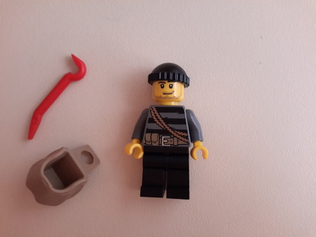](https://www.freelug.org/IMG/jpg/20170708_210816.jpg)

Le dos reprend le motif de la corde et de la ceinture, dans laquelle sont glissées quelques clés.

[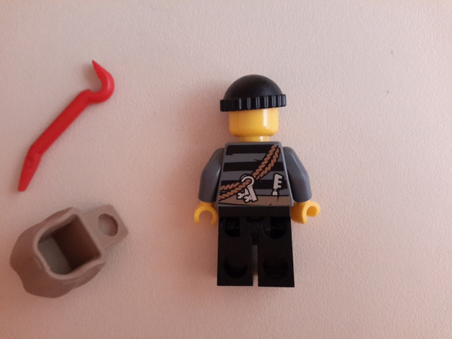](https://www.freelug.org/IMG/jpg/20170708_210758.jpg)

La construction proprement dite commence avec la base grise de la tirelire, que l’on monte de deux tenons, puis l’on passe à la porte, bleue. Rien de bien spécial, un côté est ouvert.

[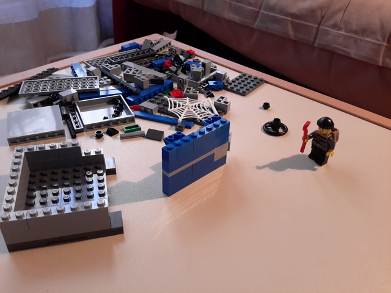](https://www.freelug.org/IMG/jpg/20170708_211252.jpg)

La porte présente, comme tout coffre-fort qui se respecte, un volant pour l’ouvrir et la fermer. Sur le dessus viendra se poser un cran pour repérer le chiffre, vraisemblablement.

[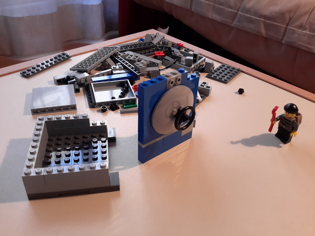](https://www.freelug.org/IMG/jpg/20170708_211426.jpg)

Au dos de la porte, voici le mécanisme qui permet de la fermer et de l’empêcher de se rouvrir : une simple barre Technic, qui vient s’insérer dans le mur non plein.

[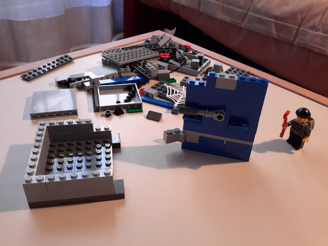](https://www.freelug.org/IMG/jpg/20170708_211457.jpg)

Une fois la porte assemblée et rattachée à la base, on continue à monter les murs, toujours gris, avec un espace sous le plancher. Une belle toile d’araignée, habitée, vient agrémenter le fond du coffre. C’est sur les côtés que viendront se fixer les autocollants, que j’ai omis dans cette revue.

[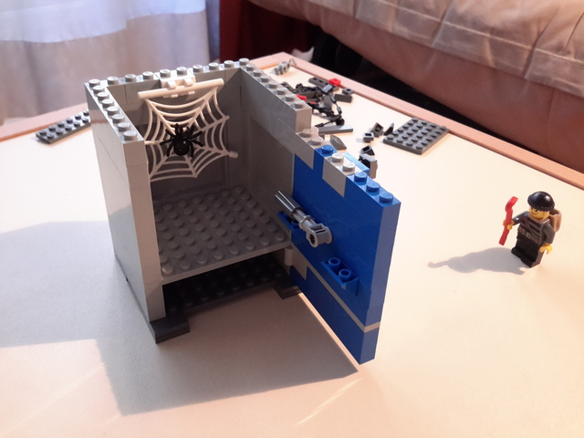](https://www.freelug.org/IMG/jpg/20170708_211913.jpg)

Le toit est d’un gris plus foncé, avec l’ouverture indispensable à la dépose des pièces. L’on aperçoit un bâton de dynamite sons le plancher, probablement posé par notre voleur pendant que je ne regardais pas.

[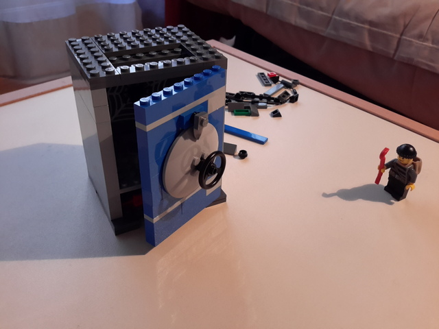](https://www.freelug.org/IMG/jpg/20170708_212129.jpg)

Et voici la tirelire complétée, avec un billet prêt à être inséré, et un signal d’alarme. Le voleur a déjà installé sa corde pour grimper, l’alarme n’est décidément pas fiable. Sur le devant les quelques pièces bonus, pas grand-chose à se mettre sous la dent.

[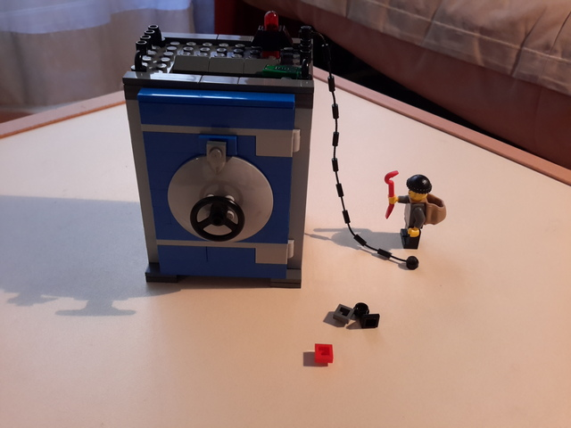](https://www.freelug.org/IMG/jpg/20170708_212412.jpg)

Un aperçu du coffre porte ouverte, mais serrure fermée, pour illustrer comment, insérée dans le mur gris creux, la barre bloque la porte. On aperçoit également le nez d’une souris.

[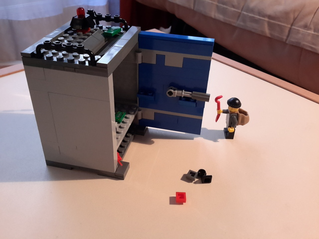](https://www.freelug.org/IMG/jpg/20170708_212428.jpg)

[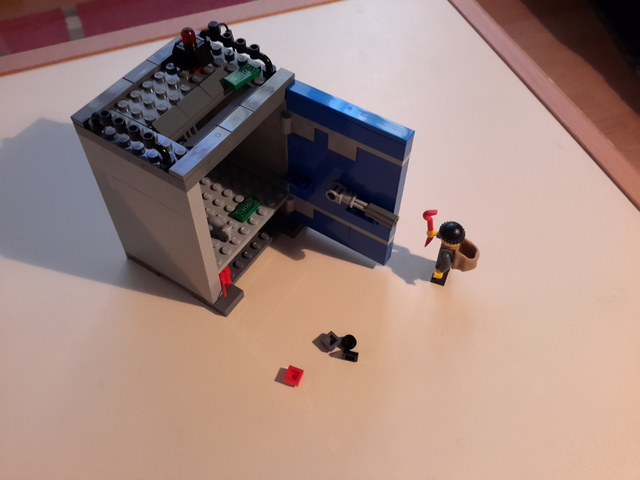](https://www.freelug.org/IMG/jpg/20170708_212446.jpg)

* * *

**Avis :** un rendu sympathique, même si la construction est toute simple. Les couleurs sont sobres, mais adaptées me semble-t-il à la fonction de l’objet. J’ai en revanche de gros doutes sur la sécurité du coffre face au voleur !

**Bonus :** toutes les étapes de construction (cliquer pour lancer).

[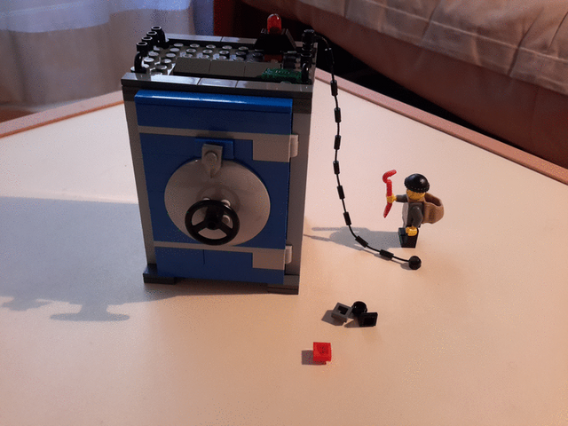](https://www.freelug.org/IMG/gif/40110-tirelire.gif)
