LEGO propose, à différents moments de l’année, des petits sets de saison.

Le set présenté ici rentre dans cette gamme, il s’agit du set _40237_, _La chasse aux œufs de Pâques_, sorti en 2017.

Pour 9,99 € (les prix habituels pour ces sets saisonniers), on obtient une boîte contenant 145 pièces (dont deux personnages), soit un ratio de 7 centimes par pièce.

* * *

L’avant de la boîte met en scène les deux figurines, une femme et un petit garçon tenant une grosse loupe pour mieux chercher les œufs. Trois petites zones de recherche sont présentes, et une brouette avec une carotte complète le tableau. Plusieurs œufs sont imprimés pour rester dans le thème.

[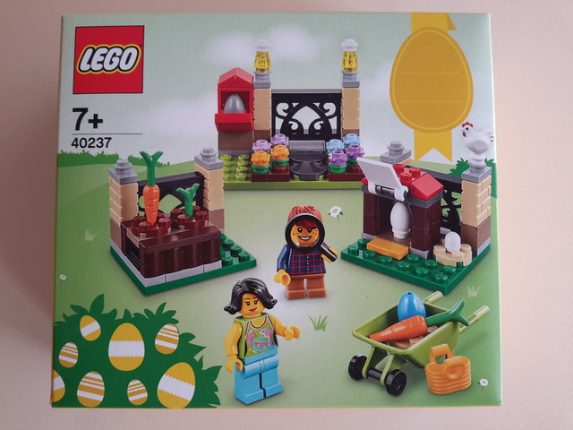](https://www.freelug.org/IMG/jpg/20170611_113124.jpg)

Le dos nous montre le petit garçon cherchant, avec l’aide de sa loupe donc, des œufs dans différents endroits, et mettant sa récolte dans la brouette.

[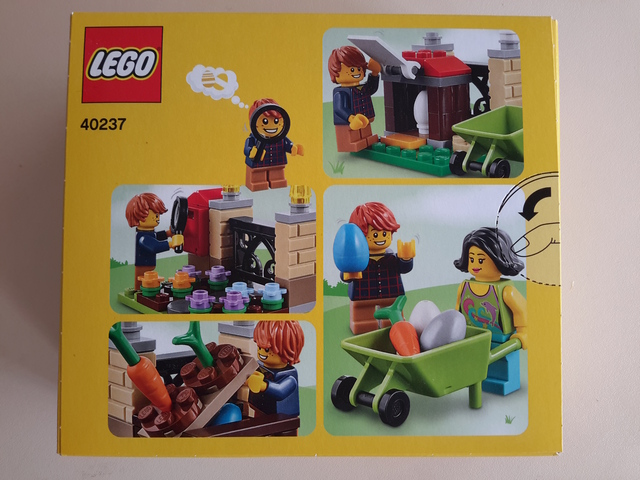](https://www.freelug.org/IMG/jpg/20170611_113145.jpg)

La boîte contient 3 sachets et une notice.

[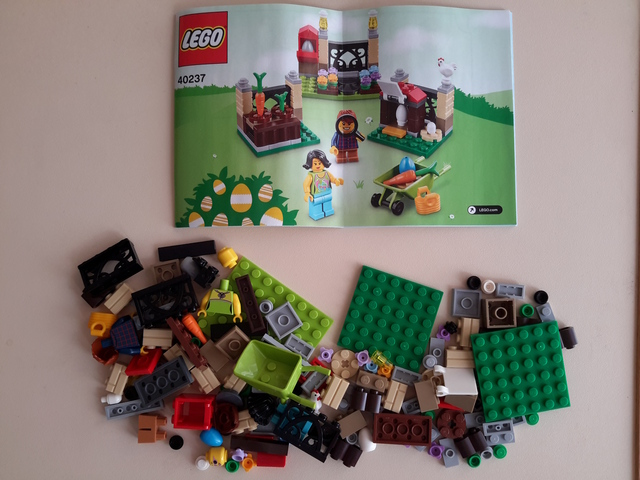](https://www.freelug.org/IMG/jpg/20170611_113737.jpg)

La jeune femme porte un magnifique t-shirt avec un dauphin, et elle sourit gentiment. Le petit garçon lui a une chemise bleu foncé à rayures rouges, et quelques taches de rousseur sur le visage. En revanche service minimal sur les jambes des deux figurines, unies.

[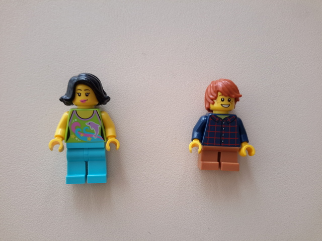](https://www.freelug.org/IMG/jpg/20170611_113844.jpg)

Le dos continue l’avant sans fioriture particulière.

À noter que la jeune femme a un visage alternatif, avec des lunettes de soleil.

[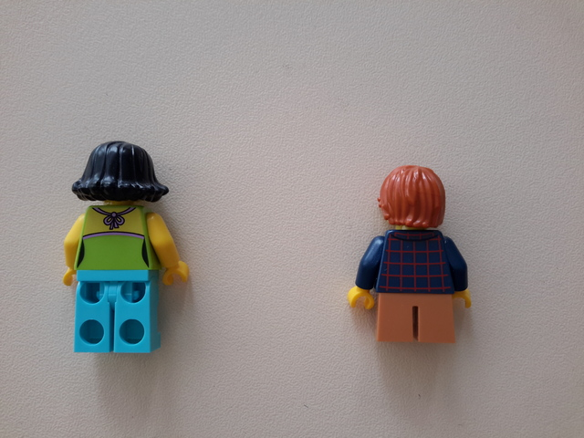](https://www.freelug.org/IMG/jpg/20170611_113901.jpg)

[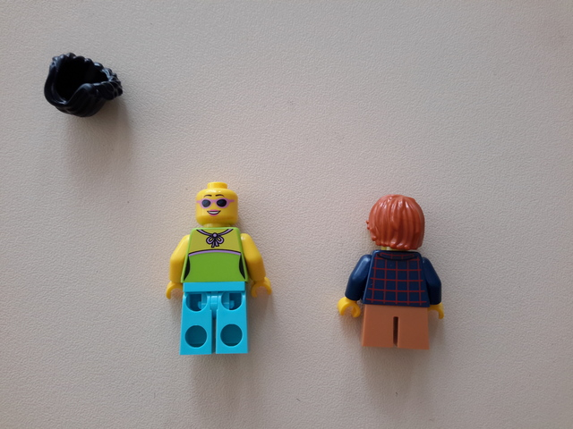](https://www.freelug.org/IMG/jpg/20170611_113916.jpg)

Et voici nos deux chercheurs équipés et prêts à aller chercher les œufs.

Les constructions proposées sont trois petites zones très similaires, avec une grille entourée de murets, sur une plaque d’herbe (puisque verte, logique).

[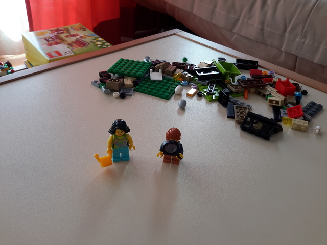](https://www.freelug.org/IMG/jpg/20170611_114008.jpg)

La première étape est de monter la brouette, sur laquelle pourront s’entasser les œufs trouvés.

[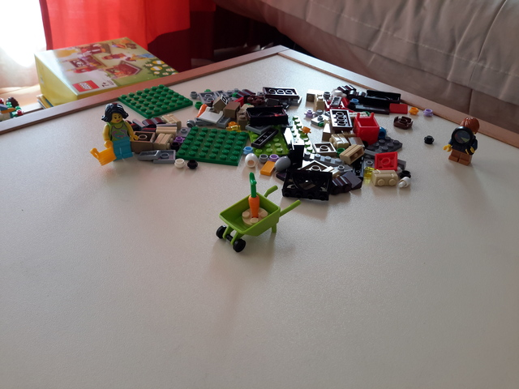](https://www.freelug.org/IMG/jpg/20170611_114110.jpg)

La première petite zone, sur une plaque de 6x6, présente un petit monticule de terre sous lequel se cachera un œuf bleu du plus bel effet. Une charnière, ici en position verticale, permettra d’ouvrir la cachette.

[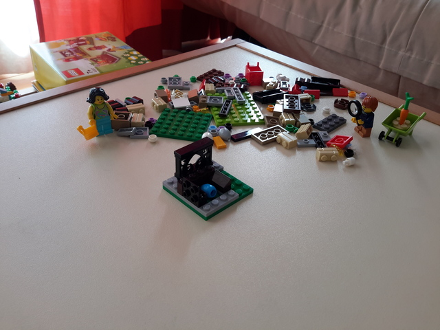](https://www.freelug.org/IMG/jpg/20170611_114340.jpg)

On cache le trésor, puis l’on monte les murets à côté de la grille du fond...

[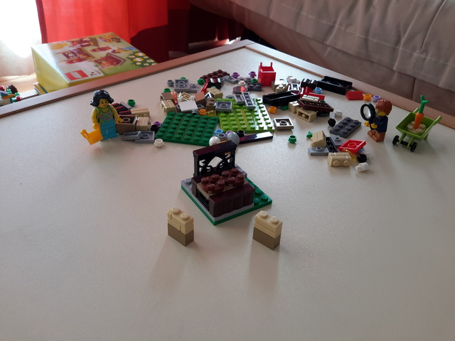](https://www.freelug.org/IMG/jpg/20170611_114514.jpg)

... avant de planter la carottes qui serviront de couverture à la cachette secrète (qui pourrait se douter qu’un œuf est caché sous des carottes, franchement ?).

[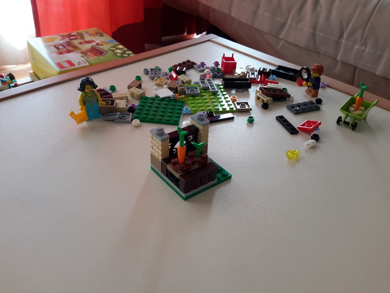](https://www.freelug.org/IMG/jpg/20170611_114611.jpg)

La deuxième petite zone de verdure est cette fois-ci sur une plaque 6x8 d’un vert un peu plus pâle, plus grande car il s’y greffera une boîte aux lettres. Il s’agit d’un parterre de fleurs, de couleurs variées. Comme précédemment, une grille est placée au fond.

[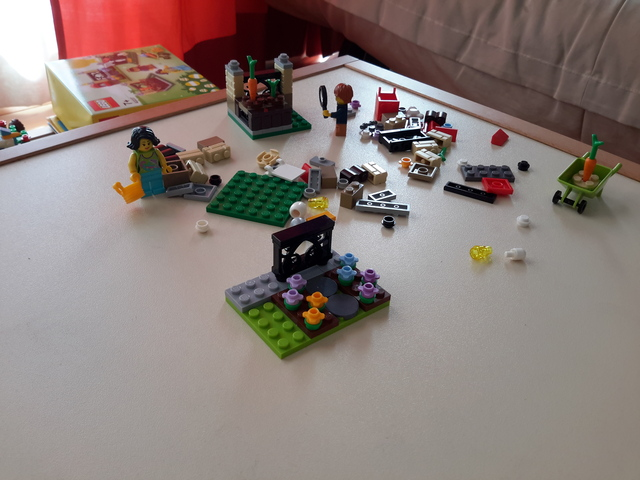](https://www.freelug.org/IMG/jpg/20170611_114856.jpg)

Deux petits bouts de murets, et on construit la boîte aux lettres dans laquelle se cache un œuf, blanc cette fois-ci.

[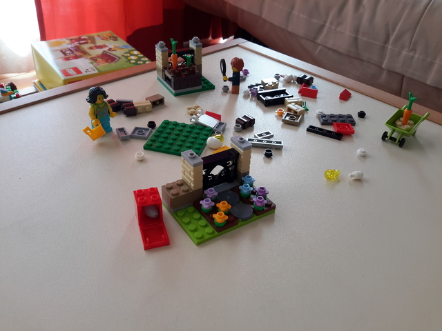](https://www.freelug.org/IMG/jpg/20170611_114953.jpg)

Enfin la dernière zone, sur une plaque 6x6 à nouveau, se construit sur la même modèle grille - murets.

[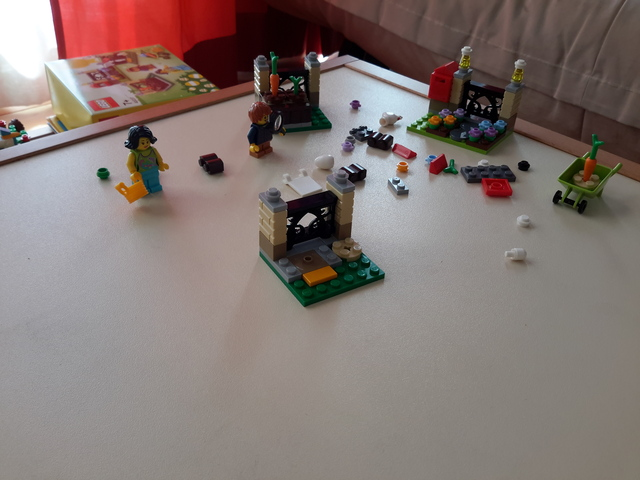](https://www.freelug.org/IMG/jpg/20170611_115239.jpg)

Cette fois-ci on y trouve une poule et son œuf, plus un œuf (en chocolat sans doute) dans ce que je pense être un mini-poulailler.

[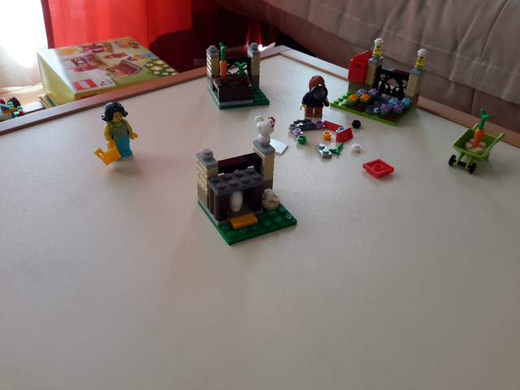](https://www.freelug.org/IMG/jpg/20170611_115340.jpg)

Et voici la zone terminée, avec un volet pivotant cachant l’œuf.

[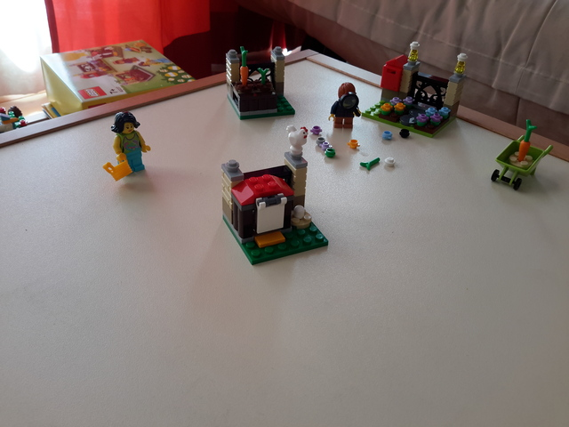](https://www.freelug.org/IMG/jpg/20170611_115422.jpg)

Et voici le set complet, avec les trois œufs cachés visibles. Le petit enfant examine, toujours avec sa loupe, les pièces bonus, plutôt nombreuses.

[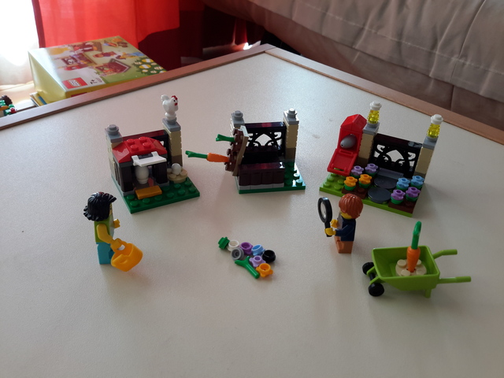](https://www.freelug.org/IMG/jpg/20170611_115512.jpg)

* * *

**Avis :** un petit set sympathique, très agréable à monter même s’il ne fait appel à aucune technique de construction particulière. Le rendu est amusant, avec quelques pièces intéressantes comme la poule et les carottes.

Bref un bon set de saison.

**Bonus :** animation de toutes les étapes de construction (cliquer pour lancer).

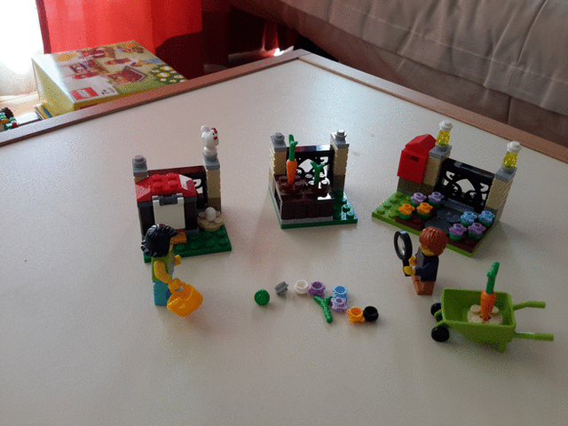
