Aujourd’hui, prenons un peu d’altitude avec la review d’un set d’avion à réaction, à savoir _31042_, _L’avion à réaction_, dans la gamme Creator.

Sorti en 2016, ce petit set comporte 100 pièces pour 9,99 €, soit un ratio relativement élevé à mon goût de 10 centimes par pièce.

Comme attendu, l’avant de la boîte se concentre sur l’avion à réaction, modèle principal, tout en montrant les deux autres modèles proposés, tandis que le « 3 in 1 » à droite et le « Creator » en haut au centre rappellent la gamme du set.

[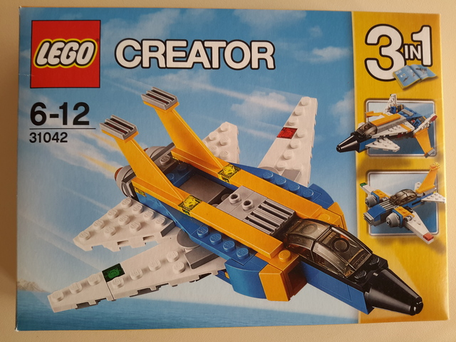](https://www.freelug.org/IMG/jpg/20170611_112330.jpg)

L’arrière classiquement montre les trois modèles simultanément, en vol au-dessus d’une étendue d’eau, tandis qu’un encart montre que les ailes de l’avion à réaction sont mobiles, pouvant se replier.

[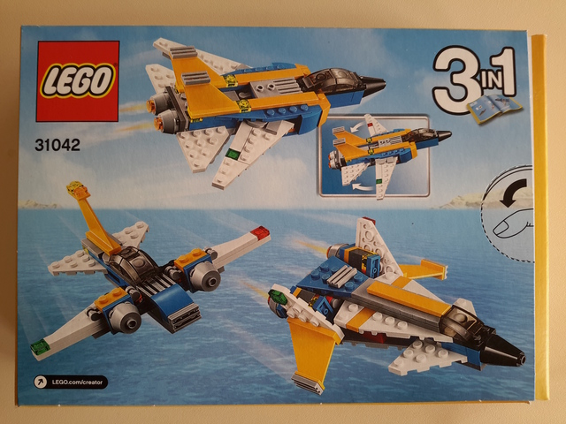](https://www.freelug.org/IMG/jpg/20170611_112355.jpg)

La boîte ouverte fait apparaître trois notices et deux sachets, qui fournissent un petit tas de briques oranges, grises, bleues et blanches.

[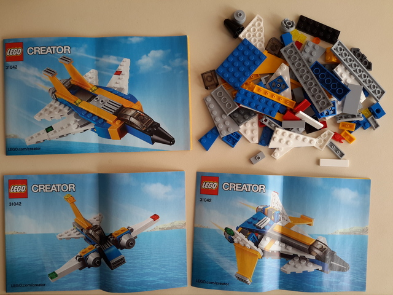](https://www.freelug.org/IMG/jpg/20170611_112257.jpg)

La construction de l’avion à réaction commence par le corps principal, à base de plaque grise 4x10, sur lequel viendront se greffer les ailes. Les deux pivots permettront la rotation des ailes, tandis que la plaque lisse à l’arrière permettra aux réacteurs de coulisser.

[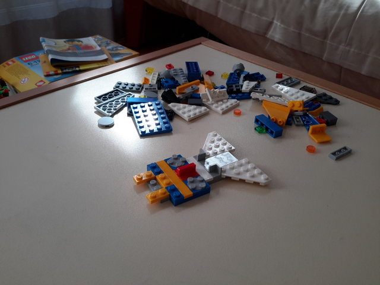](https://www.freelug.org/IMG/jpg/20170611_105640.jpg)

Le cockpit est l’étape suivante, avec deux pièces transparentes en symétrique et un nez conique. Puis on s’attelle aux ailes, ici la gauche, qui comportent une charnière verticale qui sera reliée au bloc des réacteurs.

[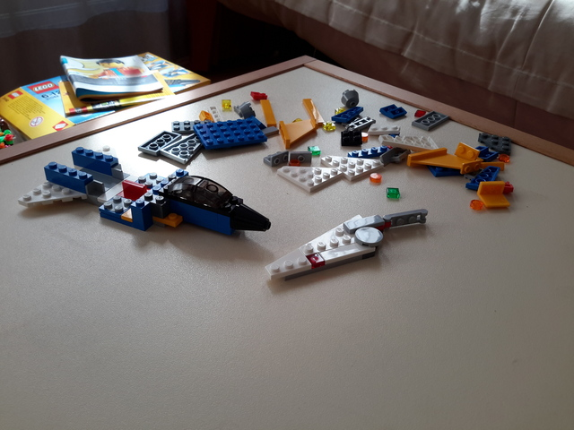](https://www.freelug.org/IMG/jpg/20170611_110007.jpg)

L’aile de droite est symétrique, et on pose les deux ailes sur les pivots appropriés.

[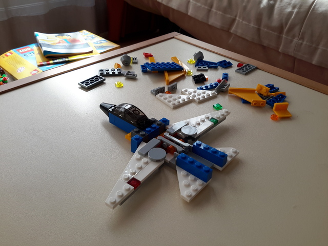](https://www.freelug.org/IMG/jpg/20170611_110249.jpg)

L’étape suivante, après avoir posé quelques éléments du toit de l’avion, est le bloc de réacteurs à l’arrière. Les pinces rouges permettront la connexion aux charnières des ailes, asservissant les trois éléments. Les réacteurs sont des cônes à sommet à tenon sur lequel est fixée une pièce ronde orange transparent.

[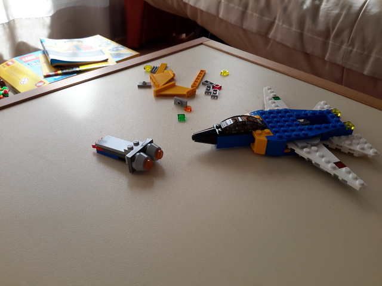](https://www.freelug.org/IMG/jpg/20170611_110627.jpg)

On fixe les réacteurs puis quelques ailerons sur le sommet, et quelques jumpers et grilles pour compléter le modèle. Les ailes sont ici en position déployée, avec les réacteurs sortis vers l’arrière. Sur le côté gauche les quelques pièces bonus.

[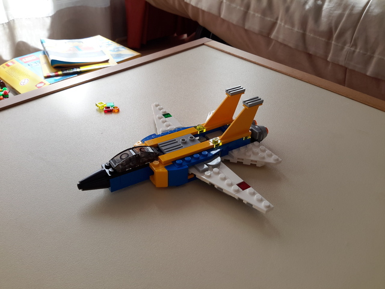](https://www.freelug.org/IMG/jpg/20170611_110739.jpg)

Et voici la position ailes repliées, qui provoque la rentrée des réacteurs dans le fuselage.

[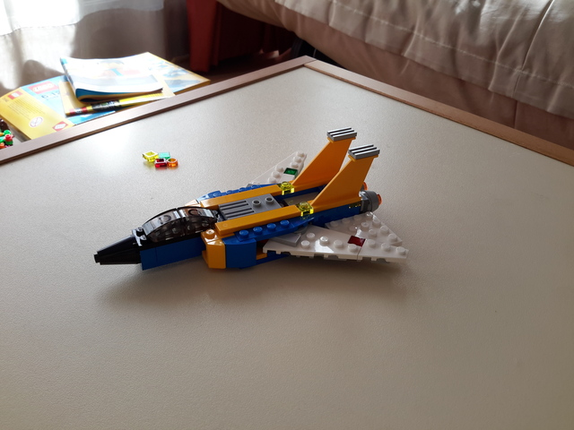](https://www.freelug.org/IMG/jpg/20170611_110747.jpg)

Une vue de derrière, ailes repliées et dépliées, illustrant mieux le déplacement d’un tenon environ des réacteurs.

[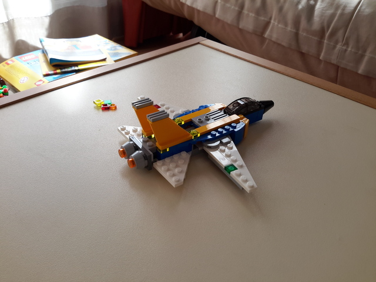](https://www.freelug.org/IMG/jpg/20170611_110807.jpg)

[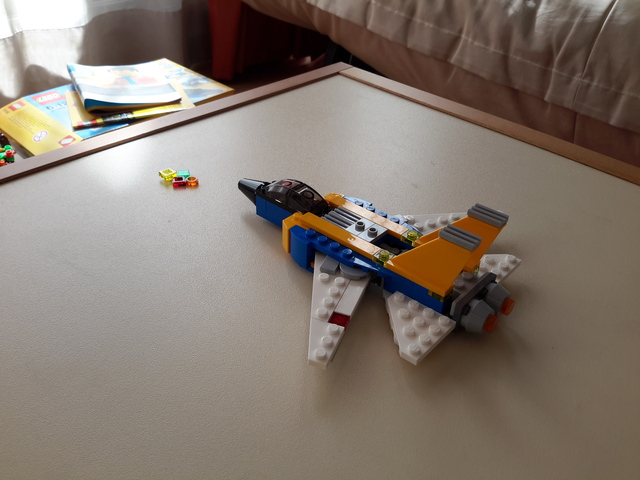](https://www.freelug.org/IMG/jpg/20170611_110819.jpg)

* * *

**Avis :** comme la plupart des sets Creator, celui-ci propose des constructions pas trop complexes mais donnant un bon rendu. L’avion est sympathique, avec des couleurs pas forcément réalistes mais pas si choquantes au final me semble-t-il, et les ailes pivotantes sont un élément de jouabilité agréable.

Bref un bon set.

**Bonus 1 :** quelques photos des modèles secondaires, le jet futuriste...

[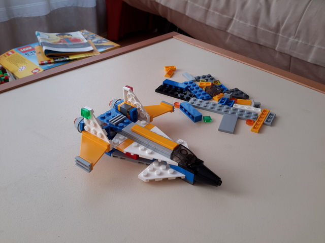](https://www.freelug.org/IMG/jpg/20170611_105008.jpg)

[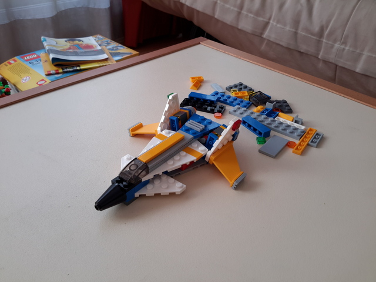](https://www.freelug.org/IMG/jpg/20170611_105017.jpg)

[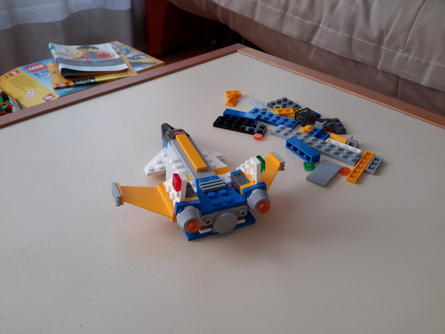](https://www.freelug.org/IMG/jpg/20170611_105024.jpg)

... et l’avion à simili-hélices.

[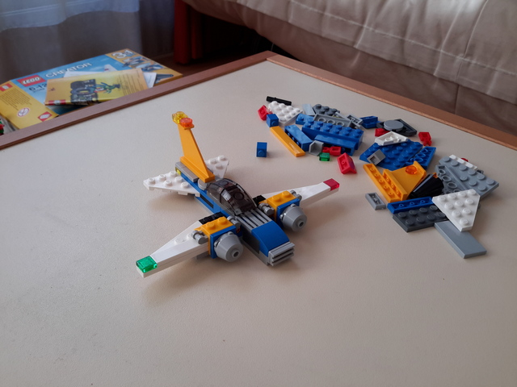](https://www.freelug.org/IMG/jpg/20170611_104016.jpg)

[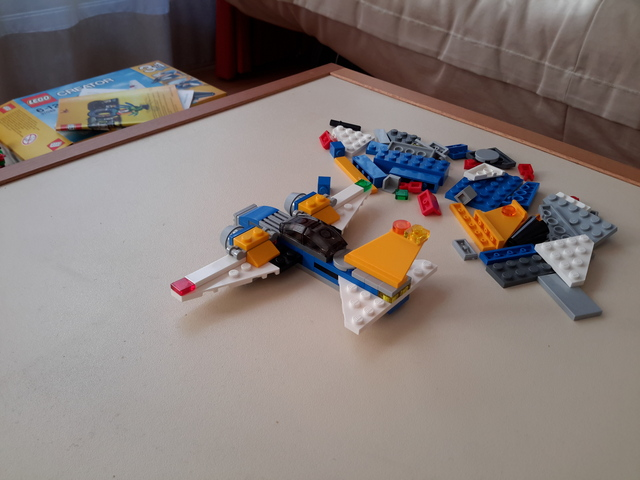](https://www.freelug.org/IMG/jpg/20170611_104022.jpg)

[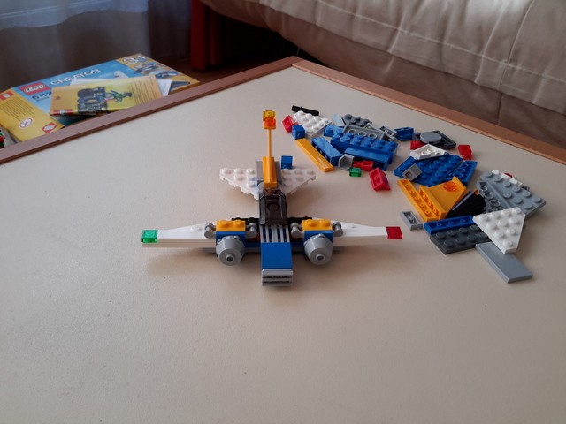](https://www.freelug.org/IMG/jpg/20170611_104027.jpg)

**Bonus 2 :** animation de la construction de l’avion à réaction (cliquer pour lancer).

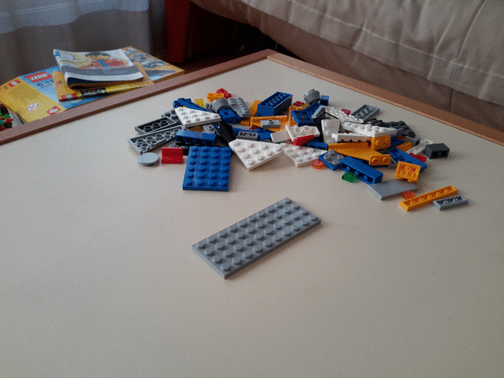
