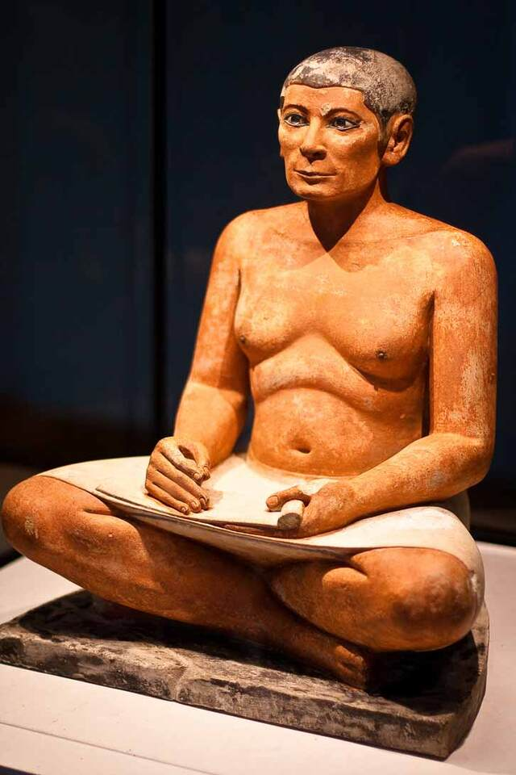
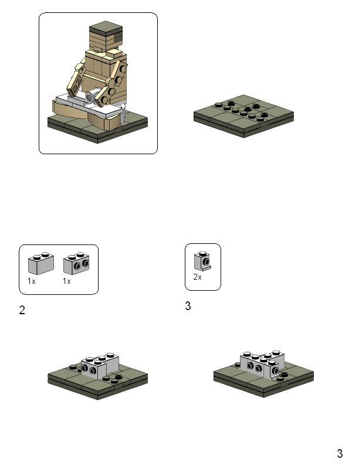
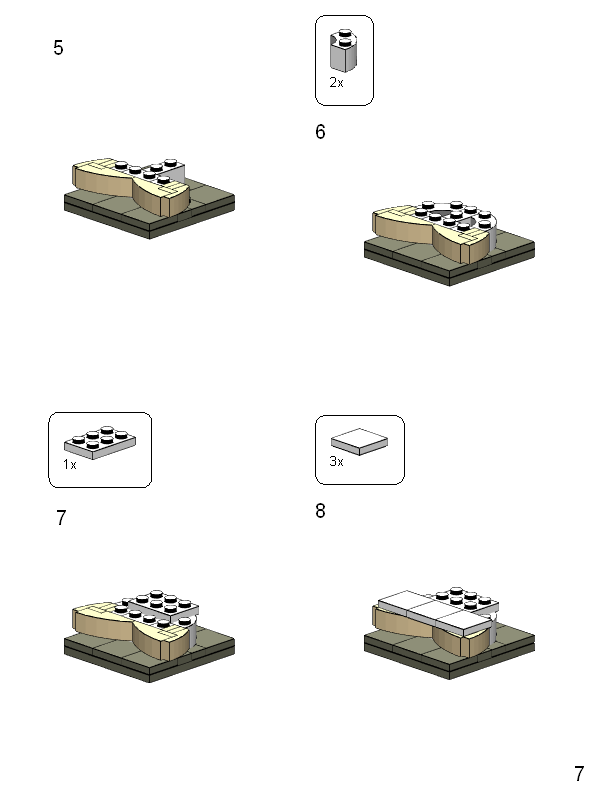
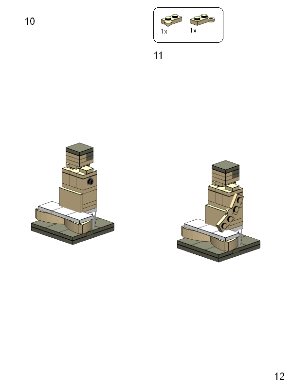
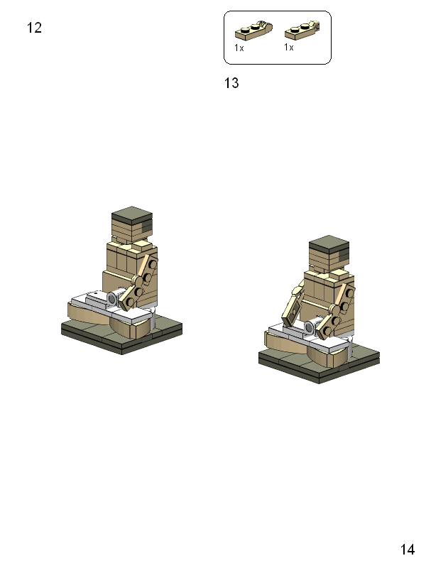
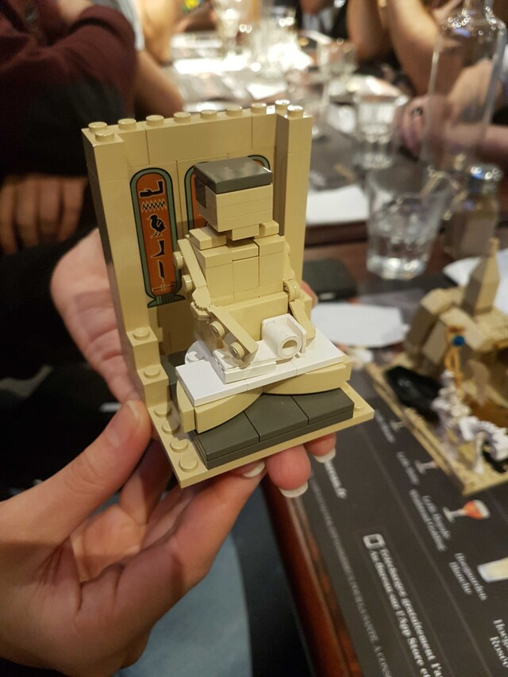

J’apprécie particulièrement les figurines construites à l’échelle Miniland. Dans des articles précédents, je vous avais déjà proposé d’en construire. Ces personnages ([1](/articles/2001/),[2](/articles/2015/),[3](/articles/2105/),[4](/articles/2107/)), de l’univers StarWars, n’étaient pas des créations originales mais des reconstitutions des modèles vus au MINILAND du parc LEGOLAND de Billund au Danemark.

Au contraire, le modèle que je vous propose ici est une construction originale créée à l’occasion d’un concours organisé par le [comité régional](/articles/1531/) VoldeCoR (Rhône Ain Isère Loire) dont le thème était l’Égypte.

Souhaitant être original, j’ai laissé de côté tout les sujets les plus connus de l’Égypte. Exit donc les pharaon, sphinx et momie ou même les statues du temple d’Abou Simbel. Le sujet finalement choisi est ainsi beaucoup moins connu. Un voyage en Égypte vous sera épargné si vous souhaitez le voir puisqu’il est exposé au Louvre à Paris.

Il s’agit d’une sculpture polychrome de l’Égypte antique représentant un scribe assis en tailleur : le scribe accroupi [^1].

La construction en pièces LEGO du personnage nécessite un socle permettant un décalage entre l’arrière en 5 tenons de large et l’avant représentant les jambes, montées en SNOT, en 6 tenons de large.

Mis à part ce montage technique, le reste du corps (buste, tête, bras) est classique.

Cela ne se voit pas sur les images, mais notez que le bras droit est fixé plus haut sur le buste que le bras gauche, avec un décalage d’un demi tenon.

Le papyrus - un rouleau de papier partiellement déroulé - est représenté par une petite porte placée à plat. [^2]

Voici enfin le modèle "en vrai", placé dans son écrin respectant très largement le règlement du concours d’une création tenant sur une plaque 16x16.

Vous retrouverez la notice détaillée complète ci-dessous sous forme d’un fichier pdf. Je suis d’autant plus content de la partager qu’elle a déjà inspiré un autre constructeur pour la création d’un bouddha.

**Scribe Accroupi**

Notice de montage du Scribe Accroupi

[^1]: Dont l’état de conservation est impressionnant quand on songe qu’il est vieux de plus de 4000 ans

[^2]: Cet usage de la porte m’a été inspiré par un usage classique de la porte en guise de rouleau de papier hygiénique.
