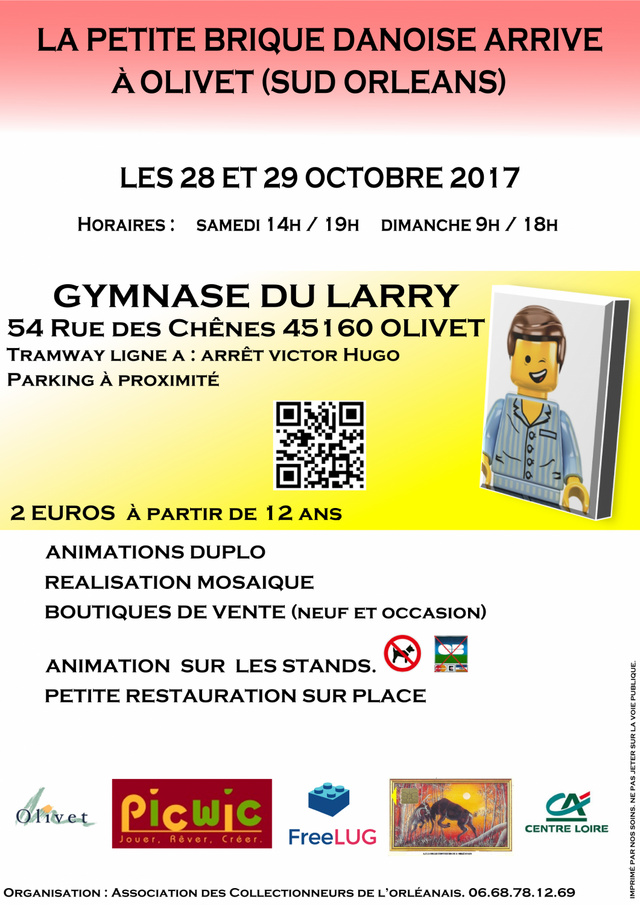
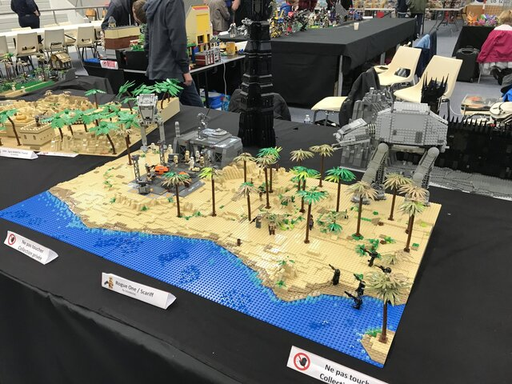
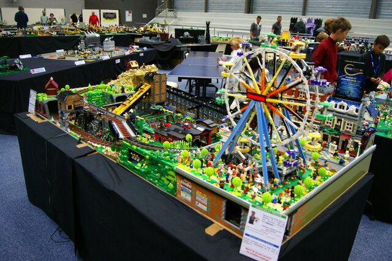
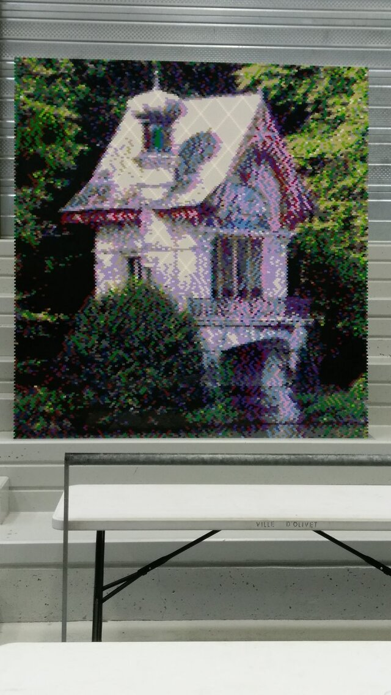

FreeLUG a été invitée à cette exposition 100% LEGO pour présenter une mosaïque. Certains adhérents y étaient également présents. En contrepartie nous avons obtenu un peu de visibilité de la part des organisateurs : l’ATL 45.

Affiche de l’exposition

* * *

**Rodolphe** :

L’ancien salon du jouet d’Olivet est devenu l’expo 100% LEGO d’Olivet.  
Le changement de nom s’est accompagné d’un changement de lieu.  
Les exposants ont pu apprécier le coin repas séparé, les espaces aérés aux centres des ilots stands.  
Au vu de l’affluence des visiteurs, ces espaces de calme relatif étaient les bienvenus.  
De bien bonnes trouvailles à renouveler dès l’année prochaine !

[https://www.flickr.com/photos/15359...](https://www.flickr.com/photos/153590198@N03/)

* * *

**Florent** :

Nouveau moment de partage entre un public nombreux, curieux et intéressé. Des exposants de tous les âges qui ont tenu la distance pour cette édition dans un nouveau lieu plus vaste et sur une période d’ouverture plus grande. Échanger, prendre des idées chez les uns ou les autres, découvrir le dernier faucon millénium au hasard d’un stand. Les portes se referment sur l’édition 2017, les dioramas regagnent tant des cartons que l’étape du démontage pour certains. Bravo pour la mosaïque qui a fédéré les spectateurs de tous les âges. Déjà la tête pour trouver de nouvelles thématiques pour 2018.

* * *

**Stéphane**  :

Ma première fois sur Olivet (mais déjà habitué du salon des trains miniatures voisin). Mais quelle première fois ! Pour une seconde édition, elle a dépassé les espérances de chacun. Mes enfants ont pour la première fois exposé leur création à mes côtés. J’avoue avoir été débordé par le succès, et cela faisait longtemps que cela ne m’était pas arrivé. Néanmoins, un week-end épuisant, mais quel bonheur !

Un (trop) rapide coup d’œil sur les créations des voisins, des petites idées à prendre, des changements nocturnes, des discussions passionnées, de délicieuses crêpes, et un excellent café. Le tout avec une organisation aux petits oignons, un chef sans besoin de micro pour se faire entendre, et une mosaïque que je n’aurai malheureusement vu que de loin !

Et comme dirai un célèbre robot... je reviendrai !  
[Mes photos de ces deux jours](https://public.joomeo.com/users/HonnyPict/albums)

* * *

**Xavier** :

Troisième participation à l’exposition d’Olivet et une fois de plus très bon moment. Une salle plus grande, des stands mieux répartis pour le bonheur des exposants comme du public. Pour cette édition les curieux ont été très largement au rendez-vous, surtout dimanche !  
Les échanges furent nombreux et c’est toujours un plaisir de faire partager sa passion.  
Bref, prêt pour remettre ça...

**–** [Galerie Flickr](https://flic.kr/s/aHsmapg7zj)  
**–** [Facebook](https://www.facebook.com/House-of-bricks-369551940145834/)

* * *

**Béatrice** :

Après une année de préparation, des moments d’incertitude, de nombreuses discussions avec la mairie, l’édition 2017 a été un vif succès entre 5500 et 6000 visiteurs sont venus voir vos réalisations.

Je remercie l’ensemble des exposants et bénévoles qui ont participé à cette édition, je vous donne rendez vous pour 2018, la date devrait être connue sous peu.

* * *

**Sébastien** :

Première fois pour moi, à l’exposition d’Olivet, mais avec la mosaïque : il y a eu du boulot. Déjà de préparation avant l’exposition et puis pendant. Merci à Simon, le spécialiste des mosaïques.

Merci à Xavier C pour son coup de main car nous étions bien débordés par moment car il a même fallu démonter une partie de la mosaïque le samedi soir afin que les visiteurs puissent en monter un bout le lendemain... mais ce fut rapide... pour midi c’était fini.

En fin de journée le dimanche les visiteurs nous ont donné un coup de main pour le démontage et le tri par couleur et forme.

Voici le rendu de la mosaïque

**Gare à bateau sur le Loiret**
