Déroulement de la journée :  
A partir de 9h30 , LEGO Store de Lyon (libre…)  
17h au Mini World Lyon. Puis un restaurant et un concours était prévu pour ceux qui le souhaitaient après la visite vers 19h.

L’habituel Afol day’s a été une réussite une fois de plus grâce à toutes les personnes venues que ce soit au LEGO Store, au MiniWorld ou encore au restaurant.

[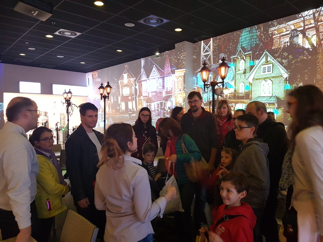](https://www.freelug.org/IMG/jpg/20171104_171206.jpg)

Pour rappel : le MiniWorld Lyon est entièrement en intérieur sur plus de 3 000 m², il est le plus grand parc de miniatures animées en France !  
70 000 heures de travail ont été nécessaires pour fabriquer les 3 premiers mondes (ville, montagne, campagne).

[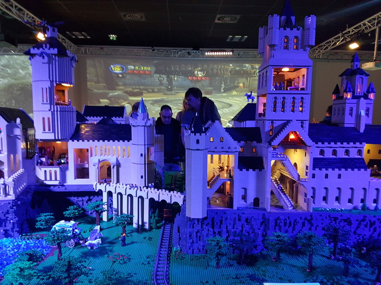](https://www.freelug.org/IMG/jpg/20171104_172837.jpg)

[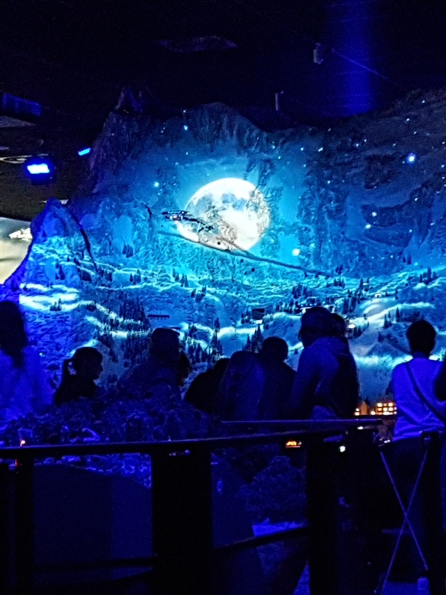](https://www.freelug.org/IMG/jpg/20171104_182322-2.jpg)

[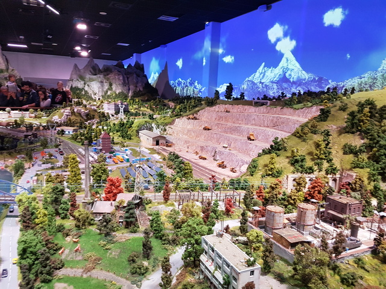](https://www.freelug.org/IMG/jpg/20171104_175142.jpg)

Et enfin un restaurant « Au Bureau » à Vaulx-en-Velin près du Carré de Soie.  
(Burgers, cuisine bistro et spécialités locales dans une chaîne de brasseries-pubs au décor anglo-saxon rétro.) Repas très bien servi.

[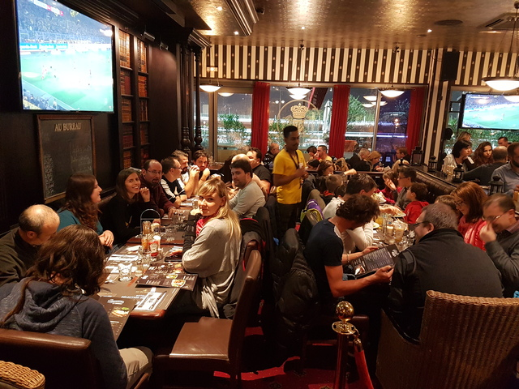](https://www.freelug.org/IMG/jpg/20171104_193738.jpg)

27 personnes présentes (et nous en avons refusé... N’ oubliez pas de bien vous inscrire avant pour les prochaines journées organisées )

Un concours avait évidement été organisé pour l’occasion :

> Le 4 novembre 1922 : L’égyptologue britannique Howard Carter découvre le tombeau de Toutânkhamon.  
> Vous l’avez donc peut-être deviné…  
> Créer une construction sur le thème de l’Egypte (ancienne, actuelle, architecture, Histoire…au choix)
> 
> Taille de base maxi 16x16, pas de limite de hauteur.

[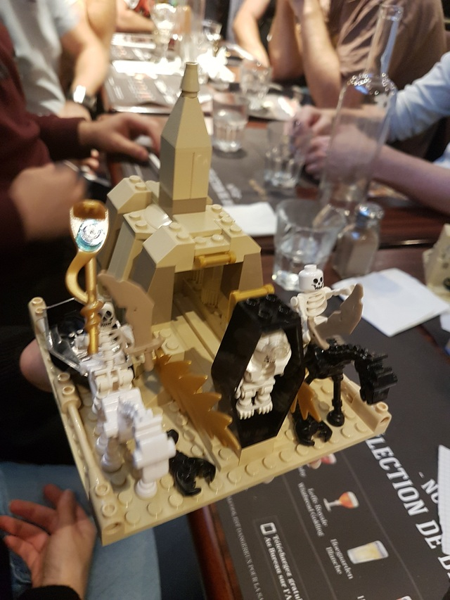](https://www.freelug.org/IMG/jpg/20171104_213214.jpg)

[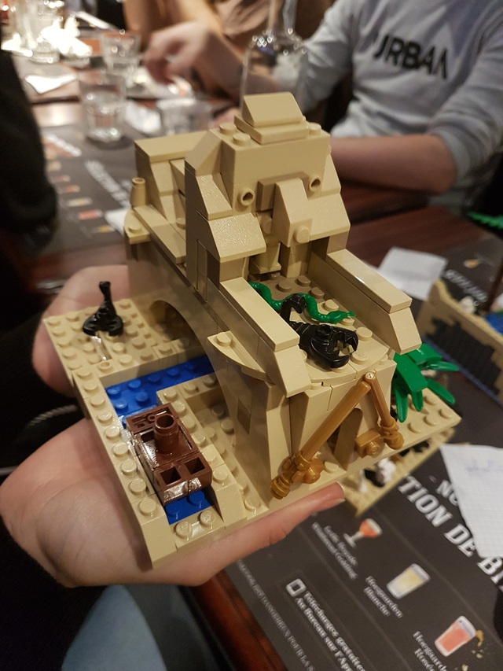](https://www.freelug.org/IMG/jpg/20171104_213223.jpg)

[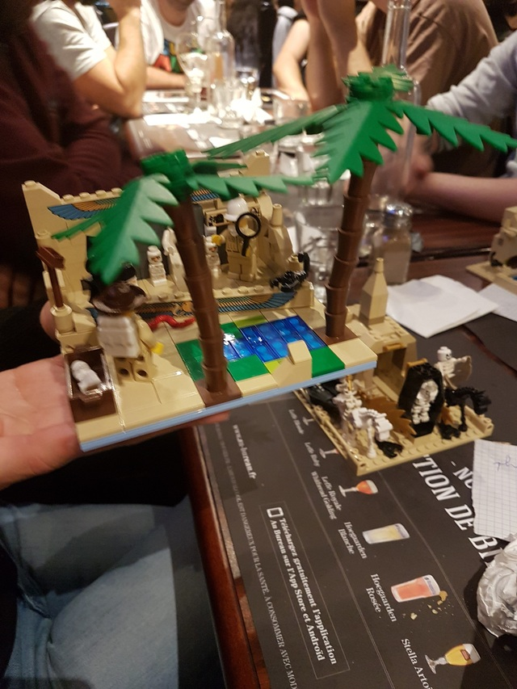](https://www.freelug.org/IMG/jpg/20171104_213238.jpg)

[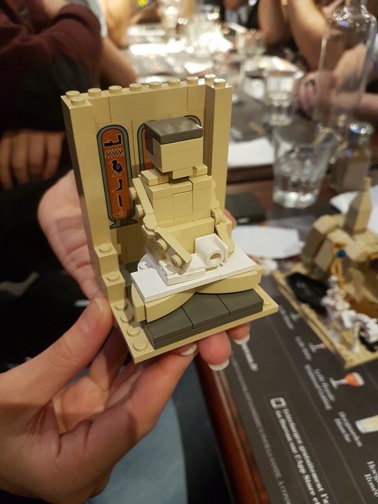](https://www.freelug.org/IMG/jpg/20171104_213248.jpg)

Les gagnants ont été :

**–** 1er prix 21308 Adventure Time (Didier) (vous pourrez retrouver tous les [détails du MOC dans cet article](/articles/2769/))  
**–** 2ème prix 31062 Le robot explorateur (Sylvain)  
**–** 3ème prix 31058 Le dinosaure féroce (Xavier)  
**–** 4éme prix 31043 Transport de l’hélicoptère (Rudolph)

[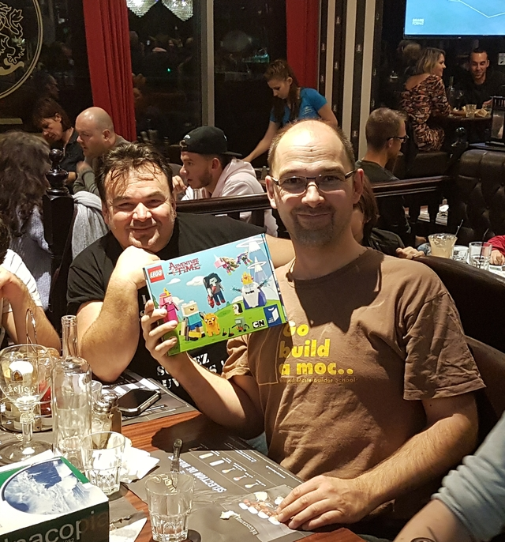](https://www.freelug.org/IMG/jpg/20171104_214113.jpg)

[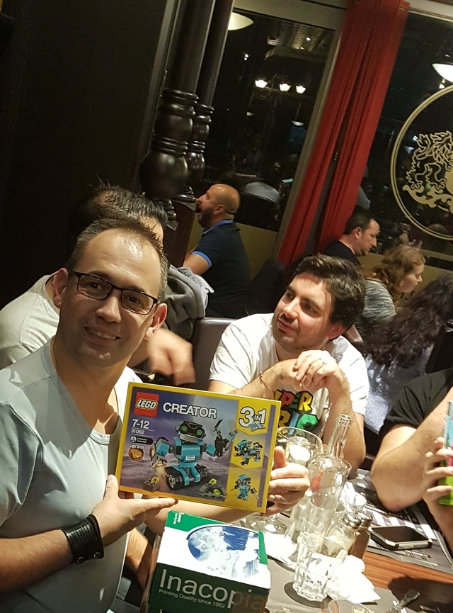](https://www.freelug.org/IMG/jpg/20171104_214048.jpg)

[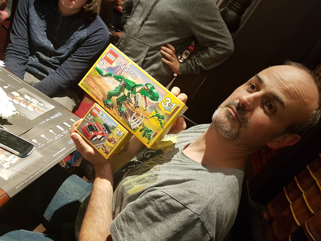](https://www.freelug.org/IMG/jpg/20171104_213809.jpg)

Félicitations encore à toutes les personnes ayant participé.

Bisous briqués.

Cordialement ChoupsLego
