Pour la troisième édition de son salon, l’Amicale des Commerçants et Artisans (ACA)de Wavrin souhaitait proposer quelque chose d’inédit aux visiteurs. Ils ont donc contacté le Comité régional Nord de FreeLUG pour nous demander si nous étions intéressés de venir exposer à l’occasion de cet évènement.

Cette exposition rentrait, à l’origine, dans le cadre de la promotion de l’exposition Lomme Brique 2017 qui devait avoir lieu le week-end suivant, les samedi 11 et dimanche 12 novembre. Malgré l’annulation de l’exposition Lomme Brique, nous étions engagés et annoncés sur le salon de Wavrin, nous avons donc été y exposer nos créations et sets.

[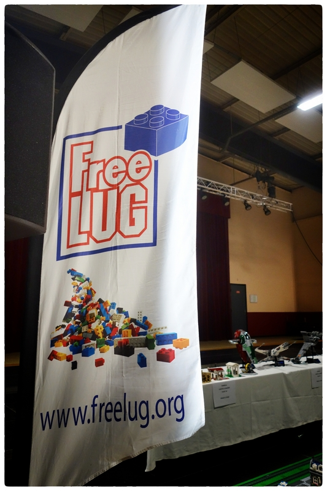](https://www.freelug.org/IMG/jpg/Expo_Wavrin_2017_001.jpg)

Après la mise en place du samedi après-midi, nous étions donc 4 à représenter FreeLUG le dimanche. Nous avions à notre disposition une quinzaine de mètres en façade, sur des praticables montés à 40cm de hauteur, sur lesquels nous avons installés plusieurs dioramas et MOCs (Indiana Jones, Battlestar Galactica, notre île des pirates, un saloon western, un dio Battle sur Hoth, et un dio city de 14 x 6 baseplates composé de modulars - dont deux MOCs - d’une gare, entouré d’une double boucle de rails sur lesquelles nous avons fait circuler quelques trains pendant la journée. Trains que plusieurs enfants ont eu le plaisir de conduire pendant quelques minutes. Juste derrière, sur des tables, une collection d’UCS Star Wars et une série de vignettes "Mythologie" exposées au store de Lille l’été dernier complétaient la partie exposition.

[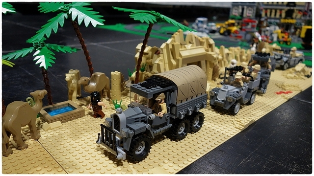](https://www.freelug.org/IMG/jpg/Expo_Wavrin_2017_002.jpg)

[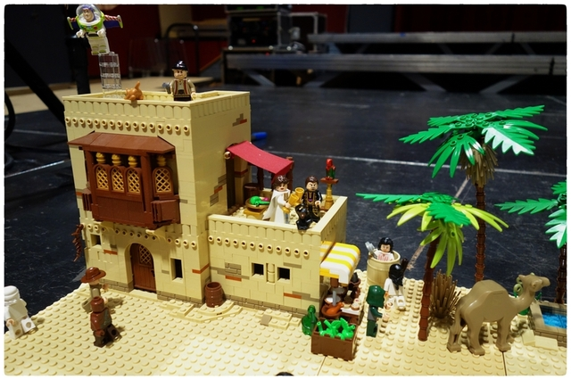](https://www.freelug.org/IMG/jpg/Expo_Wavrin_2017_003.jpg)

[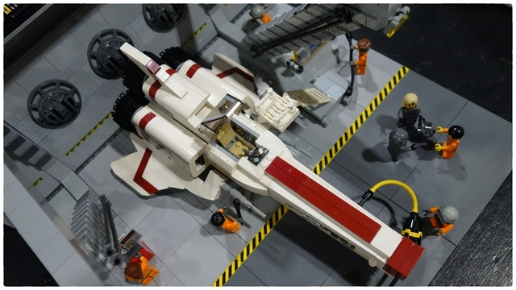](https://www.freelug.org/IMG/jpg/Expo_Wavrin_2017_006.jpg)

[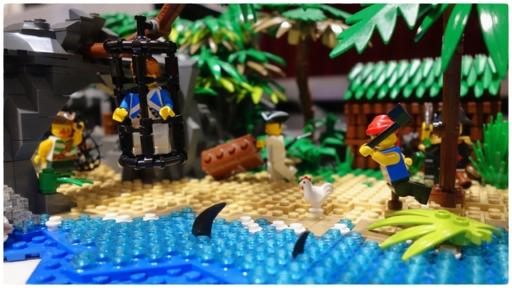](https://www.freelug.org/IMG/jpg/Expo_Wavrin_2017_007.jpg)

[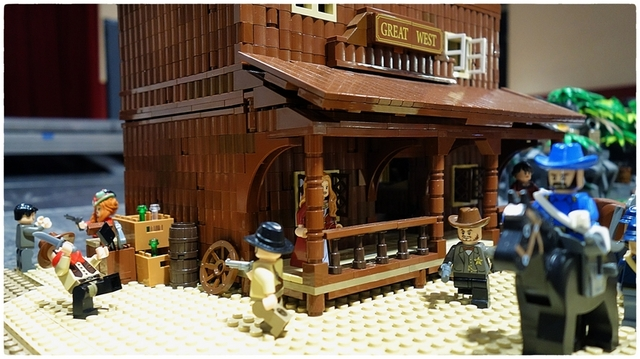](https://www.freelug.org/IMG/jpg/Expo_Wavrin_2017_009.jpg)

[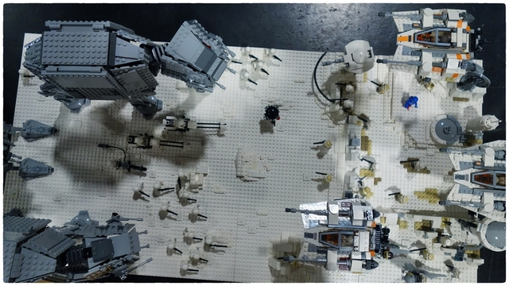](https://www.freelug.org/IMG/jpg/Expo_Wavrin_2017_013.jpg)

[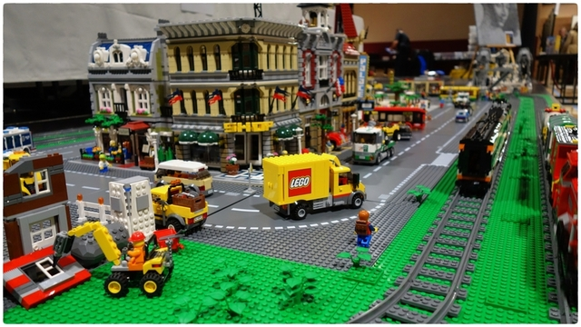](https://www.freelug.org/IMG/jpg/Expo_Wavrin_2017_004.jpg)

[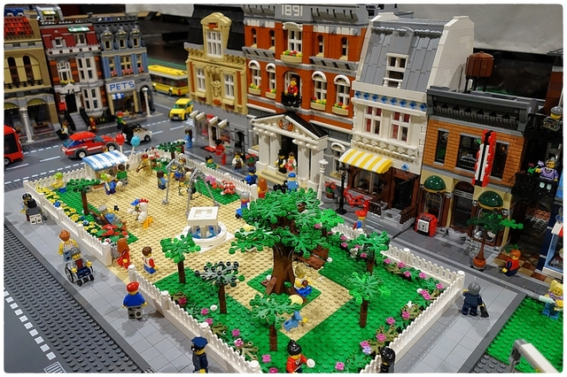](https://www.freelug.org/IMG/jpg/Expo_Wavrin_2017_005-2.jpg)

[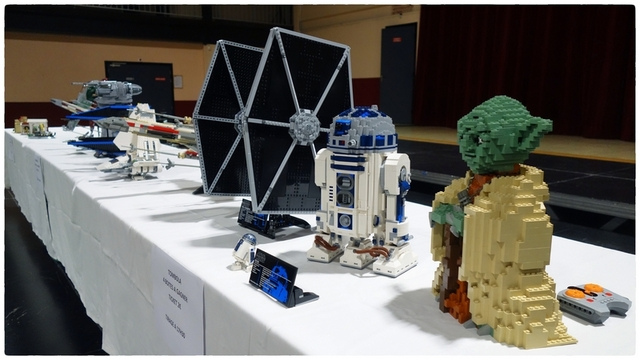](https://www.freelug.org/IMG/jpg/Expo_Wavrin_2017_008.jpg)

A cet espace, se sont ajoutés une table sur laquelle nous avons versé un bac de briques rouges, pour que les jeunes laissent exprimer leur créativité, et un espace pour de l’initiation et un tournoi de TechBall.  
A ce sujet, nous avons eu la belle surprise en arrivant de nous voir offrir un terrain de TechBall complet, de 2m x 1m, en contreplaqué, fabriqué par le menuisier local et offert par l’ACA.  
Il ne nous restera plus qu’à le mettre en peinture, dès les beaux jours revenus.

[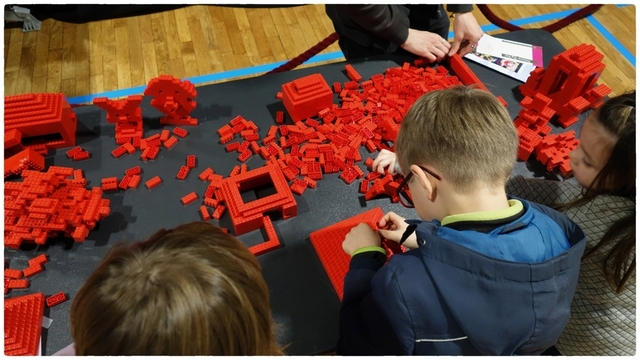](https://www.freelug.org/IMG/jpg/Expo_Wavrin_2017_014.jpg)

[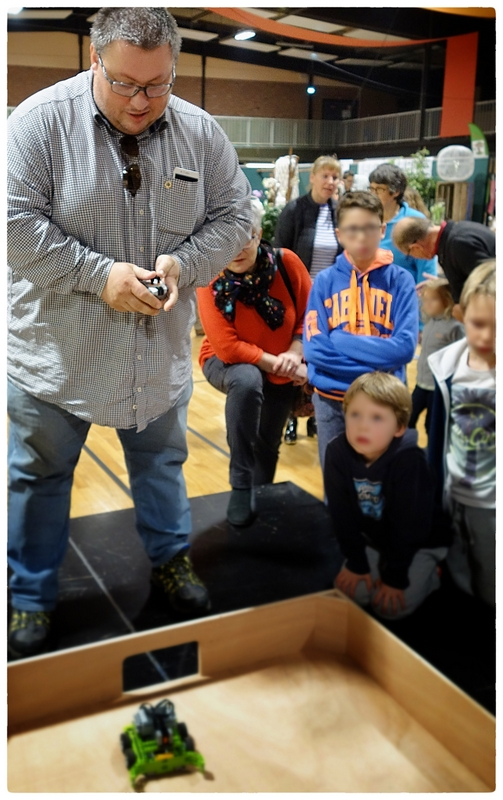](https://www.freelug.org/IMG/jpg/Expo_Wavrin_2017_011.jpg)

[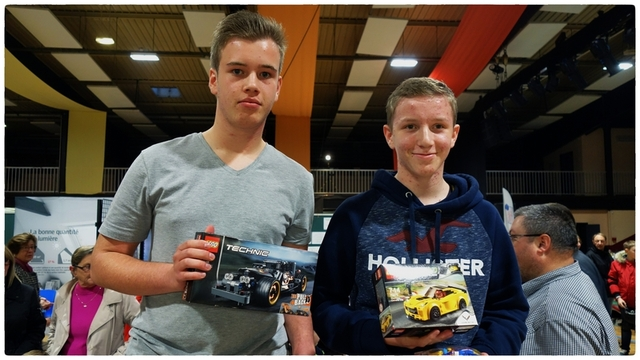](https://www.freelug.org/IMG/jpg/Expo_Wavrin_2017_012.jpg)

Les gagnants du Tournoi de TechBall.

Une tombola a complété notre animation.

Environ 1300 visiteurs se sont déplacés pour ce salon et ont, semble t’il, été très agréablement surpris de nous voir. Nous avons également apprécié de pouvoir discuter et échanger avec un public qui ne venait pas pour voir de la brique LEGO® ou des jouets, comme dans un salon dédié. Certaines personnes n’avaient pas vu un set LEGO depuis des années et ont été vraiment étonnés de voir ce qui est fait aujourd’hui. C’est finalement assez rafraîchissant...

D’un point de vue de l’accueil, nous avons été reçus comme des rois par l’ACA (le logo FreeLUG était visible sur l’affiche au côté des autres partenaires de l’expo, ainsi que sur les programmes), outre le terrain de TechBall offert, le repas du midi et un accès illimité au bar ont été intégralement pris en charge par l’organisation.

Philippe et Mickaël  
(accompagnés sur place de Nathan et Marie)
