Aujourd’hui je vous propose la review du set 76004 dans la gamme super héros : _Spider-Man™ : La poursuite en moto-araignée_. Ce set sorti en 2013 est composé de 237 pièces, dont 3 personnages, une voiture volante et une moto. Le prix est de 26.99€ soit un ratio de 0,11€ la pièce. Le set pèse (notice et boite compris) 731g soit 36,9€ le kg

Alors que dire de ce set ?  
Alors la boite, ça donne quoi ?

[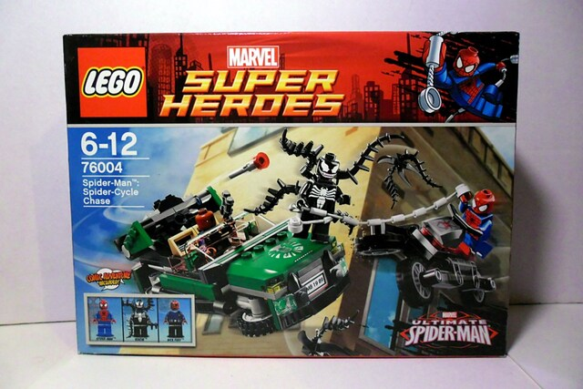](https://www.freelug.org/IMG/jpg/76004_01.jpg)

[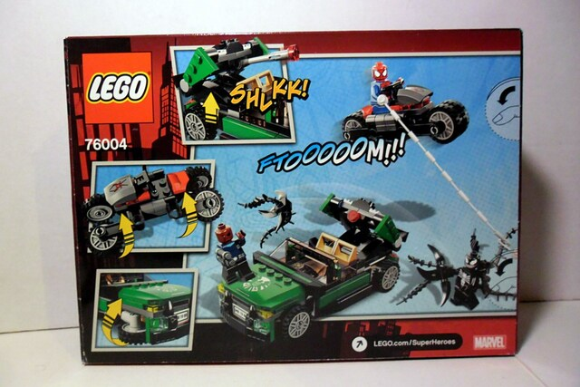](https://www.freelug.org/IMG/jpg/76004_02.jpg)

Au final, les images font bien le boulot : montrer le contenu sans mentir, avec les quelques éléments de jouabilité...

Certes, c’est bien jolie une boite, mais c’est le contenu qui compte :

[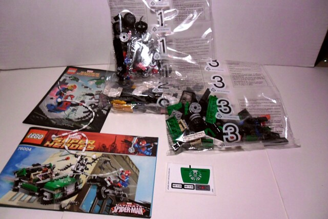](https://www.freelug.org/IMG/jpg/76004_03.jpg)

3 sachets, une notice ; une mini bd et une toute petite planche de sticker :

[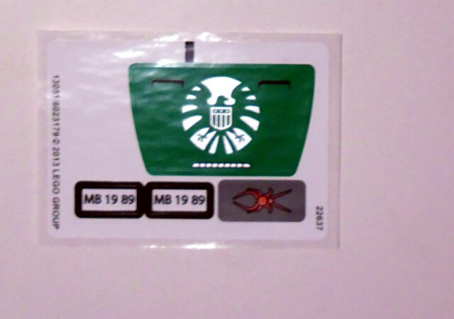](https://www.freelug.org/IMG/jpg/76004_04.jpg)

**Sachet 1 :**  
On a deux personnages :

[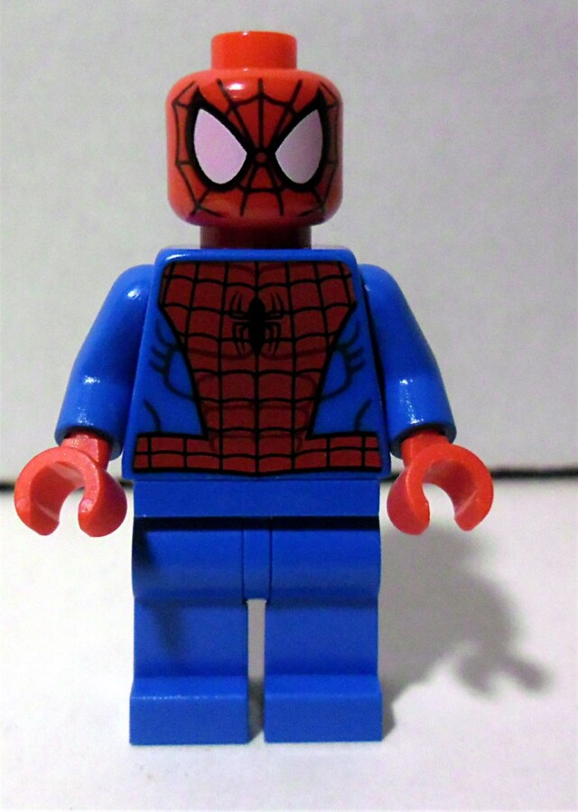](https://www.freelug.org/IMG/jpg/76004_06.jpg)

[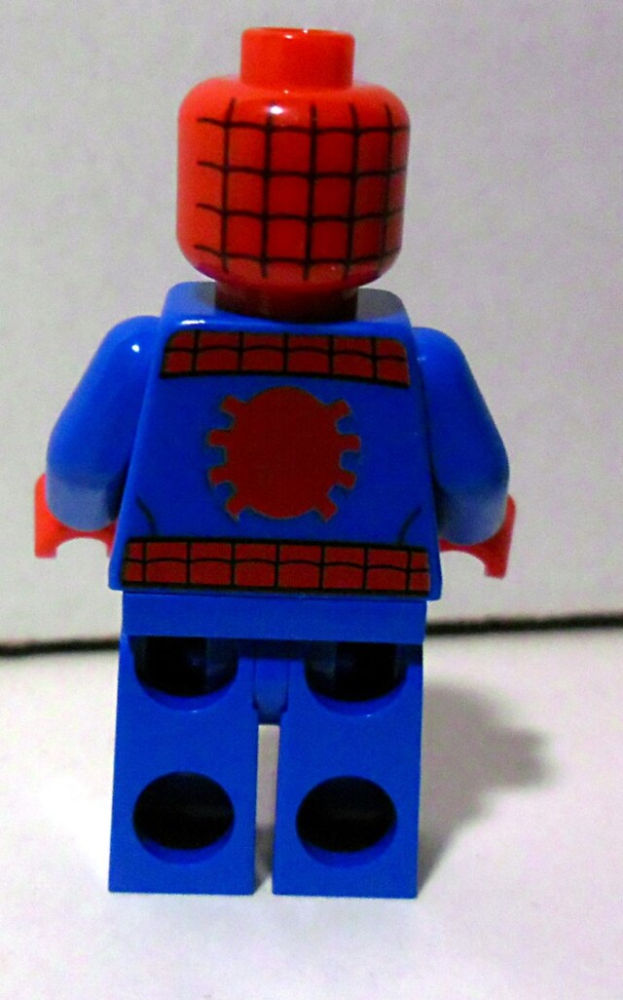](https://www.freelug.org/IMG/jpg/76004_07.jpg)

le seul et unique Spiderman (on trouve quasiment le même partout)

[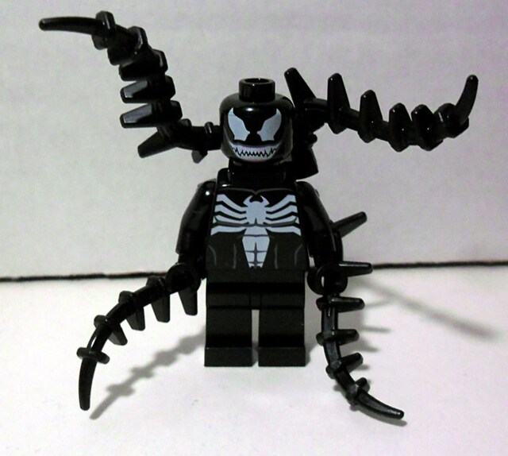](https://www.freelug.org/IMG/jpg/76004_09.jpg)

[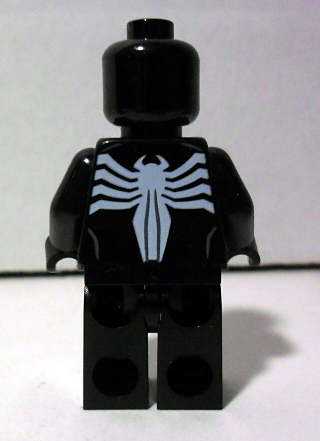](https://www.freelug.org/IMG/jpg/76004_08.jpg)

L’un des méchants le plus emblématique : Venom.

Avec quelques pièges de Venom, on a fini avec la moto :

[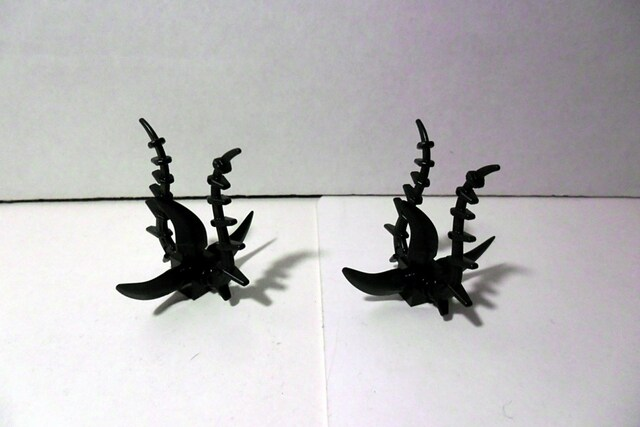](https://www.freelug.org/IMG/jpg/76004_05.jpg)

[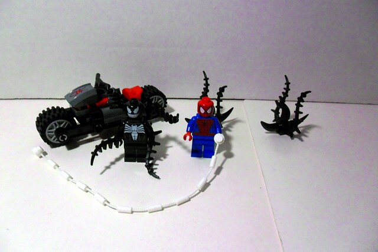](https://www.freelug.org/IMG/jpg/76004_10.jpg)

**Sachet 2 :**  
Un autre personnage emblématique : Nick Fury

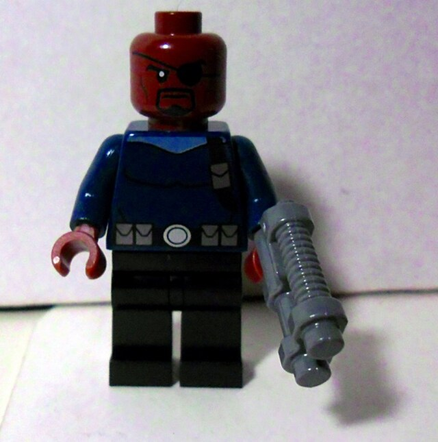

[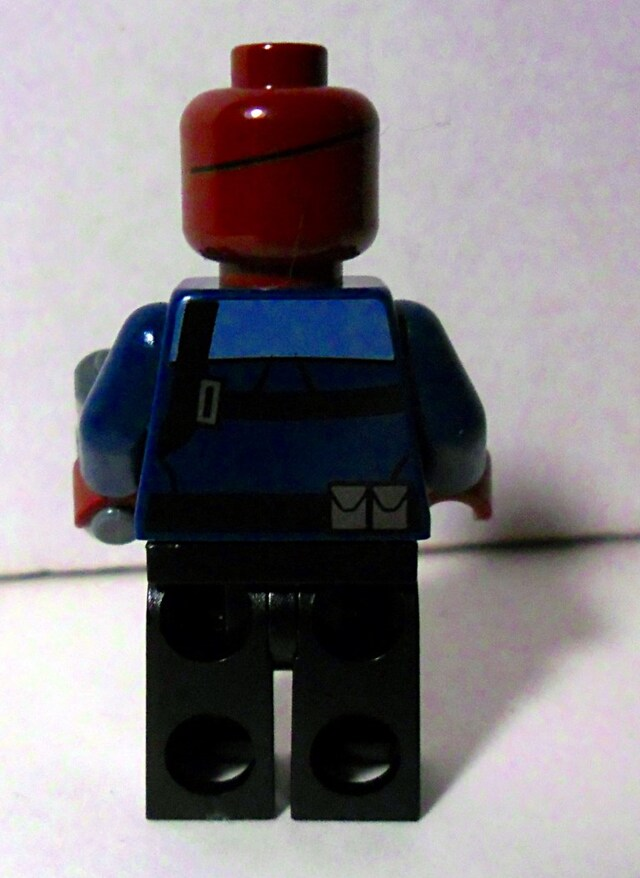](https://www.freelug.org/IMG/jpg/76004_11.jpg)

Puis passons à sa voiture :

[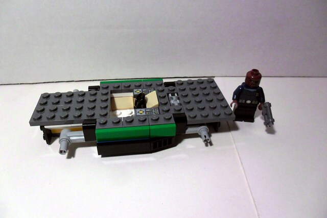](https://www.freelug.org/IMG/jpg/76004_12.jpg)

**Sachet 3 :**  
On finit la voiture :

[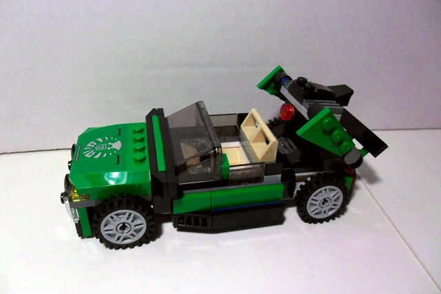](https://www.freelug.org/IMG/jpg/76004_13.jpg)

Ce qui donne au final :

[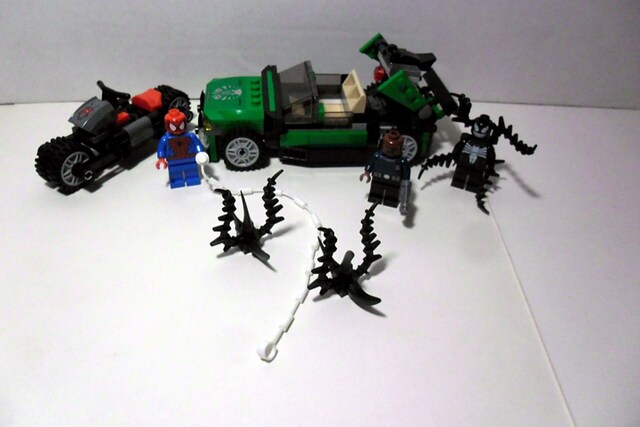](https://www.freelug.org/IMG/jpg/76004_14.jpg)

**Les extras parts :**

Alors que penser du set ? Il n’est pas trop cher et assez jouable : deux gentils, un méchants et ça roule.

Moi je l’ai pris pour le véhicule que je trouve sympa et pour Venom.
