LEGO propose, à différents moments de l’année, des petits sets de saison.

Même si dans quelques mois il y aura peut-être une nouvelle version, je vous propose aujourd’hui une présentation du set **40237**, le **Pique-nique romantique de la Saint-Valentin**.

Sorti donc en février 2017, ce set comporte 126 pièces pour 9,99 €, soit un ratio de 0,08 € par pièce.

Il comporte deux personnages, et quelques pièces sympathiques à mon goût.

* * *

L’avant de la boîte met en scène la construction, avec les deux personnages tenant l’un un chocolat l’autre une lettre (d’amour sans doute), et montre les différents éléments du décor : arbre, ballon, fontaine, etc.

[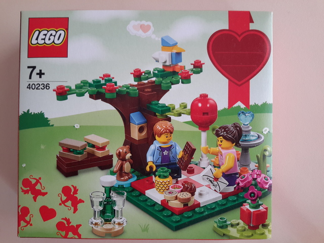](https://www.freelug.org/IMG/jpg/image-40236-0.jpg)

Le dos met en scène l’installation, la rencontre entre les deux personnages, et confirme que la lettre est bien d’amour !

[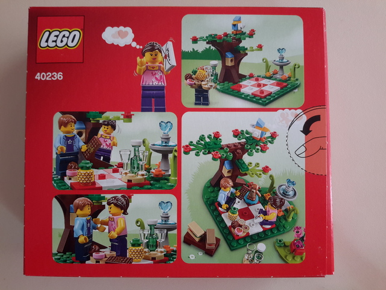](https://www.freelug.org/IMG/jpg/image-40236-1.jpg)

Dans la boîte trois sachets et une notice, donnant un petit tas de pièces.

[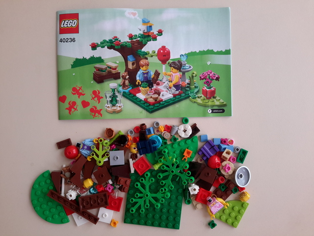](https://www.freelug.org/IMG/jpg/image-40236-2.jpg)

À noter les quelques pièces sérigraphiées, dont divers gâteaux et un ananas (une tête de personnages).

[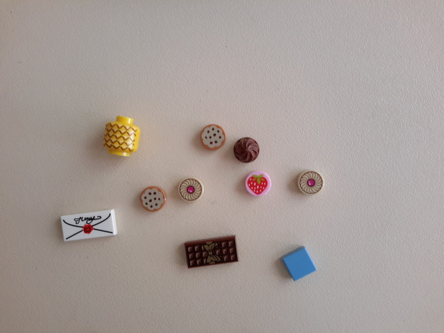](https://www.freelug.org/IMG/jpg/image-40236-3.jpg)

Et voici les deux protagonistes de la pièce. Le jeune homme a une veste ouverte et un magnifique t-shirt violet avec une étoile, tandis que la jeune femme a un collier en forme de cœur, et un débardeur rose. En revanche les jambes font le service minimal, sans décoration.

[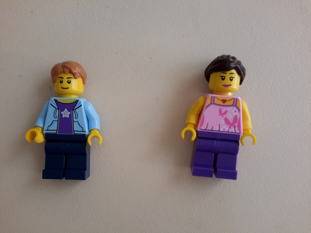](https://www.freelug.org/IMG/jpg/image-40236-4.jpg)

Le dos termine les vêtements, mais n’est pas très décoré.

[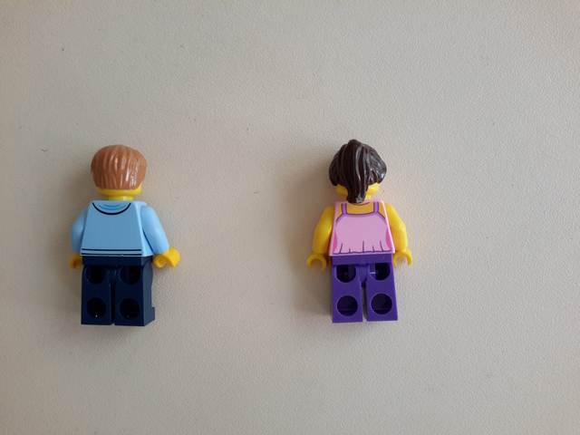](https://www.freelug.org/IMG/jpg/image-40236-5.jpg)

À noter que la jeune femme a un visage alternatif, avec des lunettes de soleil, caché par sa coiffure.

[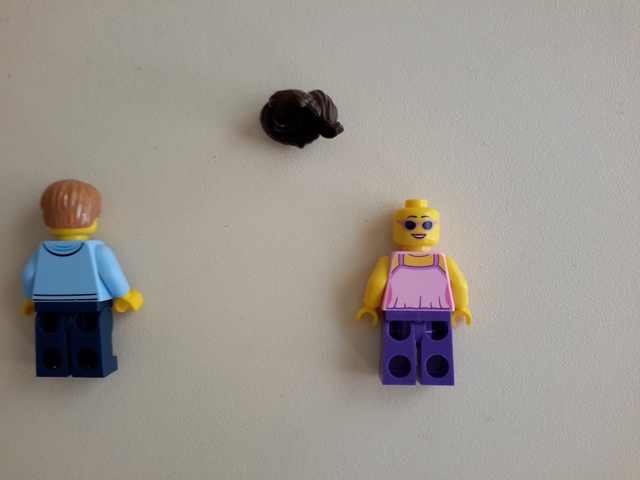](https://www.freelug.org/IMG/jpg/image-40236-6.jpg)

On équipe les personnages l’un du chocolat l’autre de la lettre, et on commence la construction du décor par une fontaine avec des fleurs, sur un demi-rond. Une barre marron assure la solidité de la fontaine.

[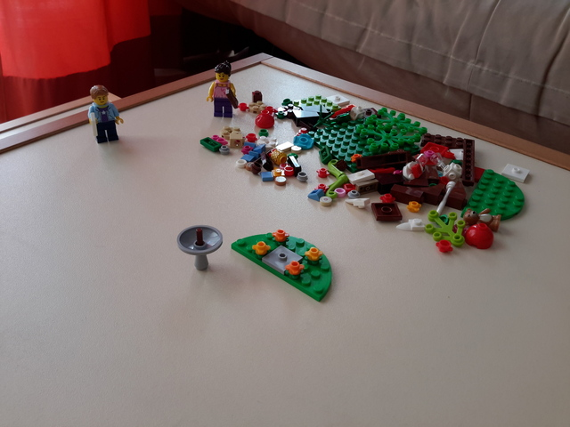](https://www.freelug.org/IMG/jpg/image-40236-7.jpg)

On complète avec deux tentacules verts et l’eau (une pièce ronde bleu transparent), et un magnifique cœur bleu transparent pour rester dans le thème de l’amour.

[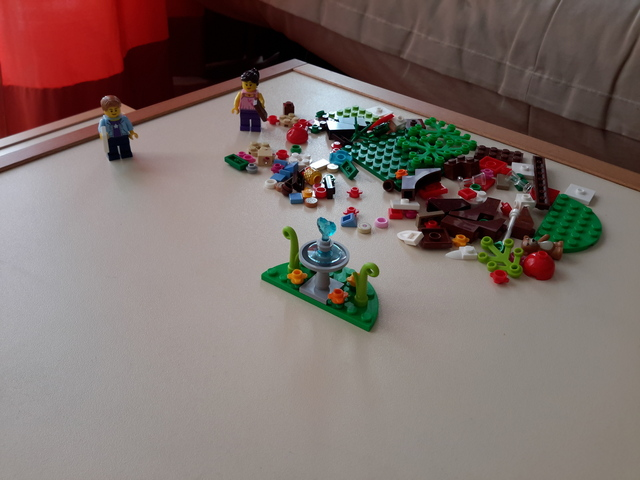](https://www.freelug.org/IMG/jpg/image-40236-8.jpg)

Pour un bon pique-nique, il faut des sandwiches, n’est-ce pas ? Les voici donc, en quatre pièces chacun. Notez les fleurs pour symboliser la garniture. Ils sont posés (via des tenons) sur une table basse simplissime.

[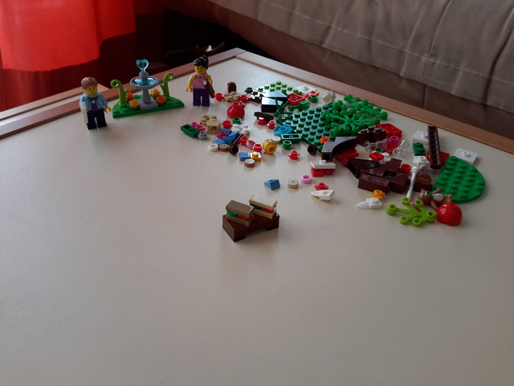](https://www.freelug.org/IMG/jpg/image-40236-9.jpg)

Et pour accompagner ces sandwiches, rien de tel qu’une bonne bouteille !

[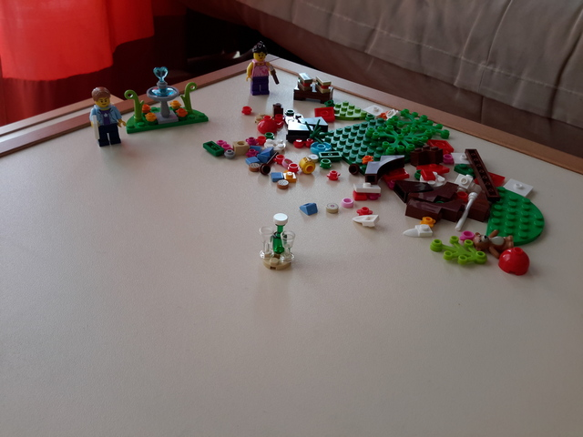](https://www.freelug.org/IMG/jpg/image-40236-10.jpg)

Pour compléter les accessoires, voici une petite fleur dans son bac rouge.

[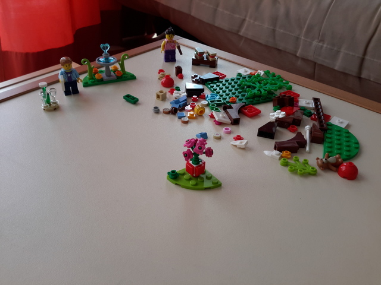](https://www.freelug.org/IMG/jpg/image-40236-11.jpg)

Ceci terminé, on passe au centre du décor, le tapis de pique-nique. Il est simplement constitué d’une plaque 8x8 verte recouverte de tiles 2x2 avec tenon, sur lesquelles l’on pourra poser différents objets.

[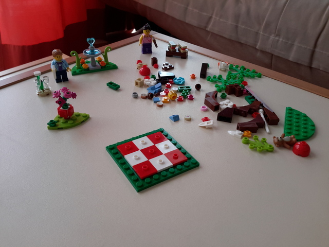](https://www.freelug.org/IMG/jpg/image-40236-12.jpg)

Ces objets sont un ananas, un ourson (probablement une peluche), un magnifique plateau de gâteaux. Un ballon sur le côté complète le tapis.

[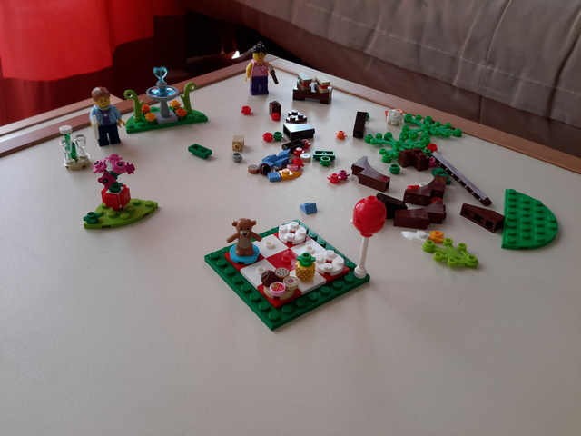](https://www.freelug.org/IMG/jpg/image-40236-13.jpg)

Enfin, dernier élément à construire, un arbre. Sur une plaque verte en demi-cercle, il est de deux marrons différents, avec une petite fleur.

[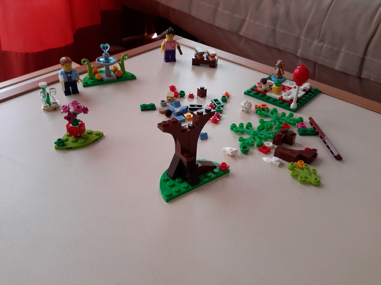](https://www.freelug.org/IMG/jpg/image-40236-14.jpg)

On lui rajoute un nichoir (deux pièces !), une première feuille verte, et une branche transversale à base de plaque 1x8 marron.

[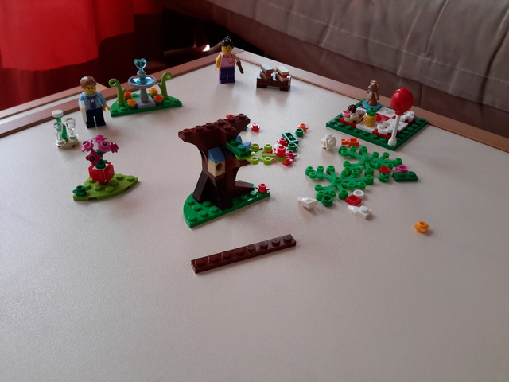](https://www.freelug.org/IMG/jpg/image-40236-15.jpg)

L’arbre, terminé avec deux feuilles supplémentaires, est plus amusant avec un oiseau, très stylisé mais parfaitement reconnaissable, exposant de belles couleurs vives.

[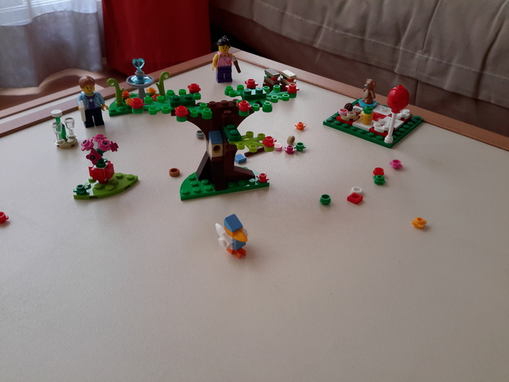](https://www.freelug.org/IMG/jpg/image-40236-16.jpg)

Voici la scène complète, avec tous les éléments. L’oiseau est sur l’arbre, le tapis entre celui-ci et la fontaine, avec la nourriture à côté et la fleur d’un autre.

[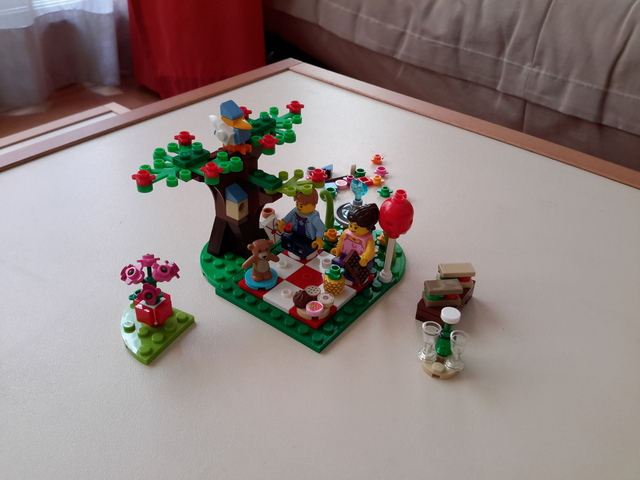](https://www.freelug.org/IMG/jpg/image-40236-17.jpg)

Et comme les plus attentifs l’auront remarqué, vu du dessus, l’ensemble forme un magnifique cœur, parfaitement adapté à la Saint-Valentin ! En bas vous pouvez contempler les pièces bonus, en nombre assez consistant.

[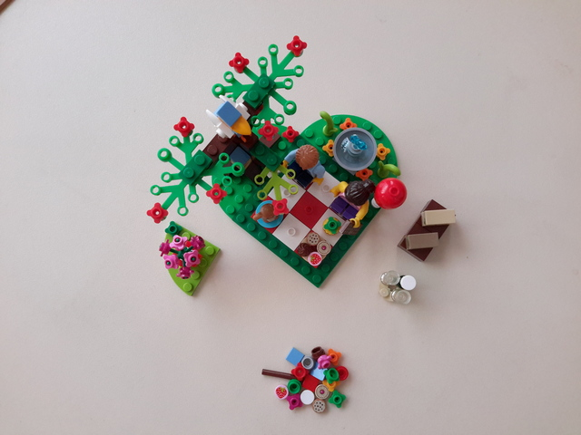](https://www.freelug.org/IMG/jpg/image-40236-18.jpg)

* * *

**Opinion :** un excellent set, que j’ai apprécié de construire (même s’il ne comporte pas de technique particulière), qui se suffit à lui-même tout en racontant une histoire (d’amour, en plus !).

**Bonus :** animation des étapes de la construction (cliquer pour lancer).

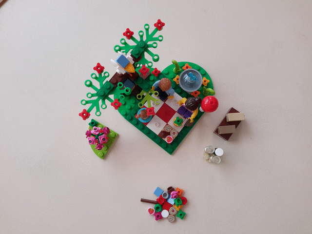
