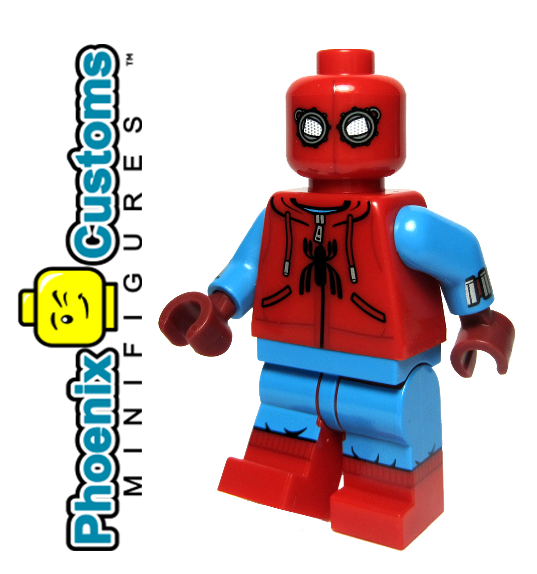
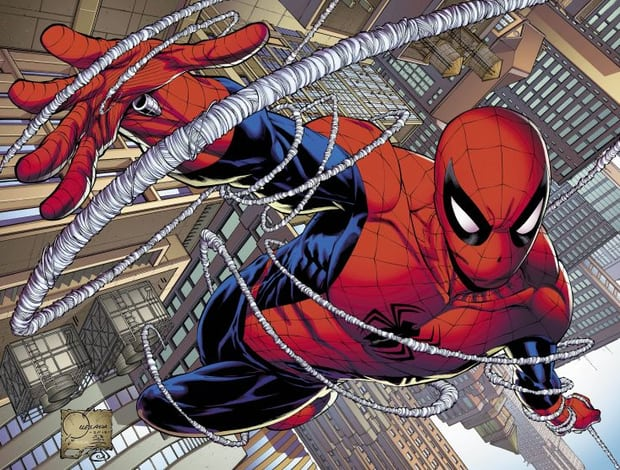
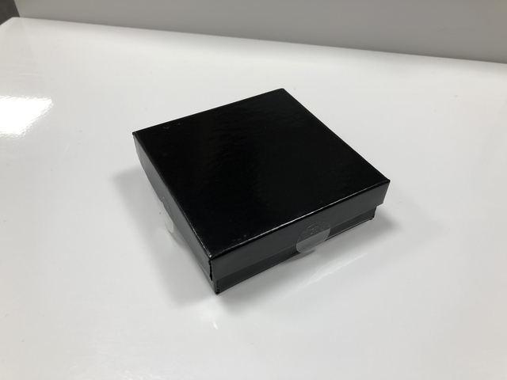
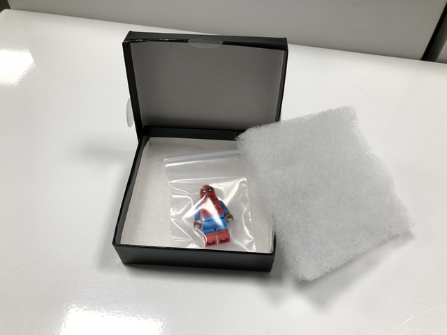
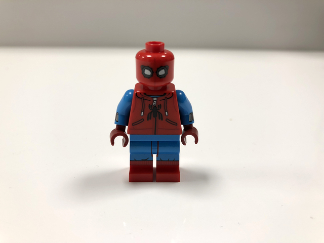
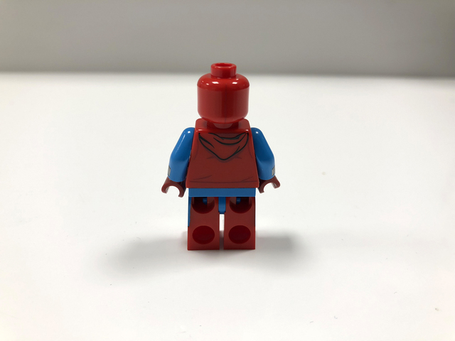
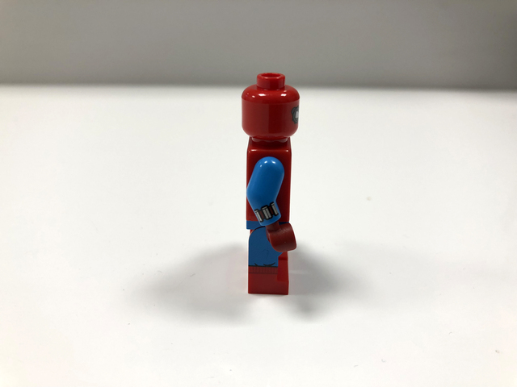
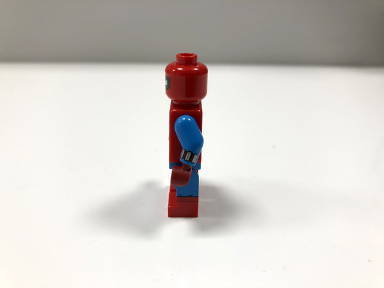
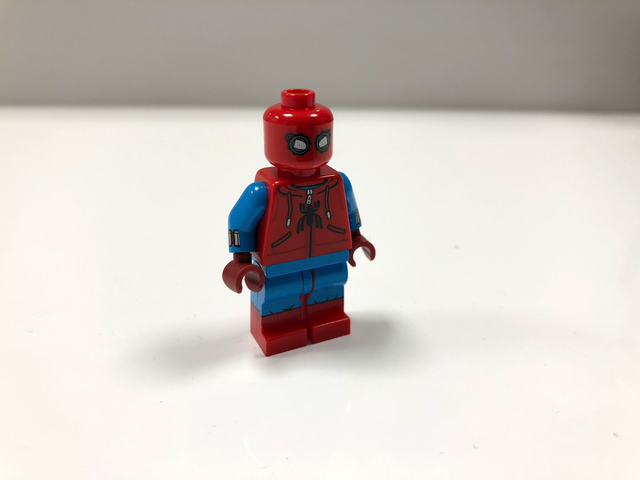

Aujourd’hui je vous propose la review d’une figurine custom du personnage de **Spider-Man Homecoming**.

_Phoenix_ est un créateur de custom reconnu par la communauté AFOL. Ses customs sont créés à partir de pièces officielles et sont sérigraphiées avec le même procédé que chez _LEGO_.  
Vous pouvez retrouver ses créations sur son site _[phoenixcustombricks.com](http://www.phoenixcustombricks.com/)_.

* * *

**Spider-Man**

Ce custom est inspiré du personnage de **Spider-Man**.

> **Peter Parker**, alias **Spider-Man** (souvent écrit « Spiderman » de façon erronée), est un super-héros évoluant dans l’univers Marvel de la maison d’édition Marvel Comics. Créé par le scénariste Stan Lee et le dessinateur Steve Ditko, le personnage de fiction apparaît pour la première fois dans le comic book _Amazing Fantasy #15_ en 1962.
> 
> En France (souvent traduit par l’**Homme Araignée** ou simplement l’**Araignée**), le personnage apparaît pour la toute première fois en mai 1969, dans le n°4 du périodique _Fantask_, publié aux Éditions LUG. Il s’agit en fait de la traduction du premier numéro de _The Amazing Spider-Man_ datant de 1963. Ses origines, parues un an plus tôt dans _Amazing Fantasy #15_, ne seront publiées en français qu’en 1980 dans un album d’_Iron-Man_ édité chez Arédit/Artima, puis en 1981 chez LUG dans un numéro spécial de sa revue _Strange_.
> 
> Lors de sa première apparition dans _Amazing Fantasy_, **Spider-Man** est l’identité que se choisit le jeune **Peter Parker** après avoir été mordu par une araignée radioactive et découvert qu’il avait à cette occasion développé des super-pouvoirs. Le succès de ce numéro permet à **Spider-Man** d’avoir dès 1963 sa propre série, _The Amazing Spider-Man_.
> 
> **Spider-Man** est depuis lors l’un des personnages les plus populaires de l’univers des comics. Au fil des ans, d’autres périodiques lui seront consacrés, tel _Spectacular Spider-Man_ et _Peter Parker, the Spider-Man_, mais _The Amazing Spider-Man_ est toujours le magazine principal du héros.
> 
> Source : _[Wikipedia](https://fr.wikipedia.org/wiki/Spider-Man)_.

* * *

Depuis le custom _[Galactic Master](/articles/2617/)_, les productions de _Phoenix_ sont emballés dans une boite en carton noire du plus bel effet.

A l’intérieur, la figurine est protégée dans un sachet plastique, lui-même entouré de bourre en fibre.

De face, **Spider-Man** est une réussite. La tampographie est magnifique.

Dommage tout de même que _Phoenix_ n’ai pas choisi de jambes bi-injectées, au prix du custom cela aurait été bienvenu.

Au dos l’impression est simple mais toujours très bien réalisée, les détails des plis de la capuche sont vraiment réalistes.

Sur les côtés on a le droit à l’impression des cartouches de fluide servant à la fabrication de la célèbre toile de l’**Homme Araignée**.

Une petite vue de trois-quart pour finir cette review.

* * *

CONCLUSION :

Encore une réussite pour Phoenix qui nous livre une figurine vraiment réussie malgré le petit bémol des jambes non bi-injectées.

Vous pouvez trouver ce custom en suivant ce _[lien](http://www.phoenixcustombricks.com/homemade-arachnid-hero-minifigure)_, à l’heure ou j’écris ces lignes, il est toujours disponible au prix de 40$.
