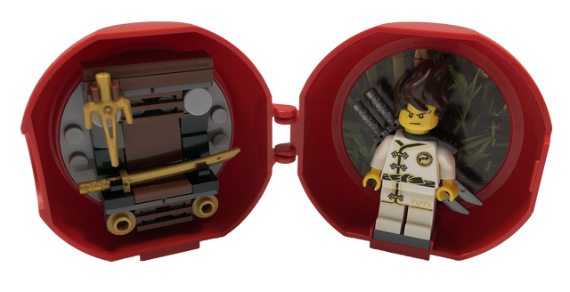
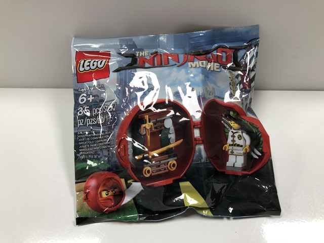
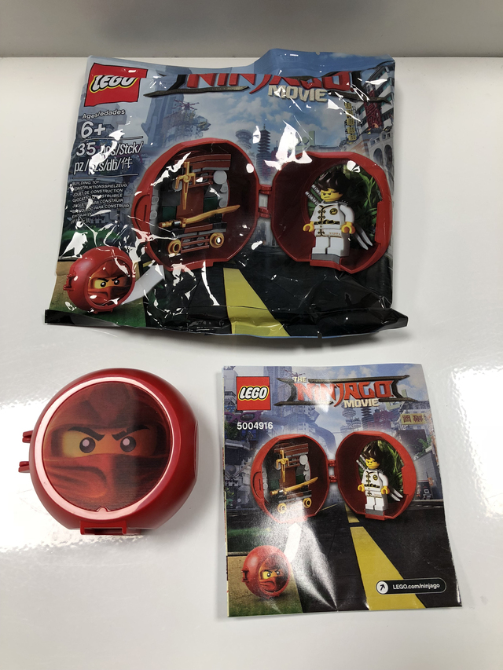
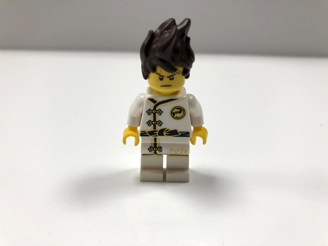
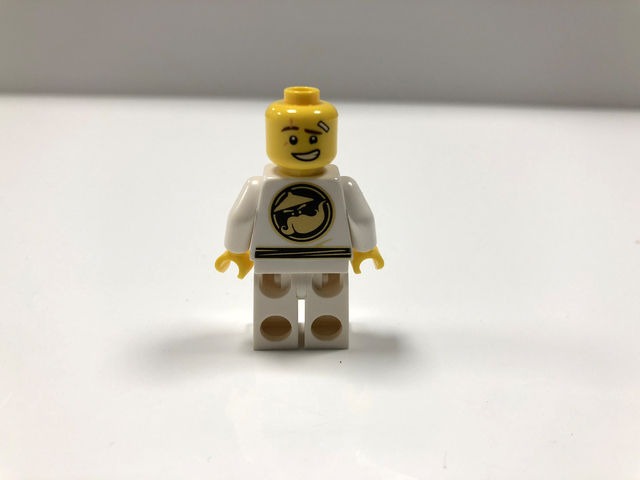
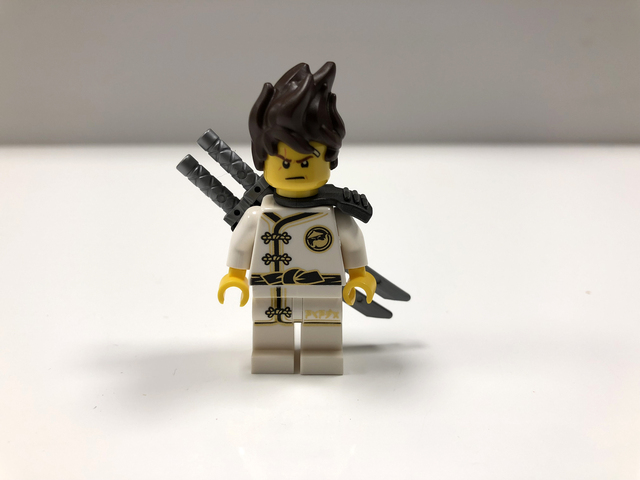
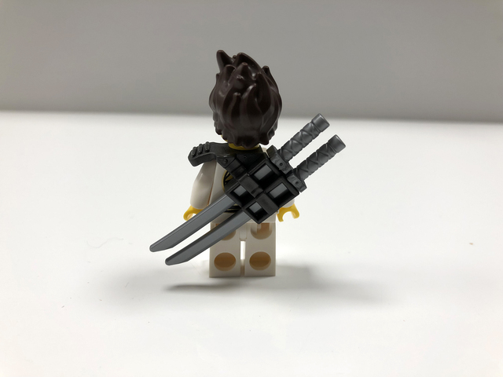
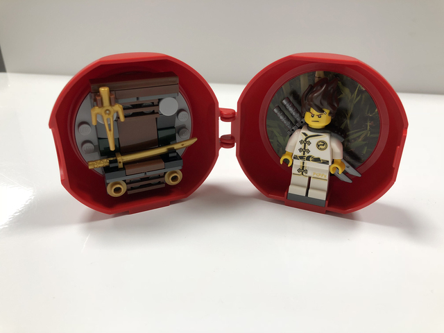

Aujourd’hui je vous propose la review du polybag 5004916 dans la gamme _The Ninjago Movie_ : **Kai’s Dojo Pod**.  
Ce polybag sorti en 2017 est composé de 35 pièces, il était offert dans les _LEGO Store_ physique et le _S@H_ pour tout achat dans la gamme _LEGO The Ninjago Movie_.

* * *

Sur le polybag, le _Pod_ est ouvert et mis en situation sur un fond ressemblant à _Ninjago City_. Les logos _LEGO_ et _The Ninjago Movie_ sont présent en haut du polybag.

A l’intérieur on trouve un sachet de pièces contenu à l’intérieur du Pod et une notice de montage.

* * *

_[Kai - White kimono](https://brickset.com/minifigs/njo346/kai-white-kimono-\(5004916\))_ est joliment réalisé, les tampographies noires et ors sont fines et précises. Les petits nœuds qui ferment le kimono sont joliment réalisés.  
Les cheveux sont originaux et pourront facilement être réutilisés. Le visage énervé est réussi.

De dos, la tampographie est là aussi superbe, le logo dans le dos est _cartoonesque_ et le visage alternatif souriant, qui fait lui aussi _cartoon_, est une franche réussite.  
On reste tout à fait dans le ton de la série.

**Kai** avec ses sabres et ses double fourreaux dorsaux.

**Kai** dans le _Pod dojo_. Très peu de montage, mais le rendu est tout de même sympathique dans le peu d’espace disponible.

* * *

**AVIS :**

Un très bon polybag offert par _LEGO_, avec une figurine exclusive magnifique.
